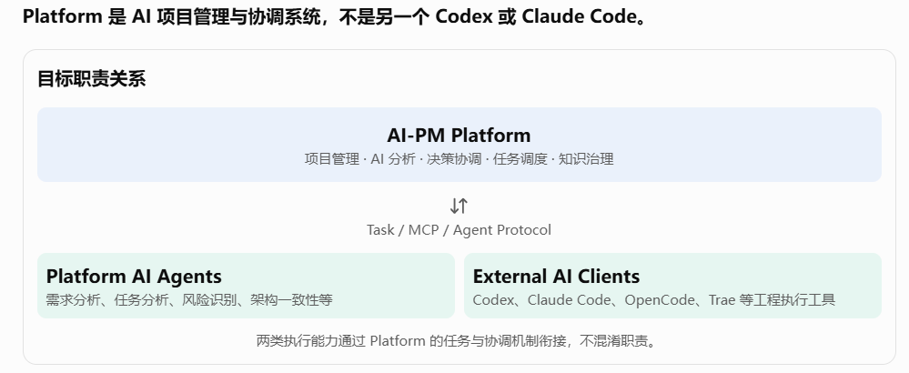

# S03-00 V1.2 — AI-PM Platform 架构感知型技术现状审计 · 执行基线

| 文档属性 | 内容 |
|---|---|
| 文档编号 | S03-00 |
| 版本 | V1.2 |
| 类型 | Technical Architecture Audit |
| 模式 | Read-only Audit（只读，不修改任何生产代码） |
| 范围 | Platform + Technical Design + ADR |
| 前置版本 | S03-00 V1.1（R1~R8 修订，见 S03-00-v1.1-revision-log.md） |
| 修订日期 | 2026-11-06 |
| 关联在途稿 | S03-ACP V1.3.1（Task-Based Continuation，待独立评审） |
| 用户裁决 | 本 V1.2 方案作为后续 S03 的正式审计执行基线（2026-11-06） |

---

## 0. 修订定位

S03-00 从「Technical Design & ADR 领域资产核验」升级为「AI-PM Platform 架构感知型技术现状审计」。本次升级结合 S03-ACP V1.3 之后的文档调整（V1.3.1 修订稿），不仅新增若干 AI 模块检查项，而是将整个 PM-AI Platform 的架构闭环纳入审计对象。

### 0.1 升级原则

- 保留 V1.0 已完成的代码核验结论。
- 保留原有只读审计性质，不在 S03-00 修改代码。
- 将 AI-PM Platform 整体架构纳入审计。
- 以已经正式裁决的产品架构为依据，而不是让当前代码反过来定义产品。
- 为 S03-01 及后续 S03 实施提供可靠的技术基线。

### 0.2 用户补充裁决（2026-11-06，闭环定位）

> 这次升级不仅是给 S03 增加几个 AI 模块的检查项。
>
> 我们实际上是在确保整个 PM-AI Platform 的架构能够支持一个完整闭环：
>
> **人类管理项目 → AI-PM 理解项目 → AI-PM 组织设计 → 人类确认 → Platform 调度工程 Agent → Agent 执行 → Platform 验收协调 → 知识库更新。**
>
> Design 和 ADR 是这个闭环中的**正式工程知识资产**，而不是独立的文档管理功能。
>
> 因此，本次 V1.2 作为后续 S03 的正式审计执行基线。

由此派生的审计判据：§3.B / §3.C 判「Design / ADR 是否为独立领域对象」的标准不是「有没有表」，而是**闭环上下游是否将其作为正式资产引用**（Requirement→Design→Task→Run→Delivery→Acceptance 的追溯链，即 §3.E 是 B / C 的验收判据）。

---

## 1. 版本变更记录

V1.0 → V1.1：R1~R8 口径修正（K-3 / K-6 / DEF-02 归属 / 不可变性三层表述 / 审批结构路线撤出裁决等），见 `S03-00-v1.1-revision-log.md`。

V1.1 → V1.2（本版）：

| 项目 | V1.1（现状） | V1.2（本次升级） |
|---|---|---|
| 核验重点 | Design / ADR | Design / ADR + Platform |
| 架构范围 | 局部领域模型 | 整个平台及模块边界 |
| AI 能力 | AI 设计辅助 | AI-PM 调度、协调、外部 Agent 执行 |
| 知识管理 | 设计文档 | Markdown + Git 权威模型 |
| 执行追溯 | Task / Run / Delivery | 完整生命周期追溯 |
| 治理机制 | 审批与权限 | AI 建议、人工决策、授权、审计 |
| 交付目标 | 领域资产差距 | 平台架构差距 + 领域资产差距 |

---

## 2. 审计基准与不可变约束

### 2.1 代码基线

V1.0 已使用的代码基线：

- Branch：feat/s01-implementation
- Commit：3ccb42f
- 审计模式：只读

V1.2 保留上述历史基线作为 V1.0 结果的追溯依据，同时**重新确认本次实际审计所使用的最新代码分支及 Commit**。不能把历史基线和最新审计基线混为一谈。

落盘时点事实（2026-11-06）：master @ 8fe2f33。V1.0 基线之后已落地：S01 收口批（1faa55c）、S02-I1 需求核心纵切（db466ab，迁移 0039）、S02-I6-A Approver 授权基座（ee18099，迁移 0040）、S02-I6-B 执行器退役（2d7d4e0，红线双宿主）、S02-I2 Markdown 权威投影（1bf9eb0，迁移 0042）。**DEF-02 执行器面已在代码层闭合**。S03 实施迁移号自 **0043** 起（0041 已被并行会话 team_llm 批占用，撞号风险持续存在，实施前必须重核迁移登记表）。

### 2.2 产品架构约束

本次审计必须遵循以下已确定的产品决策：

| 编号 | 已确定的架构约束 |
|---|---|
| P01 | 人类负责项目，AI Agent 协助执行 |
| P02 | AI-PM Platform 原生具备项目分析和管理能力 |
| P03 | Platform 负责 AI 调度和协调 |
| P04 | Codex、Claude Code、OpenCode、Trae 等负责外部工程执行 |
| P05 | 不在 Platform 内堆积大量负责实际编码的 AI Agent |
| P06 | Project AI Team 采用多 Agent 并行执行、统一协调知识库写入 |
| P07 | 高能力模型承担统一分析与协调 |
| P08 | AI 提议，正式决策由人类确认 |
| P09 | Markdown + Git 是需求与知识正文的权威载体 |
| P10 | PostgreSQL 是 ID、状态、版本引用、审批、状态机及审计事件的权威载体 |
| P11 | PageIndex 是可重建的派生索引 |
| P12 | AI-PM 是项目知识的主要维护者和版本管理者，但必须经过质量门禁 |

这些约束是审计的产品基线，**不允许因为现有代码尚未实现就将其判定为不必要的设计**。

---

## 3. V1.2 完整审计范围

本次审计分为六个部分。

### A. AI-PM Platform 整体架构

V1.2 新增的核心审计范围。重点核验：

1. Platform 的模块划分是否清晰。
2. Project、Team、Project AI Team 的职责边界。
3. AI-PM 内置能力与外部 AI 工具的边界。
4. AI Orchestration 的实现位置。
5. LLM Provider 配置、模型选择和调用链路。
6. MCP 是否仅作为通信接口，而非工程执行 Runtime。
7. Task、Run、Delivery 的统一管理方式。
8. 项目级权限、Team 权限及跨项目隔离。

需要特别核验：

**Platform 是 AI 项目管理与协调系统，不是另一个 Codex 或 Claude Code。**



这里需要核验一个重要问题：Platform 内的 AI Agent 是业务分析与协调角色，还是已经出现了重复建设工程执行 Runtime 的情况。

### B. Technical Design Domain

保留 V1.0 的原始核验范围，并扩大与 Platform 的关联：

- Design Entity
- Design Revision
- Design 与 Requirement 多对多关系
- Design Status / Lifecycle
- Design Review
- Design Approval
- Implementation Scope
- Acceptance Criteria
- Design 与 Task 的追溯

重点确认 Design 是否真正成为独立、可版本管理、可审批的领域对象，而不是简单的 Markdown 文档。

### C. ADR Domain

核验：

- ADR 是否为独立实体。
- ADR 与 Requirement 的关联。
- ADR 与 Technical Design 的关联。
- ADR 状态机。
- ADR 提议、审查、确认及废弃机制。
- ADR Revision 与历史记录。
- AI 能否提议 ADR，但不能代替人类正式确认。
- ADR 是否进入项目知识库及 Git 版本管理。

### D. Knowledge Integration

结合 S02 和 Project Knowledge Repository 新增的重点。核验四层权威分工：

| 层次 | 权威职责 |
|---|---|
| Markdown | 需求、设计、ADR 等正文 |
| Git | 正文历史及版本管理 |
| PostgreSQL | ID、状态、版本引用、审批、审计 |
| PageIndex | 可重建的知识索引 |

重点审查：

1. Design Revision 如何对应 Markdown 文件版本。
2. ADR 如何进入 Knowledge Repository。
3. AI 生成的设计内容如何进入正式知识库。
4. 人工批准后如何形成正式版本。
5. Git Commit 与 PostgreSQL 状态如何保持一致。
6. 并发修改如何防止覆盖。
7. 外部工程师提交 Commit 后，AI 如何识别设计及知识变化，并完成必要的澄清或记录无需澄清的结果。

### E. Engineering Execution Traceability

核验从设计到实际代码交付的完整链路（八环）：

```
01 Requirement       需求及其正式版本
02 Technical Design  设计及 Design Revision
03 ADR               架构决策及正式状态
04 Implementation Scope  确定实施范围和验收条件
05 Task              Platform 创建、分配和协调任务
06 Run               外部 Agent 工程执行
07 Delivery          交付、Commit 和 Review
08 Acceptance        人类验收及知识回写
```

审计重点：

- 是否可以从一个 Requirement 找到对应的 Design。
- 是否可以从 Design Revision 找到对应的 Task。
- 是否可以从 Task 找到 Run。
- 是否可以从 Run 找到 Delivery。
- 是否可以从 Delivery 找到实际 Git Commit。
- 是否可以追溯实际交付对应的设计版本。
- 设计变化后，如何识别受到影响的任务和交付。

### F. Governance & S04 Readiness Gate

核验：

- AI 建议与正式决定的区别。
- 人工审批权限。
- Project Admin、Team Admin 等角色权限。
- AI AutoApply 是否存在越权审批。
- 审批记录与审计事件。
- 跨项目数据隔离。
- 并发修改和版本冲突处理。
- S04 实施就绪条件是否能够通过系统状态验证。

S04 Readiness Gate 必须至少检查：

1. Design 已正式批准。
2. 必须解决的 ADR 已正式解决。
3. Implementation Scope 完整。
4. Acceptance Criteria 完整。
5. Requirement、Design、ADR 之间可追溯。
6. 对应版本已经确定。

不能仅仅因为 AI 判断设计内容完整，就自动放行。

---

## 4. 审计执行方法

V1.2 采用五阶段审计方法：

| 阶段 | 工作内容 | 产出 |
|---|---|---|
| P1 | Product Baseline | 产品裁决与架构基线 |
| P2 | Code Reality Scan | 代码、数据库、API、MCP 现状 |
| P3 | Architecture Gap Analysis | 产品目标与代码现实差距 |
| P4 | Technical Decisions | 技术方案与需要裁决的问题 |
| P5 | Implementation Baseline | 后续实施边界和依赖关系 |

每项核验结果必须区分：

- IMPLEMENTED：已经实现且有代码证据。
- PARTIALLY_IMPLEMENTED：部分实现。
- NOT_IMPLEMENTED：尚未实现。
- INCONSISTENT：实现与产品基线不一致。
- NOT_VERIFIED：缺少足够证据。
- NOT_APPLICABLE：经分析确认不适用。

禁止将设计文档中写有某项功能，直接视为代码已经实现。

每项结论必须尽可能附上：文件路径、数据库表及字段、API / MCP Endpoint、核心代码调用链、相关测试、Git Commit。

对于未找到实现的内容，必须记录实际搜索范围，避免把搜索遗漏当作确定不存在。

---

## 5. V1.2 最终交付物

| 编号 | 交付物 | 内容 |
|---|---|---|
| D01 | Product Architecture Baseline | AI-PM Platform 产品架构基线 |
| D02 | Existing Architecture Inventory | 当前代码架构及模块清单 |
| D03 | Domain Asset Inventory | Design、Revision、ADR 资产核验 |
| D04 | AI Orchestration Audit | Platform AI 调度与外部 Agent 边界 |
| D05 | Knowledge Architecture Audit | Markdown、Git、PG、PageIndex 集成 |
| D06 | Execution Traceability Audit | Requirement 到 Delivery 完整追溯 |
| D07 | Governance Audit | 权限、审批、审计及一致性 |
| D08 | Architecture Gap Analysis | 架构差距及问题分级 |
| D09 | Technical Design Proposal | 建议目标架构及技术方案 |
| D10 | S03 Implementation Baseline | 后续 S03 实施基线及依赖关系 |

问题分级统一使用：

- P0：数据安全、跨项目隔离、严重架构错误。
- P1：核心业务流程无法成立。
- P2：重要能力缺失或一致性问题。
- P3：优化及非关键改进。

---

## 6. 与后续 S03 任务的关系

V1.2 不改变 S03 原有实施顺序，而是为其提供更完整的架构依据。

| 任务 | 职责 |
|---|---|
| S03-00 V1.2 | Platform + Design + ADR 现状审计 |
| S03-01 | Technical Design Domain 详细设计 |
| S03-02 | Design Revision / Lifecycle |
| S03-03 | ADR Domain |
| S03-04 | Design Review / Approval |
| S03-05 | Implementation Baseline |
| S03-06 | S04 Readiness Gate |

后续任务编号及具体拆分可在 S03-00 审计后根据实际架构差距进一步调整，但不能因此跳过已经确定的业务裁决。

---

## 7. 执行约束

必须遵守：

1. S03-00 只读，不修改任何生产代码。
2. 不执行数据库 Schema 修改。
3. 不自动修复发现的问题。
4. 不擅自改变已经正式裁决的产品基线。
5. 不因现有架构不完善而直接建议重写整个 Platform。
6. 优先识别已有能力、可复用模块和必要扩展。
7. 发现架构冲突时，分别记录产品决策与代码现实，不擅自替用户作产品裁决。
8. 所有架构建议必须说明原因、影响范围、依赖和迁移成本。

---

## 8. 完成标准

S03-00 V1.2 只有满足以下条件才算完成：

- [ ] Platform 整体架构已经核验。
- [ ] Platform AI 与外部 AI Agent 的职责边界已经明确。
- [ ] Design / Revision / ADR 现状已经核验。
- [ ] Knowledge Repository 集成现状已经核验。
- [ ] Requirement 到 Delivery 的追溯链已经核验。
- [ ] 权限、审批和审计机制已经核验。
- [ ] S04 Readiness Gate 已经核验。
- [ ] 所有重要差距都有代码证据。
- [ ] 已有模块复用方案已经明确。
- [ ] 后续 S03 实施依赖和边界已经明确。

---

## 9. 正式版本裁定

| 属性 | 正式定义 |
|---|---|
| 名称 | S03-00 V1.2 — AI-PM Platform Architecture-aware Audit |
| 类型 | Technical Architecture Audit |
| 模式 | Read-only |
| 范围 | Platform + Design + ADR |
| 方法 | Product Baseline → Code Scan → Gap Analysis → Technical Decisions → Implementation Baseline |
| 前置 | S01 / S02 已有产品及技术基线 |
| 后续 | S03-01 及后续设计实施 |
| 代码修改 | 禁止 |

---

## 附录 A. 落盘附注：执行口径（2026-11-06 落盘会话记录，非产品裁决）

以下三条为执行口径备注，供审计执行时保持一致性；如有异议在审计启动前提出。

### A-1. 切片表变化与 TechnicalAnalysis 去向

V1.2 §6 切片表相对 V1.0 设计稿 §7（S03-01 需求技术分析 / S03-02 架构与代码分析 / …）有实质变化：原「架构与代码分析」被吸收进本审计（§3.A + D02），原「需求技术分析」（TechnicalAnalysis 领域对象，Q4 裁决的载体）在新表中无显式位置。**S03-00 审计必须在 D08/D10 中显式给出 TechnicalAnalysis 的去向结论**（并入 S03-01 Design Domain、独立成片、或裁撤），不得静默消失——Q4（AI 分析与设计、人类正式确认）依赖「分析」作为独立阶段资产。

### A-2. 在途设计的证据态标注

以下资产处于「已裁决/已成稿、未实施或未评审」状态，审计时必须使用区分性标签（如 DESIGN_IN_FLIGHT / ADJUDICATED_NOT_IMPLEMENTED），不得一律记 NOT_IMPLEMENTED（否则把已裁决未实施误报为纯缺口），也不得视为已实现：

- S03-ACP V1.3.1（Task-Based Continuation，待独立评审）→ §3.A / D04 输入。
- S02-I7 外部 Commit 接管 V1.1（修订定稿，待 S02-04 V1.2 前置裁决后进实施）→ §3.D.7 直接相关。
- S02 未收口项：I3 来源/追溯、I4 执行依据改绑、I5 验收、step-up 确认票据（A*/H-17/H-18 留位）→ §3.F / D07 记为留位而非缺陷重复立案。

### A-3. P01~P12 与既有裁决的映射

P01~P12 经核对与既有裁决一致（P09/P10/P11 = S02-04 V1.2 正式裁决；P08 = S02 Q2；P12 = S02-04 REV-01 写入者分层调和后的口径；P04/P05 与 T-081 / mcp-executor-positioning 一致）。**P1 阶段产出 D01 时须附「约束 → 裁决出处」映射表**，使产品基线可追溯；若发现某条约束无裁决出处，升级为待裁决项而非默认成立。
