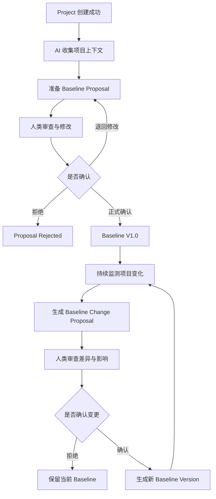

# S01 设计修订 · 第五份：S01-05 · Project Baseline — 项目基线确认与管理（专家供稿记录）

> **转交日期**：2026-11-05。本文件是对用户转交的专家设计修订稿的**忠实记录**（以转交文本为准）。
> **开篇边界声明（原稿自带）**：S01-05 管理的是 **Project Level 的正式项目基线，不是 S03 的 Implementation Baseline（实施基线）**。
> **原稿诚实性声明**：找回了核心定位，但**没有找到完整的 Q1/Q2 用户裁决**，也没有找到 Baseline 内容范围、版本策略等方面的完整原始裁决；因此已明确规则作为既定约束，需补齐部分标注为 **V1.0 设计建议，不把建议伪装成用户已裁决的事实**。
> **版本号事实**：外层「十三」节标题为「正式设计文档 V1.0」，但其内嵌文档头部与版本修订记录均为 **V1.1**（V1.0 初始建议稿→V1.1 收编六项裁决）；以内嵌文档 **V1.1** 为准，转录保持原样并在此注记差异。
> **章节完整性事实**：外层 §六 页面信息架构 6.1/6.2 标注「略」；§九 Figma AI 设计提示词**只有引导句、无提示词正文**。均按原样转录并登记挂账。
> **裁决收编事实**：外层 §十二 将 R-BL-01~06 列为「尚待用户裁决」并给出建议值；§十三 内嵌 V1.1 文档已按**完全相同的值**（B/A/A/A/A/B）收编为「六项正式用户裁决」——以 §十三 V1.1 收编为准。
> 按既定协作约定：供稿阶段只记录不评审；评审须用户明确要求。

---

## 一、已恢复的历史约束

| 事项 | 已恢复的规则 |
| --- | --- |
| 基线的形成 | AI 根据项目认知提出 Baseline |
| 正式确认 | 人类审查、修改并正式确认 |
| AI 的权限 | AI 推断不得自动成为已确认 Baseline |
| 确认权限 | 仅授权人类可以正式确认 |
| 初始化关系 | 首次基线确认属于 S01-01 初始化总览的第 4 阶段 |
| 长期管理 | 首次确认与后续维护、变更、版本管理需要区分 |

另外，S01-04 已明确 Cognition 与 Knowledge 是独立对象：Cognition 表达 AI 对项目的理解，Knowledge 保存正式知识，Context 为任务提供上下文。S01-05 **不应把这三者混成一个对象，也不能替代 S02 的需求治理**。

---

## 二、S01-05 的产品定位

Project Baseline 是**经过授权人类正式确认的项目当前共识版本**。

它回答的问题是：

- 我们正在建设什么项目？
- 项目的目标、范围和边界是什么？
- 项目有哪些已经确认的要求和约束？
- 项目当前采用哪些重要决策和技术方向？
- 当前项目基于哪些工程上下文？
- 哪些内容已经正式确认，哪些仍然存在分歧或待确认？

它**不是**一份普通说明文档，也**不是** AI 自动生成的项目总结。

它是一个具有**版本、确认记录、变更历史和追溯能力**的正式项目管理对象。

**核心原则：AI 负责准备和提出，人类负责审查和确认，系统负责版本化保存和执行时引用。**

---

## 三、V1.0 设计建议：基线内容与边界

建议将 Project Baseline 组织为一个**有版本的项目共识快照**，而不是把各业务领域的数据全部复制进一张大表。

| 基线内容 | 信息来源 | 基线中的处理方式 |
| --- | --- | --- |
| Project Identity | Project | 引用项目身份、名称、目标定位等正式信息 |
| Project Goals | Cognition、人工输入 | 形成目标与成功标准提案，经人工确认 |
| Scope & Boundaries | Requirements、人工决策 | 固化当前项目范围、包含项和排除项 |
| Requirements Summary | S02 Requirement | 引用已确认的需求及其具体版本 |
| Constraints | Cognition、Requirements、人工决策 | 固化已确认的业务、技术、资源和合规约束 |
| Product / Domain Understanding | S01-04 Cognition、Knowledge | 仅纳入经过确认、适合成为项目共识的内容 |
| Architecture Direction | Cognition、正式架构决策 | 引用已确认的方向或决策，不代替 S03 详细设计 |
| Repository Context | S01-03 Repository Management | 记录基线确认时的仓库、Branch、Commit 快照 |
| Open Issues & Risks | AI 分析、人工输入 | 明确标记未决事项，不将其伪装为已确认事实 |

需要特别守住的边界：

1. **需求的权威来源仍是 S02。** Baseline 引用需求及其 Revision，不复制一套独立的需求生命周期。
2. **Cognition 不是正式事实。** AI 可以从 Cognition 中提取候选内容，但必须经过人工确认才能成为 Baseline 的正式内容。
3. **Knowledge 不等于 Baseline。** Knowledge 是可长期积累的正式知识；Baseline 是某一时点对项目共识的版本化确认。
4. **Repository Commit 是工程上下文，不是项目基线本身。** 基线记录确认时所依据的仓库版本，仓库后续变化不应自动修改已确认基线。
5. **未决事项可以存在于基线中，但必须明确标记。** 不应为了让基线看起来完整而自动补齐结论。

非功能需求的纳入方式，应沿用 S02 的需求治理规则；目前检索到的历史记录没有恢复其完整原文，因此本稿**不另行定义**非功能需求的治理流程。

---

## 四、生命周期与版本管理



### 4.1 首次基线确认

1. Project 创建后，内置 AI-PM 可以开始收集和分析项目上下文。
2. AI 根据已获得的信息准备 Baseline Proposal。
3. 用户进入 Project Command Center，看到基线准备情况。
4. 用户打开 Baseline Review，逐项审查内容。
5. 用户可以修改、确认、退回补充或拒绝提案。
6. 授权人类正式确认后，系统生成第一个正式 Baseline 版本。

首次确认对应 S01-01 初始化总览的第 4 阶段。它是初始化中的一个正式治理事项，但**不应成为 Project 能否开始工作的门槛**。

### 4.2 长期变更

基线正式确认后，AI 可以持续识别变化，例如：

- 新需求加入或既有需求发生变化；
- 项目目标、范围或约束发生变化；
- 已确认的项目认知出现新证据；
- 架构方向或重要决策发生变化；
- Repository Branch 或 Commit 更新；
- 原有基线内容与项目实际情况产生冲突。

这些变化**只产生 Change Proposal，不直接修改当前基线**。

每份 Change Proposal 至少应展示：当前基线内容；建议变更内容；变更原因和证据；关联的需求、认知、知识或工程版本；影响范围；对现有基线的差异；AI 的建议及不确定性。

人类确认后，系统创建新版本；拒绝后保留原版本和提案记录。

### 4.3 版本规则（建议）

- 已确认 Baseline **不允许原地覆盖**。
- 每次正式变更创建新版本。
- 同一 Project 同一时刻**只有一个 Current Baseline**。
- 历史版本永久可追溯。
- 历史版本必须保留当时引用的 Requirement Revision 和 Repository Commit。
- 新版本不能悄悄改变旧版本的含义。
- 提案被拒绝或撤回，不产生正式 Baseline Version。

> 以上是建议采用的版本治理规则，尚未恢复到用户此前的明确裁决（原稿自带注）。

---

## 五、与 S03 Implementation Baseline 的边界

这一点尤其重要，避免两个工作包设计出重复功能。

| 对比项 | S01-05 Project Baseline | S03 Implementation Baseline |
| --- | --- | --- |
| 核心目的 | 确认项目整体共识 | 授权具体实施范围 |
| 主要内容 | 目标、范围、约束、需求引用、项目认知、工程上下文 | Requirement / Design / ADR 的具体版本、实施范围、验收、依赖及仓库上下文 |
| 使用场景 | 项目管理、需求治理、AI-PM 理解和规划 | 进入具体实施阶段 |
| 生命周期 | 随项目演进，持续产生新版本 | 面向具体实施授权 |
| 确认方式 | 授权人类正式确认 | 授权人类正式确认 |
| 关系 | 上游项目共识依据 | 在项目共识基础上形成实施授权 |

S03 历史设计曾将 Implementation Baseline 定位为**进入后续实施阶段的不可变授权快照**。S01-05 **不应取代它**，也**不应提前承载** S03 的全部设计审批细节。

---

## 六、页面信息架构

建议 S01-05 作为 Project 内的**长期管理页面**，而不是只在初始化时出现的确认弹窗。

（6.1/6.2 原稿标注「略」）

### 6.3 Change Proposals

变更审查必须突出**「旧内容与新内容的差异」**，不能只显示一份重新生成的基线文档。

建议分成：

- Current Baseline：当前正式内容；
- Proposed Changes：AI 建议的新内容；
- Evidence：来源和证据；
- Impact Analysis：对需求、范围、架构和实施的影响；
- Human Decision：确认、拒绝、要求修改。

### 6.4 Version History

每个正式版本应能够查看：版本号；确认时间；确认人；变更摘要；关联 Change Proposal；关联的需求 Revision；关联 Repository / Branch / Commit；与上一版本的差异。

**历史版本只读，不提供直接编辑入口。**

---

## 七、状态与权限建议

### 7.1 对象状态

建议至少区分三个不同层次：

| 对象 | 建议状态 |
| --- | --- |
| Baseline Proposal | Draft / Pending Review / Confirmed / Rejected / Withdrawn |
| Baseline Version | Current / Superseded |
| Baseline Change Proposal | Pending Review / Confirmed / Rejected / Withdrawn |

这些是本稿**建议的展示状态，不应直接认定为现有数据库枚举**。

特别注意：

- Proposal 的 Confirmed 不代表 Baseline Version 可以继续编辑。
- Baseline Version 的 Superseded 不代表历史版本失效或被删除。
- 当前基线可以没有待审查提案，也可以同时存在多个不同内容的提案；是否允许同一内容并行提案，需要技术设计明确。
- 初始化事项的展示状态与以上领域对象状态相互独立。

### 7.2 权限原则

| 操作 | AI-PM | 普通项目成员 | 授权确认人 |
| --- | --- | --- | --- |
| 收集项目上下文 | 允许 | — | — |
| 生成 Baseline Proposal | 允许 | — | — |
| 修改 Proposal | 提供建议 | 按授权允许 | 允许 |
| 确认正式 Baseline | **禁止** | 未授权时禁止 | 允许 |
| 拒绝 Proposal | 不可代替人类 | 按授权允许 | 允许 |
| 创建变更提案 | 允许 | 按授权允许 | 允许 |
| 查看历史版本 | — | 按项目权限 | 允许 |

这里需要区分**「有权编辑提案」和「有权正式确认基线」**。二者不应被默认视为同一权限。

正式确认必须记录操作者、时间、目标版本、提案版本、确认意见和审计信息。

---

## 八、与现有系统的技术边界

当前**不能直接假设**现有数据库已有 project_baseline、baseline_version 或 baseline_proposal 等表。需要技术核验后才能决定实体与迁移方案。

建议技术评审重点核验：

1. 是否已经存在项目级正式基线的实体或读模型。
2. S02 Requirement 及 Revision 能否被 Baseline 以版本化引用方式关联。
3. S01-04 Cognition / Knowledge 的确认记录和来源证据能否被 Baseline 引用。
4. S01-03 多 Repository 关系能否支持逐仓库记录 Branch 和 Commit。
5. 是否存在正式人类确认协议，以及其权限校验和审计机制。
6. Baseline Version 是否能保证不可变和历史追溯。
7. Baseline Change Proposal 能否独立保存差异、证据和影响分析。
8. Baseline 与 S03 Implementation Baseline 是否能够保持清晰的领域边界。

**不要直接复用其他领域的状态机。** 应先确认现有实体、命令、事件及审批机制的真实语义，再决定复用还是建立独立模型。

---

## 九、Figma AI UX/UI 设计提示词

以下提示词可以直接交给 Figma AI。目标是**设计完整页面，而不是只画一个初始化确认弹窗**。

（原稿此处无提示词正文，直接进入 §十——登记挂账，见附 B-1。）

---

## 十、页面线框

```
┌──────────────────────────────────────────────────────────────┐
│ Project Navigation                                           │
├──────────────────────────────────────────────────────────────┤
│ Project Baseline                              [New Proposal] │
│                                                              │
│ ┌──────────────────────────────────────────────────────────┐ │
│ │ Current Baseline                                          │ │
│ │ V1.0   Confirmed                                          │ │
│ │ Confirmed by ...       Last updated ...                   │ │
│ │                                                          │ │
│ │ [View Details] [Compare Versions]                         │ │
│ └──────────────────────────────────────────────────────────┘ │
│                                                              │
│ ┌──────────────────────────────┐ ┌─────────────────────────┐ │
│ │ Baseline Content             │ │ Review / Detail         │ │
│ │                              │ │                         │ │
│ │ Project Identity             │ │ Selected Section        │ │
│ │ Project Goals                │ │                         │ │
│ │ Scope & Boundaries           │ │ Current Content         │ │
│ │ Requirements                 │ │                         │ │
│ │ Constraints                  │ │ Sources & Evidence      │ │
│ │ Domain Cognition             │ │                         │ │
│ │ Architecture Direction       │ │ Related Requirements    │ │
│ │ Repository Context           │ │                         │ │
│ │ Open Issues                  │ │                         │ │
│ └──────────────────────────────┘ └─────────────────────────┘ │
│                                                              │
│ ┌──────────────────────────────────────────────────────────┐ │
│ │ Pending Change Proposals                                  │ │
│ │ Proposal 01    Scope change          [Review]             │ │
│ │ Proposal 02    New project constraint [Review]            │ │
│ └──────────────────────────────────────────────────────────┘ │
│                                                              │
│ ┌──────────────────────────────────────────────────────────┐ │
│ │ Version History                                           │ │
│ │ V1.0 Confirmed                                             │ │
│ │ V0.9 Superseded                                            │ │
│ └──────────────────────────────────────────────────────────┘ │
└──────────────────────────────────────────────────────────────┘
```

---

## 十一、验收标准

- [ ] Project 创建后即可进入 Project Command Center，不要求先确认 Baseline。
- [ ] 首次 Baseline Proposal 可以由内置 AI-PM 根据已有项目认知准备。
- [ ] AI 不能自动确认正式 Baseline。
- [ ] 人类可以逐项审查、修改、确认或拒绝提案。
- [ ] 正式确认必须经过权限校验。
- [ ] 确认后生成可追溯的正式版本。
- [ ] 已确认版本不可原地覆盖。
- [ ] AI 识别到项目变化时只产生 Change Proposal。
- [ ] Change Proposal 必须包含差异、来源和影响。
- [ ] 人类确认变更后才生成新的正式版本。
- [ ] 历史版本可以查看和比较。
- [ ] Baseline 对 S02 Requirement Revision 使用明确引用。
- [ ] Repository Branch / Commit 变化不自动改变正式 Baseline。
- [ ] Baseline 与 S03 Implementation Baseline 不混淆。
- [ ] 未决内容不能被显示成已确认事实。

---

## 十二、尚待用户裁决的事项

> 以下问题在目前找回的历史记录中没有明确答案。建议先把它们作为 V1.0 的待裁决项，而不是擅自冻结。（记录者注：§十三 V1.1 已按完全相同的建议值收编为正式裁决，以外层本节的「待裁决」表述被 V1.1 取代为准。）

| 编号 | 待裁决事项 | 建议 |
| --- | --- | --- |
| R-BL-01 | Baseline 是否包含完整需求正文，还是只引用 Requirement Revision？ | B：只引用具体版本，避免重复治理 |
| R-BL-02 | Baseline 是否允许存在未决事项？ | A：允许，但明确标记未决 |
| R-BL-03 | 是否允许没有 Repository 的项目确认 Baseline？ | A：允许，工程上下文标记未接入 |
| R-BL-04 | 是否允许在没有完整 Cognition 时确认首个 Baseline？ | A：允许，未准备内容明确标记 |
| R-BL-05 | 是否每次正式确认都创建全量快照？ | A：是，逻辑上形成完整版本，底层可采用引用与增量存储 |
| R-BL-06 | 谁可以正式确认？ | B：由 Project 授权角色决定，与创建者身份分开 |

这些选项是本次提出的**建议**，不是恢复到的历史裁决。

---

## 十三、正式设计文档 V1.1（外层标题为「正式设计文档 V1.0」，内嵌文档实际版本 V1.1；原稿以内嵌完整文档形式给出，此处转为正文格式转录，内容逐字保留）

**文档编号**：S01-05　**文档版本**：V1.1　**文档性质**：用户裁决收编后的产品设计基线
**所属阶段**：S01 · Project Initialization & Readiness
**前置工作包**：S01-01、S01-02、S01-03、S01-04　**后续工作包**：S01-06、S01-07

### 1. 产品定位

Project Baseline 是经过授权人类正式确认的项目当前共识版本。

它记录项目的目标、范围、边界、约束、已确认需求引用、重要项目认知和工程上下文，为后续项目管理、需求治理、AI-PM 分析及工程活动提供正式依据。

Project Baseline 是**长期管理能力**，不是普通项目说明文档、AI 自动生成的总结，也不是一次性初始化页面。

#### 1.1 核心原则

1. AI 根据项目上下文准备 Baseline Proposal。
2. AI 不得自行将推断转化为正式 Baseline。
3. 正式 Baseline 必须由 Project 授权角色确认。
4. 正式确认后生成新的 Baseline Version。
5. 已确认版本不可原地覆盖。
6. 项目变化只产生 Change Proposal，不自动修改正式基线。
7. 人类确认变更后才生成新的正式版本。
8. 每个正式版本都必须具有完整逻辑快照。
9. 未决事项允许存在，但必须明确标记。
10. Repository 和 Cognition 均不是确认首个 Baseline 的前置条件。

### 2. 六项正式用户裁决

#### R-BL-01：Requirement 引用方式 —— **裁决：B**

Baseline **只引用具体的 Requirement Revision**，不重复管理需求正文和需求生命周期。

规则：

- 每项需求引用必须指向明确的 Requirement Revision。
- Baseline 保留确认时所引用的需求版本。
- S02 仍是需求内容、状态和版本治理的权威来源。
- 需求后续变化不自动修改历史 Baseline。
- 需求变化可以触发 Baseline Change Proposal。

#### R-BL-02：未决事项 —— **裁决：A**

**允许** Baseline 中存在未决事项。

规则：

- 未决事项必须明确标记。
- 必须说明未决原因、当前已知信息和责任归属（如已指定）。
- 不得把 AI 推断或尚未确认的结论标记为正式共识。
- 未决事项**不自动阻断** Baseline 正式确认。
- 后续可以通过 Change Proposal 更新相关内容。

#### R-BL-03：Repository 非必需 —— **裁决：A**

**没有 Repository 也允许确认** Project Baseline。

规则：

- Repository 是可选工程集成。
- 没有 Repository 时，工程上下文标记为未接入或尚未建立。
- 不得因为缺少 Repository 阻断项目级 Baseline 确认。
- Repository 后续接入时，可以通过 Change Proposal 更新工程上下文。
- 已确认版本不得因 Repository 接入而自动改变。

#### R-BL-04：Cognition 不完整时允许确认 —— **裁决：A**

**Cognition 不完整也允许确认**首个 Baseline。

规则：

- AI 根据当前可用上下文准备 Proposal。
- 尚未形成的认知内容可以留空或标记为待补充。
- 不得为了追求完整度而自动生成未经确认的项目事实。
- Baseline 应表达当前已经达成的项目共识，而不是假设所有信息均已具备。
- 后续 Cognition 的变化可以触发 Change Proposal，但不得直接覆盖 Baseline。

#### R-BL-05：完整逻辑快照 —— **裁决：A**

每次正式确认形成**一个完整逻辑快照**。

规则：

- 每个 Baseline Version 必须能够独立表达确认时的完整基线语义。
- 可以通过实体引用、版本引用、内容快照或增量存储实现。
- 底层存储优化不得影响历史版本的完整可读性。
- 历史版本必须能够还原当时的 Requirement Revision、Repository Commit 引用及其他基线内容。
- 新版本不得改变旧版本的含义。
- 已确认版本不可原地编辑。

#### R-BL-06：正式确认权限 —— **裁决：B**

正式确认权限**由 Project 授权角色决定，与创建者身份分离**。

规则：

- Project 创建者不自动拥有 Baseline 正式确认权限。
- Proposal 编辑权限与正式确认权限分开。
- 确认操作必须进行服务端权限校验。
- 确认记录必须保留实际操作者、确认时间、目标版本及确认意见。
- AI 不具有正式确认权限。

### 3. Baseline 内容结构

建议包含：1. Project Identity；2. Project Goals；3. Scope & Boundaries；4. Requirements References；5. Constraints；6. Product / Domain Understanding；7. Architecture Direction；8. Repository Context；9. Open Issues & Risks。

每项内容应能够记录：内容本身；确认情况；来源；证据；关联业务对象；版本信息；未决原因（适用时）。

Baseline **不是**上述领域对象的替代品，而是对确认时项目共识的**版本化表达**。

### 4. 首次 Baseline 确认流程

1. Project 创建成功。
2. 内置 AI-PM 收集可用项目上下文。
3. AI 准备 Baseline Proposal。
4. 用户进入 Baseline Review。
5. 用户逐项审查、修改、确认、拒绝或要求补充。
6. 系统检查确认人的 Project 授权。
7. 授权人类正式确认。
8. 系统生成首个正式 Baseline Version。
9. Command Center 更新 Baseline 确认情况和版本入口。

首次确认**不要求**：已接入 Repository；已配置 MCP 或外部 Agent；Cognition 已经完整；所有需求已经全部确认；所有未决事项已经解决。

### 5. 长期变更流程

1. AI 或系统识别项目上下文变化。
2. AI 创建 Baseline Change Proposal。
3. 展示当前版本、建议内容、差异、来源、证据和影响。
4. 授权人类审查。
5. 确认变更后生成新 Baseline Version。
6. 拒绝变更后保留当前正式版本。
7. 所有提案、确认和拒绝行为进入审计记录。

**AI 不得直接修改 Current Baseline。**

### 6. 版本治理

- 同一 Project 同一时刻只有一个 Current Baseline。
- 每次正式确认形成新的逻辑完整版本。
- 历史版本只读。
- 历史版本保留确认人、确认时间、来源、关联提案和外部版本引用。
- Requirement 引用必须指向具体 Revision。
- Repository 引用必须保留具体 Commit。
- 拒绝或撤回 Proposal 不创建正式版本。
- 底层可以使用引用和增量存储，但必须保证完整逻辑快照可还原。

### 7. 页面信息架构

- **Baseline Overview**：展示当前正式版本、确认人、确认时间、待审查变更和基线内容概览。
- **Baseline Review**：提供首次 Baseline Proposal 的逐项审查、修改、确认、拒绝和补充能力。
- **Change Proposals**：展示变更原因、当前内容、建议内容、证据和影响。
- **Version History**：展示正式版本、确认记录和版本差异。
- **Baseline Detail**：提供具体版本的完整逻辑内容、来源和关联对象。

### 8. 与其他工作包的边界

- S01-01：负责初始化事项展示和进度入口。
- S01-02：负责 Project 主体创建。
- S01-03：负责 Repository 接入和管理。
- S01-04：负责 AI-PM Cognition 与 Knowledge。
- S01-05：负责 Project 级正式共识基线。
- S02：负责 Requirement 的权威治理。
- S03：负责 Implementation Baseline 和具体实施授权。

**不得将 S01-05 的 Project Baseline 与 S03 的 Implementation Baseline 合并。**

### 9. 权限与审计

AI 可以准备 Proposal，但不能正式确认。

Proposal 编辑权限与正式确认权限分离。

正式确认必须记录：Project ID；Baseline Version；Proposal ID；操作者；操作者授权依据；确认时间；确认意见；版本来源及关联证据。

所有确认行为必须经过**服务端权限校验**。

### 10. 建议状态模型

- Baseline Proposal：Draft / Pending Review / Confirmed / Rejected / Withdrawn
- Baseline Version：Current / Superseded
- Baseline Change Proposal：Pending Review / Confirmed / Rejected / Withdrawn

以上是产品展示层建议，最终状态枚举须以代码核验和技术设计为准。

### 11. 技术核验要求

1. 核验是否已有项目级 Baseline 实体。
2. 核验 Requirement Revision 的版本引用能力。
3. 核验 Cognition / Knowledge 的来源和确认记录。
4. 核验多 Repository 的 Branch / Commit 快照能力。
5. 核验正式确认权限及审计能力。
6. 核验逻辑完整快照和历史追溯机制。
7. 核验 Change Proposal 的差异和影响记录能力。
8. 核验 S01 Baseline 与 S03 Implementation Baseline 的边界。
9. 核验未决事项的保存、展示和后续处理能力。
10. 核验历史引用对象被修改、删除或失效时的完整性保障。

**不得在代码事实未经核验时宣称已有对应表、状态机或命令。**

### 12. UX 验收标准

- Project 创建后不要求先完成 Baseline。
- AI 可以准备 Baseline Proposal。
- AI 不能自动确认 Baseline。
- 人类可以逐项审查和修改。
- 正式确认必须有 Project 授权校验。
- 没有 Repository 时仍可确认。
- Cognition 不完整时仍可确认。
- 未决事项可以保留并明确标记。
- Baseline 引用具体 Requirement Revision。
- 确认后形成完整逻辑快照。
- 历史版本不可覆盖。
- 项目变化只产生提案。
- 人类确认后才创建新版本。
- 差异、来源、影响和历史均可追溯。
- 不混淆 S01 Project Baseline 与 S03 Implementation Baseline。

### 13. 版本修订记录

- **V1.0**：形成 Project Baseline 初始设计建议稿，提出六项待裁决事项。
- **V1.1**：收编六项用户正式裁决：R-BL-01：B；R-BL-02：A；R-BL-03：A；R-BL-04：A；R-BL-05：A；R-BL-06：B。六项裁决均已纳入正式设计规则。

### 14. 冻结条件

V1.1 的产品规则已完成用户裁决。

进入正式实施基线冻结前，还需完成：

1. 现有代码与领域模型核验。
2. 数据模型和版本引用方案核验。
3. 权限与正式确认协议核验。
4. 与 S02 Requirement 及 S03 Implementation Baseline 的边界核验。

在技术核验完成前，本稿属于**已裁决的产品设计基线**，不代表数据库和代码实现已经冻结。

---

## 附 A · 记录者附注：与既有文档的关系登记（事实登记，非评审）

| # | 既有文档/事实 | 关系登记 |
| --- | --- | --- |
| A-1 | README「S01 后续推进顺序」表顺序 7「（原）项目基线管理」 | 本稿落实了该挂空条目：S01-05=Project Baseline（长期基线管理），与第一份修订稿 §九 修订后顺序表（S01-05 Project Baseline）一致；README 既有注「初始基线确认 vs 长期基线管理职责不同、长期基线管理不再占用 S01-05 编号」中的占位意图由本稿承接 |
| A-2 | `s01-01-project-baseline-confirmation-ux-v1.md`（初始基线确认 UX，现占 S01-01 号） | 本稿 §4.1「首次确认对应 S01-01 初始化总览的第 4 阶段」与该稿衔接；两稿分工（初始确认 vs 长期管理/版本演进）与 README 既有注一致；编号收敛与改名仍待统一执行 |
| A-3 | 实现仓既有基线纵切片（**源自会话记忆，须以当前分支代码核验为准**） | ai-pm 实现仓 2026-11-05 已有 S01-05 基线前后端纵切片实施记录（迁移 0037：proposal 单 pending 部分唯一索引、item/version 头不可变；`pm_baseline.rs`；BaselinePage；未决更正 blocking / Unknown=documented uncertainties 口径）。本稿 §八「不能直接假设已有表」的核验对象**应包含该实现**；R-BL-02「未决事项允许且明确标记、不自动阻断」与该实现口径同向（以核验为准） |
| A-4 | S03 设计稿 `../.docs/scenarios/s03/ui/smark-pm-s03-01-analysis-design-technical-decisions-v1.md` | 本稿 §五 边界表与 S03 V1.0 的 ImplementationBaseline 定位（不可变授权快照、五领域对象、基线不可变快照裁决）一致：S01-05 不取代、不提前承载；两基线的引用关系（S01-05 上游共识 → S03 实施授权）为跨工作包衔接点 |
| A-5 | 裁决记录 R-S01-01-01 | §二 核心原则、§4.1「不应成为 Project 能否开始工作的门槛」、R-BL-03（无 Repository 可确认）、R-BL-04（Cognition 不完整可确认）与裁决方案 A 同向 |
| A-6 | S01-04 V1.2 修订稿 | 本稿开篇引用「Cognition/Knowledge/Context 三者不混、不替代 S02 需求治理」与 S01-04 V1.2 §1.2 五条互不取代约束一致；§三 边界 1「需求权威来源仍是 S02」与 S02-04 V1.2 裁决（Requirement 权威在 S02）同向 |
| A-7 | README「冻结的设计原则」 | 本稿 §一 已恢复的历史约束（AI 提出基线/人类确认/AI 推断不自动成为基线/仅授权人类确认）与 README 冻结原则 3~5（当前有效基线唯一/正式确认必须由人类完成/AI 负责分析提案修订和证据整理）同源 |
| A-8 | Q1/Q2 原始裁决 | 原稿明示未找回完整 Q1/Q2 正文；已恢复六条约束与内嵌 V1.1 十条核心原则可作现行口径，原始正文若后续找回须回改本记录 |

## 附 B · 待基线确认后的执行挂账

1. **§九 Figma AI 提示词正文缺失**（原稿仅引导句）——待专家补发；内嵌 V1.1 §7 五页面清单（Overview/Review/Change Proposals/Version History/Detail）可作为最小骨架。
2. §六 6.1/6.2 页面布局原稿标注「略」——同上待补。
3. §八 八项核验 + 内嵌 §11 十项核验，与 S01-03 V1.2 §10（17 项）、S01-04 V1.2 §15（10 项）、S01-01 总览稿 §14 缺口表（G-01~G-09）**四套清单统一合并**；核验对象含 A-3 所记实现仓既有 0037 基线纵切片（以当前分支代码为准）。
4. 「初始基线确认稿（现 s01-01 号）vs 本稿（S01-05 长期基线管理）」的编号收敛与两稿交叉引用修订，随 README 统一改名执行。
5. 本稿状态：内嵌 V1.1=**已裁决的产品设计基线**（冻结条件 §14 四项核验完成前不等于实施冻结）；记录阶段不执行冻结、不改既有稿状态。
