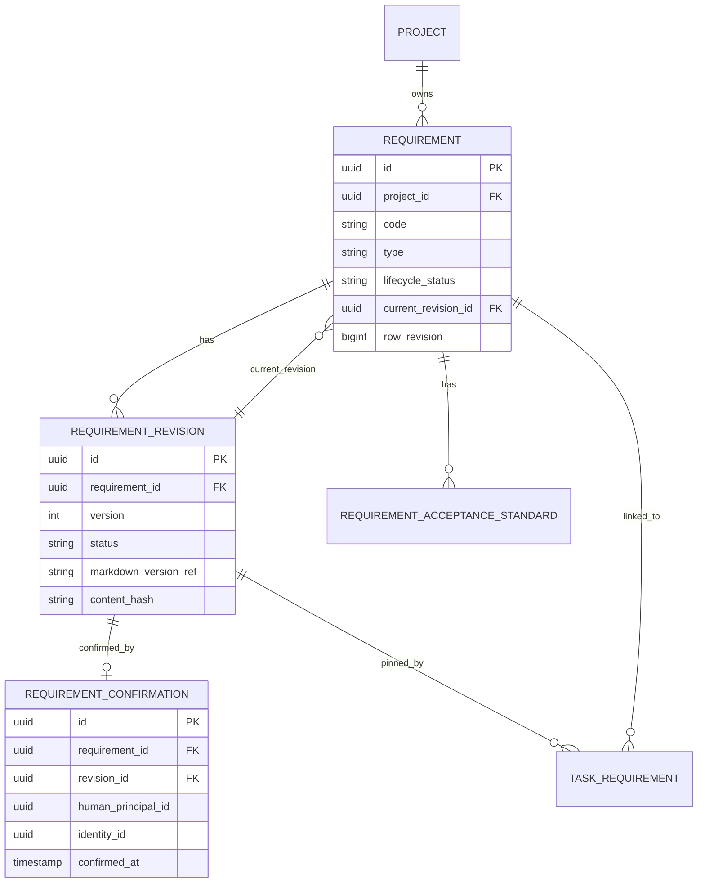
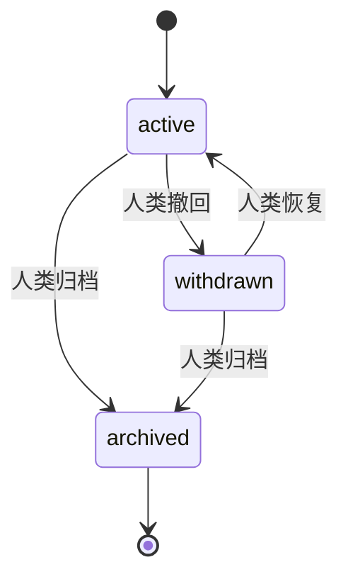
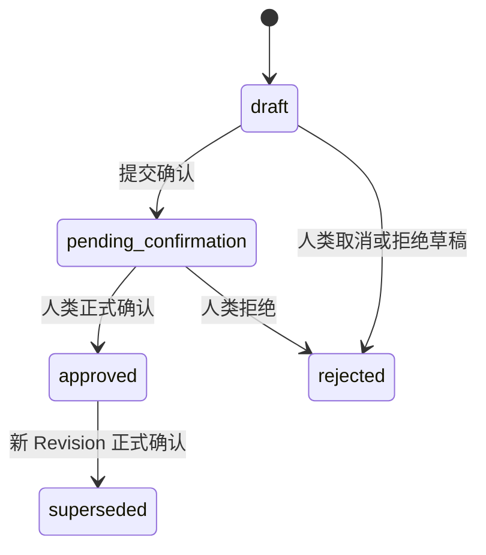

# S02-I1 · Requirement Core 详细设计稿 V1.0

> 文档性质：S02-05 I-Slice 详细设计稿  
> 所属领域：Requirement  
> 版本：V1.0  
> 日期：2026-11-04  
> 状态：待评审  
> 上游基线：S02-04 Requirement 需求领域总体设计与最终裁决、S02-02 运行时核验报告 V1.0、S02-03 需求管理业务场景与用户操作流程 V1.0、S02-I6-A 权限基座与人类正式确认协议 V1.2  
> 下游依赖：S02-I2 Markdown & Revision Governance、S02-I3 Source & Traceability、S02-I4 Task Integration、S02-I5 Acceptance & Verification、S02-I6-B Application Service & Interfaces

---

# §0. 文档目的与设计边界

## 0.1 设计目的

本切片定义 smark-pm 的 Requirement 核心领域模型，解决以下问题：

1. Requirement 稳定身份与 Revision 版本之间的关系。
2. Functional Requirement 与 Non-functional Requirement 的统一模型。
3. Requirement Revision 的生命周期及状态转换。
4. Requirement 正式确认的领域语义。
5. Requirement 当前正式版本指针的维护规则。
6. Requirement 与现有数据库实体的映射。
7. 并发修改、版本冲突和状态一致性约束。
8. Requirement 核心模型与 Markdown/Git、Discovery、Task、Run、Delivery 的边界。

本设计是后续 I-Slice 的核心数据模型依据。

## 0.2 本切片不负责的内容

| 内容 | 所属切片 | I1 的处理方式 |
|---|---|---|
| Markdown 文件组织、路径、Git 提交、正文写入 | I2 | 定义引用关系和约束 |
| Markdown 与 DB 投影同步、恢复、重建 | I2 | 定义核心模型依赖 |
| Discovery Finding 来源关系 | I3 | 预留关系接口 |
| Decision 来源关系 | I3，与 S03 协同 | 预留关系接口 |
| SourceArtifact | I3 | 不在 I1 建表 |
| Task 执行依据 Revision | I4 | 定义稳定 Revision 标识 |
| Run 实际执行依据 | I4 | 不在 I1 建表 |
| Delivery 实际交付依据 | I4 | 不在 I1 建表 |
| Requirement 级验收标准 | I5 | 定义归属 Requirement 的原则 |
| Task 级验收和 Delivery 验收 | I5 | 不在 I1 实现 |
| Project Approver、授权、Human Confirmation 安全协议 | I6-A | 直接遵循 V1.2 |
| 统一 Application Service、REST/MCP/Executor 入口 | I6-B | 定义领域操作语义 |

## 0.3 不可改变的上游裁决

| 决策编号 | 已确认内容 | I1 约束 |
|---|---|---|
| Q-2 | AI 不可自动确认正式需求 | 只有授权人类能够完成正式确认 |
| Q-3 | Knowledge Markdown 是唯一正文权威 | DB 不得成为独立可编辑正文来源 |
| Q-4 | Requirement ↔ Discovery Finding 纳入 S02 | I1 不提前实现来源关系 |
| Q-5 | Requirement ↔ Decision 语义由 S02 定义，具体实现与 S03 协同 | I1 不擅自确定 Decision 关联表 |
| Q-10 | 第一阶段不建设 Project Requirement Baseline | 不引入 Project Baseline 实体 |
| Q-17 | Task 对同一 Requirement 默认只允许一个有效执行依据版本 | 由 I4 实现，I1 保证 Revision 身份稳定 |

其他约束：

- Requirement 类型只允许 `functional`、`non_functional`。
- AI-PM 可以提出、创建和修改草稿，但不能正式确认。
- AI-Agent 是唯一 Markdown 文件写入执行者。
- Requirement 正式确认和 Markdown 发布不是同一个生命周期。
- PageIndex 是派生索引，不是正文权威。
- 数据库中的 `current_revision_id` 是每项 Requirement 的当前正式 Revision 指针，不是 Project Baseline。

---

# §1. 核心领域概念

## 1.1 Requirement：稳定身份实体

Requirement 表示项目内一项具有稳定身份的正式需求。

它不直接承载可独立编辑的需求正文，而是负责：

- 标识一项需求。
- 归属一个 Project。
- 提供稳定的业务编号。
- 标识需求类型。
- 指向当前正式 Revision。
- 管理需求本身的生命周期。
- 作为 Revision、来源关系、验收标准和 Task 关联的稳定根实体。

Requirement 的身份不随正文修改而改变。

例如：

```text
REQ-001
  ├── Revision 1
  ├── Revision 2
  ├── Revision 3
  └── Current Revision → Revision 3
```

即使 Revision 3 修改了需求正文，`REQ-001` 仍然是同一个 Requirement。

## 1.2 Requirement Revision：需求版本实体

Revision 表示某项 Requirement 在某个时间点的一个正式版本候选或已确认版本。

它承担：

- 版本编号。
- 生命周期状态。
- Markdown 正文版本引用。
- 正文完整性校验信息的引用。
- 创建者和确认信息的关联。
- 历史版本追溯。
- 被 Task、Run、Delivery 引用时的稳定身份。

Revision 的正文权威来自 Knowledge Markdown 对应版本。

数据库中的 Revision 记录不能脱离对应 Markdown 版本而成为另一份可编辑的正文。

## 1.3 Requirement Confirmation：正式确认记录

正式确认不是普通状态更新，而是一项独立的治理行为。

它必须记录：

- 被确认的 Requirement。
- 被确认的 Revision。
- 被确认的 Markdown 版本。
- 被确认的正文 hash。
- 确认人类主体。
- 确认时使用的可信身份上下文。
- 确认时间。
- 确认来源和必要的审计信息。

正式确认记录是“谁在什么时间确认了哪个精确版本”的权威凭据。

`approved` 状态表示该 Revision 已经存在有效的人类正式确认，不允许通过普通 SQL 更新、AI-PM 自动应用或 AI-Agent 文件写入来伪造该状态。

## 1.4 三个概念不能混为一谈

| 概念 | 表达的问题 | 权威位置 |
|---|---|---|
| Requirement | 这项需求是谁？ | PostgreSQL |
| Requirement Revision | 这项需求有哪些版本？当前版本是什么状态？ | PostgreSQL 元数据 + Markdown 版本引用 |
| Requirement 正文 | 这一版本具体要求什么？ | Knowledge Markdown + Git |

---

# §2. 核心实体与关系

## 2.1 实体关系总览



说明：

- 上图是领域关系示意，不代表最终 SQL 字段清单。
- `REQUIREMENT_ACCEPTANCE_STANDARD` 是 I5 候选实体，I1 只表达归属关系。
- `TASK_REQUIREMENT` 是现有表，不在 I1 重新创建。
- Confirmation 的最终表结构和授权约束需要与 I6-A/I6-B 协调。
- Markdown 版本引用字段的实际结构由 I2 确定。

## 2.2 与现有数据库表的映射

| 领域概念 | 现有数据库对象 | I1 处理 |
|---|---|---|
| Requirement | `delivery.requirement` | 保留并调整 |
| Requirement Revision | `delivery.requirement_revision` | 保留并调整 |
| Task-Requirement 关系 | `delivery.task_requirement` | 保留，交由 I4 调整 |
| Requirement 正式确认 | 当前无独立确认实体 | 新增确认记录机制，具体结构与 I6-A 对齐 |
| Requirement Approver | I6-A 提议的新授权实体 | I1 不重复定义 |
| Requirement Acceptance Standard | 当前没有符合要求的 Requirement 级实体 | I5 新增 |
| Requirement Source | 当前无完整统一关联 | I3 新增或调整 |

不得因为 I1 需要新的领域模型，就重复创建另一套 Requirement 主表。

## 2.3 Requirement 身份约束

`delivery.requirement` 必须满足：

1. 一个 Requirement 只能属于一个 Project。
2. Requirement ID 创建后永久稳定。
3. `code` 在同一 Project 内唯一。
4. Requirement 删除采用受控生命周期，不允许直接级联删除历史 Revision。
5. Revision 历史不因 Requirement 当前状态变化而丢失。
6. Requirement 的类型原则上在创建时确定。

关于类型变更：

V1.0 建议不允许已创建 Requirement 直接改变 `type`。

如果业务确实需要把 FR 改为 NFR，应该由人类发起类型变更评估，明确历史验收标准、Task 关联和来源语义的迁移策略，再由后续设计决定是否允许。

不能通过普通 PATCH 任意改变类型。

---

# §3. Requirement 类型模型

## 3.1 仅允许两种类型

```text
functional
non_functional
```

不增加：

- `constraint`
- `technical`
- `business`
- `architecture`
- `security`
- `performance`

这些可以作为需求分类标签或内容属性，不应在第一阶段扩大核心类型枚举。

## 3.2 Functional Requirement

Functional Requirement 描述系统必须提供的行为或能力。

例如：

```text
REQ-001
type = functional

需求正文：
系统应允许项目负责人创建 Requirement。
```

其验收标准可以有多个：

- 正常创建成功。
- 无权限时拒绝。
- 重复编号时拒绝。
- 审计记录正确生成。

不能假设一个 Requirement 只有一个验收条件。

## 3.3 Non-functional Requirement

Non-functional Requirement 描述系统质量属性、约束或运行要求。

例如：

```text
REQ-002
type = non_functional

需求正文：
Requirement 查询应满足项目规模增长时的性能要求。
```

NFR 的验收标准不要求全部使用固定数值。

可接受的验收方式包括：

- 数值阈值。
- 测试报告。
- 观察性指标。
- 安全审查。
- 专家评估。
- 合规检查。
- 运行环境验证。

验收标准必须适合需求本身，不能为了结构化而强制所有 NFR 都转化为一个数字。

## 3.4 类型与生命周期解耦

FR 和 NFR：

- 使用同一 Requirement 表。
- 使用同一 Revision 表。
- 使用同一正式确认协议。
- 使用同一权限模型。
- 使用同一来源追溯体系。
- 使用同一 Task 关联模型。

类型差异主要体现在需求正文、验收标准和验证方式，而不是生命周期。

---

# §4. Requirement 生命周期

## 4.1 Requirement 生命周期状态

建议保留三个核心状态：

```text
active
withdrawn
archived
```

含义：

| 状态 | 语义 |
|---|---|
| active | 正常有效的需求 |
| withdrawn | 人类决定不再继续维护或执行的需求 |
| archived | 已归档，保留历史但不再参与正常活动 |

注意：

- `withdrawn` 不是 Revision 的 `rejected`。
- `archived` 不是删除。
- Requirement 被 withdrawn，不意味着其历史 Revision 失效或消失。
- 已经被 Task、Run、Delivery 引用的历史依据必须继续可追溯。

## 4.2 状态转换



V1.0 建议：

- 只有具备 Project 管理权限的人类可以执行 Requirement 的撤回、恢复和归档。
- AI-PM 可以建议这些操作，但不能自行执行正式生命周期变更。
- archived 不允许直接恢复，若确有业务需求，应另行定义恢复流程。

以上是领域建议，具体角色映射由 I6-A/I6-B 约束。

---

# §5. Requirement Revision 生命周期

## 5.1 Revision 状态

建议状态：

```text
draft
pending_confirmation
approved
rejected
superseded
```

| 状态 | 语义 | 正文是否可修改 |
|---|---|---|
| draft | 草稿 | 可以，通过受控流程 |
| pending_confirmation | 等待人类正式确认 | 不可以，需新建修订版本 |
| approved | 已正式确认 | 不可以 |
| rejected | 人类拒绝本次版本 | 不可以 |
| superseded | 已被新正式版本取代 | 不可以 |

## 5.2 状态机



注意：

1. AI-PM 不得触发 `approved`。
2. AI-Agent 不得触发 `approved`。
3. 普通数据库写操作不得直接将 Revision 更新为 `approved`。
4. 正式确认必须经过 I6-A 定义的 Human Confirmation 授权协议。
5. 已提交确认的 Markdown 版本必须固定。
6. 拒绝后不能把原 Revision 重新打开并修改，应创建新的 Revision。
7. `superseded` 只能由新的正式 Revision 成功确认后产生。

## 5.3 draft 创建与编辑

允许以下主体提出草稿：

- Human。
- AI-PM。
- Discovery 流程产生的 AI 提案。
- 受控导入流程。

但主体能提出草稿，不等于主体能直接写 Markdown 文件。

草稿正文通过受控 Requirement 流程提交给 AI-Agent，由 AI-Agent 执行唯一的文件写入操作。

草稿编辑必须满足：

- 明确目标 Requirement。
- 明确当前基础 Revision。
- 记录修改来源。
- 记录修改理由。
- 产生可追踪的 Markdown 版本。
- 保留历史草稿或版本变更证据。

具体 Markdown 写入、Git 操作、Proposal 和恢复机制由 I2 定义。

## 5.4 pending_confirmation 冻结规则

Revision 进入 `pending_confirmation` 后：

- 该版本正文不可修改。
- 对应 Markdown 版本不可被覆盖。
- 确认请求必须绑定精确 Markdown 版本及 hash。
- 如果正文需要修改，应撤销或结束当前确认请求，并创建新 Revision。
- 不允许确认请求指向一个可变动的文件路径而不绑定版本。

确认操作必须校验：

```text
requirement_id
revision_id
markdown_version_ref
content_hash
human_principal_id
project_id
```

任何一项不匹配，都不得确认。

## 5.5 approved 的含义

`approved` 表示：

该 Revision 已经过合法的人类正式确认，并且确认对象与当前 Revision 所引用的 Markdown 版本完全一致。

`approved` 不表示：

- 已经完成 Task。
- 已经交付。
- 已经通过全部测试。
- 已经成为 Project Baseline。
- 所有 Task 必须立即采用该版本。

这些属于其他领域。

## 5.6 rejected 的语义

`rejected` 表示某次 Revision 正式确认请求被人类拒绝。

它不表示：

- Requirement 本身被删除。
- Requirement 之前已确认的版本失效。
- 对应 Discovery Finding 被拒绝。
- Requirement 永久不能再次修改。

拒绝记录必须保留拒绝人、时间和理由。

如果同一个 Requirement 已经有一个 approved Revision，新的 Revision 被拒绝时：

- 原 approved Revision 仍然有效。
- `current_revision_id` 不改变。
- 新 Revision 进入 `rejected`。
- 不得因为新 Revision 被拒绝而清除当前正式版本。

---

# §6. current_revision_id 规则

## 6.1 字段语义

`delivery.requirement.current_revision_id` 指向该 Requirement 当前正式有效的 Revision。

它不是：

- 最新创建的 Revision。
- 最新修改的草稿。
- 最新提交确认的 Revision。
- Project Baseline。
- 某个 Task 的执行依据。

## 6.2 更新条件

只有一项 Revision 成功完成正式人类确认后，才允许更新 `current_revision_id`。

以下行为不得改变该指针：

- 创建 Draft。
- 修改 Draft。
- 提交确认。
- 拒绝 Revision。
- 创建 Task。
- 创建 Run。
- 创建 Delivery。
- Markdown 文件写入。
- PageIndex 索引成功或失败。

## 6.3 新 Revision 确认成功

假设：

```text
REQ-001
current_revision_id = REV-2

REV-1 = superseded
REV-2 = approved
REV-3 = pending_confirmation
```

人类确认 REV-3 成功后，必须在同一个 PostgreSQL 事务内完成：

1. 锁定 Requirement 和目标 Revision。
2. 校验目标 Revision 仍然是 `pending_confirmation`。
3. 校验确认凭据对应当前精确 Markdown 版本。
4. 校验 Project membership 与 Approver 授权。
5. 写入正式 Confirmation 记录。
6. 将 REV-2 从 `approved` 更新为 `superseded`。
7. 将 REV-3 更新为 `approved`。
8. 将 Requirement.current_revision_id 更新为 REV-3。
9. 更新 Requirement.row_revision。
10. 写入审计事件。

任一必要步骤失败，整个数据库事务回滚。

跨 Markdown/Git 与 PostgreSQL 的一致性恢复由 I2 负责；不能假设 Git commit 与 PostgreSQL transaction 原子。

## 6.4 首次正式确认

如果 Requirement 尚无正式 Revision：

```text
current_revision_id = NULL
```

首次确认成功后：

```text
current_revision_id = REV-1
```

不允许在 Requirement 创建时将草稿 Revision 当成正式版本。

## 6.5 指针一致性约束

必须满足：

- `current_revision_id` 指向的 Revision 属于同一个 Requirement。
- 当前指针只能指向 `approved` Revision。
- 一个 Requirement 在任意时刻最多有一个当前正式 Revision。
- `superseded` Revision 不能重新成为 current。
- `rejected` 和 `draft` Revision 不能成为 current。

数据库层应尽可能通过外键、唯一约束、事务和受控写入路径保证这些规则。

跨行状态一致性不应仅依赖应用层注释。

---

# §7. 并发控制与版本一致性

## 7.1 现状问题

S02-02 V-3 已运行时证实：

- 同一 Requirement 的不同 Draft 并发审批可能两个请求都返回 200。
- 最终虽然只有一个 Revision 成为当前版本，但第一个操作没有获得正确的冲突反馈。
- 现有 `row_revision` 有写入增长，但没有用于并发条件检查。

这是 DEF-03，不能继续保留现状。

## 7.2 V1.0 采用乐观并发 + 数据库原子保护

核心操作必须携带预期版本信息。

候选条件：

```text
expected_current_revision_id
expected_row_revision
```

两者用途：

| 字段 | 用途 |
|---|---|
| expected_current_revision_id | 防止基于过期正式版本提交变更 |
| expected_row_revision | 防止 Requirement 元数据并发覆盖 |

正文 hash 只负责完整性校验，不能代替并发令牌。

## 7.3 Draft 创建

创建 Draft 时记录：

```text
base_current_revision_id
base_row_revision
```

如果已有当前正式 Revision，草稿必须明确其基于哪个版本产生。

如果 Requirement 尚无正式版本，基础 Revision 可以为空。

## 7.4 正式确认 CAS

确认时必须校验：

```text
requirement.current_revision_id == expected_current_revision_id
requirement.row_revision == expected_row_revision
```

并通过事务锁或等效原子条件更新保证不会发生并发竞态。

如果基础版本已经变化：

- 返回明确的版本冲突。
- 不允许静默覆盖。
- 不允许自动把旧 Draft 重新解释为新版本。
- 保留原草稿及其来源，供后续人工或 AI-PM 重新整合。

## 7.5 两个不同 Draft 并发确认

例如：

```text
REV-3 based on REV-2
REV-4 based on REV-2
```

如果 REV-3 首先成功确认：

```text
current_revision_id = REV-3
```

REV-4 随后确认时必须因为基础版本不匹配而冲突。

不能出现两个请求都成功，而后一个静默覆盖前一个的情况。

## 7.6 同一个 Revision 并发确认

同一 Revision 的两个确认请求：

- 最多一个请求成功。
- 另一个请求应返回幂等成功或明确状态冲突，具体取决于是否是同一确认请求重放。
- 不允许重复生成两个独立有效 Confirmation。
- 不允许重复产生版本切换事件。

幂等键和重放识别机制由 I6-B 详细设计。

---

# §8. Requirement 与正文权威边界

## 8.1 权威来源

| 数据 | 权威来源 |
|---|---|
| Requirement 身份 | PostgreSQL |
| Requirement code | PostgreSQL |
| Project 归属 | PostgreSQL |
| Requirement 类型 | PostgreSQL |
| Requirement 生命周期 | PostgreSQL |
| Revision 编号与状态 | PostgreSQL |
| 当前 Revision 指针 | PostgreSQL |
| 正式确认记录 | PostgreSQL |
| Requirement 正文 | Knowledge Markdown + Git |
| Markdown 版本 | Knowledge Markdown/Git 版本体系 |
| 正文完整性 hash | 对应 Markdown 版本的内容计算结果 |
| PageIndex | 可重建派生索引 |

## 8.2 禁止的双重权威

禁止出现：

```text
Markdown 正文 = A
requirement_revision.content = B
```

并且允许不同业务消费者分别读取 A 或 B。

数据库字段如果继续保留 `content`：

- 必须明确标记为派生投影。
- 必须记录对应 Markdown 版本。
- 必须记录 `content_hash`。
- 不允许 REST、Executor、Task Context 将其作为独立权威正文。
- 不允许通过修改 `content` 反向改变 Markdown。
- 投影损坏时必须可从 Markdown 重建。

## 8.3 正文消费者迁移

下列现有消费者必须在 I2 完成迁移：

| 现有路径 | 当前问题 | 目标 |
|---|---|---|
| REST `pm_write` | 直接写 `requirement_revision.content` | 通过统一受控流程提交 Markdown 写入 |
| Frontend `createRevision` | 可能按 DB 正文模型创建 Revision | 使用统一 Requirement 写入协议 |
| Task Context `read.rs:40-56` | 从 `content` 读取需求正文 | 读取指定 Markdown 版本 |
| Executor `create_requirements` | 写入 DB 正文 | 通过 AI-Agent 文件写入流程 |

I1 只确认迁移约束，不直接实现这些路径。

---

# §9. 与 I6-A 权限协议的关系

## 9.1 授权模型

I1 不重新定义授权模型，遵循 S02-I6-A V1.2。

必须区分：

- Project Member。
- Project Owner / Project Lead。
- Project Requirement Approver。
- Human Principal。
- AI-PM。
- AI-Agent。

`project_member.role='owner'` 映射为 Project Lead，不新增 `lead` 枚举。

Approver 是独立授权，不因普通 Project Member 身份自动获得。

## 9.2 正式确认规则

正式确认必须满足：

1. 操作者是可信 Human Subject。
2. 操作者是目标 Project 的当前成员。
3. 操作者具有有效 `requirement.confirm` 授权。
4. 操作者确认的是精确 Requirement 和 Revision。
5. 操作者确认的是精确 Markdown 版本及 hash。
6. 确认请求不允许跨 Project、跨 Revision 或跨 Markdown 版本重放。
7. 已撤销 Approver 授权不能继续确认。
8. Agent 不能借用人类 MCP Key 完成确认。

## 9.3 R-I6A-1 A* 裁决

已确认方案：

- MCP 不提供 Requirement Revision 正式确认工具。
- 正式确认只允许通过具备独立可信 Human Interactive Context 的 REST/UI 流程。
- MCP Key 不能调用 REST 正式确认接口。
- 如果当前 REST/UI 认证上下文无法区分 MCP Key 与人类交互会话，则必须拒绝确认。
- 不允许退化为只检查普通 JWT principal 或 ActorKind。
- 不允许把 `X-AI-PM-Device-Id` 作为可信身份或授权凭据。

**关键实施门禁：**

仅仅删除 MCP Confirm 工具不构成 DEF-02 修复。

必须通过代码核验和运行时测试证明：

```text
Agent + Human MCP Key
    └── REST Confirm Endpoint
            └── DENY
```

而独立可信的人类交互会话：

```text
Human + Trusted Interactive Session
    └── REST Confirm Endpoint
            └── Approver Authorization
                    └── ALLOW
```

如果两种调用无法可靠区分，必须 fail closed。

---

# §10. 与其他领域的关系

## 10.1 Discovery Finding

Finding 是发现的事实，不是 Requirement。

一条 Finding 可以支撑多条 Requirement；一条 Requirement 也可以由多条 Finding 支撑。

I1 不把 Finding 内容复制进 Requirement 正文，也不把 Finding 确认为 Requirement。

Finding 确认与 Requirement 正式确认是两项独立治理动作。

具体关联结构由 I3 设计。

## 10.2 Decision

Decision 表示已经作出的项目决策，不等于 Requirement。

Requirement 可以引用 Decision 作为来源、依据或约束。

但不能简单地把 Decision 文本复制成 Requirement，也不能假设所有 Decision 都必须转化为 Requirement。

具体关系模型由 I3 与 S03 协同确定。

## 10.3 Task

Task 是执行工作单元，Requirement 是执行依据。

现有 `delivery.task_requirement` 保留为关联实体。

Q-17 约束：

同一 Task 对同一 Requirement 默认只允许一个有效执行依据 Revision。

Task 必须明确引用 Revision ID，而不能只引用 Requirement ID 后动态读取最新版本。

Task 创建和 Revision 变化后的影响分析由 I4 负责。

## 10.4 Run

Run 是一次实际执行过程。

Run 必须能够追溯它实际使用的 Requirement Revision，而不能只根据当前 Task 配置推断。

I1 不创建 Run 关系表，交由 I4。

## 10.5 Delivery

Delivery 是实际交付结果。

Delivery 必须能够追溯实际交付所依据的 Requirement Revision。

Task 计划依据、Run 实际依据、Delivery 实际依据是不同概念，不允许混用。

具体关系由 I4 设计。

## 10.6 Acceptance Standard

Requirement 级验收标准属于 Requirement 的治理内容。

Task 级验收和 Delivery 验收属于执行与交付内容。

I5 采用双链关系：

```text
Requirement
    └── Requirement Acceptance Standard

Task
    └── Task Acceptance / Verification

Requirement Acceptance
            \
             └── Delivery Confirmation
            /
Task Acceptance
```

Requirement 级验收标准不合并进 Requirement 主表，也不直接复用 Task 级验收表。

---

# §11. 数据库结构调整建议

## 11.1 delivery.requirement

建议保留并明确以下核心字段：

| 字段 | 类型建议 | 说明 |
|---|---|---|
| id | UUID | 稳定身份 |
| project_id | UUID | Project 归属 |
| code | TEXT | Project 内唯一编号 |
| type | TEXT / ENUM | functional / non_functional |
| lifecycle_status | TEXT / ENUM | active / withdrawn / archived |
| current_revision_id | UUID NULL | 当前正式 Revision |
| row_revision | BIGINT | 并发控制版本 |
| created_at | TIMESTAMPTZ | 创建时间 |
| created_by | UUID | 创建主体 |
| updated_at | TIMESTAMPTZ | 更新时间 |
| updated_by | UUID | 最近修改主体 |

以上是逻辑字段建议，最终类型、命名和现有字段兼容情况需要核对当前 migration。

## 11.2 delivery.requirement_revision

建议保留并明确以下核心字段：

| 字段 | 类型建议 | 说明 |
|---|---|---|
| id | UUID | Revision 稳定身份 |
| requirement_id | UUID | 所属 Requirement |
| version | INTEGER | Requirement 内递增版本 |
| status | TEXT / ENUM | Revision 状态 |
| base_current_revision_id | UUID NULL | 创建时的基础正式版本 |
| base_row_revision | BIGINT | 创建时的基础并发版本 |
| markdown_version_ref | TEXT / UUID | 精确 Markdown 版本引用，具体由 I2 定义 |
| content_hash | TEXT | 对应正文完整性 hash |
| created_at | TIMESTAMPTZ | 创建时间 |
| created_by | UUID | 创建主体 |
| submitted_at | TIMESTAMPTZ NULL | 提交确认时间 |

需要进一步确认：

- `approved_by` 是否存在其他消费者。
- 如果确认实体成为正式确认权威，则不再维护第二套独立确认主体字段。
- `content` 若保留只能作为派生投影。
- 现有 `UNIQUE(requirement_id, version)` 保留。

## 11.3 Requirement Confirmation

新增正式确认记录机制。

建议逻辑字段：

| 字段 | 说明 |
|---|---|
| id | 确认记录 ID |
| project_id | 所属 Project |
| requirement_id | 被确认 Requirement |
| revision_id | 被确认 Revision |
| markdown_version_ref | 精确 Markdown 版本 |
| content_hash | 精确正文 hash |
| human_principal_id | 确认人类主体 |
| identity_id | 可信身份记录 |
| confirmed_at | 确认时间 |
| source | 确认入口来源 |
| audit_event_id | 对应审计事件引用 |

约束：

- 一条 Revision 最多有一条有效正式确认记录。
- 必须校验 Requirement、Revision、Project 三者一致。
- 必须校验 Approver 授权。
- 必须校验 Human Interactive Context。
- 必须阻止跨版本重放。

`claimed_device_id` 属于不可信设备归因信息，不能作为确认凭据；若现有审计日志已有该字段，不在确认表重复维护。

表名和唯一约束在 I6-B 与 I6-A 联合设计时最终确定。

## 11.4 approved_by 迁移

I6-A R-I6A-4 建议：

1. 检查 `approved_by` 的所有 SQL、Rust、REST、MCP、前端及报表消费者。
2. 将需要确认主体的读取逻辑迁移到 Confirmation Read Model。
3. 如果没有消费者，直接删除字段。
4. 不允许 `approved_by` 和 Confirmation 同时作为两个独立权威。
5. 不允许通过保留字段的方式掩盖旧审批路径。

## 11.5 Migration 编号

S02 新 migration 从 `0034` 开始。

当前已知：

- `0029` 空闲，但不作为 S02 起始编号。
- `0030`、`0031`、`0032`、`0033` 已被 S01 并行工作占用。
- S02-05 §6.3、S02-04 R-17、相关实施待办均须同步修订为从 `0034` 开始。
- 实施前必须再次检查目标分支 migration 清单，不能只依赖当前报告。

---

# §12. 审计与领域事件

## 12.1 必须记录的核心行为

| 行为 | 审计要求 |
|---|---|
| Requirement 创建 | Project、类型、来源、创建者 |
| Draft 创建 | 基础版本、来源、创建主体 |
| Draft 修改 | 修改理由、版本引用、变更前后信息 |
| 提交确认 | Revision、Markdown 版本、hash |
| 正式确认 | Human、身份、授权、确认版本 |
| 拒绝 Revision | Human、拒绝理由、目标版本 |
| Revision supersede | 旧版本、新版本、确认事件 |
| Requirement withdraw | Human、理由 |
| Requirement restore | Human、理由 |
| Requirement archive | Human、理由 |

## 12.2 审计语义统一

REST、MCP、Executor 不应各自维护不同的业务审计语义。

I6-B 负责统一 Application Service 和审计入口。

审计记录应支持：

- actor。
- actor kind。
- principal。
- identity。
- project。
- object。
- action。
- before/after。
- source。
- reason。
- Revision。
- Markdown version。
- content hash。
- correlation/idempotency 信息。

不能把设备归因字段误当作可信人类身份。

---

# §13. 错误与冲突语义

建议领域错误至少包括：

| 错误 | 含义 |
|---|---|
| REQUIREMENT_NOT_FOUND | Requirement 不存在或不可见 |
| REQUIREMENT_NOT_ACTIVE | Requirement 当前不允许该操作 |
| REQUIREMENT_TYPE_INVALID | 类型不合法 |
| REVISION_NOT_FOUND | Revision 不存在 |
| REVISION_STATE_CONFLICT | Revision 当前状态不允许操作 |
| REVISION_BASE_CONFLICT | 基础 Revision 已发生变化 |
| REQUIREMENT_VERSION_CONFLICT | row_revision 不匹配 |
| MARKDOWN_VERSION_MISMATCH | Markdown 版本不匹配 |
| CONTENT_HASH_MISMATCH | 正文 hash 不匹配 |
| CONFIRMATION_REQUIRED | 缺少有效人类确认 |
| APPROVER_NOT_AUTHORIZED | 没有有效 Approver 授权 |
| HUMAN_INTERACTIVE_CONTEXT_REQUIRED | 缺少可信人类交互上下文 |
| REQUIREMENT_PROJECT_MISMATCH | Requirement 与 Project 不匹配 |

对外 HTTP 状态码、MCP 错误映射和 Executor 错误映射由 I6-B 统一。

---

# §14. 核心业务不变量

以下规则必须成为测试和数据库约束的依据。

| 编号 | 不变量 |
|---|---|
| RI-01 | Requirement ID 创建后保持稳定 |
| RI-02 | Requirement 必须属于一个 Project |
| RI-03 | 同一 Project 内 Requirement code 唯一 |
| RI-04 | Requirement type 仅允许 functional / non_functional |
| RI-05 | Requirement lifecycle 仅允许 active / withdrawn / archived |
| RI-06 | Revision 必须属于一个 Requirement |
| RI-07 | 同一 Requirement 的 Revision version 唯一 |
| RI-08 | Revision 正文权威必须指向 Markdown 版本 |
| RI-09 | DB content 不得成为独立正文权威 |
| RI-10 | Revision approved 必须有有效人类正式确认记录 |
| RI-11 | AI-PM 不得确认正式 Revision |
| RI-12 | AI-Agent 不得确认正式 Revision |
| RI-13 | MCP Key 不得通过 REST 接口绕过人类交互确认 |
| RI-14 | pending_confirmation 对应正文版本不可变 |
| RI-15 | current_revision_id 只能指向本 Requirement 的 approved Revision |
| RI-16 | 一个 Requirement 最多只有一个 current Revision |
| RI-17 | 只有正式确认成功才能更新 current_revision_id |
| RI-18 | 被拒绝的 Revision 不影响之前的 current Revision |
| RI-19 | 被 superseded 的 Revision 保留历史身份和正文引用 |
| RI-20 | 并发确认必须进行 CAS 或等效原子保护 |
| RI-21 | content_hash 不能代替并发版本令牌 |
| RI-22 | Requirement 历史 Revision 不得因归档或撤回而删除 |
| RI-23 | Task 必须引用明确 Revision，不能动态读取最新版本 |
| RI-24 | Run 与 Delivery 实际依据由 I4 单独记录 |

---

# §15. 验收标准

## 15.1 核心模型验收

| 编号 | 验收内容 | 预期 |
|---|---|---|
| I1-AC-01 | 创建 Requirement | 稳定 ID、Project、code、type 正确 |
| I1-AC-02 | 创建重复 code | 同 Project 冲突 |
| I1-AC-03 | 创建非法 type | 拒绝 |
| I1-AC-04 | 创建 Draft | 不改变 current_revision_id |
| I1-AC-05 | 创建多个 Draft | 各自独立，版本号唯一 |
| I1-AC-06 | Draft 提交确认 | 进入 pending_confirmation |
| I1-AC-07 | AI-PM 尝试确认 | 拒绝 |
| I1-AC-08 | AI-Agent 尝试确认 | 拒绝 |
| I1-AC-09 | 无 Approver 人类确认 | 拒绝 |
| I1-AC-10 | 合法 Human 确认 | Revision approved，current 指针更新 |
| I1-AC-11 | 确认后旧版本 | 旧 Revision superseded |
| I1-AC-12 | 新 Draft 被拒绝 | 原 current 指针不变 |
| I1-AC-13 | 修改 pending 正文 | 拒绝，要求新建 Revision |
| I1-AC-14 | Markdown hash 不匹配 | 拒绝 |
| I1-AC-15 | 同基础版本并发确认 | 最多一个成功 |
| I1-AC-16 | 同一 Revision 重复确认 | 不重复产生正式确认 |
| I1-AC-17 | Revision 跨 Requirement 引用 | 拒绝 |
| I1-AC-18 | Requirement 归档 | 历史 Revision 仍可追溯 |

## 15.2 安全验收

必须覆盖 I6-A V1.2 的测试：

- H-15：MCP 不提供正式确认工具。
- H-16：Agent 持有人类 MCP Key，不能调用 REST 确认接口。
- H-17：Agent 使用相同 Key 直接请求 REST Confirm Endpoint，必须拒绝。
- H-18：人类通过独立可信交互会话能够完成确认。
- H-19：被撤销 Approver 不能确认。
- H-20：Agent 不能修改已确认 Markdown 版本。
- H-21：普通 Project Member 不能自行授予自己 Approver。
- H-22：Project Member 被移除后，原 Approver 授权失效。

这些测试的完整执行由 I6-A/I6-B 联合验收，I1 不得将其标记为已通过。

## 15.3 代码核验与运行时证据分离

验收记录必须区分：

- `[静态已核]`：代码、SQL、约束检查。
- `[运行时已证]`：实际 API/DB/认证场景执行。
- `[设计约束]`：尚待实施的目标规则。
- `[待核验]`：缺少足够证据。

不得将设计稿中的目标状态写成现有代码已经实现。

---

# §16. 实施边界与迁移策略

## 16.1 迁移原则

S02 从 migration `0034` 开始。

现有 Requirement 表保留，不创建重复主实体。

迁移应优先：

1. 扩展现有表结构。
2. 补齐状态约束。
3. 补齐并发控制字段与检查。
4. 建立正式确认记录机制。
5. 迁移 `approved_by` 消费者。
6. 逐步取消 DB 正文权威读取和写入。
7. 保留历史 Revision 身份和引用。

根据当前 AGENTS 规则 1，已知该阶段可简化历史数据 backfill，但仍必须建立完整的外键、唯一约束、CHECK 和必要索引。实施前需要再次确认目标数据库是否已有实际数据。

## 16.2 不允许的实施方式

- 不得重新创建一套 Requirement 主表。
- 不得让 REST、MCP、Executor 分别实现审批逻辑。
- 不得只删除 MCP Confirm 工具就宣称 DEF-02 关闭。
- 不得把普通 JWT 身份等同于可信 Human Interactive Context。
- 不得把 Markdown commit 与 DB transaction 当作原子操作。
- 不得让 `content_hash` 代替 CAS。
- 不得把 `current_revision_id` 解释为 Project Baseline。
- 不得因为新 Revision 被拒绝而删除旧正式版本。
- 不得让 AI-Agent 直接决定数据库正式确认状态。

---

# §17. I1 与后续切片的交付接口

## 17.1 对 I2 的输入

I1 向 I2 提供：

- Requirement ID。
- Revision ID。
- Revision version。
- Revision status。
- Markdown 版本引用。
- content hash。
- pending_confirmation 冻结规则。
- approved 后正文不可变规则。
- DB 投影不得成为正文权威的约束。

I2 必须返回：

- Markdown 版本引用结构。
- 正文写入执行协议。
- Git 提交与 DB 状态协调协议。
- Markdown → DB Projection 重建机制。
- 跨存储失败恢复方案。

## 17.2 对 I3 的输入

I1 提供稳定 Requirement ID 和 Revision ID。

I3 负责：

- Finding 与 Requirement 多对多关系。
- Decision 与 Requirement 关系。
- SourceArtifact。
- 来源继承与来源权限。
- Source 与 Revision 的版本绑定语义。

## 17.3 对 I4 的输入

I1 提供稳定 Requirement 和 Revision 身份。

I4 负责：

- Task pin Revision。
- 同一 Task 同一 Requirement 唯一有效执行依据。
- Requirement 变更影响分析。
- Run 实际依据记录。
- Delivery 实际依据记录。
- Task、Run、Delivery 三层追溯。

## 17.4 对 I5 的输入

I1 提供 Requirement 身份、类型和 Revision。

I5 负责：

- Requirement Acceptance Standard。
- Acceptance Standard 版本化。
- FR/NFR 验收方式适配。
- Task Acceptance。
- Delivery Confirmation。
- 验收证据链。

## 17.5 对 I6-B 的输入

I1 提供领域命令语义：

- CreateRequirement。
- CreateRequirementRevision。
- UpdateRequirementDraft。
- SubmitRequirementRevision。
- ConfirmRequirementRevision。
- RejectRequirementRevision。
- WithdrawRequirement。
- RestoreRequirement。
- ArchiveRequirement。

I6-B 负责将其收敛为统一 Application Service，供 REST、MCP、Executor 使用。

---

# §18. 待裁决与待核验清单

以下事项不能在缺少证据的情况下擅自定稿。

| 编号 | 问题 | 初步建议 | 状态 |
|---|---|---|---|
| I1-D01 | Requirement 类型创建后是否允许变更 | V1 禁止普通变更，特殊变更另设治理流程 | 待用户确认 |
| I1-D02 | Requirement code 是否允许人类修改 | 建议创建后稳定，不允许普通修改 | 待用户确认 |
| I1-D03 | rejected Revision 是否允许重新提交 | 建议不复用，创建新 Revision | 待用户确认 |
| I1-D04 | withdrawn Requirement 是否允许恢复 | 建议允许人类恢复 | 待用户确认 |
| I1-D05 | archived Requirement 是否允许恢复 | 建议 V1 不允许直接恢复 | 待用户确认 |
| I1-D06 | Revision version 是否允许草稿删除后复用 | 建议永不复用，保证历史编号稳定 | 待用户确认 |
| I1-D07 | Requirement 无 current Revision 时是否允许创建 Task | 建议不允许作为正式执行依据 | 交 I4 确认 |
| I1-D08 | Confirmation 是否单独建表 | 建议独立正式确认记录 | 与 I6-A/I6-B 联合确认 |
| I1-D09 | approved_by 的最终迁移方式 | 无消费者则删除；有消费者先迁移再删除 | 待代码核验 |
| I1-D10 | content 是否保留为派生投影 | 可以保留，但不得成为正文权威 | 与 I2 确认 |
| I1-D11 | Revision version 编号策略 | Requirement 内单调递增 | 待实施核验 |
| I1-D12 | 同一 Revision 重放确认的返回语义 | 同一幂等请求可幂等成功，不同请求冲突 | 与 I6-B 确认 |

## 18.1 必须补充的代码核验

1. 检查 `delivery.requirement` 全部现有字段和索引。
2. 检查 `delivery.requirement_revision` 全部 CHECK、FK、UNIQUE。
3. 检查 `approved_by` 全部消费者。
4. 检查 `current_revision_id` 的现有写入路径。
5. 检查 `row_revision` 的全部读写路径。
6. 检查 Revision version 生成是否具备并发安全。
7. 检查历史数据是否符合新状态机。
8. 检查 `task_requirement` 现有唯一约束与 Q-17 的一致性。
9. 检查现有 API 和 Executor 是否存在直接绕过统一业务路径的状态更新。

---

# §19. I1 完成标准

I1 只有同时满足以下条件，才可以进入最终定稿：

- Requirement 与 Revision 的稳定身份关系明确。
- FR/NFR 统一模型明确。
- Requirement 生命周期明确。
- Revision 生命周期明确。
- 正式确认语义与 I6-A V1.2 完全一致。
- current_revision_id 的唯一性与更新条件明确。
- 并发控制方案明确。
- 数据库现有表映射完成。
- `approved_by` 和 `content` 迁移边界明确。
- 与 I2、I3、I4、I5、I6-B 的接口边界明确。
- 所有 P0 约束均有明确实现归属。
- 待裁决项均已获得用户决定，或明确转交对应切片。

**I1 设计通过不代表 DEF-01、DEF-02、DEF-03、DEF-04 已关闭。**

这些缺陷仍须以各自的实施和运行时回归证据独立关闭。

---

# §20. 当前结论

S02-I1 V1.0 已建立 Requirement Core 的完整设计骨架：

1. Requirement 是稳定身份实体。
2. Requirement Revision 是版本治理实体。
3. Markdown 是正文唯一权威。
4. 正式确认是独立的人类治理行为。
5. `current_revision_id` 只指向当前正式 Revision。
6. FR/NFR 共用生命周期。
7. 第一阶段不建设 Project Baseline。
8. Task、Run、Delivery 的执行依据由 I4 管理。
9. Acceptance Standard 由 I5 管理。
10. REST、MCP、Executor 统一业务入口由 I6-B 实现。

**状态：V1.0 待评审。**
