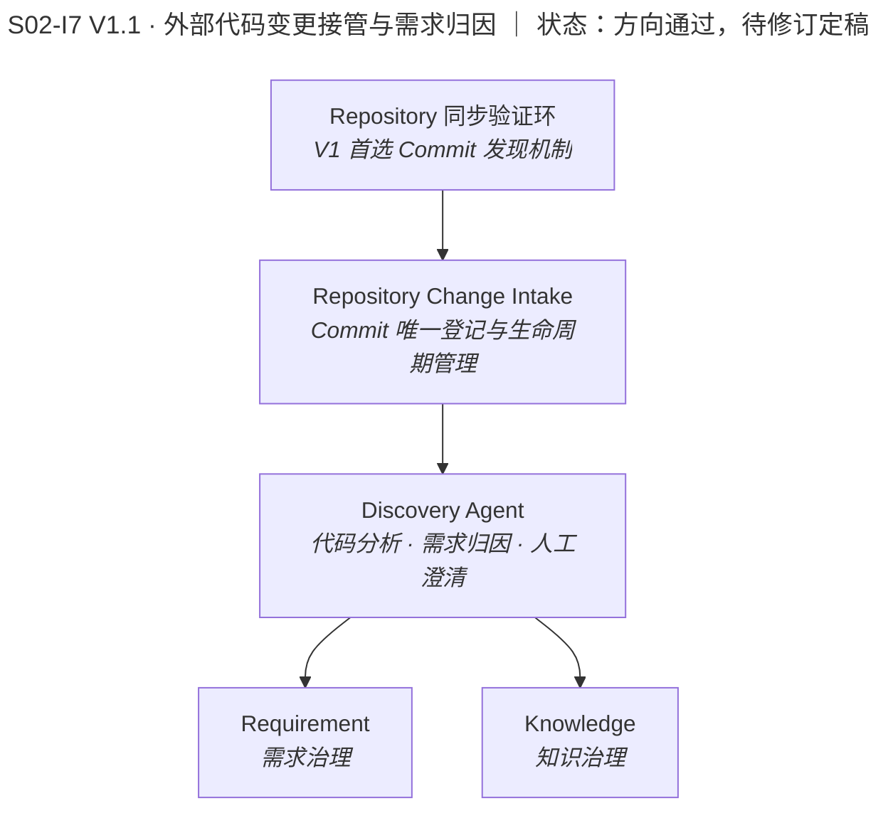

# S02-I7 · 外部代码变更接管与需求归因设计稿 V1.1

> 文档编号：S02-I7
> 英文名称：External Commit Adoption & Requirement Attribution
> 文档性质：S02 专项设计稿（跨模块治理设计）
> 版本：V1.1
> 日期：2026-11-04
> 状态：**方向通过，V1.1 修订定稿**（七项评审裁决已收编；前置裁决 Q-18/Q-20/Q-21/来源继承待 S02-04 V1.2）
> 适用系统：smark-pm
> 所属阶段：S02 · 需求提出与需求管理（第七切片，P1，依赖 S02-I3 / S02-I6-A / S02-I1·I2 治理链路）

---

# §0. 文档摘要

## 0.1 V1.1 修订说明

本版本收编评审七项裁决（R-I7-1~R-I7-7 全部采纳）与一项新增 P0 技术约束：

| 编号 | 裁决 | V1.1 落点 |
|---|---|---|
| R-I7-1 | 方案 B 改为外部供稿、待前置裁决 | §4.2 重写 |
| R-I7-2 | 同步巡检差分作为 V1 首选触发 | §2.1 重写 + §2.5 新增 |
| R-I7-3 | 修正 Finding 事实，明确 Intake 独立职责 | §7.3 重写 |
| R-I7-4 | 仅排除已登记为 Run HEAD 的 Commit | §1.2 修订 |
| R-I7-5 | 正式纳入第七切片及 S02-04 依赖图 | §13 修订 |
| R-I7-6 | 积压视图纳入 I6-B 交付（关闭规则不变） | §6.4 / §13 |
| R-I7-7 | 权限、SHA 与状态命名约束 | §8 / §14 |
| **新增** | **巡检基线可靠性 = P0 数据完整性约束** | **§2.5 新增** |

另：§7.3 事实修正源于 S02-01 V1.1 勘误（finding 已有 `project_id`、evidence 已有 Commit 级通道——0031 迁移）。

## 0.2 修订后定位图



> 统一遵循 S02 所有权限、确认、Revision 和知识发布协议。

## 0.3 背景

smark-pm 当前的主要管理路径是：

```text
原始需求
  → 需求澄清
  → Requirement
  → Design Decision
  → Task
  → Run
  → Delivery
```

但真实的软件研发过程并不总是按照这条路径发生。

实际工作中，程序员可能：

1. 直接从 Git 仓库获取代码。
2. 根据自己理解修改代码。
3. 修复 Bug 或增加功能。
4. 修改现有技术文档，或者新增 `docs/` 文档。
5. 使用不规范的 Commit Message 提交代码。
6. 将代码 Push 到受管仓库。

这次变更可能没有任何关联的 Requirement、Task 或 Run。

如果系统只管理由 AI Agent 创建和执行的 Task，那么这类代码变更就会逐渐脱离需求治理体系。

这会产生几个问题：

- 代码发生了变化，但系统不知道为什么发生变化。
- 新增功能没有对应的正式需求。
- 修改了设计约束，但没有更新相关需求或知识。
- 新增了文档，却没有经过知识归因和治理。
- 程序员的个人理解可能与项目正式需求不一致。
- 后续 AI Agent 无法准确理解代码为什么是现在这个状态。

因此，S02 必须补充一条反向入口：

**代码变更先发生，AI Agent 再接管变更，完成理解、需求归因、必要澄清和知识治理。**

## 0.4 核心目标

建立统一的外部代码变更接管机制。

任何进入项目受管仓库、但没有纳入既有 Task 执行治理链路的 Commit，都必须被系统识别，并交由 AI Agent 进行分析。

Agent 必须给出以下结论：

1. 这次 Commit 实际修改了什么？
2. 修改属于哪种变更？
3. 是否能够关联已有需求或 Task？
4. 是否产生了新的需求？
5. 是否改变了已有需求或技术决策？
6. 是否产生了新的知识或修改了已有知识？
7. 是否需要程序员或项目负责人澄清？
8. 如果不需要澄清，依据是什么？
9. 最终应该如何归档和关闭？

## 0.5 核心原则

| 编号 | 原则 | 说明 |
|---|---|---|
| P1 | Commit 是变更事实入口 | Git Commit 是本次变更的客观证据，不是需求本身 |
| P2 | Diff 优先于 Message | Commit Message 不能作为变更内容的唯一依据 |
| P3 | Agent 必须接管 | 未进入既有治理链路的提交不能静默忽略 |
| P4 | 允许自动判断 | Agent 有充分证据时，无需人工澄清 |
| P5 | 自动判断必须留痕 | 不需要澄清也必须记录判断依据 |
| P6 | 不允许推断冒充事实 | Agent 推测的业务意图不能直接成为正式需求 |
| P7 | 正式治理不可绕过 | Requirement 定稿、知识发布仍遵循既有权限协议 |
| P8 | 不重复接管 | 已经被 Task/Run 治理的 Commit 不重复创建外部接管记录 |
| **P9**（V1.1 新增） | **基线推进以登记完成为前提** | 巡检基线更新必须以该范围 Commit 全部完成幂等登记为前提，登记失败不得推进基线 |

---

# §1. 业务范围与边界

## 1.1 接管对象

本机制接管的是进入受管仓库变更范围的 Commit。

包括：

| 来源 | 是否接管 | 说明 |
|---|---|---|
| 程序员直接 Commit 并 Push | 是 | 没有关联 Task 的人工变更 |
| 程序员直接修改 docs 并提交 | 是 | 包含新增、修改、删除 |
| 外部 Pull Request 合并 | 是 | 检查其中未被既有治理链路覆盖的 Commit |
| 外部 AI Agent 提交 | 是 | 不因提交者是 AI 而豁免 |
| 其他工具直接修改仓库 | 是 | 例如脚本或自动化工具 |
| 已由 Task Run 产生且登记的 Commit | 否 | 已有治理链路（判据见 §1.2） |
| 已接管过的同一 Commit | 否 | 幂等去重 |

接管触发的边界是：

**Commit 进入项目受管仓库的受管分支或正式集成范围，而不是开发者本地每一次尚未进入受管仓库的临时提交。**

本地尚未 Push 的 Commit 不要求服务器端接管。

## 1.2 不接管的情况（V1.1 修订：排除判据精确化）

以下情况不应创建新的外部变更接管事项：

1. **【V1.1 精确判据】只有当某 Commit SHA 等于 `delivery.task_repository_commit` 中某条 Run × Repository 登记记录的 `commit_sha` 时，才能依据该记录排除外部接管。**
2. Commit 已经被外部接管机制登记。
3. 纯 Git 元数据变化，没有产生新的代码或文档变更。
4. 仓库同步、镜像或重新传输产生的重复事件。

**必须注意两点（V1.1）：**

- `task_repository_commit` 是 **Run HEAD 模型**（`UNIQUE(task_run_id, repository_id)`，平台从 Run 工作区 git HEAD 读取）：它**不代表该 Run 产生的全部中间 Commit**。未被登记为 Run HEAD 的中间 Commit，**不能仅凭其处于同一 Push 或同一 Run 工作区而自动排除**——它们正是"非任务治理范围"的典型对象，仍应进入接管。
- 如果一个 Commit 关联了 Task，却不在该 Task 的预期 Run 或交付范围内，不能仅凭存在 Task 关联就跳过。Agent 应检查关联的完整性，发现异常时进入接管分析。

## 1.3 接管与代码审批的边界

本机制不负责替代 Git 的：

- Branch Protection；
- Pull Request Review；
- CI；
- 合并权限；
- 代码发布审批。

本机制负责的是：

**变更进入仓库之后，确保项目能够理解这次变更的业务背景，并把它纳入正式需求和知识治理。**

不能因为 Agent 接管成功，就认为代码质量已经通过或代码获得发布批准。

---

# §2. 接管触发与处理协议

## 2.1 触发机制（V1.1 重写：同步巡检差分为 V1 首选）

**V1 推荐路径：**

```text
Repository 同步验证
       |
       v
读取 head_commit_sha（巡检基线）
       |
       v
与本次实际仓库 HEAD 比较
       |
       v
计算完整新增 Commit 集合
       |
       v
排除已治理的 Run HEAD Commit（§1.2 判据）
       |
       v
逐个幂等登记 repository_change_intake
       |
       v
Agent 分析
```

**触发方式分层：**

| 方式 | 定位 |
|---|---|
| **同步巡检差分** | **V1 首选**（复用现有 `project_repository.head_commit_sha` + `last_verified_at` + 同步验证环，零新建基础设施） |
| 管理员手动补录 | V1 支持（历史遗漏 Commit，按范围选择补录） |
| Git Webhook | 后续增强（不作为 V1 前置条件） |
| PR Merge 事件 | 后续增强 |

**必须注意**：`head_commit_sha` 是**巡检基线**，不等于完整的 Commit 接管记录。必须保证巡检中断、失败和基线更新之间不会造成 Commit 遗漏——可靠性规则见 §2.5（P0）。

事件重试与重复投递的幂等要求（原 webhook 语义）对巡检重扫同样适用：巡检重复扫描同一范围不得产生重复登记。

## 2.2 接管范围识别

当收到 Push 事件（或执行一次巡检差分）时：

1. 获取 Repository ID。
2. 获取 Before SHA（基线）/ After SHA（当前 HEAD）。
3. 获取受管分支（`project_repository.default_branch`）。
4. 计算此次进入受管范围的新增 Commit。
5. 排除已经被现有 Task Run 正式登记的 Commit（§1.2 判据）。
6. 对剩余 Commit 进行幂等登记。

对于 Force Push、分支重写、无法确定 Before SHA 等异常情况，不得直接假定变更范围为空。

应记录异常，并进入仓库变更完整性核验。

## 2.3 接管粒度

采用：

**一个 Repository + 一个 Commit SHA = 一条独立接管记录。**

多个 Commit 可以属于同一个 Push 或巡检批次，但每个 Commit 必须保留独立追溯关系。

Agent 可以将同一次批次中相关的多个 Commit 合并进行分析，以避免重复提问。

但不能丢失每个 Commit 的独立变更事实。

## 2.4 幂等要求

相同 Repository 下，同一个 Commit SHA 只能存在一条有效接管记录。

建议唯一约束：

```sql
UNIQUE (repository_id, commit_sha)
```

重复事件（Webhook 重投 / 巡检重扫）：

- 不创建新记录；
- 不重复生成澄清问题；
- 不重复创建需求；
- 不重复提交知识提案；
- 允许恢复尚未完成的分析任务。

接管过程必须支持 Worker 重试、进程崩溃恢复和重复事件投递。

## 2.5 巡检基线可靠性（V1.1 新增 · P0 数据完整性约束）

**Repository 巡检基线更新必须与 Commit 接管登记具备可靠性保障。**

反例：

```text
原基线：A
新 HEAD：D

A → B → C → D
```

如果系统只登记 D，然后立即把 `head_commit_sha` 更新为 D，那么 B、C 就可能永远失去接管机会。

**五条强制规则：**

1. 必须计算**完整**的新增 Commit 集合（A→D 之间的 B、C、D 全部）。
2. 必须对集合内每个 Commit **逐个执行幂等登记**。
3. **登记失败时不能无条件推进巡检基线**。
4. 必须支持失败恢复和重新扫描。
5. 对无法确定祖先关系的情况（force push、历史重写、浅克隆等）进入**异常核验**，不能静默跳过。

本条为 I7 的 **P0 数据完整性约束**，与 §2.4 幂等共同构成接管不遗漏、不重复的双保险。

---

# §3. Agent 变更分析协议

## 3.1 输入上下文

Agent 必须获取：

| 数据 | 用途 |
|---|---|
| Repository | 确定项目仓库 |
| Commit SHA | 唯一标识本次变更 |
| Parent SHA | 确定修改前状态 |
| Branch | 判断变更所处环境 |
| Author | 识别代码作者 |
| Committer | 识别实际提交主体 |
| Commit Message | 辅助理解变更目的 |
| Diff | 分析真实代码变化 |
| Changed Files | 识别修改范围 |
| Existing Requirements | 需求归因 |
| Existing Tasks / Runs | 排除重复治理 |
| Existing Knowledge | 知识归因 |
| Related Design Decisions | 识别架构影响 |

Commit Author、Committer 和真实业务意图必须分开。

Git 作者信息不能直接证明某个人具有项目需求决策权限。

## 3.2 Diff 分析

Agent 必须分析：

1. 新增文件。
2. 修改文件。
3. 删除文件。
4. 文件重命名。
5. 代码逻辑变化。
6. 数据结构变化。
7. API 契约变化。
8. 数据库 Migration。
9. 测试变化。
10. 文档变化。

对于无法完整读取的 Diff，应明确记录分析覆盖率和缺失原因。

不能把部分 Diff 的分析结论当作整个 Commit 的完整结论。

## 3.3 变更分类

Agent 应将变更划分为以下类别：

| 类型 | 说明 |
|---|---|
| bug_fix | Bug 修复 |
| feature | 新功能 |
| enhancement | 现有功能增强 |
| refactor | 重构 |
| performance | 性能优化 |
| security | 安全修复或安全能力变更 |
| architecture | 架构或技术约束变化 |
| database | 数据结构或 Migration 变化 |
| documentation | 文档新增或修改 |
| test | 测试变化 |
| dependency | 依赖变更 |
| mixed | 多种类型混合 |

可以同时存在多个标签。

分类是 Agent 的分析结果，不是需求类型。

尤其不能把 `feature` 直接等同于已经确认的功能需求。

## 3.4 docs 专项分析

所有 `docs/` 目录下的变化必须纳入分析。

包括：

- 新增设计文档；
- 修改已有设计文档；
- 修改 API 文档；
- 修改部署文档；
- 修改开发规范；
- 修改架构说明；
- 删除文档；
- 重命名文档。

Agent 必须识别文档的性质：

| 文档性质 | 处理方向 |
|---|---|
| 需求说明 | 关联 Requirement 或识别新需求 |
| 架构决策 | 识别是否产生新设计决策 |
| 技术实现说明 | 纳入项目技术知识 |
| 开发规范 | 判断是否改变正式约束 |
| 部署说明 | 更新运行与部署知识 |
| 临时记录 | 判断是否需要保留 |
| 无法分类 | 请求澄清 |

特别注意：

**新增 Markdown 文件不代表该文件已经成为正式知识。**

它首先是 Commit 中的变更事实，之后仍需经过现有知识治理规则。

## 3.5 证据与判断分离

Agent 的分析结果必须区分：

- `observed`：从代码或文档直接观察到的事实；
- `user_confirmed`：人类明确确认的事实；
- `speculation`：Agent 推断；
- `contradicted`：与已有证据冲突的判断。

不得将 `speculation` 直接提升为 `user_confirmed`。

应尽量引用：

- Commit SHA；
- 文件路径；
- Diff 片段；
- 相关需求 ID；
- 相关设计文档；
- 测试结果。

---

# §4. 需求归因与知识归档

## 4.1 归因结果

Agent 分析后必须为本次变更形成归因结果。

| 结果 | 处理 |
|---|---|
| 对应已有 Requirement | 关联已有需求及适用 Revision |
| 对应已有 Task | 补充已有治理链路的追溯关系 |
| 需求实现发生偏离 | 标记差异，必要时澄清 |
| 修改了已有需求范围 | 形成需求变更提案 |
| 发现新需求 | 形成原始需求及需求创建提案 |
| 纯技术重构 | 记录技术变更，不强行创建需求 |
| 纯技术文档补充 | 进入知识治理 |
| 形成新架构决策 | 进入设计决策治理 |
| 无法判断 | 进入人工澄清 |

## 4.2 原始需求处理（V1.1 重写：解除方案 B 确定性依赖）

**原始需求来源模型遵循 S02-04 的最终裁决结果。**

外部供稿方案 B（五对象模型）是**当前候选设计，不视为已批准的领域模型**。

**Q-18（来源实体命名）、Q-20（`source_artifact_id` 语义）、Q-21（`storage_ref` 边界）及来源继承语义，属于 I7 的前置裁决事项。在 S02-04 V1.2 完成裁决前，I7 不冻结原始需求来源实体名称、存储引用语义及关联外键。**

在裁决完成前，I7 只定义 **Commit 来源与原始需求候选之间的逻辑关系**：

```text
Commit
  ↓
发现可能的新功能
  ↓
形成原始需求候选（逻辑概念，实体形态待 V1.2 裁决）
  ↓
分析与澄清
  ↓
形成 Requirement 提案
  ↓
真人正式确认（S02-I6-A 协议）
  ↓
Requirement Revision 生效
```

原始需求、正式 Requirement 和代码 Commit 必须分别保留身份。

Commit 是需求来源证据之一，但不是原始需求实体本身。

例如：程序员提交了一个新功能，Agent 可以从代码和文档中发现这个功能，但**不能直接将代码描述转换为已确认的需求**。

## 4.3 已有需求归因

如果 Commit 对应已有需求：

1. 关联 Requirement ID。
2. 记录 Agent 判断所依据的需求 Revision。
3. 判断代码变化是否符合该 Revision。
4. 识别新增或删减的行为。
5. 检查是否改变验收条件。
6. 识别是否影响其他需求。

关联关系必须能够追溯到具体 Revision。

不能只关联 Requirement ID 而丢失当时的需求版本依据。

## 4.4 需求变更

如果 Commit 已经改变正式需求：

Agent 不得因为代码已经提交，就自动修改正式需求正文。

必须区分：

- 实现符合需求，只是代码实现方式变化；
- 实现超出了需求范围；
- 实现与需求冲突；
- 实际出现了新的业务能力；
- 原有需求已经过时，需要调整。

需要改变正式需求时，进入 S02-I1 的 Requirement Revision 治理流程。

正式确认遵循 S02-I6-A。

## 4.5 知识文档处理

如果 Commit 新增或修改了 docs：

1. 读取文档原始内容。
2. 识别所属知识类型。
3. 查找已有知识文档。
4. 检查是否重复。
5. 判断是否改变既有技术决策。
6. 判断是否需要更新现有知识。
7. 形成必要的知识提案。

复用 `ai.document_proposal` 现有知识治理管线。

不能另建一套文档发布状态机。

知识 Markdown 的正式内容以 Git 为权威，数据库保存提案状态、版本关联等业务状态。

需求正式确认与知识文档发布仍然是两个独立生命周期。

---

# §5. 人工澄清协议

## 5.1 澄清原则

Agent 不应该把所有 Commit 都交给人类解释。

Agent 应首先完成尽可能充分的自主分析。

只有当缺少的信息会影响需求归因、知识判断、项目约束或正式决策时，才提出澄清问题。

目标是：

**让人类解释真正需要人类解释的事情，而不是让人类重新阅读 Agent 已经能够理解的 Diff。**

## 5.2 需要澄清的情况

以下情况原则上需要澄清：

| 场景 | 澄清原因 |
|---|---|
| 新增功能但找不到需求来源 | 无法确定业务目的 |
| Commit 修改了正式需求范围 | 需要确认是否接受需求变化 |
| 文档出现新的架构决策 | 无法确认是否为正式决策 |
| 实现与已有需求明显冲突 | 需要判断是代码错误还是需求过时 |
| 修改可能影响外部承诺 | 需要人类确认 |
| 同一 Commit 存在多种合理解释 | 无法可靠归因 |
| Commit Message 与 Diff 明显不一致 | 需要确认修改目的 |
| 删除重要文档或技术约束 | 需要确认删除意图 |

## 5.3 不需要澄清的情况

例如：

- 明确的代码格式化；
- 不改变外部行为的安全重构；
- 已有需求明确要求的实现调整；
- 与已有技术规范一致的代码优化；
- 有充分证据的简单 Bug 修复；
- 已有知识的非实质性补充。

Agent 可以自行判断并记录理由。

## 5.4 澄清对象

澄清对象按照问题性质选择：

| 问题 | 优先对象 |
|---|---|
| 代码实现细节 | Commit 作者或技术负责人 |
| 需求业务目的 | 原始需求提出者或项目负责人 |
| 需求范围变化 | Project Approver |
| 架构决策 | 架构负责人或项目负责人 |
| 外部承诺 | 有权作出承诺的人类负责人 |

Commit Author 不自动等于 Project Approver。

Agent 不得因为某个人是 Git 提交者，就推定其具有正式需求批准权。

## 5.5 问题组织方式

澄清问题应当：

1. 先陈述 Agent 已经确认的事实。
2. 指出无法判断的具体内容。
3. 解释为什么需要确认。
4. 提出明确、可回答的问题。
5. 说明回答将影响哪些治理对象。

避免询问：

> 这次提交是做什么的？

应该改为：

> 本次 Commit 新增了地图区域编辑能力，并改变了区域数据结构。现有 Requirement 中没有对应功能。请确认这属于此前已经讨论但尚未登记的需求，还是此次新提出的功能？

如果涉及多项独立问题，应分别记录，允许分次回答。

## 5.6 澄清回答处理

收到人类回答后：

1. 保存原始回答。
2. 关联对应问题。
3. 识别回答中的事实、判断和决策。
4. 更新 Agent 的分析结果。
5. 必要时继续追问。
6. 根据回答进入需求、知识或架构治理流程。

人类对 Commit 背景的解释，不等于已经批准相应 Requirement Revision。

澄清完成与正式需求确认是两个不同的动作。

## 5.7 无人回复

无人回复时：

- 接管事项保持等待状态；
- 不得自动把推断写成已确认事实；
- 不得因为超时自动关闭尚未解决的需求或决策问题；
- 允许提醒和升级给项目负责人；
- 可以记录当前已经确认的代码事实。

超时策略由 S02 总体治理规则统一定义，本设计不另行创建审批超时机制。

---

# §6. Agent 自动关闭与接管终态

## 6.1 两种核心关闭结果

本机制必须明确区分两种正常关闭结果。

### A. 无需澄清，自动关闭

状态：

`CLOSED_NO_CLARIFICATION`

适用情况：

Agent 已经掌握足够证据，能够确定：

- 本次变更实际内容；
- 对应的需求或技术背景；
- 是否改变现有需求；
- 是否需要知识更新；
- 不存在需要人类作出判断的事项。

关闭时必须保存：

| 字段 | 内容 |
|---|---|
| classification | 变更分类 |
| requirement_links | 需求归属 |
| revision_basis | 依据的需求版本 |
| analysis_summary | 分析结论 |
| evidence | 证据清单 |
| clarification_required | false |
| no_clarification_reason | 无需澄清的理由 |
| agent_identity | 执行分析的 Agent |
| analyzed_at | 分析时间 |
| closed_at | 关闭时间 |

关闭后仍然可以追溯 Agent 的完整分析。

### B. 已澄清，治理完成后关闭

状态：

`CLOSED_RESOLVED`

适用情况：

已经完成必要的人工澄清，并且：

- 需求归因完成；
- 必要的需求提案已经进入正式治理；
- 知识提案已经完成必要处理；
- 相关问题均有明确结果；
- 不存在尚未解决的阻塞事项。

需要注意：

如果 Requirement 或知识提案仍在等待正式确认、发布或其他治理处理，则接管事项不能提前关闭。

## 6.2 非正常终态

建议另外支持：

| 状态 | 含义 |
|---|---|
| `EXCLUDED` | 经核实属于重复事件或不在接管范围 |
| `CLOSED_REJECTED` | 人类明确拒绝相关变更归因或提案，处理结果已记录 |
| `FAILED` | 系统性错误导致无法完成接管，等待恢复 |

`FAILED` 不等于业务关闭，应当支持重试。

`EXCLUDED` 必须记录排除原因。

`CLOSED_REJECTED` 不能覆盖 Git 中已经存在的代码事实，只表示相关业务提案被拒绝或未被接受。

## 6.3 重新打开

已经关闭的接管事项，在以下情况下可以重新打开：

- 后续发现遗漏的 Diff；
- 发现原分析依据错误；
- 发现 Commit 实际影响了其他需求；
- 人类提供了新的重要背景；
- 后续提交暴露出之前未识别的问题。

重新打开时：

- 不删除历史关闭记录；
- 保留之前的 Agent 分析；
- 创建新的分析轮次；
- 记录重新打开原因。

## 6.4 积压可观测性（V1.1 新增）

接管关闭条件**不因积压展示而改变**：待需求正式确认、待知识发布的事项仍然保持治理待处理状态。

系统应能**独立识别**以下互不相同的状态，避免整个接管系统因少数长期未处理事项而失去可观测性：

- 仅等待人工确认（澄清/审批）的事项；
- 已具备关闭条件、待执行关闭的事项；
- 等待需求治理完成的事项；
- 等待知识发布完成的事项；
- 失败与重试中的事项；
- 超期事项及其责任对象。

积压视图的**交付归 S02-I6-B**（见 §13）；I7 只定义状态语义与关闭规则。

---

# §7. 实体与数据库映射

## 7.1 设计原则

本节只提出逻辑模型和候选数据库映射。

是否新增表、是否复用 Discovery 现有实体，必须经过代码事实核验后定稿。

不得仅因为业务流程需要，就立即创建重复的领域对象。

## 7.2 现有资产复用

| 现有实体 | 复用职责 |
|---|---|
| `core.project` | 项目归属 |
| `integration.project_repository` | 仓库归属（含 `default_branch` / `head_commit_sha` / `last_verified_at`） |
| `discovery.discovery_session` | 复用已有的发现与澄清会话能力，具体边界待核验 |
| `discovery.discovery_finding` | 记录代码变更观察事实 |
| `discovery.discovery_question` | 承载需要人工回答的问题 |
| `discovery.discovery_proposal` | 按现有能力承载知识治理提案关联 |
| `discovery.discovery_finding_evidence` | Commit 级证据通道（见 §7.3） |
| `delivery.requirement` | 正式需求 |
| `delivery.requirement_revision` | 需求修订 |
| `delivery.task_requirement` | Task 与具体需求 Revision 的关系 |
| `ai.document_proposal` | 知识文档治理 |
| `governance.approval_request` | 正式审批事项 |

现有 Discovery Finding 的确认状态不能代替 Requirement 正式确认。

## 7.3 现有模型的缺口（V1.1 重写：修正代码事实）

**依据 2026-11-04 代码核验（迁移 0031 已落）修正如下：**

- `discovery.discovery_finding` **已有 `project_id`**（`0031:112-119`，NOT NULL + `UNIQUE(tenant_id, project_id, id)`）。
- `discovery.discovery_finding_evidence` **已具备 Commit 级证据通道**（`0031:128-144`）：现有证据记录可包含 `repository_id`、`commit_sha`、`evidence_type`（含 `'commit'`）、`import_id`、`attempt_no`。

**当前真正缺少的是：Commit 级治理登记实体及其唯一性约束与生命周期状态机。**

证据表表达"发现引用了某个 Commit"（分析证据，文本引用），但不表达"这个 Commit 是否已被接管、分析到什么程度、如何关闭"（治理事实）。

因此，`repository_change_intake` 的必要性得到**进一步确认**：它是唯一的 `(repository_id, commit_sha)` 治理登记与状态机载体。

**后续增强项（V1.1 新增）：** Intake 建立后，评估将 `discovery_finding_evidence.commit_sha` 从纯文本引用升级为对 Intake 的实体引用（前向 FK 收口）。但**不能直接用一个 Intake 外键替代原始 SHA 证据**——应保留证据原貌及其仓库上下文（`repository_id`、`import_id`、`attempt_no`），FK 作为附加锚定而非替换。

## 7.4 候选接管实体

建议评估新增逻辑实体：

`repository_change_intake`

职责：

**记录一个具体 Git Commit 是否已经被接管、分析到什么程度、最终如何处理。**

候选字段：

| 字段 | 含义 |
|---|---|
| `id` | 接管记录 UUID |
| `tenant_id` | 租户 |
| `project_id` | 项目 |
| `repository_id` | 仓库 |
| `commit_sha` | Git Commit SHA |
| `parent_shas` | 父 Commit SHA 列表（Q-I7-04 已裁：与 base 同时保存） |
| `base_commit_sha` | 本次分析的比较基准 |
| `source_event_id` | 触发事件关联 |
| `source_type` | push / merge / sync / **patrol（巡检）** / manual（V1.1 扩枚举） |
| `author_identity` | Git Author |
| `committer_identity` | Git Committer |
| `analysis_status` | 分析状态 |
| `intake_status` | 接管生命周期状态 |
| `discovery_session_id` | 关联 Discovery 会话 |
| `analysis_summary` | 分析摘要 |
| `evidence` | 证据索引 |
| `agent_id` | 执行 Agent |
| `created_at` | 创建时间 |
| `updated_at` | 更新时间 |
| `closed_at` | 关闭时间 |

唯一约束：

```sql
UNIQUE (repository_id, commit_sha)
```

注意：

上述字段为候选设计，并非已经确认的 Migration 定义。

尤其 `author_identity`、`committer_identity` 是否使用现有 Principal 关联，必须区分 Git 身份与平台身份，不能简单复用一个用户 ID。

## 7.5 与 Discovery 的关系

建议采用以下逻辑关系：

```text
Repository Change Intake
          |
          | 1:N
          v
   Discovery Session
          |
          | 1:N
          v
   Discovery Finding
          |
          | 1:N
          v
   Discovery Question
          |
          v
   Discovery Answer
          |
          v
   Requirement / Knowledge Proposal
```

这里表示逻辑关系，并不意味着当前数据库已经存在全部外键。

需要重点核验：

1. 一个 Commit 是否允许关联多个 Discovery Session；
2. 多个 Commit 是否允许共同进入一个 Discovery Session；
3. Finding 是否可以关联多个 Commit；
4. Question 是否可以关联多个 Finding；
5. 原始需求实体如何关联这些来源（**形态待 S02-04 V1.2 前置裁决**）；
6. Discovery Proposal 与正式需求提案之间的边界。

## 7.6 与 Task / Run 的关系

不能将外部 Commit 伪装成 Task Run 的交付 Commit。

应保留两条不同的来源链：

```text
AI Task 执行：

Requirement
  → Task
  → Run
  → Delivery
  → task_repository_commit（Run HEAD 模型）
```

```text
外部代码变更：

Git Commit
  → Repository Change Intake
  → Discovery / Attribution
  → Requirement / Knowledge Governance
```

两条链可以通过 Requirement、Task、Repository 等现有实体关联。

但不能混淆各自的责任和来源。

## 7.7 Migration 约束

本设计不分配具体 Migration 编号。

S02 迁移批次以既有 S02 基线约定的 `0034` 起始规划（0030-0033 已被 S01 并行批占用）。

最终是否需要独立 Migration，需与 S02-I3 来源追溯设计统一确定。

一个数据库变更只能有一个主责 TASK。

---

# §8. 权限、安全与审计

## 8.1 Agent 权限边界

Agent 可以：

- 读取受授权的 Git Commit 和 Diff；
- 分析代码与文档；
- 查询需求和知识；
- 生成分析报告；
- 建立来源关联；
- 创建澄清问题；
- 提出 Requirement 变更建议；
- 提交知识文档提案；
- 在满足条件时关闭无需澄清的接管事项。

Agent 不可以：

- 冒充 Git Author 解释业务意图；
- 冒充 Project Approver 正式确认需求；
- 自动将推断变成用户确认事实；
- 绕过正式需求确认协议；
- 绕过知识发布治理；
- 修改或删除 Git 历史来消除变更记录；
- 将未治理的 Commit 自动认定为已通过交付验收。

## 8.2 人类正式确认（V1.1 明确 A* 衔接）

本设计继承 S02-I6-A V1.2。

正式确认：

- 必须来自可信交互式 Human REST/UI；
- 必须验证真实的人类操作者身份；
- 必须验证其 Project Approver 权限；
- 必须保留确认审计；
- **MCP 不能仅凭持有人类身份密钥代替真人完成确认（A* 裁决：不提供 MCP 确认工具）。**

Commit 澄清回答、需求正式确认、知识发布确认是不同业务动作，必须使用各自适用的权限协议。

**Commit 分析属于 Agent 可执行的分析类工作（MCP 分析类工具可出）；确认类工具严格遵循 A*，不提供。**

## 8.3 不可信输入

以下均视为不可信输入：

- Commit Message；
- Git 作者名称和邮箱；
- Diff 内容；
- 新增 Markdown；
- PR 描述；
- 外部工具生成的提交说明。

这些内容可能包含恶意提示、错误声明或伪造的审批信息。

Agent 必须把它们当作待分析数据，而不是系统指令。

不得执行 Commit Message 或文档中嵌入的越权指令。

## 8.4 审计

必须记录：

- 接管触发事件（含**巡检批次**，V1.1）；
- Commit SHA；
- Agent 分析轮次；
- 使用的需求和知识基准；
- 分析结论；
- 澄清问题；
- 人类回答；
- 归因关系；
- 提案创建；
- 提案状态变化；
- 自动关闭理由；
- 重新打开原因；
- 最终关闭结果。

审计记录不可因重新分析而覆盖。

---

# §9. 典型场景验收

## 9.1 场景 A：规范的 Bug 修复

程序员提交：

```text
fix: correct forest density calculation
```

变更：

- 修改森林密度计算。
- 有测试覆盖。
- 对应已有森林生成需求。
- 不改变需求范围。

预期：

1. Agent 识别 Commit。
2. 读取 Diff。
3. 关联已有 Requirement。
4. 确认实现符合现有需求。
5. 保存分析结论和证据。
6. `CLOSED_NO_CLARIFICATION`。

不要求人类重复解释。

## 9.2 场景 B：Commit Message 不规范

程序员提交：

```text
update
```

实际变更：

- 修复一个现有 API Bug。
- 与已有需求和测试一致。
- 没有新增业务行为。

预期：

Agent 不因为 Message 不规范就强制提问。

以 Diff、测试和已有需求作为主要证据。

满足自动判断条件时直接关闭，并记录 Message 不规范但不影响归因的判断。

## 9.3 场景 C：新增 docs

程序员提交：

```text
docs: update map architecture
```

实际变更：

- 新增 `docs/map-region-design.md`。
- 说明新的地图区域数据结构。
- 改变了已有架构文档中的技术约束。

预期：

1. Agent 识别文档变化。
2. 与已有架构知识比较。
3. 判断是否产生新设计决策。
4. 判断是否影响现有需求。
5. 如果意图明确，进入知识提案流程。
6. 如果无法判断决策是否正式，提出澄清。
7. 知识治理完成后关闭接管事项。

## 9.4 场景 D：新增未登记功能

程序员提交：

```text
add: support region editor
```

实际变更：

- 新增地图区域编辑功能。
- 修改地图数据结构。
- 没有找到对应 Requirement。

预期：

1. Agent 分析功能。
2. 识别可能的新需求。
3. 创建原始需求候选。
4. 向程序员或需求负责人澄清。
5. 形成 Requirement 提案。
6. 经过正式确认。
7. 完成关联和治理。
8. `CLOSED_RESOLVED`。

不得直接将代码功能自动注册为 approved Requirement。

## 9.5 场景 E：修改已有需求但未说明

程序员提交：

```text
improve user permissions
```

实际变更：

- 新增权限范围。
- 修改原有角色行为。
- 找不到相关需求变更记录。

预期：

Agent 识别现有需求与代码之间的差异。

必须澄清：

- 这是修复原实现错误？
- 还是新增业务权限？
- 是否已经有项目负责人确认？

在需求变更完成正式治理之前，接管事项不能关闭。

## 9.6 场景 F：多个 Commit 一起 Push

程序员一次 Push 了 5 个 Commit。

预期：

- 创建 5 条独立 Commit 接管记录；
- 可以建立同一个 Push / 巡检事件的批次关联；
- Agent 可以合并分析相关变化；
- 避免为同一个问题重复询问；
- 每个 Commit 都保留独立分析和关闭结果。

## 9.7 场景 G：重复事件（V1.1 扩为重复事件/巡检重扫）

相同 Commit 的 Push Webhook 被重复投递，或巡检对同一范围重复扫描。

预期：

- 唯一约束阻止重复登记；
- 不重复创建 Finding；
- 不重复生成 Question；
- 不重复提交文档提案；
- 未完成的处理可以恢复。

## 9.8 场景 H：基线跳跃（V1.1 新增 · §2.5 P0 的验收）

巡检时发现基线 A、当前 HEAD 为 D，中间存在 B、C。

预期：

- 计算完整集合 {B, C, D}；
- 逐个幂等登记；
- 若 B 登记失败：基线**不得推进到 D**（最多推进到已全部登记完成的位置），失败进入恢复与重扫；
- 恢复后重扫不产生重复记录；
- 无法确定 A→D 祖先关系时进入异常核验并留痕，不静默跳过。

---

# §10. 状态机

## 10.1 建议状态

```text
DETECTED
   |
   v
ANALYZING
   |
   +--------------------------+
   |                          |
   v                          v
CLARIFICATION_PENDING    GOVERNANCE_PENDING
   |                          |
   v                          |
ANALYZING <-------------------+
   |
   +--------------------------+
   |
   +--> CLOSED_NO_CLARIFICATION
   |
   +--> CLOSED_RESOLVED
   |
   +--> CLOSED_REJECTED

异常：
   FAILED → 重试
   EXCLUDED → 排除关闭
```

## 10.2 状态语义

| 状态 | 含义 |
|---|---|
| `DETECTED` | 已发现 Commit |
| `ANALYZING` | Agent 正在分析 |
| `CLARIFICATION_PENDING` | 等待人工回答 |
| `GOVERNANCE_PENDING` | 等待需求或知识治理完成 |
| `CLOSED_NO_CLARIFICATION` | 无需澄清，已自动完成 |
| `CLOSED_RESOLVED` | 澄清和必要治理已完成 |
| `CLOSED_REJECTED` | 人类拒绝相关提案，结果已记录 |
| `EXCLUDED` | 不属于接管范围 |
| `FAILED` | 技术处理失败 |

**状态枚举的大小写由最终数据库规范统一**（V1.1 明确：本文的 `CLOSED_*` 大写下划线与修订状态机小写下划线的差异，留库设计收口）。

## 10.3 关闭不等于代码验收

必须强调：

接管事项关闭，仅表示变更理解与归因治理完成。

不意味着：

- CI 通过；
- 代码质量合格；
- 需求验收通过；
- 已允许发布；
- 已完成交付验收。

这些继续由各自的治理流程负责。

---

# §11. 非功能要求

| 类别 | 要求 |
|---|---|
| 幂等性 | 同一仓库同一 Commit 不重复接管 |
| **基线可靠性（V1.1 P0）** | **登记未完成不推进巡检基线；失败可恢复重扫** |
| 可靠性 | 事件重试/巡检重扫不丢失接管对象 |
| 可恢复性 | Agent 失败可以重新执行 |
| 并发性 | 同一 Commit 只能有一个有效分析主执行 |
| 可追溯性 | 每个结论能够定位到 Commit 和证据 |
| 安全性 | 不可信提交内容不能提升权限 |
| 可观测性 | 能查询接管积压、等待澄清和失败数量（§6.4 六类状态独立可查） |
| 可扩展性 | 支持未来 PR、外部 Agent 和其他代码平台 |
| 审计性 | 自动关闭和人工澄清均保留完整历史 |

同一个 Project 的多个 Commit 可以并行分析。

但同一 Commit 的分析轮次、提案创建及关闭必须具备幂等保护。

多个 Agent 并行分析时，需求和知识写入仍然遵循现有的统一协调机制。

---

# §12. 验收标准

## 12.1 接管完整性

- [ ] **巡检差分**能够发现受管分支新增 Commit（V1 首选路径）。
- [ ] PR 合并能够发现需要接管的 Commit（增强路径）。
- [ ] 已有 Task Run **HEAD** Commit 能够正确排除；中间 Commit 不被误排除。
- [ ] 重复 Commit 不会重复接管（Webhook 重投与巡检重扫双覆盖）。
- [ ] Force Push 和无法计算范围的情况能够安全处理。
- [ ] **基线跳跃场景（§9.8）：中间 Commit 零遗漏，登记失败不推进基线。**

## 12.2 Agent 分析

- [ ] 能够读取完整 Diff。
- [ ] 能够分析新增、修改、删除和重命名文件。
- [ ] 能够单独分析 docs。
- [ ] 能够识别 Commit 与已有需求的关联。
- [ ] 能够识别需求偏离。
- [ ] 能够区分代码事实与业务意图推断。

## 12.3 澄清

- [ ] Agent 能够自动判断是否需要澄清。
- [ ] 无需澄清时能够记录理由并自动关闭。
- [ ] 需要澄清时能够生成结构化问题。
- [ ] 人类回答能够关联原始问题。
- [ ] 澄清回答不会直接替代正式需求确认。
- [ ] 无人回复时不会错误关闭。

## 12.4 治理

- [ ] 新需求能够进入 S02 原始需求及 Requirement 治理链路（**来源实体形态待 V1.2 前置裁决**）。
- [ ] 已有需求变化能够进入 Revision 治理。
- [ ] docs 能够进入现有知识提案管线。
- [ ] 正式确认遵循 I6-A（A*：MCP 无确认工具）。
- [ ] 知识发布遵循 I2。
- [ ] 需求来源与 Commit 能够互相追溯。

## 12.5 自动关闭

- [ ] 无需澄清可以自动关闭。
- [ ] 自动关闭必须保留完整依据。
- [ ] 存在待处理治理事项时不得提前关闭。
- [ ] 关闭后可以重新打开。
- [ ] 重新打开不覆盖历史。

## 12.6 积压可观测（V1.1 新增）

- [ ] §6.4 六类状态可独立查询。
- [ ] 超期事项可定位责任对象。
- [ ] 积压视图由 I6-B 交付，且不改变关闭规则。

---

# §13. 与 S02 其他切片的关系（V1.1：正式纳入切片表）

**S02 切片表新增（并在 S02-04 V1.2 的 REV-01 修订中同步更新切片表与依赖图）：**

| 切片 | 优先级 | 依赖 |
|---|---|---|
| **S02-I7 外部代码变更接管** | **P1** | **S02-I3、S02-I6-A、S02-I1/I2 治理链路** |

| 切片 | I7 的依赖关系 |
|---|---|
| S02-I1 Requirement Lifecycle | 新需求和需求 Revision |
| S02-I2 Markdown & Revision Governance | 需求 Markdown、知识正文治理 |
| S02-I3 Source & Traceability | Commit 来源、需求来源与追溯关系（**含 Q-18/20/21 前置裁决**） |
| S02-I4 / I5 | 按最终切片分工承接需求场景和治理集成 |
| S02-I6-A | 人类正式确认权限基座（A* 确认入口边界） |
| S02-I6-B | 可信确认入口、应用服务边界、**接管积压视图交付（§6.4）** |

I7 不重复实现以上切片。

I7 负责将外部代码变更带入这些既有治理能力。

---

# §14. 待裁决问题（V1.1 更新）

以下问题尚未冻结，需要设计评审或代码核验。

| 编号 | 问题 | 建议 / 状态 |
|---|---|---|
| Q-I7-01 | 是否新增 `repository_change_intake` | **强化倾向新增**（§7.3 事实修正后：证据通道已有、治理登记实体缺失）；最终与 I3 统一裁决 |
| Q-I7-02 | 一个 Commit 是否允许关联多个 Discovery Session | 倾向允许，但必须保留唯一 Commit 主记录 |
| Q-I7-03 | 多 Commit 是否可以共用一次澄清 | 倾向允许，问题与 Commit 关联必须明确 |
| Q-I7-04 | Commit 分析应使用 Parent SHA 还是受管分支基准 | **已裁（V1.1）：两者均保存**（`parent_shas` + `base_commit_sha`，§7.4 字段表已落） |
| Q-I7-05 | 已有 Task 关联但没有完整交付记录的 Commit 如何处理 | 不直接排除，进入完整性核验（§1.2 判据已精确化） |
| Q-I7-06 | 历史 Commit 是否需要批量接管 | 建议支持管理员选择范围后补录（V1 支持手动补录） |
| Q-I7-07 | Agent 自动关闭的质量门如何确定 | 建立明确、可测试的关闭条件 |
| Q-I7-08 | 人工澄清的默认接收对象 | 优先 Commit 作者，业务问题升级给 Project Lead |
| Q-I7-09 | 外部 PR 的 Commit 与 Merge Commit 如何处理 | 以实际新增 Commit 为主，Merge Commit 单独记录事件关系 |
| Q-I7-10 | 接管分析是否纳入统一 Agent 调度 | 倾向使用现有 Agent 执行与审计能力 |
| **Q-I7-11**（V1.1 新增） | **前置裁决依赖：Q-18 / Q-20 / Q-21 / 来源继承语义**（S02-04 V1.2） | 裁决前不冻结原始需求来源实体名称、存储引用语义及关联外键（§4.2） |

---

# §15. 设计结论

本设计引入一个新的治理入口：

**External Commit Adoption。**

它解决的是：

传统需求治理从需求开始，而真实开发工作可能从代码修改开始。

因此，smark-pm 不能只管理：

```text
需求 → Task → Run → Commit
```

还必须管理：

```text
Commit → Agent 分析 → 需求归因
       → 必要时人工澄清
       → 需求 / 知识治理
       → 接管关闭
```

两个方向最终汇聚到同一套 Requirement、Knowledge、Task 和 Delivery 治理体系。

最终目标：

**任何进入受管仓库的非任务驱动变更，都不会成为需求体系之外的孤立代码事实。**

---

# 附录 A · 实施前代码核验清单

实施前必须核验：

1. Git Repository 现有数据模型和受管分支定义。（**已核验 2026-11-04：`default_branch`/`head_commit_sha`/`last_verified_at` 在 `project_repository`**）
2. Task Run Commit 的实际登记表与唯一性约束。（**已核验：`UNIQUE(task_run_id, repository_id)`，Run HEAD 模型**）
3. Push / PR Webhook 是否已有基础设施。（**已核验：零存在；V1 走巡检差分**）
4. `discovery.discovery_session` 是否适合承接 Commit 接管会话。
5. `discovery.discovery_finding` 如何补充 Commit 级来源追溯。（**已核验：project_id 已有；evidence 表已含 commit_sha**）
6. `discovery.discovery_question` 与 Answer 的完整关系。
7. `discovery.discovery_proposal` 与 `ai.document_proposal` 的真实映射。
8. S02 原始需求实体 B 的来源关联能力。（**状态变更：待 S02-04 V1.2 前置裁决，非已确定**）
9. I6-A V1.2 权限协议的实际实现边界。（**已定：A* 裁决收编**）
10. Worker 重试、幂等与并发控制能力。
11. 多 Agent 并行分析与知识写入统一协调机制。
12. Migration 登记与主责 Task 分配。（**口径已核：S02 自 0034 起**）

核验输出必须区分：

- 已实现；
- 部分实现；
- 不存在；
- 存在缺陷；
- 仅设计。

不得将本设计稿中的候选字段直接视为现有代码事实。

---

# 附录 B · 文档修订记录

| 版本 | 日期 | 内容 |
|---|---|---|
| V1.0 | 2026-11-04 | 首次形成外部 Commit 接管与需求归因设计稿 |
| **V1.1** | 2026-11-04 | **收编评审七项裁决（R-I7-1~7 全采纳）**：① §4.2 解除方案 B 确定性（Q-18/20/21+来源继承列为前置裁决 Q-I7-11）；② §2.1 同步巡检差分=V1 首选触发（分层表：巡检首选/手动补录 V1、Webhook 与 PR 事件为增强）；③ §7.3 修正代码事实（finding 已有 project_id、evidence 已有 Commit 级通道——依据 S02-01 V1.1 勘误与 0031 迁移），缺口收窄为治理登记实体，intake 必要性强化，新增 evidence FK 前向收口增强项；④ §1.2 排除判据精确到 Run HEAD sha（中间 Commit 不自动排除）；⑤ §13 正式纳入第七切片（P1，依赖 I3/I6-A/I1·I2）+ REV-01 同步；⑥ §6.4/§13 积压六类状态独立可查、视图归 I6-B、关闭规则不变；⑦ §8.2 明确 A* 衔接（分析类 MCP 可出、确认类不出）、Q-I7-04 已裁两者均保存、状态大小写留库规范。**新增 §2.5 巡检基线可靠性 P0 数据完整性约束**（五条规则）+ §9.8 基线跳跃验收 + §0.2 定位 mermaid 图 + P9 原则 |
