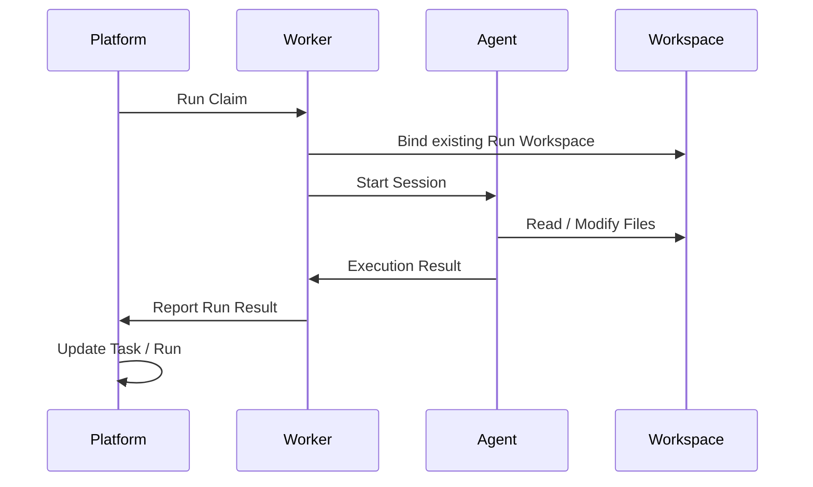
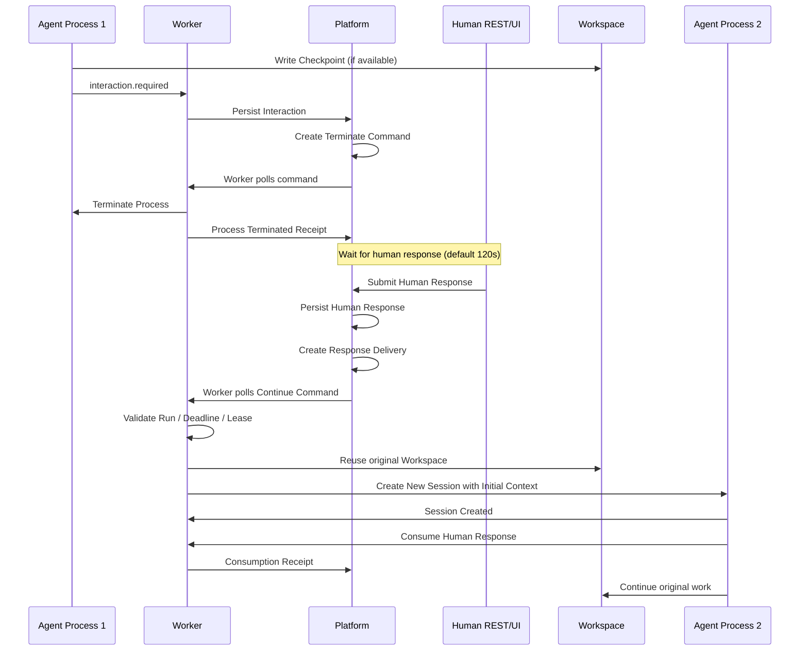

# S03-ACP Agent Communication Protocol V1.3.1
## Task-Based Continuation — 正式修订设计稿

| 文档属性 | 内容 |
|---|---|
| 文档编号 | S03-ACP |
| 文档名称 | Agent Communication Protocol — Task-Based Continuation |
| 版本 | V1.3.1 |
| 文档状态 | 修订设计稿，待独立评审 |
| 修订日期 | 2026-11-06 |
| 前置版本 | S03-ACP V1.3 |
| 代码核验基线 | `ai-pm master @ db466ab (2026-11-06)` |
| 修订依据 | V1.3 Task-Based Continuation 评审报告 V1.0；用户确认的七项裁决 |
| 适用范围 | Model B：Worker spawn Agent |
| 核心设计 | Task 是任务连续性根；同一 Run 内创建新 Session 和新 Process 继续执行 |

---

# 0. 修订摘要

## 0.1 本次修订背景

S03-ACP V1.3 将 Agent 人工介入后的恢复方式，从跨进程恢复原 Session，调整为 Task-Based Continuation：

- 不再要求 Agent 支持跨进程恢复原 Session。
- Agent Process 可以终止。
- Workspace 和已有代码成果必须保留。
- 人工回复后，基于原 Task、原 Run、原 Workspace 创建新 Session。
- 新 Session 以原始任务、已有执行上下文、Checkpoint 和人工回复作为初始上下文。
- 继续执行原 Task，而不是创建新 Task。

V1.3 的方向获得评审认可，但代码核验发现，原稿对现有代码能力的描述不准确，且 Continuation 与 Run 的关系、Workspace 生命周期、命令传输机制等仍有缺口。

因此，本次修订将 V1.3 调整为 V1.3.1。

## 0.2 V1.3.1 核心裁决

| 编号 | 裁决 | V1.3.1 正式定义 |
|---|---|---|
| D-01 | Continuation 与 Run | Continuation 是同一 Run 内的执行代次，不创建新 Run |
| D-02 | Deadline | 原始 Agent Deadline 不暂停、不顺延、不自动刷新 |
| D-03 | Process 终止 | Model B 收到 `interaction.required` 后立即终止 Agent Process |
| D-04 | 人工回复 | 人类通过可信 REST/UI 提交；Agent 通过 Worker/Adapter 消费 |
| D-05 | 执行模式 | Task-Based Continuation 仅适用于 Model B |
| D-06 | Checkpoint | 文件保存在 Workspace，Platform 保存引用和摘要 |
| D-07 | 历史版本 | 历史版本不归档，以 Revision Log 记录演进（2026-11-06 用户裁决修订：V1.0～V1.2 原稿不再取回归档） |

## 0.3 六项核心架构原则

1. **Task First**：Task 是业务任务连续性的根。
2. **Session Disposable**：Session 是可替换的对话载体，不承担任务连续性。
3. **Process Disposable**：Agent Process 可以终止和重新创建。
4. **Workspace Persistent**：Workspace 跨 Session、Process 和 Continuation 保留。
5. **Human Response Persistent**：人工回复必须先持久化，再进行投递。
6. **Evidence Based**：必须通过真实消费回执证明 Agent 已经消费人工回复。

## 0.4 本版不解决的问题

V1.3.1 不负责：

- Agent 自主决定是否需要人工审批的业务策略。
- 通用 AI-PM Agent 团队的角色分工。
- Project AI Team 的模型分配。
- Agent 内部推理过程的持久化。
- 跨进程恢复原 Session。
- Model A 外部客户端的进程管理。
- Workspace 的跨机器实时共享。
- 通用文件版本管理和 Git 版本管理。

这些问题由对应模块负责，不应混入 ACP 的 Continuation 生命周期。

---

# 1. 设计目标与适用范围

## 1.1 设计目标

当 Agent 执行任务时，如果需要人工提供信息、作出决策或批准某项操作，系统必须支持：

1. Agent 提交人工介入请求。
2. Platform 持久化人工介入事项。
3. Worker 立即终止当前 Agent Process。
4. 保留原 Task、Run、Workspace 和已有执行成果。
5. 在规定的人工等待时间内接收人工回复。
6. 人工回复持久化后，可靠投递给 Worker。
7. Worker 基于原 Task 和原 Workspace 创建新的 Agent Session。
8. 将人工回复作为新 Session 的初始输入。
9. Agent 消费回复后提交消费回执。
10. 在原 Run 的 Deadline 和明确授权约束内继续执行。

## 1.2 适用执行模式

系统现有两种执行形态。

| 执行模式 | 描述 | V1.3.1 行为 |
|---|---|---|
| Model A | Human / 外部 MCP 客户端执行 | 沿用 `awaiting_decision` / `task_waiting`，不操作外部进程 |
| Model B | Worker spawn Agent | 使用 Task-Based Continuation |

### Model A

外部 Codex、Trae 或其他 MCP 客户端由用户自行启动和控制。

Platform 不拥有外部客户端的 OS Process 生命周期，因此不能假设自己能够终止、重新启动或管理它。

Model A 沿用现有人工等待和 resolve 机制：

- Task 进入 `awaiting_decision`。
- 使用 `delivery.task_waiting` 表达等待事项。
- 人类通过可信业务入口解决等待事项。
- 不创建 ACP Model B 的 Process Termination 命令。
- 不自动创建新的 Agent Session。
- 不创建 Model B Continuation。

### Model B

Worker 拥有 Agent Process 生命周期。

收到人工介入请求后：

- 持久化 Interaction。
- 立即终止当前 Agent Process。
- 保留 Workspace。
- 等待人工回复。
- 创建新的 Agent Session。
- 继续同一个 Task 和同一个 Run。

## 1.3 设计约束

- 不允许人工回复绕过 Platform 直接进入 Agent。
- 不允许 Agent 代替人类提交正式审批。
- 不允许仅凭 Session ID 恢复任务。
- 不允许通过新建 Task 规避原 Task 的状态和 Deadline。
- 不允许通过新建 Run 自动刷新 Deadline。
- 不允许未确认旧 Process 退出就启动新 Process。
- 不允许两个执行代次同时写入同一个 Workspace。
- 不允许将回复已持久化误判为 Agent 已消费回复。

---

# 2. 代码基线现状

## 2.1 核验依据

本节基于评审报告所记录的代码核验结果：

`ai-pm master @ db466ab (2026-11-06)`

本节区分：

- 已存在且可以沿用的代码机制。
- 当前不存在、需要在本轮建设的机制。
- 本轮明确不建设的机制。

不得将设计目标误写为当前代码能力。

## 2.2 已存在且可沿用的机制

| 机制 | 代码现状 | V1.3.1 处理 |
|---|---|---|
| Task | 已存在，具有独立状态机 | 沿用 |
| Run | 已存在，7 个状态 | 沿用 |
| Run Lease | 已存在 | 沿用 |
| Lease Generation + Token | 已存在 | 沿用 |
| Agent Deadline | 首次 claim 时固化 | 保留固定 Deadline 语义 |
| Task 状态机 | 已存在，13 个状态 | 复用 `awaiting_decision` |
| `delivery.task_waiting` | 已存在 | 复用等待语义 |
| Outbox | 已存在，事件目录 13 项 | 沿用事件可靠投递能力 |
| Inbound Event | 已存在 | 评估并沿用适合的入站事件处理路径 |
| Process Termination | 已有 Windows Job Object 和 Unix Process Group 等实现 | 沿用底层终止能力 |
| Workspace | 按 Run 组织路径 | 同一 Run 内跨代次复用 |

评审报告确认现有 Run 状态为：

- `queued`
- `claimed`
- `running`
- `succeeded`
- `failed`
- `timed_out`
- `cancelled`

当前每个 Task 至多一个活跃 delivery Run。

## 2.3 本轮需要新建的机制

| 机制 | 是否存在 | V1.3.1 要求 |
|---|---|---|
| Interaction | 不存在 | 新建 |
| Human Response | 不存在 | 新建 |
| Response Delivery | 不存在 | 新建 |
| Consumption Receipt | 不存在 | 新建 |
| Agent Session 记录 | 不存在 | 新建 |
| Continuation | 不存在 | 新建 |
| Checkpoint 登记 | 不存在 | 新建 |
| Platform → Worker 命令记录 | 不存在 | 新建 |
| Deadline 过期后的显式执行授权记录 | 不存在于本次核验所述机制中 | 新建 |
| Continuation 审计事件 | 不存在 | 新建 |

上述对象是 V1.3.1 的设计新增，不得宣称为既有功能。

## 2.4 本轮明确不建设的机制

| 机制 | 决定 |
|---|---|
| Inbox 数据库表 | 不建设 |
| 跨进程恢复原 Agent Session | 不建设 |
| Model A 外部进程终止 | 不建设 |
| TOML 配置框架 | 不建设 |
| 以 Agent Session 作为业务任务主键 | 不采用 |
| 以 Outbox 直接替代 Worker 命令队列 | 不采用 |

Outbox 和 Worker Command 是不同职责：

- Outbox：负责业务事件可靠分发。
- Worker Command：负责 Platform 对 Worker 发出的持久化操作指令。

两者不能混为一谈。

---

# 3. 核心领域模型

## 3.1 对象关系

V1.3.1 采用以下关系：

```text
Project
  │
  └── Task
       │
       ├── Run（同一业务执行上下文）
       │    │
       │    ├── Workspace（持续保留）
       │    │
       │    ├── Continuation generation 1
       │    │    ├── Session 1
       │    │    └── Process 1
       │    │
       │    ├── Continuation generation 2
       │    │    ├── Session 2
       │    │    └── Process 2
       │    │
       │    └── Continuation generation N
       │         ├── Session N
       │         └── Process N
       │
       └── Interaction
            │
            ├── Human Response
            │    └── Response Delivery
            │         └── Consumption Receipt
            │
            └── Checkpoint Reference
```

说明：

- Task 与 Run 的关系沿用现有领域模型。
- 一个 Task 在其生命周期中可以产生多个 Run，但本方案中的人工继续执行不创建新 Run。
- 一个 Run 可以产生多个 Continuation。
- 每个 Continuation 最多成功启动一个新的 Session。
- 每个 Session 对应一次 Agent 对话生命周期。
- 每个 Process 对应一个实际 OS 进程实例。
- Workspace 与 Run 绑定，不与 Session 或 Process 绑定。
- Interaction 是独立的人工介入事项。
- Human Response 是人工提交的不可覆盖记录。
- Response Delivery 表示回复如何交付给新 Session。
- Consumption Receipt 是 Agent 已消费回复的证据。

## 3.2 Run 与 Continuation 的关系

本版正式裁决：

**Continuation 是同一 Run 内的执行代次，不是 Run 的替代品，也不是 Task 的并列执行根。**

例如：

```text
Task T-100
  └── Run R-100
       ├── continuation_generation = 1
       │    └── Session S-1 / Process P-1
       │
       ├── continuation_generation = 2
       │    └── Session S-2 / Process P-2
       │
       └── continuation_generation = 3
            └── Session S-3 / Process P-3
```

人工介入后：

- Task ID 不变。
- Run ID 不变。
- Workspace 不变。
- Continuation generation 增加。
- Session ID 改变。
- Process ID 改变。

## 3.3 两种 Generation 必须分开

系统必须区分：

| 字段 | 所属对象 | 目的 |
|---|---|---|
| `continuation_generation` | Continuation | 标记同一 Run 内的执行代次 |
| `lease_generation` | Run Lease | 防止旧 Worker 持有者继续操作 |

两者不是同一个概念。

例如：

```text
continuation_generation = 3
lease_generation = 8
```

这是合法状态。

Continuation generation 不负责分布式锁的 fencing；Lease generation 不负责记录业务执行代次。

## 3.4 Session 与 Process 的区别

| 对象 | 定义 | 生命周期 |
|---|---|---|
| Session | Agent 对话载体 | 一次 Agent 对话 |
| Process | OS 进程实例 | 一次进程运行 |
| Continuation | 同一 Run 内的执行代次 | 一次继续执行周期 |

一个 Session 可能由一个 Process 承载；一个 Process 结束后，Session 不具备自动恢复能力。

V1.3.1 不要求 Adapter 支持原 Session 跨进程恢复。

现有 `task_run.executor_session` 是平台侧 opaque 标识，不得直接视为 Agent 内部 Session ID。

新 Session 记录必须区分：

- Platform Session ID。
- Agent Adapter Session ID（若 Adapter 能提供）。
- 对应的 Process ID。
- 对应的 Continuation ID。
- 前一个 Session 的关联 ID。

## 3.5 Workspace 的归属

Workspace 归属于 Run。

当前代码路径布局：

```text
{AI_PM_WORKSPACE_ROOT}/{run_id}/{workspace_path}
```

V1.3.1 沿用该布局。

同一个 Run 的多个 Continuation 必须继续使用同一个 Workspace。

不能因为 Session 或 Process 终止而：

- 删除 Workspace。
- 重建一个空 Workspace。
- 将原 Workspace 复制到另一个 Run 目录。
- 自动清理尚未确认的代码成果。

Workspace 是工程实际状态的权威来源。Checkpoint 只是辅助上下文。

---

# 4. 完整生命周期

## 4.1 正常执行流程



## 4.2 人工介入与继续执行流程



## 4.3 流程关键规则

1. Agent 在发出 `interaction.required` 前，可以尝试写入 Checkpoint。
2. Checkpoint 不存在不能阻止人工介入。
3. Worker 收到有效 `interaction.required` 后，立即启动 Process Termination。
4. Platform 持久化 Interaction 后，启动人工等待期限。
5. 人工回复可以早于 Process Termination 确认到达。
6. 即使回复已保存，也不得在旧 Process 退出前启动新 Process。
7. 旧 Process 确认退出后，才允许新 Session 创建。
8. 新 Session 使用原 Task、Run 和 Workspace。
9. Agent 必须通过消费回执确认人工回复已被实际消费。
10. Continuation 完成后继续原 Task 的正常生命周期。

## 4.4 人工回复早于进程退出

这是必须支持的竞态场景。

例如：

- T0：Interaction 已持久化。
- T1：Platform 发出 terminate 命令。
- T2：用户立即提交回复。
- T3：Human Response 持久化成功。
- T4：旧 Process 尚未退出。
- T5：旧 Process 退出并被确认。
- T6：Worker 才能创建新 Session。

T4 阶段不能提前启动新 Agent。

人工回复先保存，执行继续等待 Process Termination Receipt。

---

# 5. 协议消息定义

本章定义 V1.3.1 新增的逻辑协议。消息名称是协议设计，不代表现有仓库已经存在对应事件或工具。

## 5.1 `interaction.required`

方向：Agent → Worker → Platform

用途：Agent 请求人工介入。

示例：

```json
{
  "event_type": "interaction.required",
  "event_id": "evt-001",
  "task_id": "task-001",
  "run_id": "run-001",
  "session_id": "platform-session-001",
  "continuation_generation": 1,
  "interaction": {
    "interaction_id": "interaction-001",
    "reason": "needs_decision",
    "title": "需要确认数据库迁移策略",
    "question": "是否允许删除旧字段？",
    "options": [
      {
        "value": "approve",
        "label": "允许删除"
      },
      {
        "value": "reject",
        "label": "保留旧字段"
      }
    ],
    "required_response": true
  },
  "checkpoint": {
    "path": ".aipm/checkpoint.json",
    "available": true
  }
}
```

`reason` 沿用现有等待语义：

- `needs_info`
- `needs_decision`
- `needs_approval`
- `external_dependency`

`interaction.required` 不代表 Agent 已经获得人工批准，也不代表人工回复已经提交。

## 5.2 `agent.process.terminate`

方向：Platform → Worker

用途：要求 Worker 终止指定 Agent Process。

```json
{
  "command_type": "agent.process.terminate",
  "command_id": "cmd-terminate-001",
  "task_id": "task-001",
  "run_id": "run-001",
  "interaction_id": "interaction-001",
  "session_id": "platform-session-001",
  "process_id": "process-001",
  "reason": "human_intervention_required",
  "issued_at": "2026-11-06T09:00:00Z"
}
```

要求：

- `command_id` 全局唯一。
- Worker 重复收到同一命令时必须幂等。
- 不得仅凭发送终止信号就认定 Process 已退出。
- 必须检查真实 Process 退出结果。
- 终止命令必须与 Task、Run、Interaction、Session 和 Process 绑定。

## 5.3 `agent.process.terminated`

方向：Worker → Platform

用途：报告 Process 的实际终止结果。

```json
{
  "event_type": "agent.process.terminated",
  "event_id": "evt-terminated-001",
  "command_id": "cmd-terminate-001",
  "task_id": "task-001",
  "run_id": "run-001",
  "interaction_id": "interaction-001",
  "session_id": "platform-session-001",
  "process_id": "process-001",
  "process_exited": true,
  "exit_outcome": "killed",
  "observed_at": "2026-11-06T09:00:05Z"
}
```

`exit_outcome` 采用明确的结果类型：

- `success`
- `non_zero_exit`
- `signaled`
- `killed`
- `lost`

`process_exited` 与 `exit_outcome` 必须有明确组合语义。

例如：

| process_exited | exit_outcome | 含义 |
|---|---|---|
| true | success | 正常退出 |
| true | non_zero_exit | 非零退出 |
| true | signaled | 信号导致退出 |
| true | killed | 被强制终止 |
| false | lost | 当前无法确认进程是否退出 |

只有确认 Process 已退出，才允许继续使用该 Workspace。

## 5.4 `agent.task.continue`

方向：Platform → Worker

用途：要求 Worker 在原 Task、原 Run、原 Workspace 上启动新的 Continuation。

```json
{
  "command_type": "agent.task.continue",
  "command_id": "cmd-continue-001",
  "continuation_id": "continuation-002",
  "continuation_generation": 2,
  "task_id": "task-001",
  "run_id": "run-001",
  "interaction_id": "interaction-001",
  "response_id": "response-001",
  "delivery_id": "delivery-001",
  "previous_session_id": "platform-session-001",
  "workspace": {
    "workspace_path": "workspace/path",
    "checkpoint_path": ".aipm/checkpoint.json"
  },
  "execution_authorization_id": null,
  "initial_context": {
    "original_task": "原始任务完整内容",
    "human_response": "保留旧字段",
    "checkpoint_summary": "已完成迁移分析，尚未修改数据库",
    "workspace_policy": "reuse_existing"
  }
}
```

要求：

- 必须保留原 `task_id`。
- 必须保留原 `run_id`。
- 必须使用原 Workspace。
- `continuation_generation` 必须递增。
- `previous_session_id` 仅用于历史关联，不是恢复条件。
- `initial_context` 不能只有人工回复。
- 如果 Deadline 已过期，必须提供有效的 `execution_authorization_id`。
- 不允许通过创建新 Run 绕过原 Deadline。

## 5.5 `agent.session.created`

方向：Worker → Platform

用途：确认新 Session 已创建。

```json
{
  "event_type": "agent.session.created",
  "event_id": "evt-session-created-002",
  "continuation_id": "continuation-002",
  "task_id": "task-001",
  "run_id": "run-001",
  "session": {
    "platform_session_id": "platform-session-002",
    "agent_session_id": "adapter-session-002"
  },
  "process": {
    "process_id": "process-002",
    "started_at": "2026-11-06T09:01:00Z"
  },
  "workspace_path": "workspace/path"
}
```

Platform Session ID 与 Agent Adapter Session ID 必须分开记录。

## 5.6 `interaction.consumed`

方向：Worker/Adapter → Platform

用途：证明 Agent 已经实际消费人工回复。

```json
{
  "event_type": "interaction.consumed",
  "event_id": "evt-consumed-001",
  "interaction_id": "interaction-001",
  "response_id": "response-001",
  "delivery_id": "delivery-001",
  "task_id": "task-001",
  "run_id": "run-001",
  "continuation_id": "continuation-002",
  "session_id": "platform-session-002",
  "consumed_at": "2026-11-06T09:01:10Z"
}
```

只有有效消费回执才允许将 Interaction 标记为 `CONSUMED`。

## 5.7 协议幂等规则

所有命令和事件必须有稳定标识。

| 对象 | 幂等键 |
|---|---|
| Interaction Required | `event_id`，并校验 Task/Run |
| Terminate Command | `command_id` |
| Human Response | `response_id` / 请求幂等键 |
| Response Delivery | `delivery_id` |
| Continue Command | `command_id` / `continuation_id` |
| Session Created | `session_id` + `continuation_id` |
| Consumption Receipt | `delivery_id` + `response_id` |

重复事件不得产生重复 Interaction、重复 Session 或重复消费。

---

# 6. Checkpoint 设计

## 6.1 存储位置

Checkpoint 保存在原 Workspace：

```text
{workspace_root}/{run_id}/{workspace_path}/
    .aipm/
        checkpoint.json
```

Platform 不保存 Checkpoint 正文作为唯一权威。

Platform 保存：

- Checkpoint ID。
- Task ID。
- Run ID。
- Continuation generation。
- 文件路径。
- 文件摘要或 Hash。
- 文件大小。
- 创建时间。
- 登记时间。
- 关联 Session。

## 6.2 Checkpoint 格式

建议结构：

```json
{
  "checkpoint_version": 1,
  "checkpoint_id": "checkpoint-001",
  "task_id": "task-001",
  "run_id": "run-001",
  "continuation_generation": 1,
  "previous_session_id": "platform-session-001",
  "created_at": "2026-11-06T09:00:00Z",
  "completed_items": [
    "完成数据库迁移方案分析"
  ],
  "pending_items": [
    "等待人工确认是否删除旧字段"
  ],
  "findings": [
    "旧字段仍被两个模块引用"
  ],
  "modified_files": [
    "crates/example/src/lib.rs"
  ],
  "next_actions": [
    "根据人工决定调整迁移方案"
  ],
  "warnings": [
    "尚未执行数据库迁移"
  ]
}
```

## 6.3 Checkpoint 写入规则

1. Agent 在发出 `interaction.required` 前可以尝试写入 Checkpoint。
2. Worker 收到 `interaction.required` 后必须立即启动 Process Termination。
3. Worker 不得为了等待 Checkpoint 而延迟终止。
4. 如果文件存在，Worker 可以检查文件是否可读取、是否完成刷新。
5. Worker 不负责判断 Checkpoint 是否真实反映 Agent 的全部推理状态。
6. 如果 Checkpoint 不存在，新 Session 必须从 Task 与 Workspace 重建上下文。

## 6.4 冲突处理

如果 Checkpoint 与 Workspace 实际文件内容冲突：

**以 Workspace 中的实际文件和代码为准。**

例如：

- Checkpoint 记录某文件未修改。
- Workspace 中该文件已经发生修改。

新 Session 必须重新读取文件，不能覆盖实际文件状态。

Checkpoint 不是代码成果权威，也不能代替 Git。

---

# 7. 状态机设计

V1.3.1 不通过新增 Task 状态来表达 Continuation。

Task、Run、Interaction、Continuation、Session、Process 分别管理生命周期。

## 7.1 Task 状态

复用现有 Task 状态机。

人工介入时：

```text
当前可执行状态
      │
      ▼
awaiting_decision
      │
      ├── 人工回复并完成 resolve
      │       │
      │       ▼
      │   原有合法可执行状态
      │
      └── 人工等待超时
              │
              ▼
          等待重新处理
```

约束：

- 使用现有 `awaiting_decision`。
- 进入该状态时必须存在至少一个 open question。
- 离开该状态前必须 resolve 等待上下文。
- 不增加 `WAITING_HUMAN`。
- 不增加 `CONTINUING`。
- 不将 `INTERACTION_REQUIRED` 作为新的持久 Task 状态。

具体状态转换必须通过现有 Task 应用服务完成，不允许 ACP 直接修改数据库状态绕过状态机。

## 7.2 Run 状态

Run 沿用现有 7 个状态。

人工介入期间：

- Run 仍然是同一个逻辑执行上下文。
- 不创建新 Run。
- Agent Process 可以不存在。
- Workspace 保留。
- Continuation 记录当前暂停和继续执行阶段。

为支持同 Run Continuation，实施时必须明确 Run 的逻辑生命周期与 Worker Lease 生命周期分离：

- 人工等待期间，Run 不代表存在活跃 Agent Process。
- Worker 可以释放当前执行 Lease。
- Run 不得因单纯的人工介入而被标记为 `failed`。
- 新 Continuation 必须重新取得合法 Lease。
- 原 Run Deadline 继续有效。

Run 到达 Deadline 后，不允许未经授权启动新 Process。具体授权规则见第 9 章。

## 7.3 Interaction 状态

```text
             ┌──────────────┐
             │   PENDING    │
             └──────┬───────┘
                    │
          ┌─────────┼──────────┐
          │         │          │
          ▼         ▼          ▼
      RESPONDED  TIMED_OUT  CANCELLED
          │
          ▼
       CONSUMED
```

状态说明：

| 状态 | 含义 |
|---|---|
| `PENDING` | 等待人工回复 |
| `RESPONDED` | 人工回复已持久化 |
| `CONSUMED` | Agent 已实际消费回复 |
| `TIMED_OUT` | 人工回复期限已到 |
| `CANCELLED` | Interaction 被合法取消 |

`RESPONDED` 不代表已经交付，更不代表 Agent 已消费。

如果 Task 被取消或归档，未完成的 Interaction 必须进入 `CANCELLED`，并保留审计记录。

## 7.4 Interaction 唯一性

同一个 Task 同一时刻最多允许一条 `PENDING` Interaction。

上一条 Interaction 进入终态后，才能创建新的 Interaction。

超时后重新发起人工介入：

- 创建新的 Interaction。
- 记录 `retry_of`。
- 不复用已超时 Interaction。
- 不覆盖历史 Human Response。

## 7.5 Continuation 状态

建议状态：

```text
PENDING
   │
   ▼
VALIDATING
   │
   ▼
STARTING
   │
   ▼
SESSION_CREATED
   │
   ▼
RUNNING
   │
   ├── COMPLETED
   ├── EXECUTION_FAILED
   └── CANCELLED

VALIDATING ──► VALIDATION_FAILED
STARTING ────► START_FAILED
STARTING ────► SESSION_CREATION_FAILED
```

另外，当 Deadline 已过期但尚未获得上层授权时，Continuation 处于等待授权状态，不允许进入 `STARTING`。

Continuation 状态与 Run 状态独立。

## 7.6 Session 状态

建议：

- `CREATING`
- `CREATED`
- `RUNNING`
- `TERMINATED`
- `FAILED`

Session 只描述 Agent 对话生命周期。

## 7.7 Process 状态

建议：

- `STARTING`
- `RUNNING`
- `TERMINATING`
- `EXITED`
- `LOST`

Process 状态必须依据 Worker 对 OS Process 的实际观测结果更新。

---

# 8. Interaction 与人工回复机制

## 8.1 人工等待默认期限

默认值：

```text
human_intervention_timeout_seconds = 120
```

计时起点：

**Platform 成功持久化 Interaction 的时间。**

必须持久化：

- `created_at`
- `deadline_at`
- `timed_out_at`

Platform 重启不能重新计算或延长原有等待期限。

当前配置沿用环境变量方式，不在本版引入 TOML。

建议环境变量：

```text
AI_PM_HUMAN_INTERVENTION_TIMEOUT_SECS=120
AI_PM_PROCESS_TERMINATION_TIMEOUT_SECS=10
```

实际配置名称应在实施时与现有配置命名规范统一。

## 8.2 回复超时行为

如果 120 秒内没有有效人工回复：

1. Interaction 进入 `TIMED_OUT`。
2. 关闭该 Interaction 的回复入口。
3. 不自动启动新 Agent。
4. 不自动创建新 Session。
5. 不删除 Workspace。
6. 不清除 Checkpoint。
7. 保留 Task 和 Run 的历史关系。
8. 用户若仍要继续，必须明确重新发起人工介入事项，并创建新的 Interaction，关联原 Interaction。

超时不意味着已有代码成果被丢弃。

## 8.3 人工回复入口

正式人工回复只能通过可信 REST/UI 入口。

MCP 不提供人类正式审批入口。

权限检查至少包含：

- 当前用户是否属于目标 Project。
- 当前用户是否具有相应操作权限。
- 当前用户是否为 Project Lead 或被明确授权的 Approver。
- Interaction 是否仍处于允许回复的状态。
- 是否已经超过 `deadline_at`。
- 当前回复是否符合要求的响应结构。

任何权限不明确、身份不可验证或状态不匹配的情况均应 fail-closed。

## 8.4 人工回复不可覆盖

人工回复必须独立持久化。

建议记录：

- `response_id`
- `interaction_id`
- `task_id`
- `run_id`
- `responded_by`
- `response_payload`
- `created_at`
- `idempotency_key`
- `authorization_context`

已提交回复不能被新的回复静默覆盖。

需要修改回复时，应通过新的业务操作形成明确的更正记录，并保留原始记录和审计链。

## 8.5 回复持久化、投递、消费三层机制

### 第一层：Human Response Persistence

REST/UI 收到回复后，先持久化 Human Response。

只有持久化成功，才能向用户确认提交成功。

### 第二层：Response Delivery

Platform 创建 Response Delivery，交给 Worker。

V1.3.1 对 Codex 等新 Session 启动方式优先采用：

**将人工回复作为新 Session 的初始输入。**

Delivery 必须有独立 `delivery_id`。

如果启动过程失败：

- 保留原始 Human Response。
- 保留原 Delivery 记录。
- 允许幂等重试。
- 不重复创建新的 Human Response。
- 不重复启动多个 Continuation。

### 第三层：Consumption Receipt

Agent 真正接收到并处理人工回复后，Worker/Adapter 提交消费回执。

只有消费回执成功持久化，才能将 Interaction 标记为 `CONSUMED`。

## 8.6 消费回执的严格含义

以下事件不能单独证明 Agent 已消费回复：

- 用户点击提交。
- Platform 保存回复。
- Worker 收到回复。
- Worker 创建 Session。
- OS Process 启动。
- Adapter 将输入写入进程标准输入。
- Adapter 调用 Agent CLI。

必须有 Adapter 能够证明 Agent 已实际接收并消费该输入的明确证据。

如果具体 Adapter 无法提供可靠消费证据，则不得伪造 `interaction.consumed`。

---

# 9. Agent Deadline 与执行授权

## 9.1 原始 Deadline 规则

原 Run 的 `task_run.deadline_at` 必须保持固定。

人工等待期间：

- Deadline 继续计时。
- 不暂停。
- 不顺延。
- 不因 Session 重新创建而刷新。
- 不因 Process 重新启动而刷新。
- 不因 Worker 重新领取 Run 而刷新。

此规则沿用 T-032。

## 9.2 Deadline 到期时的行为

如果人工回复到达时：

```text
now() >= task_run.deadline_at
```

则原 Run 的执行授权已过期。

Platform 不得直接创建新 Session。

必须进入：

```text
Continuation
    │
    ▼
VALIDATING
    │
    ├── Deadline 有效
    │       │
    │       ▼
    │     STARTING
    │
    └── Deadline 已过期
            │
            ▼
       AUTHORIZATION_REQUIRED
            │
            ▼
       人工上层重新授权
            │
            ▼
          VALIDATING
```

## 9.3 上层重新执行授权

重新授权必须是明确的人类业务操作。

授权主体：

- Project Lead；或
- 项目中被明确授权的 Approver。

授权不能由 Agent 自行完成。

建议新增逻辑实体 `RunExecutionAuthorization`。

字段：

| 字段 | 含义 |
|---|---|
| `authorization_id` | 授权 ID |
| `task_id` | 原 Task |
| `run_id` | 原 Run |
| `continuation_id` | 获准继续的 Continuation |
| `authorized_by` | 授权人 |
| `authorized_at` | 授权时间 |
| `reason` | 重新执行原因 |
| `original_deadline_at` | 原始 Deadline |
| `authorized_deadline_at` | 本次显式授权的执行截止时间 |
| `scope` | 本次授权范围 |
| `status` | 授权状态 |

原始 `task_run.deadline_at` 不得被修改。

`authorized_deadline_at` 是独立授权记录，不是对原始 Deadline 的静默刷新。

授权必须：

- 指向明确的 Task、Run 和 Continuation。
- 明确授权范围。
- 明确新的执行截止时间。
- 只能由有权限的人提交。
- 产生审计事件。
- 不允许 Agent 自行延长。
- 不允许重复使用已消费的授权。

## 9.4 Deadline 检查

Worker 启动新 Session 前必须同时检查：

1. 原 Run 的身份和状态。
2. 原始 Deadline 是否有效。
3. 是否存在有效的上层授权。
4. 授权是否覆盖当前 Continuation。
5. 授权截止时间是否有效。
6. Worker Lease 是否有效。
7. Workspace 是否可用。
8. 旧 Process 是否已经退出。

任何一项不满足，都不得启动新 Agent。

## 9.5 与 Lease 续租的关系

继续执行仍然受 Lease Generation + Token 双校验保护。

续租必须使用当前合法授权期限。

不能因为有新的 Continuation 就自动刷新原始 Deadline。

实施时需要将 Deadline 授权规则纳入 Run Claim、Lease Renewal 和 Worker 启动前的统一校验，避免出现不同入口采用不同截止时间的情况。

---

# 10. Platform → Worker 命令通道

## 10.1 设计选择

V1.3.1 采用：

**命令持久化 + Worker 轮询。**

不采用没有持久化保障的临时消息推送。

原因：

- 当前 Worker 已采用数据库轮询模型。
- Platform 重启不能丢失命令。
- Worker 离线后仍可重新领取命令。
- 可以实现命令幂等。
- 可以审计命令生命周期。

## 10.2 命令记录

建议新增 `worker_command` 逻辑表。

字段：

| 字段 | 含义 |
|---|---|
| `command_id` | 命令 ID |
| `command_type` | 命令类型 |
| `worker_id` | 目标 Worker，可为空或按领取规则确定 |
| `task_id` | Task |
| `run_id` | Run |
| `interaction_id` | Interaction |
| `continuation_id` | Continuation |
| `payload` | 命令参数 |
| `status` | 命令状态 |
| `issued_at` | 创建时间 |
| `delivered_at` | Worker 领取时间 |
| `acked_at` | 成功确认时间 |
| `failed_at` | 失败时间 |
| `retry_count` | 重试次数 |
| `last_error` | 最近错误 |

## 10.3 命令状态

```text
ISSUED
   │
   ▼
DELIVERED
   │
   ├── ACKED
   │
   └── FAILED
```

定义：

| 状态 | 含义 |
|---|---|
| `issued` | Platform 已持久化命令 |
| `delivered` | Worker 已领取命令 |
| `acked` | Worker 已完成命令并确认 |
| `failed` | 命令最终失败 |

`delivered` 不代表命令已成功执行。

对于 Terminate Command，只有 Process 确认退出后才允许 ACK 成功。

对于 Continue Command，必须至少确认 Session 已创建，才能确认对应启动阶段成功。

## 10.4 命令轮询

Worker 定期轮询：

- 分配给自己的命令。
- 自己持有有效 Run Lease 的命令。
- 满足目标 Worker 与 Run 绑定约束的命令。

Worker 必须在领取命令时验证：

- `command_id`
- `task_id`
- `run_id`
- `lease_generation`
- Lease Token
- 命令当前状态

过期 Worker 不能执行命令。

## 10.5 Outbox 与 Worker Command

| 项目 | Outbox | Worker Command |
|---|---|---|
| 方向 | 业务事件分发 | Platform 操作 Worker |
| 主要目的 | 通知与事件可靠投递 | 执行明确操作 |
| 是否需要命令 ACK | 不作为统一要求 | 必须 |
| 是否表达 Process 终止 | 不直接负责 | 是 |
| 是否直接创建 Continuation | 不直接负责 | 是 |

不得为了复用 Outbox 而将命令生命周期塞入事件分发模型。

---

# 11. Workspace 并发与 Process 管理

## 11.1 Workspace 单写约束

同一个 Workspace 在同一时刻只能被一个 Agent Process 写入。

Continuation 启动前必须完成：

1. 验证旧 Process 已退出。
2. 验证 Workspace 路径存在。
3. 验证 Workspace 未被其他 Run 或 Process 占用。
4. 获取有效 Worker Lease。
5. 验证 Lease Generation。
6. 验证 Lease Token。
7. 验证 Deadline 或显式授权。
8. 创建新 Session。
9. 启动新 Process。

## 11.2 Lease 与 Workspace Lock

继续沿用 Lease Generation + Token 双重校验。

Workspace Lock 用于表达实际 Workspace 写入占用。

两者职责不同：

- Run Lease：控制 Run 执行权。
- Workspace Lock：控制 Workspace 写入权。
- `lease_generation`：隔离过期 Worker。
- `continuation_generation`：表达执行代次。

不允许只检查某个布尔值就启动 Agent。

## 11.3 Process Termination

用户已裁决：

**收到 `interaction.required` 后立即终止 Agent Process。**

终止流程：

1. Worker 接收人工介入请求。
2. Platform 持久化 Interaction。
3. Platform 创建 Terminate Command。
4. Worker 执行 OS Process Termination。
5. Worker 检查 Process 是否实际退出。
6. Worker 发送 Termination Receipt。
7. Platform 更新 Process 状态。
8. Workspace 保留。

现有底层能力包括 Windows Job Object 和 Unix Process Group 等机制，应沿用并统一结果语义。

## 11.4 终止超时

默认进程终止超时：

```text
process_termination_timeout_seconds = 10
```

超时后：

- 不允许启动新 Agent。
- 不允许释放 Workspace 占用保护。
- Worker 按有界重试策略重新执行终止检查或终止命令。
- 重试次数和间隔由实施配置明确。
- 重试耗尽后，Task 进入现有合法的阻塞处理路径并产生告警。
- Interaction 保持 `PENDING`，但回复入口冻结。
- 必须保留错误证据和进程标识。

回复入口冻结意味着系统不接受新的有效人工回复，也不能因为用户已经提交过回复而提前启动新 Agent。

## 11.5 Process 已退出但 Worker 尚未上报

Platform 不能仅凭超时推断 Process 已退出。

需要通过 Worker 的进程状态核验或既有进程清理账本进行恢复性检查。

无法确认时保持 `LOST` 或终止未确认状态，继续禁止同一 Workspace 启动新 Process。

---

# 12. 数据模型与持久化设计

本章定义逻辑数据模型。字段类型、索引、外键和迁移拆分应在实施切片设计中确定。

不得重复创建已经存在的 Task、Run、Lease 等实体。

## 12.1 Interaction

建议表：`task_interaction`

| 字段 | 含义 |
|---|---|
| `interaction_id` | 主键 |
| `task_id` | 关联 Task |
| `run_id` | 关联 Run |
| `session_id` | 发起请求的 Session |
| `continuation_generation` | 发起请求时的执行代次 |
| `reason` | 人工介入原因 |
| `title` | 标题 |
| `question` | 问题内容 |
| `response_schema` | 回复结构约束 |
| `status` | Interaction 状态 |
| `created_at` | 创建时间 |
| `deadline_at` | 人工等待截止时间 |
| `responded_at` | 回复时间 |
| `consumed_at` | 消费时间 |
| `timed_out_at` | 超时时间 |
| `cancelled_at` | 取消时间 |
| `retry_of` | 上一条 Interaction |
| `response_frozen_at` | 回复入口冻结时间 |

约束：

- 同一 Task 同时最多一个 PENDING Interaction。
- 回复必须通过权限校验。
- 超时后不得接受回复。
- 同一 Interaction 只能有一条有效消费结果。
- 历史 Interaction 不得覆盖。

## 12.2 Human Response

建议表：`interaction_response`

| 字段 | 含义 |
|---|---|
| `response_id` | 主键 |
| `interaction_id` | 关联 Interaction |
| `task_id` | Task |
| `run_id` | Run |
| `responded_by` | 人类用户 |
| `response_payload` | 回复内容 |
| `idempotency_key` | 幂等键 |
| `created_at` | 创建时间 |
| `authorization_context` | 权限校验上下文 |

Human Response 必须不可覆盖，修改应形成新审计记录。

## 12.3 Response Delivery

建议表：`interaction_response_delivery`

| 字段 | 含义 |
|---|---|
| `delivery_id` | 主键 |
| `response_id` | Human Response |
| `interaction_id` | Interaction |
| `continuation_id` | 目标 Continuation |
| `status` | Delivery 状态 |
| `attempt_count` | 尝试次数 |
| `last_attempt_at` | 最近投递时间 |
| `delivered_at` | 成功投递时间 |
| `consumed_at` | 消费确认时间 |
| `last_error` | 最近错误 |

建议状态：

- `PENDING`
- `DELIVERING`
- `DELIVERED`
- `CONSUMED`
- `FAILED`

`DELIVERED` 不能等同于 `CONSUMED`。

## 12.4 Continuation

建议表：`task_run_continuation`

| 字段 | 含义 |
|---|---|
| `continuation_id` | 主键 |
| `task_id` | 原 Task |
| `run_id` | 原 Run |
| `interaction_id` | 来源 Interaction |
| `generation` | Continuation generation |
| `previous_session_id` | 上一个 Session |
| `new_session_id` | 新 Session |
| `workspace_path` | 原 Workspace 路径 |
| `checkpoint_id` | Checkpoint 引用 |
| `response_id` | 人工回复 |
| `delivery_id` | 回复投递 |
| `execution_authorization_id` | Deadline 过期后的授权 |
| `status` | Continuation 状态 |
| `created_at` | 创建时间 |
| `started_at` | 启动时间 |
| `completed_at` | 完成时间 |
| `failure_reason` | 失败原因 |

唯一性要求：

- 同一 Run 的 generation 唯一。
- 同一 Interaction 最多成功启动一个 Continuation。
- 同一 Continuation 最多绑定一个成功创建的 Session。
- 重试启动失败时，应复用原 Continuation 和 Delivery 的幂等关系，不得重复创建业务代次。

## 12.5 Agent Session

建议表：`task_agent_session`

| 字段 | 含义 |
|---|---|
| `session_id` | Platform Session ID |
| `agent_session_id` | Adapter 返回的 Agent Session ID |
| `task_id` | Task |
| `run_id` | Run |
| `continuation_id` | Continuation |
| `previous_session_id` | 上一 Session |
| `process_id` | Process |
| `adapter_kind` | Adapter 类型 |
| `status` | Session 状态 |
| `created_at` | 创建时间 |
| `ended_at` | 结束时间 |

不允许将 `task_run.executor_session` 直接解释为 Agent 内部 Session ID。

## 12.6 Process 记录

如果现有 Process Cleanup Ledger 已有可扩展结构，应优先扩展，不重复建立相同的进程管理实体。

至少能够追踪：

- Process ID。
- Worker ID。
- Task ID。
- Run ID。
- Session ID。
- Continuation ID。
- OS PID / Process Group / Job Object 标识。
- 启动时间。
- 终止请求时间。
- 实际退出时间。
- ExitOutcome。
- 当前确认状态。

## 12.7 Checkpoint 登记

建议表：`task_run_checkpoint`

| 字段 | 含义 |
|---|---|
| `checkpoint_id` | 主键 |
| `task_id` | Task |
| `run_id` | Run |
| `continuation_id` | Continuation |
| `session_id` | 创建 Checkpoint 的 Session |
| `relative_path` | Workspace 内相对路径 |
| `content_hash` | 文件摘要 |
| `file_size` | 文件大小 |
| `created_at` | 文件创建时间 |
| `registered_at` | Platform 登记时间 |

Checkpoint 正文仍以 Workspace 文件为准。

## 12.8 Worker Command

建议表：`worker_command`，具体字段见第 10 章。

## 12.9 Run Execution Authorization

建议表：`task_run_execution_authorization`，具体字段见第 9 章。

## 12.10 事务边界

以下操作必须通过统一业务应用服务完成：

- 创建 Interaction。
- 创建 Human Response。
- 创建 Response Delivery。
- 创建 Continuation。
- 创建 Worker Command。
- 确认 Process Termination。
- 提交 Consumption Receipt。
- 创建 Deadline 重新授权。

不得让 MCP、Worker 或 Adapter 直接绕过业务应用服务修改正式业务状态。

---

# 13. Adapter 能力要求

## 13.1 必须具备的能力

Model B Adapter 必须满足：

| 能力 | 要求 |
|---|---|
| Task Execution | 支持执行 Task |
| Workspace Binding | 支持绑定指定 Workspace |
| New Session | 支持创建新的 Agent Session |
| Initial Context | 支持将完整初始上下文传入新 Session |
| Process Termination | 支持终止 Agent Process |
| Consumption Receipt | 能提供人工回复消费证据 |

## 13.2 不再要求的能力

不要求：

- `persistent_session`
- `resume_after_process_exit`
- 跨进程恢复原 Session
- 原 Agent 进程存活

## 13.3 能力声明方式

当前代码核验未发现 Adapter Capability Discovery 已实现。

因此 V1.3.1 不将动态 Discovery 写为既有能力。

实施时可以通过 Adapter 注册信息或静态能力配置进行校验。

Adapter 缺少必需能力时：

- 不允许将其配置为支持 Model B Task-Based Continuation。
- 必须在启动任务前报告能力不足。
- 不允许运行中才发现无法终止或无法创建新 Session。

## 13.4 Agent 内部 Task ID

不同 Agent 可能使用自己的 Task Identifier。

Adapter 必须维护映射：

```text
AI-PM task_id
      │
      ▼
Adapter Mapping
      │
      ▼
Agent Internal Task ID
```

AI-PM `task_id` 始终是业务权威标识。

Agent 内部 ID 不能替代 AI-PM Task ID。

---

# 14. 失败与恢复策略

| 场景 | 处理方式 |
|---|---|
| `task_id` 缺失 | 拒绝创建 Interaction |
| Run 不存在或不属于 Task | 拒绝 |
| Interaction 重复事件 | 按 event_id 幂等 |
| 同 Task 已有 PENDING Interaction | 拒绝新建或进入明确排队流程，不允许并发等待 |
| Workspace 不存在 | Continuation 验证失败，不创建新 Run 掩盖问题 |
| Checkpoint 不存在 | 从 Task 与 Workspace 重建上下文 |
| Checkpoint 与 Workspace 冲突 | 以 Workspace 实际内容为准 |
| 旧 Process 未退出 | 禁止新 Session 启动 |
| Process Termination 超时 | 有界重试 |
| Process Termination 重试耗尽 | Task 进入合法阻塞路径，告警，冻结回复入口 |
| Worker 离线 | 命令保留，等待 Worker 恢复领取 |
| Human Response 持久化失败 | 不确认提交成功 |
| Human Response 已持久化但 Delivery 失败 | 保留 Response，使用原 delivery_id 幂等重试 |
| Session 创建失败 | Continuation 进入失败状态，保留 Workspace 和 Response |
| Session 已创建但回执丢失 | 通过 continuation_id / session_id 查询核实，不重复创建 |
| Agent 未消费人工回复 | 不标记 CONSUMED，可按原 Delivery 幂等恢复 |
| 回复超过 120 秒 | 拒绝，Interaction TIMED_OUT |
| Deadline 已过期 | 等待上层重新授权 |
| 授权无效或权限不足 | 拒绝启动 |
| Lease Token 过期 | 拒绝操作 |
| Lease Generation 不匹配 | 拒绝操作 |
| Workspace 被其他 Process 占用 | 拒绝启动 |
| Continuation 重复命令 | 按 command_id / continuation_id 幂等 |
| Task 被取消 | 取消尚未完成的 Interaction 和 Continuation，保留审计 |
| Task 被归档 | 禁止新 Continuation，保留历史 Workspace 直到满足清理条件 |

失败恢复必须优先保证：

1. 不丢失人工回复。
2. 不丢失 Workspace。
3. 不产生两个并发写入 Process。
4. 不绕过 Deadline。
5. 不重复创建业务执行代次。
6. 不伪造 Agent 消费回执。

---

# 15. Workspace 清理与保留策略

## 15.1 基本原则

Workspace 不随 Session 终止而清理。

Workspace 不随 Process 终止而清理。

Workspace 不随 Interaction 超时而清理。

Workspace 不随 Continuation 失败而清理。

## 15.2 清理前置条件

Workspace 只有在满足以下条件后，才允许进入清理候选：

- 对应 Task 已进入终态。
- 对应 Run 已进入终态。
- 不存在活跃 Process。
- 不存在待消费 Human Response。
- 不存在待处理 Continuation。
- 不存在未完成的交付或成果确认。
- 不存在仍有效的保留要求。
- 已完成必要的清理审计。

## 15.3 清理方式

V1.3.1 不擅自裁决具体保留天数。

建议采用：

- 可配置保留期限。
- 支持管理员人工触发清理。
- 自动清理必须经过完整前置条件校验。
- 清理前记录 Workspace 路径、Run ID、Task ID、清理主体和清理时间。
- 清理失败必须保留错误记录。

在具体保留期完成产品和运维裁决前，不启用无条件自动删除。

## 15.4 当前代码现状

评审报告核验：当前没有 Run Workspace 自动删除代码。

这只是现状事实，不代表永久不需要清理机制。

V1.3.1 必须将 Workspace 清理作为显式生命周期能力建设，不能依赖偶然的磁盘清理或进程退出副作用。

---

# 16. 安全与权限边界

## 16.1 人类权限

人类回复必须验证：

- 用户身份。
- Project 归属。
- Project Lead / Approver 权限。
- Interaction 状态。
- 回复截止时间。
- 回复内容格式。
- 幂等键。

## 16.2 Agent 权限

Agent 可以：

- 发起人工介入请求。
- 提供问题、原因和建议选项。
- 写入 Workspace Checkpoint。
- 消费人工回复。
- 报告执行结果。

Agent 不可以：

- 代替人类批准。
- 修改 Human Response。
- 自行授予 Deadline 延长授权。
- 自行解除 Workspace Lock。
- 自行将 Interaction 标记为 CONSUMED。
- 直接绕过 Platform 更新正式 Task 状态。

## 16.3 Worker 权限

Worker 可以：

- 执行 Process Termination。
- 创建新 Session。
- 绑定 Workspace。
- 执行 Continuation。
- 提交 Process 结果和消费回执。

Worker 必须受 Run Lease、Lease Generation、Lease Token 和执行授权约束。

## 16.4 Platform 权限

Platform 负责：

- 创建和管理 Interaction。
- 持久化 Human Response。
- 管理 Response Delivery。
- 创建 Worker Command。
- 管理 Continuation 状态。
- 验证 Deadline。
- 验证人工授权。
- 记录消费回执。
- 维护审计和状态机。

---

# 17. 事件、审计与可观测性

## 17.1 建议新增事件

以下是 V1.3.1 计划新增的逻辑事件，不是当前已有事件目录。

| 事件 | 含义 |
|---|---|
| `interaction.required` | Agent 请求人工介入 |
| `interaction.created` | Platform 持久化 Interaction |
| `interaction.responded` | 人类回复已持久化 |
| `interaction.timed_out` | 人工等待超时 |
| `interaction.cancelled` | Interaction 取消 |
| `interaction.consumed` | Agent 已消费回复 |
| `agent.process.terminate_requested` | 请求终止 Process |
| `agent.process.terminated` | Process 已确认退出 |
| `agent.session.created` | 新 Session 创建 |
| `agent.continuation.started` | Continuation 开始 |
| `agent.continuation.completed` | Continuation 完成 |
| `agent.continuation.failed` | Continuation 失败 |
| `agent.execution.authorization.granted` | 上层重新授权 |
| `workspace.cleanup.requested` | Workspace 清理请求 |
| `workspace.cleanup.completed` | Workspace 清理完成 |

## 17.2 审计要求

至少记录：

- 谁发起人工介入。
- 为什么需要人工介入。
- 谁提交人工回复。
- 回复内容及时间。
- 谁授权 Deadline 过期后的继续执行。
- 谁触发 Process Termination。
- Process 实际退出结果。
- 谁启动 Continuation。
- 创建了哪个新 Session。
- 哪个 Worker 持有 Lease。
- 人工回复何时被消费。
- Workspace 何时被清理。

审计记录必须能够串联：

```text
task_id
  → run_id
    → interaction_id
      → response_id
        → delivery_id
          → continuation_id
            → session_id
              → process_id
```

---

# 18. 与现有 ACP 及业务架构的关系

## 18.1 与 Task 系统

Task 仍然是业务任务的唯一连续性根。

ACP 不另建任务体系。

## 18.2 与 Run 系统

Run 仍然是一次受 Deadline、Lease 和执行状态机约束的执行上下文。

Continuation 不创建新的 Run。

## 18.3 与 AI-PM

AI-PM 负责：

- 判断任务是否需要人工介入。
- 决定问题是否可以由 AI-PM 自己解决。
- 生成需要人类回答的问题。
- 在人工回复后更新项目上下文。
- 协调继续执行的业务条件。

ACP 负责人工介入后的执行生命周期和通信协议。

## 18.4 与 MCP

MCP 是通信接口，不是执行运行时。

MCP 可以用于 Agent 获取任务、读取信息、提交工作结果。

MCP 不作为人类正式审批入口。

Model A 外部 MCP 客户端仍按现有 `awaiting_decision` / `task_waiting` 处理。

## 18.5 与知识库

人工回复可能影响：

- 需求。
- 技术设计。
- ADR。
- 实施方案。
- 项目知识。

但 ACP 不直接把人工回复写入 Markdown 知识库。

业务知识的正式写入仍由 AI-PM 知识治理流程负责，并遵守既有审批、Revision 和 Markdown + Git 权威模型。

## 18.6 与 Worker

Worker 是执行节点。

Worker 负责：

- Agent Process 生命周期。
- Workspace 绑定。
- Adapter 调用。
- 命令轮询。
- Session 创建。
- 回复投递。
- 消费回执。

Worker 不能替代 Platform 的业务状态机和权限判断。

---

# 19. 验收标准

以下为 V1.3.1 修订后的验收用例。原 V1.3 的 ACP-401～420 应与本版逐项对照，避免历史测试用例丢失；新增 ACP-421～426 对应本次评审报告提出的补充场景。

| 编号 | 验收场景 | 预期结果 |
|---|---|---|
| ACP-401 | 正常执行 Task | Task、Run、Workspace 正常绑定 |
| ACP-402 | Agent 发起人工介入 | Interaction 被持久化 |
| ACP-403 | Interaction 持久化后 | Platform 创建 Terminate Command |
| ACP-404 | 收到 `interaction.required` | Worker 立即启动 Process Termination |
| ACP-405 | Process 正常终止 | Worker 上报真实退出结果 |
| ACP-406 | Process 被强制终止 | 正确记录 `killed` 等 ExitOutcome |
| ACP-407 | Workspace 保留 | Process 终止后 Workspace 文件仍存在 |
| ACP-408 | 人工等待 120 秒 | 使用持久化 deadline 计算 |
| ACP-409 | Platform 重启 | 不重置 Interaction deadline |
| ACP-410 | 人工回复提交 | Human Response 先持久化 |
| ACP-411 | 回复投递成功 | 创建对应 Response Delivery |
| ACP-412 | 新 Session 创建 | 使用原 Task、Run、Workspace |
| ACP-413 | 新 Session 上下文 | 包含原始任务、Workspace 上下文、Checkpoint 和人工回复 |
| ACP-414 | Agent 消费回复 | 提交有效 Consumption Receipt |
| ACP-415 | 消费回执持久化 | Interaction 进入 CONSUMED |
| ACP-416 | 同 Task 多次介入 | 每次使用独立 Interaction 和 Continuation |
| ACP-417 | 重复命令 | 不重复创建 Session 或 Continuation |
| ACP-418 | Workspace 被占用 | 拒绝启动新 Process |
| ACP-419 | Lease Generation 不匹配 | 拒绝过期 Worker 操作 |
| ACP-420 | Model B 任务完成 | 原 Task / Run 正常结束 |
| ACP-421 | 人工回复先于 Process 终止确认到达 | 回复先持久化，但不启动新 Session，直到旧 Process 确认退出 |
| ACP-422 | Process Termination 失败且重试耗尽 | Task 进入阻塞处理路径并告警；Interaction 回复入口冻结 |
| ACP-423 | 人工等待期间 Agent Deadline 到期 | 原 Deadline 不顺延；必须取得明确上层重新授权 |
| ACP-424 | 同 Task 上一条 Interaction 未结束又发起介入 | 拒绝重叠 Interaction 或按明确排队规则处理 |
| ACP-425 | Model A 执行形态请求人工介入 | 复用 `awaiting_decision` / `task_waiting`，不终止外部进程 |
| ACP-426 | Checkpoint 与 Workspace 实际代码冲突 | 以 Workspace 实际文件为准重建上下文 |

## 19.1 额外安全验收

以下测试虽然未单独编号，但属于正式验收门槛：

- 无 Project 权限用户不能提交回复。
- Agent 不能代替人类提交正式批准。
- 过期 Interaction 不能接收回复。
- Human Response 持久化失败时不能向用户报告成功。
- Delivery 失败不能丢失 Human Response。
- 无 Consumption Receipt 不得标记 CONSUMED。
- Deadline 过期且没有授权时不得启动 Agent。
- 新 Session 不得自动获得新的原始 Run Deadline。
- Workspace 不得因 Session 创建失败而被删除。
- Task 取消后未完成 Interaction 必须被正确取消。
- 重复消费回执不得产生重复业务操作。

---

# 20. 实施拆分建议

V1.3.1 不建议一次性把所有机制塞进一个大切片。

建议按依赖关系拆分。

| 切片 | 内容 | 主要交付 |
|---|---|---|
| ACP-01 | Interaction 领域模型 | Interaction、状态机、权限校验、`awaiting_decision` 映射 |
| ACP-02 | Process Termination | Terminate Command、Worker 轮询、退出确认、失败处理 |
| ACP-03 | Human Response | REST/UI 回复入口、持久化、审计、幂等 |
| ACP-04 | Response Delivery | 回复投递、delivery_id、重试、消费回执 |
| ACP-05 | Task-Based Continuation | Continuation、Session 记录、原 Run 复用 |
| ACP-06 | Workspace 与 Checkpoint | Checkpoint 文件、登记、Workspace Lock、清理保护 |
| ACP-07 | Deadline Authorization | Deadline 检查、上层授权、审计、Lease 集成 |
| ACP-08 | Adapter 能力与集成 | Model B 能力校验、Codex Adapter 集成 |
| ACP-09 | Model A 兼容 | `awaiting_decision` / `task_waiting` 回归验证 |
| ACP-10 | 验收与版本记录 | ACP-401～426、Revision Log 维护（V1.0～V1.2 不归档，2026-11-06 用户裁决） |

建议实施顺序：

```text
ACP-01
  ↓
ACP-02
  ↓
ACP-03
  ↓
ACP-04
  ↓
ACP-05
  ↓
ACP-06
  ↓
ACP-07
  ↓
ACP-08 / ACP-09
  ↓
ACP-10
```

ACP-02 与 ACP-03 可以并行开发，但必须先统一 Interaction 的状态和命令关联模型。

ACP-07 必须在 Continuation 启动逻辑正式实施前完成，不能先允许新 Session 启动，再补 Deadline 授权。

---

# 21. 配置要求

V1.3.1 沿用现有环境变量配置体系。

建议配置项：

| 配置项 | 默认值 | 用途 |
|---|---:|---|
| `AI_PM_HUMAN_INTERVENTION_TIMEOUT_SECS` | 120 | 人工回复期限 |
| `AI_PM_PROCESS_TERMINATION_TIMEOUT_SECS` | 10 | 单次 Process 终止确认期限 |
| Process Termination retry policy | 实施时确定 | 终止失败后的有界重试 |
| Workspace retention policy | 实施时确定 | 终态 Workspace 保留策略 |
| Worker command polling interval | 沿用现有轮询配置或实施时确定 | Worker 命令轮询 |

不得在 V1.3.1 中假设已经存在 TOML 配置框架。

---

# 22. 历史版本与 Revision Log

## 22.1 历史版本处理

**2026-11-06 用户裁决：V1.0～V1.2 历史稿不再归档。**

- 历史版本仅以 §22.2 Revision Log 记录演进脉络，原始稿件不再取回或存档。
- ACP-DEC-003 等关键历史裁决以 §22.3 的文字记录为准。
- 历史版本仅用于追溯，不再作为当前实施依据。

## 22.2 Revision Log

| 版本 | 主要变化 | 状态 |
|---|---|---|
| V1.0 | 初始 Agent 人工介入机制 | 不归档（2026-11-06 用户裁决，仅存目） |
| V1.1 | 中间修订 | 不归档（2026-11-06 用户裁决，仅存目） |
| V1.2 | 原 Session 恢复路线 | 被 V1.3 Task-Based Continuation 替代 |
| V1.3 | 以 Task 为连续性根，终止 Process 后创建新 Session | 方向采纳，评审有条件通过 |
| V1.3.1 | 同 Run Continuation、固定 Deadline、立即终止、回复三层机制、Model A/B 边界、Checkpoint 和命令通道修订 | 本次修订稿，独立评审已通过（2026-11-06，附 N-1~N-6 非阻塞意见） |

## 22.3 关键历史裁决保留

ACP-DEC-003：

- Q1：人工等待默认 120 秒。
- Q2：收到人工介入请求后立即终止 Agent Process。
- 原 Q3 的原 Session 恢复要求，已由 Task-Based Continuation 方向替代。

V1.3.1 不得将旧 Q3 当作仍然有效的恢复约束。

---

# 23. 正式基线冻结条件

V1.3.1 当前是修订设计稿，完成以下工作后才能升级为正式设计基线。

## 23.1 P0 闭合

- [ ] R-1：Continuation 与 Run 关系统一为同 Run 内执行代次。
- [ ] R-2：代码现状、已有机制、新建机制、不建设机制准确区分。
- [ ] R-3：Workspace 路径、生命周期和清理保护规则闭合。

## 23.2 裁决落地

- [x] Q-1：同 Run Continuation。
- [x] Q-2：Deadline 不暂停、不顺延，过期需显式上层授权。
- [x] Q-3：收到 `interaction.required` 立即终止 Process。
- [x] Q-4：可信 REST/UI 人工回复，Worker/Adapter 提交消费回执。
- [x] Q-5：仅 Model B 使用 Task-Based Continuation。
- [x] Q-6：Checkpoint 保存在 Workspace，Platform 保存引用。
- [x] Q-7：历史版本处理已按 2026-11-06 用户裁决修订为仅维护 Revision Log，不归档原始稿。

## 23.3 实施设计前闭合

- [ ] Worker Command 的持久化、轮询、幂等和失败升级。
- [ ] 人工回复权限与项目隔离。
- [ ] Response Delivery 与 Consumption Receipt。
- [ ] Task `awaiting_decision` 状态映射。
- [ ] Interaction CANCELLED、TIMED_OUT 和唯一活跃约束。
- [ ] Process Termination 失败处理。
- [ ] Deadline 过期后的授权操作和有效期限。
- [ ] Workspace Lock 和 Worker Lease 的协同规则。
- [ ] Adapter 能力验证。
- [ ] Model A 回归路径。

## 23.4 最终评审

- [ ] 全文术语和状态机一致。
- [ ] 数据模型与协议消息一致。
- [ ] 时序图与异常处理一致。
- [ ] ACP-401～426 验收可执行。
- [ ] 完成代码事实复核。
- [ ] 独立评审结论为"通过"。

---

# 24. 最终架构结论

S03-ACP V1.3.1 的核心不是恢复 Agent，而是恢复任务的执行连续性。

**Task 是业务连续性的根，Run 是受执行授权约束的执行上下文，Continuation 是同一 Run 内的执行代次，Session 和 Process 可以重新创建，Workspace 必须持续保留。**

人工回复必须先持久化，再投递给新的 Session；只有消费回执才能证明 Agent 已真正接收回复。

Agent Deadline 不因人工等待、Session 重建或 Process 重启而自动延长。超过原 Deadline 时，必须通过明确的上层授权操作重新允许执行。

V1.3.1 因而建立了一条完整、可审计的执行连续性链路：

```text
Task
  → Run
    → Continuation
      → Session
        → Process
          → Interaction Required
            → Process Terminated
              → Human Response Persisted
                → Response Delivered
                  → New Session Created
                    → Response Consumed
                      → Continuation Running
                        → Original Task Completed
```

**最终设计原则：**

> Agent 可以终止，Session 可以更换，Process 可以重启；但任务身份、工作成果、人工决策、执行授权和审计链必须保持连续。

---

**文档结束**
