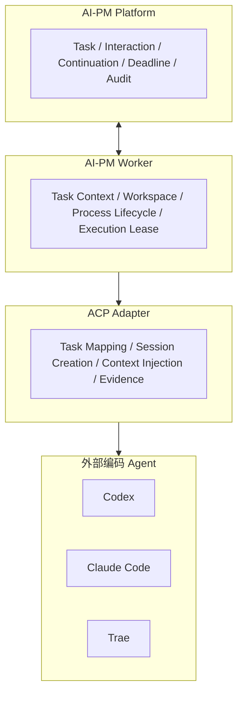

# S03-ACP · Agent Communication Protocol
# V1.3 正式设计方案 — Task-Based Continuation

| 项目 | 内容 |
|---|---|
| 所属阶段 | S03 — Analysis, Design & Technical Decisions |
| 文档性质 | 架构设计方案 · 基于 V1.2 裁决修订 · 待正式基线确认 |
| 版本 | V1.3 |
| 状态 | 新方案草案（Architecture Design），待评审、待用户裁决 |
| 适用范围 | Codex、Claude Code、Trae 及未来接入的外部编码 Agent |
| 核心目标 | Task-Based Continuation：Agent 进程可随时终止，人工介入后任务可继续执行，不依赖 Agent 原 Session 的跨进程恢复能力 |

> 落盘说明：本文件由专家讨论稿（V1.3）整理转录而来，正文内容未做实质改动；仅修复排版（代码块、表格），并将原稿末尾架构图（图1）重绘为 mermaid。

---

## 1. 设计背景

### 1.1 原有设计的问题

此前 S03-ACP 的人工介入方案采用 Session 恢复模型：

```text
Agent 请求人工介入
       ↓
保存 session_id
       ↓
终止 Agent 进程
       ↓
等待人工回复
       ↓
使用原 session_id 恢复
```

该方案存在一个问题：

它将 AI-PM 的任务连续性绑定到了外部 Agent 的 Session 生命周期。

不同 Agent 的 Session 管理机制不同，有些 Agent 不支持进程退出后的 Session 恢复。这会导致 ACP 的人工介入能力受到具体 Agent 实现方式的限制。

### 1.2 新设计方向

本次正式转向 Task-Based Continuation。

核心思想：

AI-PM 管理任务，Worker 管理工作目录，Adapter 管理 Agent Session。

Agent 进程退出后，不要求恢复原 Session，而是通过原 task_id 重新执行任务，创建一个新的 Session，并将人工回复作为新 Session 的初始输入。

原有工作目录、代码修改、任务要求均得到保留。

### 1.3 设计目标

1. Agent 进程可以随时终止，不长期占用 Worker 资源。
2. 人工介入后，任务能够继续执行。
3. 不依赖 Agent 原 Session 的跨进程恢复能力。
4. 保证原始任务内容和工作目录不丢失。
5. 支持 Codex、Claude Code、Trae 等不同 Agent。
6. 保证人工回复只被正确的 Task 和 Interaction 消费。
7. 保证多 Agent 并发执行时，不发生工作目录冲突。
8. 保留完整的任务执行和人工决策审计记录。

---

## 2. 核心领域模型

### 2.1 三个核心对象

V1.3 明确建立三个不同层级。

```text
Task
任务连续性的根本
负责回答：要完成什么工作？
- task_id
- 原始任务内容
- 工作目录引用
- 任务执行约束
- 任务检查点
- 历史执行记录
```

```text
Session
对话执行载体
负责回答：Agent 当前如何理解和执行任务？
- session_id
- adapter_id
- Agent 内部对话上下文
- 本次启动输入
- 执行记录
```

```text
Process
进程运行实例
负责回答：Agent 进程在哪里执行？
- process_id
- worker_id
- process_generation
- 启动参数
- 退出结果
```

三者关系：

```text
Task
 ├── Run 01
 │    ├── Session 01
 │    │    └── Process 01
 │    └── Interaction 01
 │
 └── Run 01 Continuation
      ├── Session 02
      │    └── Process 02
      └── Interaction 01 (原人工介入记录)
```

这里有一个重要的建模约束：

Task、Run、Session 不能混为一谈。

- Task：业务上的工作目标。
- Run：一次执行尝试及其执行上下文。
- Session：Agent 的一次对话。
- Process：操作系统中的实际进程。
- Interaction：一次需要人工参与的交互事项。

人工介入后的继续执行，属于原 Task 的延续，不应创建新的业务 Task。

具体是否创建新的 Run，应依据现有 Run 模型表达执行代次，不应通过创建新 Task 来实现。

### 2.2 Task 必须具备的持久化信息

| 信息 | 说明 | 持久化要求 |
|---|---|---|
| task_id | AI-PM 任务唯一标识 | 必须 |
| project_id | 所属项目 | 必须 |
| original_request | 原始任务内容 | 必须 |
| workspace_id | 工作目录标识 | 必须 |
| workspace_path | Worker 本地工作目录 | 必须有可恢复映射 |
| adapter_id | 使用的 Agent Adapter | 必须 |
| execution_constraints | 执行约束 | 必须 |
| task_checkpoint | 当前工作检查点 | 建议 |
| previous_session_id | 上一次 Session | 建议 |
| current_session_id | 当前 Session | 必须在执行时记录 |

工作目录必须是持久化工作区，而不是某个 Agent 进程的临时目录。

如果 Worker 重启，需要能够重新定位原工作目录。

---

## 3. 人工介入完整生命周期

### 3.1 标准流程

```text
Task-Based Human Intervention

1. Agent 正常执行
   RUNNING
   Agent 在指定 Workspace 中完成任务。

2. 请求人工介入
   INTERACTION_REQUIRED
   Agent 提交 task_id、run_id、session_id、interaction_id 和问题内容。

3. Platform 持久化
   
   保存人工介入请求，生成绝对截止时间 deadline_at，默认 120 秒。

4. Worker 立即终止进程
   PROCESS_TERMINATING
   终止当前 Agent 进程，保留 Workspace。

5. 确认进程退出
   PROCESS_TERMINATED
   Worker 返回真实退出证据，释放进程资源。

6. 等待人工回复
   WAITING_HUMAN
   Platform 等待最多 120 秒。

7. 收到人工回复
   
   持久化用户决定及回复内容，关闭原 Interaction 的回复入口。

8. 重新执行原 Task
   
   Worker 获取原 Task、Workspace、Checkpoint 和人工回复。

9. 创建新 Session
   NEW_SESSION
   Adapter 创建新的 Agent Session，并将人工回复作为初始输入。

10. 继续执行
    TASK_RUNNING
    Agent 检查现有工作成果，继续完成原任务。
```

### 3.2 为什么必须先确认进程退出？

这里有一个不能省略的执行顺序：

```text
持久化人工介入请求
        ↓
发出终止命令
        ↓
确认原进程已经退出
        ↓
收到人工回复
        ↓
获取 Workspace 执行权
        ↓
创建新 Session
```

不能出现：

```text
旧 Agent 还在执行
        +
新 Agent 已经启动
        ↓
两个 Agent 同时修改同一个 Workspace
```

如果人工回复在原进程退出确认之前到达，Platform 应当先持久化回复，但 Worker 必须等待原进程退出并完成执行权交接，才能启动新 Session。

---

## 4. Task Continuation 执行协议

### 4.1 Agent 请求人工介入

Agent Adapter 向 Platform 发送：

```json
{
  "event": "interaction.required",
  "task_id": "task-001",
  "run_id": "run-001",
  "session_id": "session-001",
  "interaction_id": "interaction-001",
  "reason": "human_decision_required",
  "payload": {
    "question": "是否允许执行此操作？",
    "options": [
      {
        "value": "approve",
        "label": "允许"
      },
      {
        "value": "reject",
        "label": "拒绝"
      }
    ]
  }
}
```

字段约束：

| 字段 | 规则 |
|---|---|
| task_id | 必须，关联 AI-PM 原始任务 |
| run_id | 必须，关联执行上下文 |
| session_id | 记录当前 Session，但不是恢复条件 |
| interaction_id | 必须，全局唯一 |
| payload | 必须，包含人工交互内容 |

这里需要特别说明：

task_id 是 AI-PM 的规范任务标识。

如果 Codex、Claude Code 等 Agent 自己也有内部 Task ID，Adapter 可以维护映射关系：

```text
AI-PM task_id
      ↕
Adapter mapping
      ↕
External Agent task identifier
```

不要求不同 Agent 内部使用相同的 ID。

### 4.2 Platform → Worker：终止命令

```json
{
  "command": "agent.process.terminate",
  "command_id": "cmd-001",
  "task_id": "task-001",
  "run_id": "run-001",
  "session_id": "session-001",
  "interaction_id": "interaction-001",
  "reason": "waiting_for_human"
}
```

Worker：

1. 校验 Worker 身份及执行租约。
2. 校验 Task、Run 和 Process 的归属关系。
3. 校验执行代次。
4. 终止对应 Agent 进程。
5. 确认操作系统进程已经退出。
6. 释放该进程持有的执行资源。
7. 保留 Workspace。
8. 回传终止结果。

重复命令必须幂等。

### 4.3 Worker → Platform：终止确认

```json
{
  "event": "agent.process.terminated",
  "task_id": "task-001",
  "run_id": "run-001",
  "session_id": "session-001",
  "interaction_id": "interaction-001",
  "process_id": "process-001",
  "process_exited": true,
  "exit_code": 0
}
```

如果进程退出异常，也必须如实报告。

例如：

```json
{
  "event": "agent.process.termination_failed",
  "task_id": "task-001",
  "run_id": "run-001",
  "process_id": "process-001",
  "error_code": "PROCESS_TERMINATION_FAILED"
}
```

进程终止失败时，禁止启动同一 Workspace 的新 Agent。

### 4.4 Platform → Worker：继续执行任务

收到人工回复后，Platform 发出：

```json
{
  "command": "agent.task.continue",
  "command_id": "cmd-002",
  "task_id": "task-001",
  "run_id": "run-001",
  "continuation_id": "continuation-002",
  "interaction_id": "interaction-001",
  "workspace_id": "workspace-001",
  "response": {
    "decision": "approve",
    "content": "允许继续执行"
  }
}
```

Worker 根据 task_id 获取任务执行上下文。

不能仅仅依靠 Platform 传来的 JSON 就假设工作目录存在。

Worker 必须核验：

- Task 是否存在。
- Workspace 是否存在。
- Workspace 是否属于该 Task。
- 原 Agent 进程是否已经退出。
- 是否存在其他 Agent 正在占用 Workspace。
- Interaction 是否已成功回复且未超时。
- Agent Deadline 是否仍然有效。

通过核验后，才能创建新的 Session。

### 4.5 新 Session 启动输入

Adapter 将任务上下文和人工回复组织为新的 Session 输入。

建议统一定义：

```rust
struct TaskContinuationRequest {
    task_id: TaskId,
    run_id: RunId,
    continuation_id: ContinuationId,

    workspace: WorkspaceReference,

    original_task: TaskDescription,

    checkpoint: Option<TaskCheckpoint>,

    previous_session_id: Option<SessionId>,

    interaction: InteractionResponse,

    execution_constraints: ExecutionConstraints,
}
```

其中：

previous_session_id 仅用于历史关联，不能作为恢复成功的判断依据。

Adapter 创建新 Session 后，必须返回：

```json
{
  "event": "agent.session.created",
  "task_id": "task-001",
  "run_id": "run-001",
  "continuation_id": "continuation-002",
  "session_id": "session-002",
  "process_id": "process-002"
}
```

Platform 更新当前 Session 引用，但保留历史 Session 记录。

---

## 5. Task Checkpoint 设计

### 5.1 为什么需要 Checkpoint？

虽然 Workspace 保存了代码，但代码本身不能完整表达 Agent 的执行进度。

例如：

原 Agent 已经完成：

- 创建用户实体。
- 创建数据库迁移。
- 修改权限模块。
- 发现一个兼容性问题。
- 准备处理异常分支。

如果新 Session 只收到原始任务和人工回答，Agent 可能需要重新分析大量工作。

因此，建议建立任务检查点机制。

### 5.2 Checkpoint 结构

```rust
struct TaskCheckpoint {
    checkpoint_id: CheckpointId,

    task_id: TaskId,

    run_id: RunId,

    previous_session_id: Option<SessionId>,

    created_at: DateTime<Utc>,

    completed_items: Vec<String>,

    pending_items: Vec<String>,

    findings: Vec<String>,

    modified_files: Vec<String>,

    next_actions: Vec<String>,

    warnings: Vec<String>,
}
```

Checkpoint 的定位：

它是帮助新 Session 理解当前工作状态的辅助材料，不是任务成果的唯一存储位置。

实际代码以 Workspace 中的文件为准。

如果 Checkpoint 与实际代码状态不一致，Agent 必须重新检查代码，不能盲目相信 Checkpoint。

### 5.3 Checkpoint 的生成时机

建议：

1. Agent 正常执行期间，可以周期性生成检查点。
2. Agent 请求人工介入时，生成一次最新检查点。
3. Worker 终止进程前，尽可能完成必要的工作状态记录。
4. 新 Session 启动时，读取最近一次有效检查点。
5. Agent 恢复执行后，可以生成新的检查点。

但有一个特殊情况：

如果 Agent 因崩溃或强制终止而无法生成 Checkpoint，不能因此丢弃 Task。

新 Session 仍然可以通过：

```text
task_id
  ↓
original task
  ↓
workspace
  ↓
existing files
  ↓
人工回复
```

继续进行任务分析。

---

## 6. 工作目录管理与并发控制

这是 Task-Based Continuation 能否可靠工作的关键。

### 6.1 Workspace 生命周期

Workspace 的生命周期必须独立于 Agent Process。

```text
Workspace CREATED
       |
       v
Agent Process RUNNING
       |
       v
Agent Process TERMINATED
       |
       v
Workspace PRESERVED
       |
       v
New Agent Process RUNNING
       |
       v
Workspace UPDATED
```

终止 Agent 进程不能自动删除 Workspace。

Workspace 的清理必须由独立的任务清理策略决定。

### 6.2 Workspace Lock

每个 Task 的 Workspace 必须有执行互斥保护。

建议使用：

```text
workspace_id
task_id
worker_id
lease_generation
lock_token
lock_expires_at
```

新 Session 启动前必须取得有效 Workspace 执行租约。

尤其要防止：

- 旧进程尚未退出，新进程启动。
- Worker 重启后，旧进程实际上仍然存在。
- 两个 Worker 同时执行同一个 Task。
- 旧执行代次的命令误操作新执行代次。

继续沿用 S03-ACP 已有的 Lease Generation 与 Token 双重校验机制。

### 6.3 多 Agent 并行执行

需要区分两种情况：

| 情况 | 规则 |
|---|---|
| 不同 Task 使用不同 Workspace | 允许并行 |
| 同一个 Task 的不同执行代次 | 不允许同时写入同一 Workspace |
| 同一 Task 的多个 Agent | 必须明确划分工作目录或通过已有协调机制管理 |

这与此前确立的多 Agent 并行执行、知识库统一协调原则保持一致。

不能因为 Task-Based Continuation 就允许两个 Agent 同时修改同一份代码。

---

## 7. 状态模型

V1.3 将执行状态分成四个维度。

### 7.1 Task 状态

建议表达：

- RUNNING
- WAITING_HUMAN
- CONTINUING
- COMPLETED
- FAILED
- CANCELLED

具体需要映射到现有 Task 领域模型，不另行创建冲突的业务状态体系。

### 7.2 Interaction 状态

```text
PENDING
   |
   +----> RESPONDED
   |         |
   |         v
   |      CONSUMED
   |
   +----> TIMED_OUT
```

### 7.3 Session 状态

```text
SESSION-001: ACTIVE
       |
       v
SESSION-001: TERMINATED

SESSION-002: CREATED
       |
       v
SESSION-002: ACTIVE
```

Session 之间通过 Task 和 Continuation 关联。

### 7.4 Process 状态

```text
PROCESS-001: RUNNING
       |
       v
PROCESS-001: TERMINATING
       |
       v
PROCESS-001: TERMINATED

PROCESS-002: STARTING
       |
       v
PROCESS-002: RUNNING
```

四个维度必须独立记录。

例如：

```text
Task        = CONTINUING
Interaction = RESPONDED
Session     = CREATED
Process     = STARTING
```

这并不矛盾，而是说明任务已经安排继续执行，但 Agent 尚未真正开始工作。

---

## 8. 人工等待及超时机制

本部分沿用已经确认的 ACP-DEC-003-Q1。

### 8.1 默认配置

```toml
[human_intervention]
timeout_seconds = 120

[agent_process]
termination_timeout_seconds = 10

[task_continuation]
enabled = true
require_original_task = true
require_existing_workspace = true
create_new_session = true
auto_create_new_task = false
```

说明：

- 人工等待默认 120 秒。
- 进程终止需要有独立的操作超时。
- 进程终止超时不能被解释为进程已经退出。
- 新 Session 必须继续原 Task。
- 不允许自动创建新 Task。

### 8.2 超时处理

```text
PENDING
   |
   | 120 秒
   v
TIMED_OUT
   |
   v
禁止接受原 Interaction 的回复
   |
   v
保留 Workspace
   |
   v
Task 进入等待后续处理的状态
```

这里不自动启动 Agent，也不自动丢弃工作目录。

如果用户在超时之后才回复：

- 原 Interaction 不再接受回复。
- 不允许直接投递给 Agent。
- 如果用户仍然希望继续工作，应创建新的人工介入事项或通过明确的 Task 继续执行操作。
- 原有工作成果仍然保留。

### 8.3 Deadline 约束

保留原有 Agent Deadline 设计。

必须区分：

| Deadline | 作用 |
|---|---|
| Human Intervention Deadline | 用户必须在 120 秒内回复 |
| Agent Deadline | Agent 本次执行所允许的有效期限 |

新 Session 不得通过重新启动进程而自动获得新的 Agent Deadline。

如果原 Deadline 已经失效：

1. 不允许直接继续原执行。
2. 不允许自动刷新 Deadline。
3. Platform 必须报告执行期限异常。
4. 只有经过明确的上层授权，才能产生新的执行授权。

这里的执行授权与新 Session 是两件不同的事情。

---

## 9. Adapter 能力模型修订

V1.3 最大的架构变化就是降低对 Agent Session 的依赖。

原先要求：

```text
supports_persistent_session
supports_resume_after_process_exit
```

现在不再要求这两项作为人工介入能力的必要条件。

改为：

```rust
struct AgentCapabilities {
    supports_task_execution: bool,

    supports_workspace_binding: bool,

    supports_new_session: bool,

    supports_initial_context: bool,

    supports_interaction_consumption_receipt: bool,

    supports_process_termination: bool,
}
```

| 能力 | V1.3 要求 | 说明 |
|---|---|---|
| supports_task_execution | 必须 | 能够执行指定 Task |
| supports_workspace_binding | 必须 | 能够使用指定 Workspace |
| supports_new_session | 必须 | 能够创建新的 Session |
| supports_initial_context | 必须 | 能够接收任务及人工回复 |
| supports_interaction_consumption_receipt | 必须 | 能够确认人工回复已消费 |
| supports_process_termination | 必须 | 能够配合 Worker 终止进程 |

这里需要区分：

Adapter 必须支持创建新 Session，但不要求支持恢复原 Session。

session_id 仍然有价值，它用于：

- 追踪每次 Agent 对话。
- 审计执行过程。
- 关联 Agent 日志。
- 排查执行异常。

只是它不再承担 Task 连续性职责。

### 9.1 Agent 接入兼容性

V1.3 的目标不是要求所有 Agent 拥有相同的内部实现。

而是统一对外契约：

```text
AI-PM Task
    |
    v
Adapter
    |
    +---- 获取 Task
    |
    +---- 绑定 Workspace
    |
    +---- 创建 Session
    |
    +---- 注入任务上下文
    |
    +---- 注入人工回复
    |
    +---- 返回执行证据
```

不同 Adapter 可以采用不同的内部方式：

- 有些 Agent 使用命令行参数启动。
- 有些 Agent 通过本地 API 启动。
- 有些 Agent 需要启动专用后台服务。
- 有些 Agent 需要通过文件注入任务上下文。

这些差异由 Adapter 隔离，Platform 不应该知道 Agent 内部的启动细节。

---

## 10. 数据持久化设计

建议 V1.3 在现有领域模型上扩展，不要重复建立 Task、Workspace、Run 等已经存在的实体。

以下是逻辑模型，不代表要求新增同名数据库表。

### 10.1 Task 执行上下文

```rust
struct TaskExecutionContext {
    task_id: TaskId,
    workspace_id: WorkspaceId,
    adapter_id: AdapterId,

    original_task: String,

    current_run_id: RunId,

    current_session_id: Option<SessionId>,

    continuation_generation: u32,

    checkpoint_id: Option<CheckpointId>,
}
```

### 10.2 Task Continuation 记录

建议增加独立的 Continuation 记录，避免将每一次恢复操作的信息塞进 Task 主记录。

```rust
struct TaskContinuation {
    continuation_id: ContinuationId,

    task_id: TaskId,

    run_id: RunId,

    interaction_id: InteractionId,

    previous_session_id: Option<SessionId>,

    new_session_id: Option<SessionId>,

    checkpoint_id: Option<CheckpointId>,

    status: ContinuationStatus,

    created_at: DateTime<Utc>,

    completed_at: Option<DateTime<Utc>>,
}
```

Continuation 状态建议：

```text
PENDING
   |
   v
VALIDATING
   |
   v
STARTING
   |
   v
SESSION_CREATED
   |
   v
RUNNING
   |
   v
COMPLETED

异常分支：
VALIDATION_FAILED
START_FAILED
SESSION_CREATION_FAILED
EXECUTION_FAILED
CANCELLED
```

### 10.3 数据关系

```text
Project
  |
  +---- Task
          |
          +---- Workspace
          |
          +---- Run
          |      |
          |      +---- Session 01
          |      +---- Session 02
          |
          +---- Interaction
          |      |
          |      +---- Human Response
          |
          +---- Continuation
                 |
                 +---- Previous Session
                 +---- New Session
                 +---- Checkpoint
```

关键约束：

1. 一个 Task 可以关联多个 Session。
2. 一个 Task 可以有多次人工介入。
3. 一个 Interaction 只能被成功消费一次。
4. 一个 Continuation 必须关联原 Task。
5. 新 Session 必须记录其来源 Continuation。
6. Workspace 不能因为 Session 终止而删除。
7. Task 的原始需求不能因为 Agent 创建新 Session 而改变。

---

## 11. 失败处理及恢复策略

| 异常场景 | 处理策略 |
|---|---|
| Agent 请求人工介入，但没有 task_id | 拒绝该事件并报告协议错误 |
| Workspace 不存在 | 禁止继续执行，报告异常 |
| 原始任务内容丢失 | 禁止创建新 Session |
| 原进程没有退出 | 禁止启动新 Agent |
| 人工回复超过 120 秒 | 拒绝回复 |
| Worker 暂时离线 | Platform 持久化继续执行命令 |
| Worker 重启 | 重新核验 Workspace 和进程状态 |
| 新 Session 创建失败 | 报告异常，不创建新 Task |
| 人工回复未被消费 | 保持未消费状态，不能宣称成功 |
| Agent Deadline 失效 | 不允许原授权下继续执行 |
| Checkpoint 不存在 | 通过 Workspace 和原始 Task 重建执行上下文 |
| Workspace 被其他执行者占用 | 阻止启动，等待执行租约释放 |
| 同一个 Continuation 重复执行 | 根据 continuation_id 幂等处理 |

### 11.1 新 Session 创建失败

例如：

```text
人工回复已收到
       |
       v
Workspace 验证成功
       |
       v
Agent 启动失败
       |
       v
SESSION_CREATION_FAILED
```

此时：

- Interaction 保留 RESPONDED。
- Continuation 标记失败。
- Task 不得标记 COMPLETED。
- Workspace 保留。
- 人工回复保留。
- 允许对同一个 Continuation 进行受控重试。

如果重试成功，继续原 Task。

### 11.2 人工回复消费失败

例如：

```text
Session 已创建
       |
       v
Agent Process 已启动
       |
       v
人工回复提交失败
```

此时不能标记 INTERACTION_CONSUMED。

必须保留回复投递记录，并确保重试不会造成重复消费。

这里建议为人工回复建立独立的投递标识：

```text
interaction_id
response_id
delivery_id
```

同一个 response_id 必须具备幂等性。

---

## 12. 与现有 S03-ACP 架构的关系

本次调整不是推翻 ACP，而是修正 ACP 对 Agent Session 的依赖。

| 现有机制 | V1.3 处理 |
|---|---|
| Adapter Capability Discovery | 保留，调整能力定义 |
| Agent Run | 保留 |
| Agent Session | 保留，允许一个 Task 多个 Session |
| Agent Process | 保留，明确可销毁、可重建 |
| Interaction | 保留 |
| RESPOND_INTERACTION | 保留人工回复操作语义 |
| interaction.consumed | 保留，作为消费证据 |
| Outbox / Inbox | 保留 |
| 多 Runner 保护 | 保留 |
| Lease Generation | 保留 |
| Agent Deadline | 保留 |
| 原地回传 / 恢复式回传 | 重新按 Task Continuation 统一定义 |
| 跨进程 Session 恢复 | 从必要能力中移除 |
| Task-Based Continuation | 新增为标准机制 |

特别说明：RESPOND_INTERACTION 的 EXECUTED 语义必须保持严格，不能因为新 Session 已经创建，就认为人工回复已经执行。

---

## 13. 验收标准

建议为 V1.3 建立独立测试集。

| 编号 | 验收场景 | 预期结果 |
|---|---|---|
| ACP-401 | Agent 请求人工介入 | 正确保存 task_id |
| ACP-402 | Agent 进程退出 | Workspace 保留 |
| ACP-403 | 120 秒内收到回复 | 创建新 Session |
| ACP-404 | 新 Session 启动 | 使用原 Task 和 Workspace |
| ACP-405 | 新 Session 获得人工回复 | 作为初始输入 |
| ACP-406 | 新 Session 创建成功 | 记录新的 session_id |
| ACP-407 | 原 Session 不可访问 | 不影响 Task Continuation |
| ACP-408 | 原始任务内容丢失 | 禁止继续执行 |
| ACP-409 | Workspace 丢失 | 报告异常 |
| ACP-410 | Checkpoint 丢失 | 通过现有文件重建上下文 |
| ACP-411 | 人工回复超过 120 秒 | 拒绝过期回复 |
| ACP-412 | 原进程未退出 | 禁止新进程启动 |
| ACP-413 | 同一 Continuation 重复执行 | 幂等 |
| ACP-414 | 同一 Workspace 被占用 | 禁止并发写入 |
| ACP-415 | 新 Session 创建失败 | 保留人工回复及 Workspace |
| ACP-416 | Agent 未消费人工回复 | 不得标记 CONSUMED |
| ACP-417 | Agent Deadline 过期 | 禁止原授权下继续执行 |
| ACP-418 | Worker 重启 | 能够重新获取 Task 执行上下文 |
| ACP-419 | Platform 重启 | 120 秒截止时间不重置 |
| ACP-420 | 同一 Task 多次人工介入 | 正确建立多条 Interaction 和 Continuation |

---

## 14. 版本演进与实施范围

建议正式采用以下版本定位：

| 版本 | 核心定位 |
|---|---|
| S03-ACP V1.0 | Agent 通信基础 |
| S03-ACP V1.1 | 执行协调、交互和可靠性约束 |
| S03-ACP V1.2 | 原 Session 跨进程恢复方案（已被新裁决取代） |
| S03-ACP V1.3 | Task-Based Continuation 标准执行模型 |

V1.3 实施分为四个阶段：

**阶段 A：Task Continuation 基础**

- Task 执行上下文持久化。
- Workspace 与 Task 绑定。
- Session 历史关联。
- Continuation 记录。

**阶段 B：人工介入生命周期**

- 120 秒等待机制。
- Agent 进程立即终止。
- 终止确认。
- 人工回复持久化。
- 超时处理。

**阶段 C：新 Session 执行**

- 按原 Task 获取上下文。
- 获取原 Workspace。
- 创建新 Session。
- 注入人工回复。
- 消费证据回传。

**阶段 D：可靠性及并发**

- Outbox / Inbox。
- 幂等处理。
- Workspace 执行租约。
- Deadline 检查。
- Worker 重启恢复。
- 全部验收测试。

---

## 15. V1.3 正式设计原则总结

我认为 V1.3 必须冻结以下六条架构原则：

1. **Task First**：Task 是任务连续性的唯一业务根标识。
2. **Session Disposable**：Session 可以销毁和重新创建，不承担任务持久化职责。
3. **Process Disposable**：Agent Process 可以终止和重新启动，不长期占用 Worker。
4. **Workspace Persistent**：Workspace 独立于 Process 和 Session，必须保留实际工作成果。
5. **Human Response Persistent**：人工回复必须先持久化，再投递给新 Session。
6. **Evidence Based**：必须通过明确的消费证据确认 Agent 已经收到并处理人工回复。

还有一个需要特别保护的架构边界：

AI-PM Platform 不应该负责理解 Agent 的内部对话历史，也不应该依赖 Agent 自己的记忆能力。Platform 负责提供完整的 Task 执行上下文，Agent 负责读取上下文并继续工作。

---

## 最终架构

原稿图1（据原稿重绘为 mermaid）：



> 不同 Agent 使用各自的 Session 实现，但遵循统一的 Task Continuation 契约。
