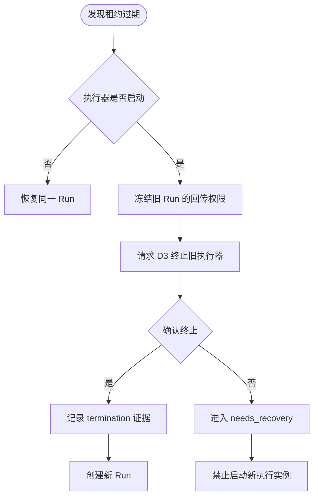

# AI-PM Slice D 执行链路 V1 设计评审

> 评审对象：`docs/slice-d/ai-pm-slice-d-execution-pipeline-v1.md`（1623 行设计稿）
>
> 评审结论：**总体方向认可 / 建议修订后实施 / 存在若干 P0 级语义缺口**
>
> 记录说明：本文件为专家评审意见的原文记录，仅做格式整理（Markdown 化、表格规范化），不改动措辞与结论。评审内容在「P0-1 我的建议」处接收时截断，后续内容待专家补充后回填（见文末附录）。

---

## 总体结论

这份设计已经有相当成熟的架构意识，特别是 Run 生命周期、租约恢复、多仓基线、状态机约束和执行器隔离。但目前有一个问题：设计把很多异常恢复规则写得很完整，却没有完全闭合这些规则之间的执行责任。

不建议推倒重来，也不建议重新拆分 D1～D5。

建议：**保留整体架构，只针对几个关键问题做一次最终修订，然后冻结 D1。**

---

## 一、总体评价

| 评审维度 | 评价 | 说明 |
| --- | --- | --- |
| 分层架构 | 优秀 | 平台 / 调度 / MCP / Codex 职责明确 |
| Run 生命周期 | 优秀 | queued、claimed、running 三态区分正确 |
| 并发控制 | 优秀 | 行锁、SKIP LOCKED、唯一索引三重保护 |
| 多仓模型 | 良好 | 声明关系与 Run 基线快照分离 |
| 状态机治理 | 优秀 | 强调统一迁移入口 |
| 故障恢复 | 需修订 | 执行器隔离与租约回收责任没有完全闭合 |
| 调度可靠性 | 需修订 | 健康检查、调度开关、回收之间存在边界问题 |
| 策略快照 | 需修订 | D1、D2.1 的版本口径需要统一 |
| 验收体系 | 需修订 | 测试矩阵有少量互相矛盾的断言 |

最值得肯定的是三个设计：

1. 不把 Outbox 当作执行队列。
2. 不把 Codex 当作平台状态的直接写入者。
3. 不把一次执行失败覆盖成下一次执行。

这三个原则是整个 AI-PM 执行架构的基础。

---

## 二、必须修订的问题

以下按严重程度排序。

### P0-1：租约回收与执行器隔离之间存在责任断层

这是整份设计最重要的问题。

§5.5.1 定义了两种恢复：

- B3-1：执行器尚未启动，租约过期，恢复同一个 Run。
- B3-2：执行器已经启动，租约过期，隔离旧执行器，创建新 Run。

这个区分完全正确。

但是问题在于：**谁负责真正隔离旧执行器？**

设计目前写的是：

> 先隔离旧执行实例并记录旧 Run 终止结果，再创建新 Run。

但 D1 明确不启动 Codex，D3 才负责启动、监控和终止。

这就出现了一个执行责任问题。假设：

1. Run-1 已经启动 Codex。
2. Worker 与 Codex 之间网络断开。
3. Run-1 租约过期。
4. 另一个 Worker 发现租约过期。
5. 系统准备创建 Run-2。

此时，Run-1 的 Codex 可能仍在修改代码。

如果 Run-2 已经启动，就可能出现**两个 Codex 同时操作同一个项目工作区**。

即使 T25 能够拒绝旧实例迟到的 MCP 回传，也不能阻止旧进程继续修改文件或提交 Git。

这是两个完全不同的问题：

- **Fencing**：拒绝旧实例的过期写入。
- **Isolation**：真正阻止旧实例继续操作资源。

#### 我的建议

增加一个明确的恢复协议：



恢复协议的明确要求：

1. 旧实例的回传权限必须先失效。
2. 旧进程必须有可验证的终止结果。
3. 终止无法确认时，不允许启动新的执行实例。
4. 进入人工恢复状态时，保留旧 Run 和相关证据。

注意：这里的 needs_recovery 应该是恢复控制状态或 Delivery 层状态，不要随意增加到现有 Run 状态集合。

不能把数据库中的租约过期等同于操作系统中的进程已经死亡。

**这是一个必须修订的 P0。**

---

### P0-2：claimed 的恢复规则与状态图不完全一致

§5.5 和 §5.5.1 对未启动执行器的租约过期定义为：

> claimed → queued

而状态图中又出现：

> claimed → timed_out

这两者存在语义冲突。

另外，§5.4.2 的候选 SQL 将所有租约过期的 claimed Run 都纳入领取候选：

```sql
WHERE (r.status = 'queued' AND r.next_dispatch_at <= now())
   OR (r.status = 'claimed' AND r.lease_expires_at < now())
```

但是没有在候选 SQL 中区分：

- stage = dispatch
- stage = started

虽然事务后续可以判断，但设计必须明确：**不能把所有过期 claimed Run 当成同一种情况处理。**

#### 建议

明确状态规则：

| 当前状态 | 执行阶段 | 恢复方式 |
| --- | --- | --- |
| claimed | dispatch | 同一 Run 回到 queued |
| claimed | started | 进入执行器隔离流程 |
| running | started | 进入执行器隔离流程 |
| queued | 无 | 正常领取 |

同时：

- 未启动恢复不增加 attempt_count。
- 已启动恢复必须处理旧执行器。
- 只有真正创建替代 Run 时才增加 attempt_no 和 attempt_count。
- 基础设施失败不增加任务执行连续失败次数。

此外，T3 目前将租约过期统一断言为旧 Run timed_out 并新建 Run，而 T19 又要求未启动时恢复同一 Run。

**T3 必须拆分或改为明确覆盖已启动场景，不能与 T19 相互矛盾。**

---

### P0-3：工作区隔离没有进入多仓模型的硬约束

§5.7 定义：

```
repos/<safe-name>-<repository_id>
```

并且要求：

- 唯一。
- 稳定。
- 可复现。
- 仓库改名不改变映射。

这里有一个问题。

如果路径包含 safe-name，仓库改名后，重新计算路径就可能发生变化。

虽然文档允许另一种方案：

```
repos/<repository_id>
```

但没有最终冻结唯一算法。

#### 我的建议

直接确定：

```
repos/<repository_id>
```

仓库显示名称与工作区路径分离。

原因：

- repository_id 本身具有唯一性。
- 不受仓库改名影响。
- 不存在名称清洗碰撞。
- 不存在路径穿越问题。
- 多个同名仓库不会发生冲突。

如果确实需要更友好的目录名称，可以另设显示字段，但不要参与物理路径计算。

另外还应明确一个问题：

**同一个 Run 的多个仓库必须处于同一个 Run workspace 根目录之下。**

例如：

```
workspace/
  run.json
  repos/
    <repository-id-A>/
    <repository-id-B>/
    <repository-id-C>/
```

这样 D2 下发上下文时，Codex 不需要自行决定目录布局。

---

### P0-4：调度开关与健康检查的职责仍需明确

§5.9 的设计非常好：

```
AI_PM_RUN_DISPATCH=off
```

只禁止新领取，不关闭租约健康检查。

但是这里有个容易遗漏的问题：

当前第四条 Worker 循环既要负责调度，又要持续做健康检查和恢复。

假如：

- 调度开关关闭；
- Worker 循环因为异常退出；
- 没有新的 Worker 实例启动。

那么健康检查也停止了。

文档虽然明确要求健康检查不受开关影响，但没有充分明确它的运行保障。

#### 建议

将调度逻辑拆成两个独立的 application 操作：

```
dispatch_once()
recover_expired_leases()
```

同一个 Worker 进程可以运行两个循环，也可以由一个循环调用两个操作。

关键是：

| 操作 | 开关 off | 开关 on |
| --- | --- | --- |
| 新 Run 领取 | 禁止 | 允许 |
| 过期租约检查 | 持续运行 | 持续运行 |
| 未启动 Run 恢复 | 允许 | 允许 |
| 已启动实例隔离 | 允许 | 允许 |
| running 实例监控 | 持续运行 | 持续运行 |

这里不需要第二套调度服务。

但需要让健康检查具备独立的生命周期、错误处理和运行指标。

---

## 三、P1 级改进

### P1-1：TaskReadyHandler 的创建逻辑与 Run 创建封装需要进一步统一

§5.5.1 B3-6 明确要求：

> 创建 Run、递增计数、重试资格判断、审计写入封装为共享操作。

我赞同。

但目前 D1 的领取流程、TaskReadyHandler 和故障恢复涉及三个不同入口。

必须避免各自实现一套 Run 创建逻辑。

建议建立统一领域操作：

```
create_task_run(
    task_id,
    reason,
    attempt_policy,
)
```

至少统一负责：

- 锁定 Task。
- 判断是否存在活跃 Run。
- 校验重试资格。
- 计算 attempt_no。
- 更新 attempt_count。
- 创建 Run。
- 创建必要的失败关联记录。
- 写审计。

三个调用方只表达业务意图，不重复实现数据库规则。

尤其需要注意：

**TaskReadyHandler 的重复事件不能因为 Run 已经 claimed 而产生错误死信。**

这部分 T15 应该保留为强制回归测试。

### P1-2：策略快照存在 D1 与 D2.1 的版本口径漂移

文档 §5.3 和 §5.6 后续补充了 D2.1 的实现：

- D1 最小策略快照。
- D2.1 四层策略合成。
- canonical 有效策略 SHA256。
- policy_version 取 hash 前 12 位。

但 §5.6、§九、§十三并非完全采用同一版本口径。

例如，S3 仍然写：

> D1 写 NULL

而 §十三又写：

> D2.1 已完成，不再写 NULL。

这属于文档演进产生的版本冲突。

#### 建议

将策略快照明确分成两部分：

| 字段 | 责任 |
| --- | --- |
| policy_hash | 有效策略内容的 SHA256 |
| policy_version | hash 前 12 位 |
| captured_at | 快照生成时间 |
| approval_required | 审批要求 |
| approval_status | 审批证据状态 |
| execution_enabled | 最终执行许可 |
| repository_baselines | 多仓基线 |

并且要求：

**Run 领取时必须持久化当时的有效策略快照，后续策略修改不能改变历史 Run 的策略依据。**

还需要明确，策略版本标识不是策略快照本身，不能只保存 hash 而丢失可审计的实际内容。

### P1-3：Task 状态与 Run 状态的原子性需要更明确

§2.3 对 Task、Run、Delivery 三层状态的区分非常正确。

但是 §5.4.1 的领取事务同时执行：

```
ready → claimed
queued → claimed
```

需要明确一个约束：

**两者必须在同一个 PostgreSQL 事务中提交。**

不能出现：

- Task 已 claimed，但 Run 仍 queued。
- Run 已 claimed，但 Task 仍 ready。

同样，后续：

```
claimed → running
```

必须保证 Task 和 Run 的状态一致。

建议将这条约束提升为明确的不变量：

> Task 与 Run 的对应状态迁移必须在同一事务内完成；任一迁移失败，整体回滚。

另外，建议对 update_task_status 做一次检查，确保它不会把统一状态机守卫引入的副作用与 Run 领取事务拆开。

---

## 四、数据库设计方面的几个具体问题

| 位置 | 问题 | 建议 |
| --- | --- | --- |
| §5.3.1 | 动态删除 status CHECK | 验证只命中预期约束，不应删除所有包含 status 的 CHECK |
| §5.3.1 | infrastructure_retry_count 在后文再次提出 | 统一定义一次，避免迁移实现重复添加 |
| §5.3.2 | task_repository 缺少对 project_id 与 task_id 关系的级联语义说明 | 明确删除及更新策略 |
| §5.3.3 | task_run_repository 使用单列 run_id 外键 | 可以接受，但建议评估数据库层面的项目一致性保护 |
| §5.4.2 | 候选领取 SQL | 增加阶段识别和租约恢复分支的明确事务说明 |
| §5.5.1 | 旧执行器隔离 | 增加终止确认凭据和恢复失败处理 |
| §5.7 | workspace_path | 冻结 repository_id 路径算法 |
| §5.8 | 审计 after_data | 补充旧执行器身份、恢复原因和 fencing 结果 |

还有一个特别建议补充的数据库约束：

**task_run_repository 应当是不可变快照。**

不能因为 Task 的仓库声明被修改，就同步修改已经领取的 Run 基线。

建议：

- 领取时 INSERT。
- 正常业务流程不允许 UPDATE。
- 删除和修改声明仓库，不影响历史 Run 快照。
- 历史 Run 必须能够独立还原当时的仓库基线。

---

## 五、测试矩阵评价

这份设计的测试体系值得肯定。

T1～T26 已经远远超过普通 CRUD 测试的水平。

特别是：

- T14：TaskReadyHandler 与 claim 并发。
- T17：唯一索引冲突等待与死锁。
- T19：未启动与已启动的恢复区分。
- T25：旧执行器迟到回传。
- T26：基础设施重试耗尽。

这些都是实际生产环境会遇到的问题。

但建议增加以下测试。

| 新增编号 | 场景 | 核心断言 |
| --- | --- | --- |
| T27 | 旧 Codex 进程未能确认终止 | 不启动替代 Run |
| T28 | 两个 Worker 同时恢复同一过期 Run | 只有一个恢复操作成功 |
| T29 | 恢复过程中数据库事务失败 | 旧 Run、Task、审计保持一致 |
| T30 | 领取后修改 Task 仓库声明 | 历史 Run 快照不改变 |
| T31 | 仓库改名后再次计算 workspace_path | 路径保持一致 |
| T32 | 调度关闭且调度循环异常退出 | 健康检查恢复机制仍能独立运行 |
| T33 | 策略在 Run 领取后发生变化 | 历史 Run 使用原策略快照 |
| T34 | 旧执行器终止确认失败 | 禁止新 Run 获得冲突工作区的写权限 |

特别是 T27、T28、T34，属于必须加入的测试。

---

## 六、我认为不应该修改的架构决策

有些地方虽然还可以继续讨论，但建议不要再动。

1. **保留五阶段拆分**：D1 → D2 → D3 → D4 → D5。不要为了追求快速交付而合并。
2. **保留平台控制 / Codex 执行 / MCP 通信**：这是整个系统的核心边界。Codex 不直接写 Task 状态，MCP 不承担调度职责。
3. **保留 Task / Run / Delivery 三层状态**：不要把执行状态、任务生命周期和交付状态揉成一个枚举。
4. **保留多仓声明与运行快照分离**：task_repository 表示任务需要哪些仓库；task_run_repository 表示本次执行实际锁定了哪些仓库及其基线。这两个概念必须长期分开。
5. **保留失败 Run 不覆盖的原则**：重试新建 Run，历史永久可追溯。

这对 AI 研发平台尤其重要，因为未来需要回答：

- AI 第一次做了什么？
- 为什么失败？
- 第二次修改了什么？
- 哪次提交被接受？
- 最终是谁批准的？

不能只保存最后一次结果。

---

## 七、最终裁决：Slice D V1 修订清单

建议作为提交给设计方或 Codex 的最终修订依据。

### 必须修订

- [ ] P0-1：明确执行器隔离、终止确认和替代 Run 的顺序。
- [ ] P0-2：统一 claimed 租约过期恢复规则，修正 T3/T19 冲突。
- [ ] P0-3：冻结 workspace_path 算法。
- [ ] P0-4：明确调度与健康检查的独立生命周期。

### 建议修订

- [ ] P1-1：统一 Run 创建操作。
- [ ] P1-2：统一 D1/D2.1 策略快照版本口径。
- [ ] P1-3：明确 Task/Run 同事务迁移。
- [ ] 补充 T27～T34 测试。

### 保持不变

- [x] 平台 / MCP / Codex 三层分工。
- [x] D1～D5 阶段拆分。
- [x] Task / Run / Delivery 三层状态。
- [x] Outbox + task_run，不引入第二套消息队列。
- [x] 多仓库基线快照。
- [x] 历史 Run 不覆盖。

### 最终结论：架构方向通过

这份设计的评价是：**已经从一份执行流程设计，发展成了一份具有生产系统意识的执行调度架构设计。**

不过，需要特别强调一个更深层的问题：

> 你做的不是一个简单的 Codex 自动化工具，而是一个 AI 研发管理平台。

这意味着平台必须能够控制多个 Codex 执行实例，并且在它们出现异常时，仍然能够保证代码仓库、任务状态、执行历史和交付证据的一致性。

所以，整个设计最重要的不是「如何领取 Run」，而是：

**当一个 Codex 已经开始修改代码，但平台失去对它的控制时，平台如何确保不会出现两个互相冲突的执行者。**

这个问题解决了，D1～D5 才真正形成可靠的执行闭环。

最终建议：**不要重新设计 Slice D。只做上述修订，特别是 P0-1 和 P0-2，然后冻结 D1 设计。**

这次评审不需要再引入一轮大规模架构讨论。

---

## 附录：记录状态

| 项 | 状态 |
| --- | --- |
| 评审接收范围 | 完整：总体结论 → 一、总体评价 → 二、P0-1～P0-4 → 三、P1-1～P1-3 → 四、数据库设计问题 → 五、测试矩阵评价（T27～T34）→ 六、架构决策保留项 → 七、最终裁决与最终结论 |
| 回填时间 | 2026-11-01，分 5 次接收完成 |
| 格式整理 | 表格 Markdown 化、章节层级规范化、状态迁移与 SQL 代码块化；措辞与结论未改动 |
| 状态 | 评审记录完整，无截断残留 |