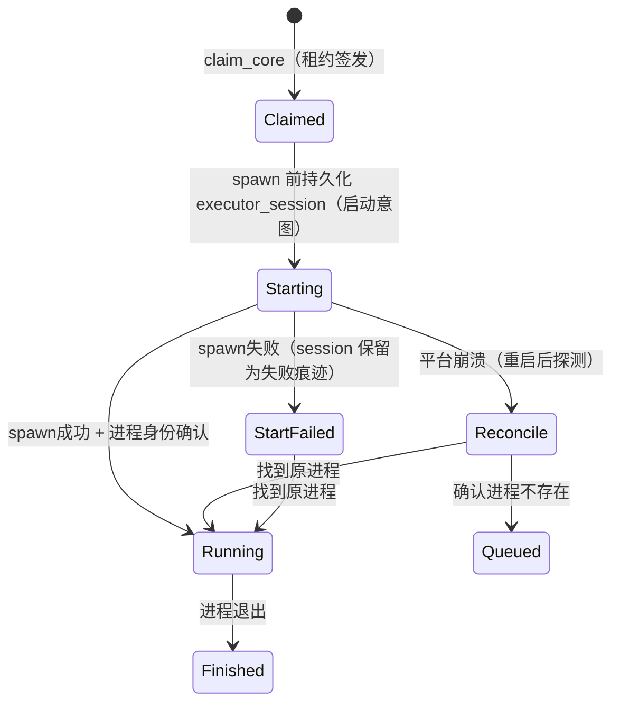

# T-032 · Codex Executor 可靠性与启动协议加固（D3.1 设计稿）

> 状态：**已过稿**（2026-11-01 落盘；同日经专家 T1–T4 终裁 + 用户生命周期约束定稿，进入实施）
> 日期：2026-11-01
> 一句话：不推翻 T-031，把 D3 的可靠性边界做扎实——进程启动持久化协议、执行端凭据下发（按 ADR-0002）、心跳与进程存活分离、子进程完整回收、Git 镜像仓保护与结构化退出；不修改任务状态机，不提前实现 D5，不引入容器或远程执行。
> 上位依据：外部评审六项意见（材料包 `docs/executor/ai-pm-t031-executor-expert-review-pack.md` §4 对照结论）、**ADR-0002（Q2 已裁决，Accepted）**、**T1–T4 终裁（`docs/executor/ai-pm-t032-finalization-expert-questions.md`，2026-11-01）**、`docs/slice-d/ai-pm-slice-d3-executor-adapter-v1.md` §8（T-031 交付记录）、`docs/slice-d/ai-pm-slice-d2-mcp-context-v1.md` v1.1（R-G4 待修订）、todo.md §6 M3 / §11 T-051。
> 本稿与评审草案的差异：评审草案的「执行端身份与 MCP 认证」一节已由 **ADR-0002 七项裁决替代**（A1+B1 统一 lease_token，不新增凭据体系），本稿 §3 按裁决重写并并入落地项 L1–L6。

---

## 1. 交付范围（评审意见 × 裁决映射）

| 必修 | 来源 | 本稿章节 |
|---|---|---|
| 进程启动持久化协议 | 评审 Q1（P0） | §2 |
| 执行端凭据下发与 MCP 认证 | 评审 Q2（P0）→ **已裁决，按 ADR-0002 实施** | §3 |
| 心跳与进程存活分离 | 评审 Q2（P0） | §4 |
| 子进程完整回收 | 评审 Q3（P0） | §5 |
| 补充可靠性（镜像仓锁 / 路径校验 / 日志 / ExitOutcome） | 评审 Q4/Q5 + 技术债清单（P1） | §6 |
| Codex Launch Profile | 评审 Q6（P0）+ ADR-0002 D7 | §7 |

> **2026-11-01 用户最终裁决（修正专家复审 §五的过窄拆分）**：执行**数据面**（Q1 启动持久化 / Q2 身份认证 / Q3 子进程回收 / Token 生命周期与 fencing / MCP 工具权限校验 / 日志脱敏与凭据安全）**全部 P0 归 T-032**，不得为缩小任务而牺牲执行生命周期完整性；执行**管理面**（Executor 查询展示 / 手动管理）拆 **T-093**（P2）；完整 Registry P2 后续任务。**Q1/Q2/Q3 不能各自独立验收**——必须按 §8 生命周期一致性总验收整体交付。

---

## 2. 必修一：进程启动持久化协议（评审 Q1）

### 2.1 现状缺口（T-031 交付记录）

`claim_and_start` 时序（`run_executor.rs:63-121`）：① claim（DB 提交）→ ② `executor.start()`（建目录 → checkout → **spawn** → 写 pid 文件）→ ③ 开事务写 `executor_session` + 推进 running → ④ 提交。

**② 与 ④ 之间平台崩溃** → Run 仍 `claimed` 且 `executor_session IS NULL`，但 Codex 进程在运行。重启后两个恢复路径均不可见：

- `reconcile_orphans`（`run_executor.rs:267-271`）只查 `executor_session IS NOT NULL` → 跳过；
- `claim_once` 只回收租约过期 → 回收时因 session 为空**不会 kill** → 僵尸 Codex。

反向窗口同理：先落 `executor_session` 再 spawn 失败 → 库中存在从未启动的执行会话（现状由 start 失败退避路径兜底，可接受）。

### 2.2 启动持久化协议（T1 终裁：选项 ii · executor_session 前置，零迁移）

核心原则：**任何一个可能已经启动的 Codex，都必须能被平台识别和回收。**
语义定调（终裁原文）：**executor_session 是启动意图，不等于进程已经启动。**



> Starting **不是新状态枚举**：= `claimed` 态 + `executor_session IS NOT NULL` + 进程身份未确认。库内零新列、零新枚举（终裁采纳选项 ii）。

**协议三段（终裁强制约束：启动意图、进程身份持久化、启动确认必须形成完整协议，不留不可恢复的孤儿进程窗口）**：

1. **启动意图（spawn 前）**：生成 `{kind}:{uuid-v4}`，条件 UPDATE 写入 `executor_session`（复用既有列）。
2. **进程身份持久化（spawn 成功后、start 返回前）**：`process.json` 原子写——临时文件 + rename（Windows `MoveFileEx(MOVEFILE_REPLACE_EXISTING)` 语义）；记录 PID + 进程创建时间（§5.2）。
3. **启动确认（落库）**：DB 推进 running + session 关联确认，进入现有时序 ③。

**强制约束（终裁原文）**：**PID 文件不存在不能直接等同于子进程不存在**——spawn 成功但 PID 尚未持久化时，进程仍必须可被可靠发现和回收。落地：reconcile 判定「进程不存在」必须基于**三重证据**——① pid 文件不存在，② run 目录无活跃进程痕迹，③（Windows）Job 对象无残留 /（Unix）同 pgid 无存活进程；任一证据不得单独定论。无法确证时按「可能存活」处理（标记 + 告警 + 保留回收任务），不得静默跳过。

- **spawn 失败**：`executor_session` **保留**（启动失败痕迹，终裁确认），走既有 `start_failed` 退避；下次重试生成新 session 覆盖。**旧 session 被覆盖前保留必要历史**（终裁约束）：写入 `executor-events.jsonl` 的 `session_replaced` 事件（旧 session id / 时间 / 原因），库内不另设历史表。
- **重启 reconcile**：查询条件维持「`executor_session IS NOT NULL`」（`run_executor.rs:267-271` 现状）——意图前置后自动覆盖 starting 态；「找到原进程 / 确认不存在」按三重证据 + §5.2 创建时间比对判定。

---

## 3. 必修二：执行端凭据下发与 MCP 认证（ADR-0002 D1–D7）

> 本节是 ADR-0002 的实施节，裁决全文见 `docs/adr/ai-pm-adr-0002-executor-credential-separation.md`。原则：**Principal 负责归因，Credential 负责授权，Executor 负责执行。**

### 3.1 凭据链路（A1+B1）

Model A / Model B 统一：`pm_claim_task` / worker claim → 签发 32B 随机 `lease_token`（sha256 入库，明文一次返回）→ **下发给执行端**（Model A：用户配置 MCP 时持真人 key + claim 返回 token；Model B：worker 把明文经 `AI_PM_LEASE_TOKEN` 环境变量注入 spawn 的 Codex 进程）。

落地项（ADR-0002 §3 L1/L2）：

- **L1 修订 D2 R-G4**：删除「Model B 一律拒绝」；run 级准入条件改为「`lease_token_hash IS NOT NULL` 且 hash 严格相等」——Model B claim 同样签发 token。同步修订 D2 文档 §6.1。
- **L2 修订 T-031 实施裁定 1**：`codex_executor.rs:235-239` 注入清单补 `AI_PM_LEASE_TOKEN`。
- **修订 D1 实施**：worker 侧 claim 路径返回明文（现「不签发」裁定废止）。

### 3.2 MCP 认证七项校验（ADR-0002 D2）

| # | 校验 | 现状 | T-032 动作 |
|---|---|---|---|
| ① | 有效 Bearer Token | 已有（`auth.rs:75` 粗粒度门） | 保留为第一层 |
| ② | Token hash 与 Run 记录一致 | 已有（D2 裁决 D，`lease_token_hash` 严格匹配） | 保留 |
| ③ | 请求 Run ID 与凭据授权范围一致 | 已有（run 级绑定） | 保留 |
| ④ | Run 状态允许当前操作 | 已有（fencing `accept_executor_result` / 状态守卫） | 保留 |
| ⑤ | 租约未过期且未撤销 | 已有（过期续租拒绝，`lease.rs:198-216`） | 保留 |
| ⑥ | 当前租约 generation 有效 | **无对应机制** | 见 3.3 裁定点 |
| ⑦ | 工具级权限满足要求 | 已有（`PM_MCP_READ` / `PM_MCP_DOCUMENT_WRITE`） | 保留 |

**Model A 与 Model B 不设任何认证豁免路径**（裁决原文）。

### 3.3 租约 fencing generation（T2 终裁：方案 a）

⑥「当前租约 generation 有效」实施定稿（ADR-0002 D2-⑥；X3 场景走查通过，终裁采纳方案 a）。

**语义定调（终裁原文）**：**lease_generation 是执行权世代，不等于普通的凭据校验**——它 fencing 的是「租约所有权代次」，与 token（一次性凭据）互补而非重复。

规则（终裁原文逐条）：

- **新列**：`lease_generation INT NOT NULL DEFAULT 1`——**首次有效领取 generation = 1**。
- **递增**：每次**成功获取执行权**递增——含 Model A `pm_claim_task` 与 B3-1 过期租约重领同一 Run；B3-2 重派生成新 Run 行，从 1 重新起算。
- **不递增**：心跳续租、领取失败（未产生新执行权）。
- **MCP 校验**：必须**同时**验证 lease token 与 generation（执行端请求携带其领取时的 generation）；服务端两者与 Run 行比对一致才放行；**旧 generation 永远不能重新获得授权**。

场景走查（X3「双执行端并发写入」，对照代码验证不可达，保留作依据）：

```text
Worker A 领取 Run-1（token T1, gen=1）→ spawn Codex → 网络中断
  → 租约过期 → 平台回收：
     B3-1 重领同一 Run：claim.rs:552-576 新随机 token + hash 覆盖 + gen=2 → T1/gen=1 双重失配
     B3-2 重派新 Run：isolate_started_run（lease.rs:66-76）清空 hash + Run-1 置终态 → T1 双重拒绝
  → Worker B 领取（新 token T2）
  → Worker A 恢复：
     编排器 poll_active_runs 查不到终态 Run → 不再续租；
     续租失败分支 terminate(LeaseReclaimed) 杀掉自己 spawn 的进程；
     若 Codex 持 T1/gen=1 调 MCP → hash 为 NULL / 状态终态 / generation 失配，三重拒绝
```

### 3.4 凭据生命周期（ADR-0002 D3 + T3 终裁）

- 绑定租约：取消 / 隔离 / 重领 / 回收四处同步 `SET lease_token_hash = NULL`（已有，`lease.rs` 四路径）。
- **Run 级绝对截止 `deadline_at`（T3 终裁：选项 i）**：新列 `task_run.deadline_at TIMESTAMPTZ`——**首次成功 claim 时**按 `task.timeout_seconds` 与环境默认上限计算并**固化**；**后续租约重领、心跳续租均不得重置或延长 deadline**；Task 参数事后修改不影响在跑 Run；**绝对执行截止优先于租约续期**——deadline 已过的续租请求一律拒绝并触发 `terminate(timed_out)`。
- **迁移方式（终裁约束，修正此前「回改历史迁移」的设想）**：**0011 / 0015 已应用，不得直接修改已应用的历史迁移**——本任务全部新列（`lease_generation` / `deadline_at` / `last_agent_heartbeat_at` / `last_progress_at`）走**新增 forward-only migration** `0023_run_executor_hardening.sql`（编号跳过 0022——该号段 T-041 / T-083 预留冲突另行澄清）。
- **终止顺序反转（L3）**：`cancel_run` / `record_termination`（`run_executor.rs:216-247 / 476-524`）从「先 terminate 进程 → 再落终态」改为「**先落终态 + 清凭据（DB 事务，原子）→ 后 terminate 进程**」。
  - 新窗口兜底（ADR-0002 §4 P2）：终态 Run 的进程若 terminate 失败，`reconcile_orphans`（只查 `claimed/running`）不覆盖 → 补「终态但 `executor_session IS NOT NULL` 且进程存活」的清理路径（重试 terminate + 告警，或扩展 reconcile 扫描终态 Run）。

### 3.5 审计与隔离（ADR-0002 D4/D5）

- **L5 `execution_mode` 新列**（`human` / `spawn`，`remote` / `container` 预留）：落 `task_run`，显式区分执行形态，替代从 `lease_owner` 前缀推导。**2026-11-01 专家复审 §五：移交 T-059**（P1，与审计三列同批迁移）——此列不阻塞 Model B 认证闭环（token 校验不依赖），T-032 范围内不做。验收第 12 条随 T-059 验收。
- **L6 `triggered_by_user_id` 核查**：确认可空性（无人值守允许触发人为空）；审计口径补「触发人 ≠ 监督人」。`actor` 仍为 `dev_agent` principal（attribution，不改变）。
- **T-051 门控升级**（ADR-0002 D5）：per-project 调用方绑定改为「多租户 / 跨机上线前置」；Claim 阶段必须校验 Tenant / Project 授权；Run 级 Token 不得扩大 Claim 权限。单机 V1（T-041）不受阻。

### 3.6 下发通道与泄露面（ADR-0002 D6）

- V1 允许 `AI_PM_LEASE_TOKEN` 环境变量注入。
- **禁止面全链路检查（P3）**：token 明文不得出现在命令行参数（`/proc/<pid>/cmdline` 可见）、stdout、stderr、审计 `after_data`、worker 日志、pid 文件（`process.json`）、`process_alive` 探测输出。
- 多租户共享 Worker 必须提供 OS 账户 / 容器等效隔离（归 P11，V1 单 worker 单机可接受）。

---

## 4. 必修三：心跳与进程存活分离（评审 Q2 后半）

现状：平台 poll 兜底续租是唯一通道——进程存活即续租，死锁进程被无限续租（仅受 `timeout_seconds` 约束，而 NULL 时不判定 → §3.4 L4 修复后仍有缺口）。

四类信号分立：

| 信号 | 含义 | T-032 落点 |
|---|---|---|
| Process Liveness | OS 进程存活 | 既有 poll（避免误判死亡） |
| Agent Heartbeat | Agent 仍在工作 | `task_run.last_agent_heartbeat_at` 新列；Model B 由执行端经 MCP `report_progress` 上报（§3.1 打通后可用） |
| Progress Report | 执行阶段有进展 | `last_progress_at`（stage 变化时刷新） |
| Run Timeout | 总时间耗尽 | §3.4 绝对截止，强制化 |

处理策略：Agent 心跳失效阈值 + 无进展阈值 + 最大执行时间三阈值（env 配置，默认值实施时定）；**平台 poll 续租维持 V1 行为**（兜底通道），但租约续期记录与 agent 心跳分离——「进程活着但心跳死了」超阈值 → `terminate(HeartbeatLost)` + 失败行，不再无限续租。**心跳不能自动视为执行进展**（T4 终裁确认）——`last_agent_heartbeat_at` 与 `last_progress_at` 独立刷新、独立阈值、独立判定；四类信号（进程存活 / Agent 心跳 / 执行进展 / Run 绝对截止）严格分立。

---

## 5. 必修四：子进程完整回收（评审 Q3）

### 5.1 现状缺口

- pid 文件仅 `pid / session / started_at`，**无进程创建时间** → PID 重用误判存活（`process_alive` 只查存在性，`codex_executor.rs:352-368`）。
- Unix `libc::kill` 只发主 pid，无进程组 → Cargo / Git / Shell 子进程残留。
- Windows 有句柄路径 `start_kill()`（TerminateProcess 只杀主进程）；孤儿路径 `taskkill /T /F` 杀树（部分缓解）。

### 5.2 设计

1. **进程身份验证**：pid 文件补 `created_at`（进程创建时间，Windows `GetProcessTimes` / Unix `/proc/<pid>/stat` field 22）；reconcile 前先比对创建时间再判存活——PID 重用场景下时间不一致 → 视为原进程已死。
2. **Windows Job Object**：spawn 后立即 `CreateJobObject` + `JOB_OBJECT_LIMIT_KILL_ON_JOB_CLOSE`，把子进程句柄挂入；terminate = `TerminateJobObject`；pid 文件记录 job 句柄信息。正式设计，不是未来优化（当前主开发环境是 Windows 11）。
3. **Unix Process Group**：spawn 用 `setsid`（或 `setpgid`）建独立进程组；terminate = `kill(-pgid, SIGTERM)` → 宽限 → `kill(-pgid, SIGKILL)`。
4. 终止后验证：wait 返回后再探测进程组 / Job 内是否清空，残留告警。

---

## 6. 补充可靠性（P1 级，随本任务一并做）

| # | 项 | 设计 |
|---|---|---|
| 6.1 | Git 镜像仓并发保护（Q4） | 每 `repo_id` 跨进程文件锁（`{root}/git-mirror/{repo_id}.lock`，`flock`/Windows `LockFileEx`）；首 clone 用临时目录成功后原子 rename；fetch 失败保留既有镜像；bare 完整性探测（`git rev-parse --is-bare-repository`）+ 损坏重建 |
| 6.2 | workspace_path 二次校验（Q5 剩余） | 执行器侧 join 前规范化校验（`components()` 断言无 `ParentDir`/`RootDir`/绝对路径），防 DB 值被改坏后穿越（算法本身 `port.rs:52-64` 已安全，此为防御层） |
| 6.3 | 日志限制与脱敏 | `stdout/stderr.log` 大小上限 + 截断策略；token / SSH key 模式脱敏后再落盘 |
| 6.4 | 结构化 `ExitOutcome` | `Success / NonZeroExit{code} / Signaled{signal} / Killed{reason} / Lost`（Windows/Unix 差异调整）；替代现有 `Option<i32>` 单值表达 |
| 6.5 | `executor-events.jsonl` | Run 目录内结构化事件流：启动 / 心跳 / 阶段变化 / 终止 / 退出——执行时间线、故障排查、前端 Run 详情（T-070）直接消费 |

---

## 7. Codex Launch Profile（评审 Q6 + ADR-0002 D7）

三层切分（评审建议 + 专家 D7 确认）：

| 层 | 职责 | 归属 |
|---|---|---|
| 环境初始化 | 安装 / 验证执行环境（Worker、MCP、凭据登记） | codex-bootstrap（T-087，**一次**） |
| Launch Profile | 每次启动的配置生成 | 本任务（**每 Run**） |
| RunExecutor | 进程生命周期 | 既有 `CodexExecutor`（T-031） |

`CodexLaunchProfile`（每 Run 生成，序列化进 Run 目录供审计）：

```text
CodexLaunchProfile
├── executable / arguments        # 由 AI_PM_CODEX_BIN/ARGS 收编为结构化默认 + 覆盖
├── working_directory             # 首仓 workspace_path
├── environment                   # run/task/project/attempt/workspace_root + AI_PM_LEASE_TOKEN（§3.1）
├── mcp_configuration             # D2 工具面接入配置
├── instruction_file              # 任务契约注入文件（Run 目录内生成）
├── approval_policy / sandbox_policy / timeout_policy
```

未来 Claude Code / OpenCode 适配器复用同一抽象。**`AI_PM_CODEX_ARGS` 不再作为长期集成接口**（保留为 Profile 的覆盖项）。codex-bootstrap 定稿（T-087）时按 ADR-0002 D7 并入「统一安装能力 + Model A/B Launch Profile 分层」。

---

## 8. 验收标准

评审 8 条 + ADR-0002 增补：

1. 平台在 spawn 前后任意时刻崩溃，重启后不产生重复执行（§2 两阶段 + reconcile 扩展）。
2. Codex 进程存活但 Agent 死锁时，可被检测和终止（§4 心跳分离 + §3.4 截止强制）。
3. Codex 退出后，其所有子进程均被回收（§5 Job Object / Process Group）。
4. PID 被操作系统重用时，不会误认原执行进程（§5.2 创建时间比对）。
5. 未授权 MCP 请求不能修改其他 Run（§3.2 七项校验，Model A/B 无豁免）。
6. 两个 Run 并发操作同一 Git mirror 时不会破坏仓库（§6.1 锁）。
7. 多仓库 workspace 不允许路径穿越和目录冲突（§6.2 校验层）。
8. 默认 noop 行为与 D1/D2 现有契约保持兼容。
9. **（ADR-0002）** Model B 执行端可凭 `AI_PM_LEASE_TOKEN` 成功调用 `pm_get_run_context` / `pm_report_progress`；无效 / 过期 / 已回收 token 一律拒绝；D2 R-G4 修订后全部既有 D2 用例不回归。
10. **（ADR-0002）** 管理端取消 Run 时，凭据撤销（终态落库）先于进程终止；终态进程终止失败有兜底路径且可观测。
11. **（ADR-0002）** token 明文不出现在本稿 §3.6 禁止面的任何落点（机械断言测试）。
12. **（ADR-0002）** `execution_mode` 正确区分 `human` / `spawn` 并入审计链路（随 T-059 交付验收）。

### 8.1 生命周期一致性总验收（2026-11-01 用户最终裁决）

Q1/Q2/Q3 不能各自独立验收，必须构成一个完整的执行生命周期：

```text
创建 Run
   ↓
持久化启动意图（launch_intent）
   ↓
Spawn 子进程
   ↓
记录进程身份与关联关系
   ↓
获取执行凭据（lease_token 下发）
   ↓
MCP 认证与执行
   ↓
心跳与租约续期
   ↓
完成 / 取消 / 超时 / 崩溃
   ↓
撤销凭据（先于进程终止）
   ↓
终止并回收子进程
   ↓
持久化最终状态
```

两个必须覆盖的故障窗口：

1. **进程已启动，但平台尚未持久化进程身份就崩溃** → 重启后可能出现孤儿进程（§2.1 窗口，两阶段协议 + reconcile 扩展解）。
2. **Run 已撤销，但子进程仍在运行** → 即使 MCP Token 失效，也不能假定进程已经停止（§3.4 L3/P2 窗口，终止顺序反转 + 终态僵尸兜底解）。

**验收语句（裁决原文）**：平台在正常运行、异常退出及重启恢复场景下，都能证明一个 Run 对应的执行进程、执行凭据和最终状态具有**一致且可追溯**的生命周期。

必测场景矩阵（不得只测正常启动与正常结束）：

| 场景 | 断言 |
|---|---|
| spawn 后落库前平台崩溃 | 重启 reconcile 按 launch_intent 识别并回收，无孤儿进程 |
| 同一 Run 重复启动 | 条件 UPDATE 守卫拒绝第二个 spawn |
| 管理端取消与进程退出竞态 | 先撤凭据后杀进程；终态进程 terminate 失败有兜底重试与告警 |
| 子进程失联（Worker 死、Codex 活） | Job Object / Process Group 完整回收 |
| 平台重启恢复 | 执行进程、凭据、终态三者一致且可追溯（executor-events.jsonl + 审计链） |

**端到端一致性验证（终裁要求，实施完成后逐项确认）**：① 启动崩溃恢复（spawn 前后任意时刻崩溃 → reconcile 三重证据判定 → 无孤儿）；② 旧 generation fencing（重领后旧 token + 旧 generation 在全部 run 级工具上被拒）；③ 绝对截止（deadline 后续租拒绝 + `terminate(timed_out)`，续期不延长 deadline）；④ 心跳与进展分离（心跳活 / 进展停 → 超无进展阈值终止）；⑤ 子进程终止回收（Job Object / Process Group 全量回收 + 残留告警）。

**门禁**：`cargo test --workspace` 全绿；D1/D2/T-031 既有用例不回归；默认环境（dispatch=off / executor=noop）行为不变。

---

## 9. 明确不做

- 不新增 Executor Credential 表 / 凭据类型（ADR-0002 D1：lease_token 是唯一 run 级凭据）。
- 不为 Model B 开认证豁免路径（D2）。
- 不落 Executor Registry / `executor_id` FK（D7：推迟到确有多 Executor 调度需求）。
- 不修改任务状态机（starting 以 `executor_session` 前置表达，无新状态无新枚举）；不提前实现 D5 裁决。
- 不引入容器 / 远程执行（P11）；不做日志实时 SSE（T-070 需要时再加）。
- 不在本任务内改写 codex-bootstrap 稿（T-087 定稿时并入 D7 分层）。
---

## 10. 实施记录（2026-11-01，T-032 交付）

**验证**：`cargo test --workspace` **73 套件 / 465 passed / 0 failed**（T-031 基线 456 → 净增 9：C71 日志脱敏 / C72 PID 重用身份锚点 / C73 孤儿 Uncertain 三重证据 + c19 generation 递增断言等）；`cargo check --workspace --all-targets` 0 error / **0 warning**。

**交付清单**（相对设计稿 §2–§8 逐项落地）：

| 项 | 落点 | 说明 |
|---|---|---|
| T1 启动持久化协议 | `run_executor.rs::claim_and_start` | `executor_session` 前置（编排器生成 session → 事务①条件 UPDATE 持久化意图 → `executor.start(&run, &session)` spawn → 事务②running 确认，条件 UPDATE 带 session 匹配）；`session_replaced` 事件 + 审计双留痕；**starting 判定复用既有 `stage` 列**（`dispatch`=意图未确认 / `started`=已确认），零新列 |
| 三重证据 | `codex_executor.rs::poll` 孤儿分支 | pid 文件（含 `identity_hint` 身份锚点比对：Unix `/proc/<pid>/stat` starttime 精确 / Windows `Get-Process StartTime.Ticks`）+ run 目录初始化痕迹；证据不足 → `ExecutorProgress::Uncertain`，编排器告警保留，**绝不静默回收** |
| T2 generation | 迁移 0023 + `claim.rs` + `run_context.rs` + `pm-mcp/tools.rs` | 新列 `lease_generation`（**新行默认 0，每次成功获取执行权 +1 → 首次领取=1，重领+1**，心跳/失败不递增）；MCP 三工具入参加 `lease_generation`，`verify_row` token+generation 双验证，旧 generation 永不授权 |
| T3 deadline_at | 迁移 0023 + `claim.rs` + `lease.rs` + `run_context.rs` | 首次 claim 固化（`COALESCE(deadline_at, now()+COALESCE(timeout_seconds, 默认))`，重领/续租**不重置**）；`renew_lease`（平台通道）与 `verify_row`（MCP 通道）双重拒绝过期 deadline；poll 判定顺序 = deadline → 存量 fallback → 心跳 → 进展 |
| T4 心跳/进展分立 | 迁移 0023 + `run_context.rs` + `run_executor.rs` | MCP 通道刷 `last_agent_heartbeat_at`（续租即心跳）；**仅 stage 变化刷 `last_progress_at`**（SQL CASE）；poll 按 `agent_heartbeat_stale_secs`（默认 900）/ `progress_stale_secs`（默认 3600）独立判定 → `terminate(HeartbeatLost|ProgressStalled)` + `failed` + failure 行 |
| 凭据下发（L1/L2） | `claim.rs` + `codex_executor.rs` | **Model A/B 统一签发 token**（LeaseOwner::Worker 也生成）；`AI_PM_LEASE_TOKEN`/`AI_PM_LEASE_GENERATION` 注入执行端环境；pid 文件 / mcp.json / events 禁止面（C71 机械断言） |
| 终止顺序反转（L3） | `run_executor.rs::cancel_run` + `cleanup_finished_processes` | **先 `record_termination`（落终态+清凭据，原子）→ 后 terminate**；终态僵尸兜底：worker 主循环周期调 `cleanup_finished_processes`（近 1h 终态 + session 非空 → 补 terminate） |
| §5 子进程回收 | `codex_executor.rs` | **Windows Job Object**（`windows-sys` 新依赖，`KILL_ON_JOB_CLOSE`，spawn 后 AssignProcess、收割后 TerminateJobObject、Drop 级联）+ **Unix Process Group**（`process_group(0)`，terminate `kill(-pgid, SIGTERM→SIGKILL)`）；日志脱敏管道（token→`[REDACTED]`，行缓冲）+ 大小上限（默认 50 MiB，超限丢弃写） |
| §6 补充 | `codex_executor.rs` + `port.rs` | 镜像仓跨进程锁（原子 create_new + 陈旧检测 600s）+ 首 clone 临时目录原子发布 + fetch 失败保留镜像；`validate_workspace_path` 二次校验（防御层）；结构化 `ExitOutcome`（Success/NonZeroExit/Signaled{signal}/Killed{reason}/Lost）；`executor-events.jsonl`（launch_profile/spawn_ok/terminated/exited/session_replaced/finished_run_cleanup） |
| §7 Launch Profile | `codex_executor.rs::CodexLaunchProfile` | executable/args/workdir/environment（凭据）/mcp.json/instruction.md/approval/sandbox/timeout 结构化生成，脱敏审计摘要入 events；`AI_PM_CODEX_ARGS` 降级为 extra args 覆盖 |

**实施期与终裁的两处口径微调**（均已按语义收敛）：

1. **starting 载体**：T1 终裁 ii（executor_session 前置）落地时发现 `task_run.stage` 已有 `dispatch/started` 两值——意图态 = `session 非空 + stage='dispatch'`，确认态 = `stage='started'`；**B3-1 判定从「session IS NULL」扩展为「session IS NULL 或 stage='dispatch'」**（spawn 失败残留可同 Run 重领并覆盖 session），B3-2 仅对 `stage='started'` 生效。
2. **generation 起始值**：终裁「首次有效领取 = 1」实现为新行 `DEFAULT 0` + claim 时 `COALESCE(gen,0)+1`——若默认 1 则首次领取会变成 2，违背终裁；0023 迁移注释已同步。

**既有语义翻转的测试适配**：C17（Model B 也签发 token+hash）、c60（造超时改为压缩 `deadline_at`——timeout_seconds 事后修改不影响在跑 Run 正是 T3 固化语义）、t19/started_lost（B3 测试种子补 `stage='started'`）。

**遗留移交**：0022 号段冲突已解（T-041 保留 0022 / T-083 顺移 0024，`docs/reference/ai-pm-project-discovery-v1.md` 已同步）；D2 文档 R-G4 修订（v1.2）待随 T-041 实施时回填正文；`execution_mode` 列归 T-059（P1）。