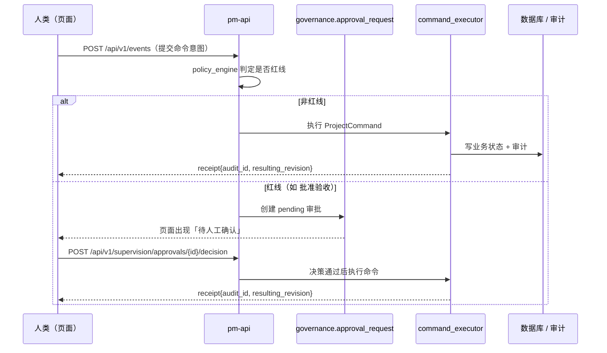
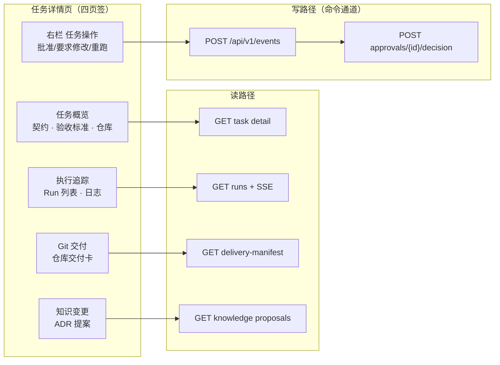
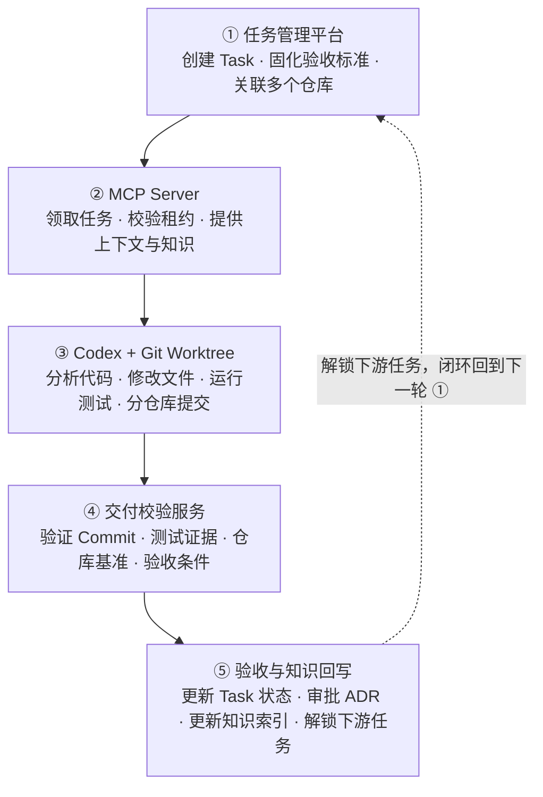

# 任务详情与执行追踪页：四页签设计定稿与执行机制映射（V1 · 供稿记录）

> **记录说明**
> - 记录日期：2026-10-31
> - 性质：需求方供稿的结构化记录稿。**只做记录与格式转换，未做任何评审、批准或裁决动作**
> - 供稿含 4 张设计图（四页签各一张，同一任务 TASK-1042）；图内文字已逐项转录，小字辨读不确定处标〔原文模糊〕
> - 与前一稿的关系：`docs/tasks/ai-pm-task-detail-tracking-v1.md` 定义页面**应该有什么**（六信息块 / 五页签 / 三栏）；本稿记录页面**实际长什么样**（四页签定稿）与**背后怎么执行**（操作到接口的映射）

| 项 | 内容 |
| --- | --- |
| 文档性质 | 页面设计定稿 + 执行机制记录（非 PRD，未定稿） |
| 版本 | V1 |
| 日期 | 2026-10-31 |
| 来源 | 需求方供稿：4 张设计图 + 「页面操作应映射到确定后端接口」的机制建议 |
| 示例任务 | TASK-1042 · 确定地形高度渲染方案（World Map Editor） |
| 状态 | 记录完成，**未评审** |
| 影响范围 | 页签数量由 5 收敛为 4（概览/执行追踪/Git 交付/知识变更）；确立「页面不直接改任务状态」的写路径原则；暴露 3 处与现有代码的冲突 |
| 前置文档 | `docs/tasks/ai-pm-task-detail-tracking-v1.md`、`docs/architecture/ai-pm-multi-repo-model-v1.md`（§8.3 交付清单）、`docs/ui/ai-pm-ui-design-system-v1.md`、`docs/architecture/ai-pm-architecture-principles.md`、`docs/architecture/ai-pm-mcp-executor-positioning-v1.md` |

### 标注图例

| 标注 | 含义 |
| --- | --- |
| 〔原文〕 | 设计图或供稿原文的直述 |
| 〔原文模糊〕 | 图内小字辨读不确定，需对照设计稿核对 |
| 〔整理〕 | 结构化归纳，不引入新决策 |
| 〔待确认〕 | 本稿推断或尚未拍板 |
| 〔待补〕 | 供稿提及但未附带内容 |
| 〔实测〕 | 本次对现有代码核对得到的事实（附文件位置） |

### 变更记录

| 版本 | 日期 | 变更内容 |
| --- | --- | --- |
| V1 | 2026-10-31 | 首次成型：共享壳层、四页签逐屏记录、写路径五原则、14 项操作到接口映射、3 处代码对账冲突、待确认 Q1–Q10 |
| V1.1 | 2026-10-31 | 追加 §6.6「领取到验收的闭环（五段服务链路）」：五段图转 Mermaid、逐段与现有实现对照、四条结构信息、与前序图的关系；新增 Q11–Q13（交付校验服务的部署形态、自证边界、租约归属） |
| V1.2 | 2026-10-31 | 追加 §6.7「页面操作与接口契约」：六项契约表、调用方矩阵（含 R1 自证风险）、校验项逐条对账、读侧收敛为 `task_get_context` 单一入口、三套命名并存；追加 §6.8「三个不能妥协的设计原则」：原则原文 + 页面落点 + 可测断言 + 知识三级分级；新增 Q14–Q18 |
| V1.3 | 2026-10-31 | 交叉引用：状态枚举与审批策略的完整规格另见 `docs/tasks/ai-pm-task-state-machine-v1.md`（13 态状态机 / 三级权限 / 16 条迁移规则 / 仓库级交付状态机 / 策略引擎）。本稿 §七 Q6（状态枚举方案）、Q8（任务级验收命令）应在该稿框架下裁定，本稿不重复裁决。 |

---

## 〇、一句话结论

> **页面是状态的投影，不是状态的持有者。**〔整理〕

需求方原文〔原文〕：

> 「我建议把页面上的每个关键操作映射到确定的后端接口，而不是让前端直接修改任务状态。」

〔整理〕这条建议的实际含义是：任务详情页上的每个按钮，都必须对应一个**语义完整的命令**，而不是「改某个字段」。页面拿到的永远是一次操作的结果回执（是否执行、审计号、新版本号），拿不到「直接改写状态」的能力。

---

## 一、页面共享壳层（四图一致）〔原文〕

四张设计图仅在中央页签区不同，头部、状态条、页签条与右栏完全一致。

### 1.1 头部

| 位置 | 内容 |
| --- | --- |
| 左上 | 分支图标 + `TASK-1042 · 确定地形高度渲染方案` |
| 标题下徽标 | `待验收`（描边徽标）+ `关联任务 2 个仓库` |
| 右上 | `{} MCP 契约` 按钮（次级按钮） |

### 1.2 状态栏（三列 + 一条交付提示）

| 列 | 字段 | 示例值 |
| --- | --- | --- |
| 1 | 所属项目 | World Map Editor |
| 2 | 执行实例 | RUN-0087 · Codex |
| 3 | 当前阶段 | 等待人工验收 |

提示条〔原文〕：

> **交付已提交，尚未合并**
> 两个仓库均已产生 Commit，跨仓库集成验证尚未全部通过。

〔整理〕该提示条承担的是「**交付态**与**任务态**不一致」的解释义务：任务已到 `待验收`，但交付并未合并、集成验证未全绿。这与 `docs/architecture/ai-pm-multi-repo-model-v1.md` §〇「三仓提交成功 ≠ 任务完成」同源。

### 1.3 页签条

`任务概览` · `执行追踪` · `Git 交付` · `知识变更`〔原文〕

> 〔整理〕前一稿（`task-detail-tracking-v1.md` §4.4）推断为五页签（多一个「验收」）。**本稿以图为准收敛为四页签**：验收不再单列页签，而是作为**右栏常驻的「任务操作」+「证据与校验」**贯穿所有页签。前一稿的推断不成立，此处按图记录。

### 1.4 右栏（四图完全一致，常驻不随页签变化）

**卡片一 · 证据与校验**

| 行 | 图标 | 名称 | 状态 |
| --- | --- | --- | --- |
| 1 | ✓ | 交付清单 | 已提交 |
| 2 | 📄 | 架构文档 | 已生成 · 待审阅内容〔原文模糊〕 |
| 3 | ⇅ | 自动化验证 | 尚无 CI 证据 |

卡片底部说明〔原文〕：

> 证据必须绑定具体仓库、Commit SHA、执行 Run 和校验结果。Agent 的文字说明不能代替真实测试记录。

**卡片二 · 任务操作**

| 序 | 按钮 | 层级 |
| --- | --- | --- |
| 1 | ✓ 批准验收 | 主按钮（深色实心） |
| 2 | 要求修改 | 次按钮 |
| 3 | 重新执行设计 | 次按钮 |

操作区底部说明〔原文模糊〕：

> 正式版操作需要权限、二次确认等控制，并记录审计日志。本原型不会调用真实仓库或改变服务端任务状态。

〔整理〕该说明本身即是对「原型 vs 正式版」边界的声明，与 §六 的写路径原则互为呼应。

### 1.5 布局还原〔整理〕

| 区域 | 宽 | 内容 |
| --- | --- | --- |
| 顶部 | — | 标题 + 状态徽标 + MCP 契约 |
| 状态栏 | — | 三列元信息 + 交付提示条 |
| 页签条 | — | 四页签，圆角描边胶囊 |
| 中央主区 | 约 340px（左卡） | 单列内容卡，圆角 8px，浅描边 |
| 右栏 | 约 200px（图内比例） | 两张固定卡片 |

〔待确认〕图内左右栏近乎等宽，与设计系统 §二（左导航 232 / 中栏自适应 / 右栏 320）不一致；此处按图记录，实际落地宽度需裁。

---

## 二、页签一：任务概览〔原文〕

图源：[`figures/task-detail-v1-tab-overview.png`](figures/task-detail-v1-tab-overview.png)

### 2.1 任务契约卡

卡片说明〔原文〕：

> 执行前冻结的目标、边界与验收标准。Agent 可以提出修改，但不能自行覆盖已批准的约束。

| 区块 | 内容 |
| --- | --- |
| 任务目标 | ① 定义适用于世界地图的高度渲染技术方案 ② 明确高度数据到地形明暗、坡度、山脊与阴影的转换路径 ③ 为后续 Bevy 2D 实现提供可执行的架构约束 |
| 验收标准 | ✓ 明确高度数据、法线 / 坡度与光照的关系 ✓ 说明平原、山地、海岸的差异化处理 ○ 给出 Bevy 渲染管线、性能约束和实施步骤 |
| 关联仓库 | `world-map-editor` — 核心应用 · Rust / Bevy 0.19 — **读写** `world-map-knowledge` — 架构与入口〔原文模糊〕· Markdown / ADR — **只读与写入**〔原文模糊，待核对〕 |
| 依赖与约束 | 依赖：地形数据模型 约束：不直接修改正式架构决策 交付：文档 + 代码证据 |

### 2.2 验收标准的勾选语义〔原文〕

> 清晰的验收勾选状态。正式版应同时对应该步骤的验收标准与证据。〔原文〕

| 勾选态 | 图中表现 | 含义 |
| --- | --- | --- |
| ✓ 实心勾 | 前两条 | 已满足，且有证据 |
| ○ 空心圈 | 第三条 | 未满足 / 未验证 |

〔整理〕此处存在一处需要澄清的设计问题：验收标准是**任务契约的一部分（事前冻结）**，勾选态却是**验收结论（事后判定）**。二者画在同一卡片、同一视觉样式下，容易让「标准」与「结论」混淆。前一稿 §2.2 的「自述与事实分离」原则在此处尚未体现。列入 §七 Q2。

### 2.3 关联仓库的权限标记

| 仓库 | 用途 | 权限标记〔原文模糊〕 |
| --- | --- | --- |
| world-map-editor | 核心应用 · Rust / Bevy 0.19 | 读写 |
| world-map-knowledge | 架构与入口 · Markdown / ADR | 只读与写入 |

〔整理〕与 `docs/architecture/ai-pm-multi-repo-model-v1.md` §一 的口径存在潜在冲突：该文档规定 `project-knowledge` **默认对所有任务只读**，而本页对 `world-map-knowledge` 显示「（只）写入」——因为本任务正是要产出 ADR 提案。二者可并存，但需要明确「默认只读 + 本任务经契约显式授予写入」的表达方式。列入 §七 Q3。

---

## 三、页签二：执行追踪〔原文〕

图源：[`figures/task-detail-v1-tab-run.png`](figures/task-detail-v1-tab-run.png)

### 3.1 卡片说明〔原文〕

> 按 Run 追踪实际执行。失败后重新执行会生成新 Run，不覆盖旧记录。

〔整理〕一句话把前一稿 §2.2 的「Task 与 Run 分离」落到了 UI 上：**Run 是只追加的记录**，重跑产生新行，不覆盖。

### 3.2 Run 卡片结构

| 字段 | RUN-0087（展开） | RUN-0086（折叠） |
| --- | --- | --- |
| 编号 | RUN-0087 | RUN-0086 |
| 执行主体 | 架构 Agent | 前序执行〔原文模糊〕 |
| 状态 | 已完成 | 已结束 |
| 时间 | 09:12–09:26 | 08:44–08:51 |
| 摘要 | 读取任务契约 → 检索相关知识 → 分析高度数据路径 → 生成架构方案 → 提交交付清单 | 深入设计 Run 日志与事件模型 |
| 展开内容 | 工具调用、终端输出、读回、时间戳可回放〔原文模糊〕 | — |

### 3.3 记录的机制要点〔整理〕

| # | 要点 | 依据 |
| --- | --- | --- |
| R1 | Run 列表按时间倒序，最新在最上且默认展开 | 图中 RUN-0087 展开、RUN-0086 折叠 |
| R2 | 旧 Run 保留可查，可折叠不删除 | 「不覆盖旧记录」 |
| R3 | 状态栏的「执行实例 RUN-0087」指向当前 Run，历史 Run 留在页签内 | 头部与卡片呼应 |
| R4 | 阶段序列以箭头链表达（非百分比） | 摘要为五段箭头链，无进度条 |

> 与 `docs/ui/ai-pm-ui-pages-v1-2.md` §二.2「执行进度不能由 AI 估算百分比」一致：本页用**阶段 + 时间戳**表达进度。

### 3.4 待补

〔待补〕「深入设计 Run 日志与事件模型」——图内明确留了这个入口，但日志字段、事件类型、回放机制本次未展开。

---

## 四、页签三：Git 交付〔原文〕

图源：[`figures/task-detail-v1-tab-git.png`](figures/task-detail-v1-tab-git.png)

### 4.1 卡片说明〔原文〕

> 每个仓库独立记录基准版本、提交和验证结果。以下 Commit 均为虚构演示数据。

### 4.2 仓库交付卡（两卡并列）

| 字段 | world-map-editor | world-map-knowledge |
| --- | --- | --- |
| 徽标 | 已提交 | 已提交 |
| 分支 | `/ai/task-1042-height` | `/ai/task-1042-adr` |
| 基准版本 | `a41c9f2f` | `c20ff61` |
| 交付版本 | `c83e1d8`（高亮等宽显示） | `f72a8e98` |
| 变更 | 高度渲染设计文档、渲染模块接口草案 | ADR 草稿、实现计划、相关知识条目索引 |

〔整理〕字段与 `docs/architecture/ai-pm-multi-repo-model-v1.md` §8.3 的交付清单口径一致，但本页**未展示**该文档要求的「测试状态 / 审查状态 / 交付态（已交付·缺失·待审）」三列，也未见 diff 入口。列入 §七 Q4。

### 4.3 交付校验

> 两个 Commit 已记录。跨仓库兼容性、实施 CI 结果与合并状态仍需验证。〔原文〕

〔整理〕这句话精确划出了三种**未决项**，且三者性质不同：

| 未决项 | 谁能给出结论 | 对应右栏证据行 |
| --- | --- | --- |
| 跨仓库兼容性 | 平台（跨仓集成验证） | 交付清单 · 已提交 |
| CI 结果 | 执行端上报 + 平台校验 | 自动化验证 · **尚无 CI 证据** |
| 合并状态 | Git / 人工合并动作 | 交付已提交，**尚未合并**（头部提示条） |

〔整理〕三处信息在页面上是**分散的**（左侧卡片、右侧证据卡、顶部提示条），但描述的是同一件事的三个侧面。是否需要一处汇总（如 `2/2 已提交 · 集成验证 未通过 · 未合并`）待裁。列入 §七 Q5。

---

## 五、页签四：知识变更〔原文〕

图源：[`figures/task-detail-v1-tab-knowledge.png`](figures/task-detail-v1-tab-knowledge.png)

### 5.1 提案卡结构

| 字段 | 内容 |
| --- | --- |
| 卡片标签 | 知识变更提案 |
| 标题 | ADR-014 · 地形高度渲染方案 |
| 状态徽标 | 待审核 |
| 所属仓库 | world-map-knowledge |
| 文件路径 | `knowledge/adr/ADR-014.md` |
| 变更摘要 | 建议采用高度场法线与法线组合的混合光照模型，结合坡向光照进行地形……〔原文模糊，图内被截断〕 |
| 变更类型 | 架构决策提案，不是已生效的既成事实 |
| 批准后动作 | 将 ADR 正式化，记录决策人和 Git 提交，重建知识索引，并通知受影响任务 |
| 底部按钮 | 查看知识变更状态机设计 |

### 5.2 记录的机制要点〔整理〕

| # | 要点 | 依据 |
| --- | --- | --- |
| K1 | 知识变更以**提案**形式存在，带审核状态 | 徽标「待审核」 |
| K2 | 提案指向具体文件路径，不指向「知识条目」抽象 | `knowledge/adr/ADR-014.md` |
| K3 | 明确声明「提案 ≠ 已生效事实」 | 变更类型一栏的措辞 |
| K4 | 批准是**一组动作**，不是一次状态翻转 | 正式化 + 记录决策人 + Git 提交 + 重建索引 + 通知受影响任务 |

〔整理〕K4 尤其重要：知识变更的批准有副作用（重建索引、通知下游任务），因此它同样不能由前端「改一个 status 字段」完成——这直接支撑 §六 的写路径原则。

### 5.3 待补

〔待补〕「查看知识变更状态机设计」——图内留了入口，状态机本次未展开。与前一稿 §六 Q2（Knowledge Change 是否单独建表）是同一问题。

---

## 六、页面背后的真实执行机制〔原文 + 实测〕

### 6.1 需求方原话〔原文〕

> 「我建议把页面上的每个关键操作映射到确定的后端接口，而不是让前端直接修改任务状态。」

〔整理〕由此展开为五条写路径原则：

| # | 原则 | 反面（禁止） |
| --- | --- | --- |
| W1 | 页面上每个写操作对应**一个语义完整的命令** | `PATCH task {status: "done"}` |
| W2 | 页面只渲染服务端返回的状态，不持有权威状态 | 前端本地 setState 后回写 |
| W3 | 每次写操作返回**回执**（审计号 + 新版本号），页面据此刷新 | 只返回 200 空体 |
| W4 | 冲突（409）与校验失败（422）原样呈现，不静默回滚 | 乐观更新后无提示地还原 |
| W5 | 红线操作先创建待确认请求，人工决策后才执行 | 按钮点了就落库 |

### 6.2 操作 → 接口映射（候选，未裁决）

> 〔待确认〕**以下为按现有代码结构推导的候选映射，需求方未逐条确认。**「现状」列的〔实测〕结论来自本次代码核对。

| # | 页面操作 | 建议后端接口 | 语义 | 现状 |
| --- | --- | --- | --- | --- |
| 1 | 打开页面 / 切换任务 | `GET /v1/pm/tasks/{task_id}`（详情，含契约） | 读 | 〔实测〕仅有 `GET /v1/pm/tasks`（列表）与 `PATCH`，**无详情端点** |
| 2 | 读任务契约（目标/约束/依赖） | 同上，或 `GET /v1/pm/tasks/{id}/contract` | 读冻结快照 | 无独立契约实体 |
| 3 | 读验收标准与勾选态 | `GET /v1/pm/tasks/{id}/acceptance-criteria` | 读 | 无表 |
| 4 | 读关联仓库与权限 | `GET /v1/pm/projects/{id}/repositories` | 读 | 〔实测〕已有（`pm_repositories`） |
| 5 | 读证据与校验 | `GET /v1/pm/tasks/{id}/evidence` | 读 | 无端点；证据实体未定 |
| 6 | 读执行追踪（Run 列表） | `GET /v1/pm/tasks/{id}/runs` | 读 | 〔实测〕`task_run` 表仍在 `0009` 草案，未落库 |
| 7 | 展开 Run 详情（工具调用/日志） | `GET /v1/pm/runs/{run_id}` + `GET /v1/pm/events/stream` | 读 + 推送 | 〔实测〕SSE 流已有（`audit_stream`） |
| 8 | 读 Git 交付清单 | `GET /v1/pm/tasks/{id}/delivery-manifest` | 读 | 视图 `v_task_delivery_manifest` 为草案 |
| 9 | 读知识变更提案 | `GET /v1/pm/knowledge/proposals?task_id=` | 读 | 无端点（`/v1/pm/documents*` 只读，无提案） |
| 10 | **批准验收** | `POST /api/v1/events`（任务级验收命令） | **写 · 红线** | 〔实测〕`ProjectCommand::SignAcceptance` 是**里程碑级**，无任务级验收命令 |
| 11 | **要求修改** | `POST /api/v1/events`（`UpdateTaskStatus` → `changes_requested`） | 写 | 〔实测〕`TaskStatus` **无** `changes_requested` 值 |
| 12 | **重新执行设计** | 新开 `task_run`（经 MCP `task.claim` 或等价内部命令） | 写 · 产生新 Run | 无接口；需保证不覆盖旧 Run |
| 13 | 查看知识变更状态机 | 无（前端静态说明） | 只读页面 | 待设计 |
| 14 | 查看 MCP 契约 | `GET /v1/pm/tasks/{id}/mcp-contract` | 读 | 无端点；契约结构见 `mcp-executor-positioning-v1.md` |

〔整理〕读路径（1–9、14）可并行开发；写路径（10–12）是**红线区**，必须先有命令定义才能做按钮，否则按钮无路可走。

### 6.3 与现有代码的三处冲突〔实测〕

#### C1 · 直写端点与命令通道并存

| 项 | 事实 |
| --- | --- |
| 位置 | `apps/pm-api/src/pm_lists.rs`：`PATCH /v1/pm/tasks/{task_id}` |
| 实现 | `pm_writes::update_task_handler` → `pm_write::update_task`，直接改库 |
| 冲突 | 页面若复用该端点做「批准验收 / 要求修改」，即等于**前端直接改任务状态**，违背 §6.1 W1 |
| 建议区分（待裁） | 列表页轻量编辑（改标题/负责人）可继续用 PATCH；**状态迁移必须走命令通道**，两者不可混用 |

> 这与项目既有硬约束（「领域写操作只走统一命令通道 command_executor + policy_engine，AI 不旁路直写库」）是一致的，此处只是把该约束扩展到**人类在页面上点按钮**的场景。

#### C2 · 状态枚举不足以表达页面徽标

| 项 | 事实 |
| --- | --- |
| 位置 | `crates/pm-domain/src/task.rs` |
| 现有值 | `backlog` / `in_progress` / `blocked` / `needs_info` / `done` |
| 页面需要 | `待验收`、`已提交`、`待审核` |
| 冲突 | 页面徽标与后端枚举**不同源**；「待验收」在现有枚举中无对应值（`done` 语义过强，`in_progress` 过弱） |

〔整理〕可选路径有三，均未裁决：① 扩展 `TaskStatus` 增加 `submitted` / `in_acceptance`；② 引入独立的 `acceptance.status` 子状态，任务态保持五值；③ 前端做派生映射（不推荐，违反 W2「状态单一来源」）。列入 §七 Q6。

#### C3 · 交付态与任务态混在同一徽标位

| 项 | 事实 |
| --- | --- |
| 现象 | 头部徽标 `待验收`（任务态），仓库卡徽标 `已提交`（交付态），二者语义粒度不同 |
| 风险 | 同一页面两套状态词汇，若共用一套枚举会互相污染 |
| 建议（待裁） | 明确两套枚举：`task.status`（任务态）+ `delivery.status`（仓库交付态），页面分别取数 |

### 6.4 执行链路（按图与代码推定）〔整理 · 待确认〕

〔实测〕该链路与现有实现吻合：`decide_handler` 返回 `outcome / audit_id / command_kind / target_id / resulting_revision`，正是 W3 要求的回执结构。因此「批准验收」按钮**不需要新造一套接口**，只需要一条任务级验收命令 + 一个 approval 记录。

### 6.5 页面与接口的一一对应关系（可视化）〔整理〕

---

### 6.6 领取到验收的闭环（五段服务链路）〔原文〕

图源：[`figures/task-loop-v1-five-stage.png`](figures/task-loop-v1-five-stage.png)

#### 6.6.1 图面转录

标题：**一次任务从领取到验收的闭环**

| 段 | 角色 | 动作（原文） |
| --- | --- | --- |
| ① | 任务管理平台 | 创建 Task · 固化验收标准 · 关联多个仓库 |
| ② | MCP Server | 领取任务 · 校验租约 · 提供上下文与知识 |
| ③ | Codex + Git Worktree | 分析代码 · 修改文件 · 运行测试 · 分仓库提交 |
| ④ | 交付校验服务 | 验证 Commit · 测试证据 · 仓库基准 · 验收条件 |
| ⑤ | 验收与知识回写 | 更新 Task 状态 · 审批 ADR · 更新知识索引 · 解锁下游任务 |

#### 6.6.2 Mermaid（布局照录）

> 实线为原图五段单向箭头；**虚线回边为〔整理〕追加**，对应第⑤段的「解锁下游任务」——该动作使链路从「线」变成「图」。原图未画回边。

#### 6.6.3 各段与现有实现的对照〔实测〕

| 段 | 与现有代码的对应 | 缺口 |
| --- | --- | --- |
| ① | `POST /v1/pm/tasks`；`project_repository`（`0008_repositories.sql`）；`ProjectCommand::CreateTask` | 「**固化验收标准**」无实体（契约/验收标准未建表）；「关联多个仓库」到任务侧需 `task_repository`（`0009` 草案） |
| ② | `/mcp` 服务 + `integration.job.lease_until` 到期重领（`e2e_scenarios.rs` 有死锁恢复用例） | 租约在 **job 层**，MCP 领取任务是否复用同一租约未定；MCP 工具命名未冻结 |
| ③ | 无平台侧实现（执行端自建 Worktree） | 平台不登记 Worktree，`task_workspace` 为 `0009` 草案；「分仓库提交」无跨仓原子性 |
| ④ | **无对应实现** | 编排（`infrastructure/docker-compose-services.yml`）仅 `pm-api` / `pm-worker` / `ai-pm-worker`；代码中只有零散 `validate_identifier` / `validate_key` 类校验，**不存在「验证 Commit · 测试证据 · 仓库基准 · 验收条件」的服务** |
| ⑤ | `TaskStatus` + `governance.approval_request`（决策返回 receipt）；`knowledge_index` 重建 | 「审批 ADR」与「更新索引」未串联；「解锁下游任务」依赖 `task_dependency`（`0009` 草案） |

#### 6.6.4 四条结构信息〔整理〕

| # | 观察 | 意义 |
| --- | --- | --- |
| L1 | 第⑤段同时是**终点与起点**（解锁下游任务 → 下一轮 ①） | 系统的基本形态是**任务图**，不是流水线；页面的「依赖关系」字段因此不是展示项，而是驱动项 |
| L2 | **④ 由平台侧独立承担校验**，不在 ③ 内 | 这是「不需要相信 Agent 说自己已完成」的架构落点：**自证无效**。前一稿 §4.7 的展示原则由此获得结构依据 |
| L3 | ② 把「校验租约」写入 MCP Server 职责 | 与现有 job 层 lease 同义不同层，需明确是否复用（否则会出现两套租约） |
| L4 | ③ 明确「**分仓库**提交」发生在执行端 | 印证「Git 无跨仓库原子提交」，故 ④ 必须做跨仓校验，⑤ 的单点状态更新才有依据 |

#### 6.6.5 与前序图的关系

| 图 | 视角 | 粒度 |
| --- | --- | --- |
| `task-tracking-v1-task-chain.png`（前一稿 §2.1） | 数据对象 | Task / MCP / Run / Commit / 知识变更 / 验收 |
| `task-loop-v1-five-stage.png`（本节） | **服务与职责** | 平台 / MCP / 执行端 / 校验服务 / 回写 |

〔整理〕两图指向同一条链路，但前者回答「有哪些对象」，后者回答「谁在哪个环节负责」。后者补齐了前者缺失的一个角色：**交付校验服务**。

---

### 6.7 页面操作与接口契约

#### 6.7.1 契约表〔原文〕

| 页面操作 | 建议调用 | 后端必须执行的校验 |
| --- | --- | --- |
| 领取任务 | `task_claim` | 原子领取、租约有效性 |
| 查看执行详情 | `task_get_context` | 任务与 Run 的访问权限 |
| 提交交付 | `task_submit` | Commit、基准版本、证据完整性 |
| 要求修改 | `task_request_changes` | 修改原因、验收失败项、状态合法性 |
| 批准验收 | `task_accept` | 验收权限、证据与状态机规则 |
| 提交知识变更 | `knowledge_propose_change` | 变更来源、文档版本、审批策略 |

原文补充〔原文〕：

> 这些是建议的接口契约名称，可以通过 MCP 工具暴露给 Codex，也可以由平台内部服务调用。

〔整理〕这段补充的份量在于「**契约不绑传输**」：同一份契约名，面向执行端时经 MCP 暴露，面向人类页面时由平台内部服务调用。因此契约的语义与校验必须在服务层实现一次，不能一处走 MCP、一处走 REST 各写一套校验。

#### 6.7.2 调用方矩阵〔整理 · 待确认〕

六项契约并非都可交给同一调用方。按 §6.6 L2「校验由平台侧独立承担」推导：

| 契约 | 执行端（经 MCP） | 平台内部服务 | 人类页面 | 说明 |
| --- | --- | --- | --- | --- |
| `task_claim` | 必须允许 | 允许（无人值守 Runner） | 间接 | 原子性要求两端共用同一租约 |
| `task_get_context` | 允许 | 允许 | 读侧 | 权限校验是唯一防线 |
| `task_submit` | 必须允许 | 允许（Runner 代提交） | **不应**由页面触发 | 页面只能读交付，不能代执行端提交 |
| `task_request_changes` | 不建议 | 允许 | 必须 | 人类是验收主体 |
| `task_accept` | **不应允许** | 允许（人类经页面） | 必须 | 见下方风险 R1 |
| `knowledge_propose_change` | 允许 | 允许 | 可选 | 人类也可直接起草提案 |

> **R1（风险，未裁决）**：若六个契约一律「通过 MCP 暴露给 Codex」，则 `task_accept` 等于让执行端**自我批准**，与「自证无效」及 §6.6 第 ④ 段的职责划分直接冲突。建议按调用方**拆分暴露面**（不是拆契约）：契约只有一份，MCP 侧不注册 `task_accept`。

#### 6.7.3 校验项与现有实现的逐条对账〔实测〕

| 契约 | 必须校验 | 现有可复用 | 缺口 |
| --- | --- | --- | --- |
| `task_claim` | 原子领取、租约有效性 | `integration.job.lease_until` + 到期重领（`e2e_scenarios.rs` 有 Worker 死亡恢复用例） | `task_run` 未落库；无**任务级**原子领取，租约仍在 job 层 |
| `task_get_context` | 任务与 Run 的访问权限 | `require_bearer`（JWKS）+ `require_mcp_permission`（`PM_MCP_READ`） | 权限是**粗粒度项目/角色级**，无 per-task / per-run ACL |
| `task_submit` | Commit、基准版本、证据完整性 | 无 | **完全空白**——即 §6.6 第 ④ 段缺失的服务。基准版本比对与证据完整性无任何实现 |
| `task_request_changes` | 修改原因、验收失败项、状态合法性 | `approval_request` 的 pending 校验（已决策再决策返回 409） | `TaskStatus` 无 `changes_requested`；「失败项」无结构化字段，无法校验 |
| `task_accept` | 验收权限、证据与状态机规则 | `policy_engine`（YAML 风险策略）+ `approval_request` 红线路径 + 决策回执 | **无任务级验收命令**（`SignAcceptance` 仅里程碑级，见 §6.3 C2 / §七 Q8） |
| `knowledge_propose_change` | 变更来源、文档版本、审批策略 | `revision` / `approval` 机制、`knowledge_index` 重建 | 「**变更来源**」无字段（缺 `source_task_id` / `source_run_id`）；文档版本靠 revision，提案与执行无关联 |

〔整理〕六项中，**三项有基础可复用**（claim 的租约、get_context 的鉴权、propose_change 的审批），**一项完全空白**（submit），**两项缺命令与状态**（accept、request_changes）。这与前一稿 §6.2 的结论一致：写路径是瓶颈，读路径不是。

#### 6.7.4 与 §6.2 候选映射的收敛关系〔整理〕

本节契约名**取代** §6.2 中由我推导的 REST 路径，成为上位口径；§6.2 退为「传输层落地建议」。

| §6.2 候选（14 项） | 收敛到 |
| --- | --- |
| 1 任务详情、2 契约、3 验收标准、5 证据、6 Run 列表、7 Run 详情、8 交付清单、14 MCP 契约 | `task_get_context`（**读侧收敛为单一入口**） |
| 9 知识提案读取 | `knowledge_propose_change` 的读侧（是否单列待定） |
| 10 批准验收 | `task_accept` |
| 11 要求修改 | `task_request_changes` |
| 12 重新执行 | `task_claim`（新 Run） |
| 4 关联仓库 | 不在六契约内，仍走 `GET /v1/pm/projects/{id}/repositories` |
| 13 状态机说明 | 前端静态页，无接口 |

> 重要收敛：**读侧从 8 个端点收敛为 1 个 `task_get_context`**。这与 `docs/architecture/ai-pm-mcp-executor-positioning-v1.md` §4.3 的既有结论一致（「收敛为单一打包入口，避免执行端多次往返」）。〔待确认〕页面是否接受「一次拉全、前端分块渲染」，还是仍需按页签懒加载分片（见 §七 Q16）。

#### 6.7.5 命名：三套方案并存〔实测〕

| 方案 | 示例 | 出处 |
| --- | --- | --- |
| `pm_*` 扁平式 | `pm_get_task_context`、`pm_submit_work_result` | `docs/architecture/ai-pm-architecture-principles.md` §九 |
| `task.*` 点分式 | `task.claim`、`task.get_context`、`knowledge.propose_change` | `docs/architecture/ai-pm-mcp-executor-positioning-v1.md` §4.1（9 个工具） |
| `task_*` 下划线式 | `task_claim`、`task_accept` | **本次供稿（6 个契约）** |

〔实测〕三套并存的**实质差异**不止分隔符：

| 差异 | 说明 |
| --- | --- |
| 动词不同 | 既有 `task.submit_result` vs 本次 `task_submit`；既有 `knowledge.propose_change` vs 本次 `knowledge_propose_change` |
| **净新增两个验收写侧契约** | `task_request_changes`、`task_accept` 在既有 9 工具清单中**均不存在**；既有只有 `task.get_review`（只读验收结果） |
| 本次未列 | 既有 `task.list`、`task.report_progress`、`task.request_decision` 不在六项内（本轮只列页面相关，非删除） |

〔整理〕可选收敛路径（未裁决）：**契约名与传输名分离**——契约层统一 `snake_case`（`task_accept`），MCP 暴露层用点分（`task.accept`），维护一张一次性映射表。理由：MCP 工具名是对外契约、改名成本高，而内部契约名是代码标识，二者不必强求一致。列入 §七 Q14。

### 6.8 三个不能妥协的设计原则〔原文〕

#### 6.8.1 原则一：Task 和 Run 必须分离〔原文〕

> 一个任务可以执行多次。失败的 Run 不应覆盖成功的历史，也不能通过重试抹掉此前的执行证据。

| 项 | 内容 |
| --- | --- |
| 页面落点 | 执行追踪页 Run 列表只追加（RUN-0087 展开 / RUN-0086 折叠共存）；状态栏「执行实例」只指向当前 Run |
| 反面 | 重跑时复用同一 Run 行、覆盖 `result` |
| 可测断言 | 第 N 次重跑后，第 N-1 次 Run 及其证据仍可查询；`task_submit` 不修改任何历史 Run 行（只能新增） |

#### 6.8.2 原则二：多仓库交付必须整体核验〔原文〕

> 每个仓库独立记录基准 Commit、交付 Commit 和测试结果。即使两个仓库都成功提交，也不能直接认定跨仓库任务已完成。

| 项 | 内容 |
| --- | --- |
| 页面落点 | Git 交付页两仓独立卡片（基准 / 交付 / 变更）+ 头部提示条「交付已提交，尚未合并」 |
| 反面 | 以「所有仓库都有 commit」作为完成判据 |
| 可测断言 | 两仓 commit 均存在但集成校验未通过时，任务**不得**进入完成态；`task_accept` 必须被状态机规则拒绝 |

〔整理〕该原则直接决定 §6.7.1 中 `task_submit` 的校验列为什么写的是「Commit、**基准版本**、证据完整性」——基准版本（base commit）是判断「提交是否基于正确起点」的唯一依据，缺了它就无法区分「正常交付」与「基于过期分支的伪交付」。

#### 6.8.3 原则三：知识回写不能等于事实生效〔原文〕

> 普通执行记录、实现说明可以自动沉淀；需求变更、架构决策等正式知识应进入提案和审批流程。PageIndex 风格索引负责让知识可检索，不负责决定知识是否有效。

| 项 | 内容 |
| --- | --- |
| 页面落点 | 知识变更页「待审核」徽标 + 「架构决策提案，不是已生效的既成事实」+ 批准后动作五步 |
| 反面 | 执行端直接把结论写进 ADR 正文；或索引里能搜到就视为生效 |
| 可测断言 | 未批准的提案可被索引检索到（且标注为提案），但**不得**出现在正式决策集合；只有批准才触发正式化与索引重建 |

〔整理〕三级知识分级（与 `docs/architecture/ai-pm-mcp-executor-positioning-v1.md` §4.2「明确不做通用 `knowledge.write`」同源）：

| 级别 | 内容 | 写入方式 | 是否需要审批 |
| --- | --- | --- | --- |
| L1 执行记录 | 运行日志、实现说明、变更摘要 | 自动沉淀 | 否 |
| L2 正式知识 | 需求变更、架构决策（ADR）、项目约束 | 提案 → 审批 → 正式化 | 是 |
| L3 索引 | PageIndex 风格的检索层 | 派生重建 | 否（**无权威性**） |

> 关键区分：L3 的职责边界是「**让知识可检索**」，不是「**决定知识是否有效**」。因此索引重建可以被自动触发，但它不能成为知识生效的判据——生效的唯一判据是审批状态。

---

## 七、待确认清单

> 只记录，不裁决。以下各项需需求方明示后才能进入设计或实现。

| # | 待确认项 | 影响 |
| --- | --- | --- |
| Q1 | 页签由前一稿推断的 5 个收敛为 4 个，是否即为定稿 | 页面结构 |
| Q2 | 验收标准（事前）与勾选态（事后）是否拆开展示，避免「标准/结论」混淆 | 概览页信息层级 |
| Q3 | 知识仓库权限如何表达「默认只读 + 本任务经契约授予写入」 | 契约字段 |
| Q4 | Git 交付页是否补齐测试状态 / 审查状态 / 交付态三列与 diff 入口 | 交付页完整性 |
| Q5 | 交付的三个未决项（跨仓兼容 / CI / 合并）是否需一处汇总 | 信息架构 |
| Q6 | 任务状态枚举如何表达「待验收」（扩展枚举 / 独立 acceptance 子状态 / 派生映射） | 枚举与迁移 |
| Q7 | 是否确认「状态迁移只走命令通道、列表页 PATCH 不得用于状态迁移」 | 写路径整改 |
| Q8 | 任务级验收命令是否新增（现有 `SignAcceptance` 仅里程碑级） | 命令集扩展 |
| Q9 | 「重新执行设计」如何保证不覆盖旧 Run（新 run 的 trigger 字段与续接关系） | 执行模型 |
| Q10 | 左右栏宽度：图内近乎等宽，与设计系统（中栏自适应 / 右栏 320）不一致 | 布局落地 |
| Q11 | 第 ④ 段「交付校验服务」是**独立部署单元**，还是 `pm-worker` 的一类作业？ | 部署形态、编排文件 |
| Q12 | 校验服务是否允许读取执行端本地环境（跑测试），还是只校验「执行端上报的证据 + Git 事实」？ | 信任模型（自证边界） |
| Q13 | MCP Server 的「校验租约」是否复用 `integration.job.lease_until`，还是任务契约层另设租约？ | 并发与死锁恢复 |
| Q14 | 三套命名（`pm_*` / `task.*` / `task_*`）如何收敛？是否采用「契约名 snake_case + MCP 暴露名点分」的分离方案？ | 对外契约，改名成本高，须一次定死 |
| Q15 | `task_accept` 是否对执行端暴露？若不暴露，MCP 侧不注册该工具是否可接受？ | 自证边界（§6.7.2 R1） |
| Q16 | 读侧是否只保留 `task_get_context` 单一入口（一次拉全、前端分块渲染），还是保留按页签懒加载的分片端点？ | 接口数量与首屏性能 |
| Q17 | `task_request_changes` 的「修改原因 / 验收失败项」是否为结构化字段？自由文本无法被校验 | 契约字段设计 |
| Q18 | `knowledge_propose_change` 的「变更来源」是否需要 `source_task_id` / `source_run_id` 强制字段？ | 可追溯性 |

---

## 附录 A：图源归档

| 页签 | 文件 | 原图 |
| --- | --- | --- |
| 任务概览 | `figures/task-detail-v1-tab-overview.png` | `60787ce1-…png` |
| 执行追踪 | `figures/task-detail-v1-tab-run.png` | `b5e03910-…png` |
| Git 交付 | `figures/task-detail-v1-tab-git.png` | `f9a6104b-…png` |
| 知识变更 | `figures/task-detail-v1-tab-knowledge.png` | `6d6ea5ad-…png` |
| 五段闭环（§6.6） | `figures/task-loop-v1-five-stage.png` | `9b23c124-…png` |

## 附录 B：本次代码核对清单〔实测〕

| 核对项 | 文件 | 结论 |
| --- | --- | --- |
| 命令集 | `crates/pm-domain/src/command.rs` | 7 个命令；`SignAcceptance` 为里程碑级红线；无任务级验收命令 |
| 任务状态枚举 | `crates/pm-domain/src/task.rs` | 5 值，无 `submitted` / `in_acceptance` / `changes_requested` |
| 任务写端点 | `apps/pm-api/src/pm_lists.rs`、`pm_writes.rs` | `PATCH /v1/pm/tasks/{id}` 直写，不经命令通道 |
| 审批决策 | `apps/pm-api/src/routes.rs`、`pm_writes.rs` | `POST /api/v1/supervision/approvals/{id}/decision`，返回 receipt |
| 审批实体 | `governance.approval_request` | pending → approved/rejected，已决策再决策返回 409 |
| 事件流 | `apps/pm-api/src/audit_stream.rs` | SSE `/v1/pm/events/stream` 已可用 |
| 仓库关系 | `apps/pm-api/src/pm_repositories.rs`、`migrations/0008_repositories.sql` | 已落库 |
| 任务运行 / 交付清单 | `migrations/` | 最大编号 `0008`，`0009_multi_repo.sql` 仍为草案，未落库 |

---

（记录截止此处。本稿未做任何评审、批准或裁决动作；后续变更以追加方式记录，不改写既有条目。）
