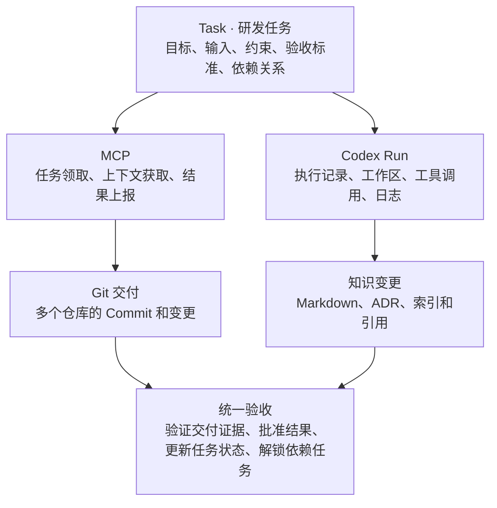
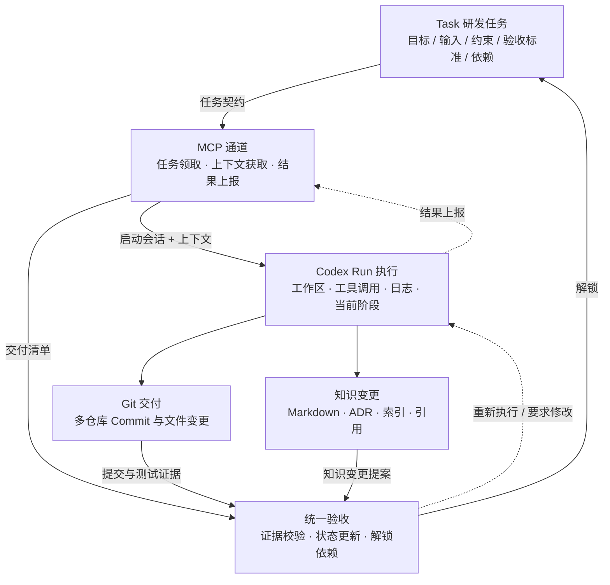
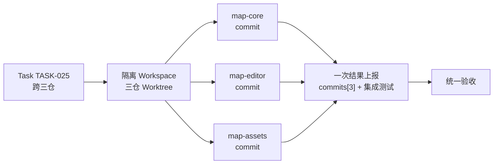
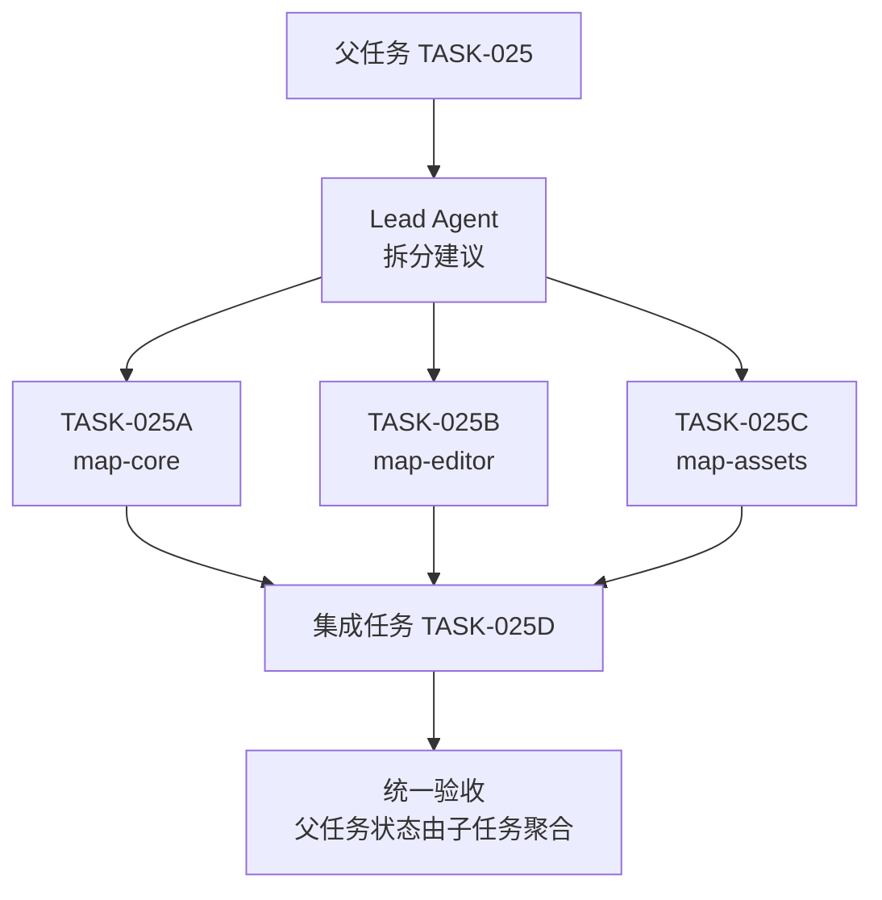
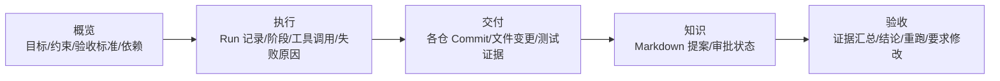

# AI 研发管理平台：任务中心模型与任务详情追踪页（V1 · 供稿记录）

> **记录说明**
> - 记录日期：2026-10-31
> - 性质：需求方供稿的结构化记录稿。**本稿只做记录与格式转换，未做任何评审、批准或裁决动作**；凡未获明示确认的推断一律标注〔待确认〕
> - 分析须待用户明示「分析」后才进行；本稿不包含分析结论
> - 配图：`figures/task-tracking-v1-task-chain.png`（任务链路图，本文 §2.1 已转为 Mermaid 文本，转换校验见附录 B）

| 项 | 内容 |
| --- | --- |
| 文档性质 | 设计供稿记录（非 PRD，未定稿） |
| 版本 | V1 |
| 日期 | 2026-10-31 |
| 来源 | 需求方关于「核心数据模型 + 任务协作机制 + 任务详情与执行追踪页」的供稿（含 1 张链路示意图） |
| 状态 | 记录完成，**未评审**；所有设计判断的生效与否不改变记录内容 |
| 影响范围 | 确立 `Task` 为系统唯一状态锚点的地位；确立 `Task / Run / Commit / Knowledge Change / Acceptance` 五对象分层；新增「任务详情与执行追踪页」页面定义 |
| 前置文档 | `docs/architecture/ai-pm-architecture-principles.md`、`docs/architecture/ai-pm-mcp-executor-positioning-v1.md`、`docs/architecture/ai-pm-multi-repo-model-v1.md`（§七 拆分策略、§8.3 交付清单）、`docs/architecture/knowledge-services/ai-pm-markdown-knowledge-space.md`、`docs/ui/ai-pm-ui-design-system-v1.md` |

### 标注图例

| 标注 | 含义 |
| --- | --- |
| 〔原文〕 | 需求方结论的直述，不改写语义 |
| 〔整理〕 | 按结论结构化归纳的补充表述，仅为可读性，不引入新决策 |
| 〔待确认〕 | 本稿推断、或需求方尚未拍板项 |
| 〔待补〕 | 供稿中提及但未随文附带的内容（如原型代码） |

### 变更记录

| 版本 | 日期 | 变更内容 |
| --- | --- | --- |
| V1 | 2026-10-31 | 首次成型：三问定位、五对象分层、链路图转 Mermaid、两种执行模式、任务详情页六信息块与五页签、与既有模型衔接、待确认清单 |
| V1.1 | 2026-10-31 | **追加勘误**：§4.4 推断的「五页签」不成立。后续供稿的四张设计图显示页签为 4 个（任务概览 / 执行追踪 / Git 交付 / 知识变更），验收不单列页签，而是作为右栏常驻的「证据与校验 + 任务操作」。以 `docs/tasks/ai-pm-task-detail-page-v1.md` 为准，本节原文保留不改。 |

---

## 〇、一句话结论

> **Task 是整个系统的中心，而不是执行会话的附属品。**〔原文〕

需求方的原始表述是「任务是整个系统的中心」，并给出三条理由：任务承载业务目标与验收标准；执行、交付、知识变更与验收都必须挂在同一个任务对象上；页面、数据模型、MCP 协议应围绕同一个任务统一，而不是各自维护一套状态。

〔整理〕该结论的直接后果：系统的状态主键是 `task_id`，不是 `session_id`、不是 `run_id`、也不是 `commit_sha`。任何「以会话为中心」的实现都会在任务重跑、跨仓库交付、跨会话协作三种场景下失效。

---

## 一、下一步必须先设计清楚的三件事〔原文〕

需求方建议在核心数据模型与任务协作机制上，先把下面三个问题设计清楚：

| # | 问题 | 核心矛盾 |
| --- | --- | --- |
| Q-A | **任务如何流转** | 从人类创建任务 → Codex 领取 → 执行 → Commit → 提交验收 → 知识回写 |
| Q-B | **多仓库如何协作** | 一个任务涉及多个仓库时，如何管理工作区、Commit、依赖与跨仓库验收 |
| Q-C | **知识如何持续维护** | 需求、架构决策、任务结果与代码之间如何建立可追溯关系 |

〔整理〕三问与本文及既有文档的对应关系：

| 问题 | 本文对应章节 | 既有文档承接 |
| --- | --- | --- |
| Q-A | §2（五对象分层）、§4.4「执行」「验收」页签 | `docs/architecture/ai-pm-mcp-executor-positioning-v1.md` 十态状态机与工具清单 |
| Q-B | §3（两种执行模式） | `docs/architecture/ai-pm-multi-repo-model-v1.md` §七、§8.3 |
| Q-C | §2.1（知识变更对象）、§4.4「知识」页签 | `docs/architecture/knowledge-services/ai-pm-markdown-knowledge-space.md`、多仓库模型 §五 知识两层 |

> 记录边界：Q-A 的完整状态机迁移表、Q-C 的知识变更数据结构，**本次供稿未展开**，本文不代拟，列入 §六 待确认。

---

## 二、任务是整个系统的中心

### 2.1 链路图（原图转 Mermaid）

**图源**：`figures/task-tracking-v1-task-chain.png`（需求方随文提供，原图为 PowerPoint 风格的五段竖排链路）。

#### 2.1.1 布局照录版（严格对应原图）



**图面结构照录**：

| 行 | 内容 | 原图形态 |
| --- | --- | --- |
| 1 | Task · 研发任务 / 目标、输入、约束、验收标准、依赖关系 | 整行宽卡片，置顶居中，圆形准星图标 |
| 2 | MCP / 任务领取、上下文获取、结果上报 ‖ Codex Run / 执行记录、工作区、工具调用、日志 | 双列并排 |
| 3 | Git 交付 / 多个仓库的 Commit 和变更 ‖ 知识变更 / Markdown、ADR、索引和引用 | 双列并排 |
| 4 | 统一验收 / 验证交付证据、批准结果、更新任务状态、解锁依赖任务 | 整行宽卡片，置底居中，圆形对勾图标 |

**转换说明**〔整理〕：原图中三处箭头均为**居中单箭头（↓）**，位于行与行之间，表示「阶段推进」，并非节点级因果连线。因此 2.1.1 采用「左列成链、右列成链」的还原方式，保证图形拓扑与原图一致；但该还原会读出「Codex Run → 知识变更」这类并不严谨的因果关系，故补充 2.1.3 语义版。

#### 2.1.2 五行语义〔整理〕

| 层 | 层名 | 回答的问题 | 一句话判据 |
| --- | --- | --- | --- |
| L1 | 任务定义 | 要完成什么 | 「做完什么算完成」 |
| L2 | 接入与执行 | 谁来干、怎么干、干了什么 | 「这次执行发生在哪个工作区、调用了什么工具」 |
| L3 | 交付物 | 产出了什么可验证的东西 | 「代码改了哪些行、知识改了什么说法」 |
| L4 | 统一验收 | 是否可以接受 | 「证据是否满足验收标准」 |

#### 2.1.3 数据流语义版〔整理 · 待确认〕



> 与 2.1.1 的差异仅在于：把 MCP 画成**横切通道**（领取与上报都是通道行为，不是一次性阶段），并补出验收回退边。此为〔整理〕推断，**需求方未确认**，标〔待确认〕。

### 2.2 五个对象必须分开〔原文〕

> 「这里有一个重要的架构决定：**Task 和 Run 必须分开。**」〔原文〕

| 对象 | 表示什么 | 生命周期 | 是否可多次 | 失败后如何处置 |
| --- | --- | --- | --- | --- |
| **Task** | 需要完成什么，是长期存在的业务对象 | 中（天/周级），跨多次执行存活 | 一个 | **不重建**，重跑或要求修改 |
| **Run** | 某一次具体执行 | 短（一次会话/一次租约） | 同一任务可有多次 | 结束即归档，保留失败原因 |
| **Commit** | 代码或文档的版本化变更 | 长（Git 内永久） | 每仓每次提交各一条 | 保留；可放弃某仓提交，不回滚全部 |
| **Knowledge Change** | 项目认知的变更提案及其审核状态 | 中（提案 → 审核 → 生效/驳回） | 可多次提案 | 驳回后保留提案记录与理由 |
| **Acceptance** | 交付物是否满足验收标准 | 一次判定，可复议 | 可多次（每次针对一个交付快照） | 失败即产生「要求修改」，不销毁交付物 |

需求方给出的三条推论〔原文〕：

1. **Codex 执行失败后可以重新运行任务，而不需要重建任务。**
2. **任务验收失败后，可以要求 Codex 基于已有 Commit 继续修改。**
3. 同一任务因此可以有多次执行、失败重试和不同 Codex 会话。

〔整理〕推论 2 的关键在于「基于已有 Commit」：这意味着重跑不是从 `base_commit` 重来，而是可以从上一次 run 的产出继续。该能力要求 Run 之间能建立**续接关系**（见 §6 Q4）。

### 2.3 分开之后才成立的三件事〔整理〕

| 能力 | 依赖的分层 | 若 Task 与 Run 未分开会怎样 |
| --- | --- | --- |
| 失败重试 | Task 独立于 Run 存在 | 重试必须新建任务，历史断裂，验收标准丢失 |
| 增量修改 | Acceptance 指向交付快照而非任务本身 | 「要求修改」只能新建任务，无法带上一次 Commit |
| 多会话并行 | 一个 Task 对应多个 Run | 并行会话互相覆盖同一任务状态 |

### 2.4 不变量（Invariants）〔整理 · 待确认〕

以下为从「Task 与 Run 分离」推导出的约束，**需求方未逐条确认**：

| # | 不变量 | 强制点（建议） |
| --- | --- | --- |
| T1 | 任务状态由平台裁决，不由执行端自述决定 | 执行端只能上报 `result`，不能直接写 `task.status` |
| T2 | 一个 Run 属于且仅属于一个 Task | `task_run.task_id NOT NULL` |
| T3 | 一个 Run 的产物是提交集合，不是单一 commit | `commits[]`，无顶层 `commit_sha`（与多仓库模型 I5 一致） |
| T4 | Acceptance 必须指向具体的交付快照 | `acceptance` 记录 `run_id` + `manifest_version` |
| T5 | Knowledge Change 必须可追溯到触发它的 Task/Run | 提案携带 `source_task_id` / `source_run_id` |

---

## 三、多仓库任务的两种执行模式〔原文〕

> 「多仓库任务必须支持两种执行模式。」

### 3.1 模式 A：单个 Codex 跨仓库执行

```text
模式 A：单个 Codex 跨仓库执行
一个任务涉及多个仓库，由同一个 Codex 在隔离的 Workspace 中统一修改和验证。
适合接口同步修改、小型跨仓库重构，以及需要整体理解的工作。
```



| 项 | 说明 |
| --- | --- |
| 执行者 | 单一 Codex 会话 |
| 工作区 | 一个隔离 Workspace，内部为多仓 Worktree |
| 提交 | 每仓各自 commit，一次上报提交集合 |
| 适用 | 接口同步修改、小型跨仓库重构、需要整体理解的工作 |
| 主要风险 | 上下文过大、单点失败导致三仓皆未交付 |

### 3.2 模式 B：父任务拆分为多个子任务

```text
模式 B：父任务拆分为多个子任务
Lead Agent 将工作拆分给不同 Codex 会话，各自拥有工作区，完成后由集成任务统一验证。
适合模块边界清晰、接口约定明确、可以并行开发的工作。
```



| 项 | 说明 |
| --- | --- |
| 执行者 | 多个 Codex 会话，各自独立 |
| 工作区 | 每会话一个工作区，互不共享 |
| 提交 | 每子任务各自提交，由集成任务统一验证 |
| 适用 | 模块边界清晰、接口约定明确、可并行开发 |
| 主要风险 | 接口漂移、集成阶段才发现不一致 |

### 3.3 两模式对照

| 维度 | 模式 A | 模式 B |
| --- | --- | --- |
| 会话数 | 1 | N + 1（含集成任务） |
| 一致性保障 | 同一会话内保证 | 靠接口冻结 + 集成验证保证 |
| 并行度 | 无 | 高 |
| 上下文负担 | 高（需理解全部改动面） | 低（每会话只看局部） |
| 失败影响面 | 全任务 | 单子任务 |
| 原子一致性 | 较好（同一时刻统一改） | 较弱（需协调窗口） |

### 3.4 建议由平台提出，但不强制〔原文〕

> 「平台应该根据任务依赖、接口稳定性和修改范围提出建议，**但不应强制所有跨仓库任务都拆分**。」〔原文〕

〔整理〕建议输入与既有文档的对应：

| 建议依据 | 判断信号 | 既有承接 |
| --- | --- | --- |
| 任务依赖 | 是否存在可并行的、互不阻塞的子工作 | `task_dependency (kind='blocks' / 'interface')` |
| 接口稳定性 | 接口已冻结 → 可拆；接口待设计 → 单会话 | `interface_ref` + `pinned_commit` |
| 修改范围 | ≥3 仓或改动面过大 → 倾向拆分 | 任务创建表单的拆分建议提示 |

> 本节与 `docs/architecture/ai-pm-multi-repo-model-v1.md` §7 属同一议题的不同表述：模式 A ≈「fat task（单任务多仓库）」，模式 B ≈「thin tasks（父任务 + 子任务 + 集成任务）」。**两处口径是否合并为单一定义，未裁决**（§6 Q6）。

---

## 四、接下来最值得设计的页面〔原文〕

> 「我建议先设计一个全新的核心页面：**任务详情与执行追踪页**。它应该成为人类、Lead Agent 和 Codex 之间的共同工作界面。」〔原文〕

### 4.1 页面定位〔原文〕

| 项 | 内容 |
| --- | --- |
| 页面名 | 任务详情与执行追踪页 |
| 页面角色 | 人类、Lead Agent、Codex 三方共同工作界面 |
| 要解决的问题 | 用户不必一直盯着 Codex 终端，也不需要相信 Agent 自述「已完成」，而是能看到任务依据、实际执行、Git 交付、测试证据与最终验收结果 |
| 收敛作用 | 该页确定后，数据库模型、MCP 协议与 AI 执行中心围绕**同一个任务对象**统一，而不是各自维护一套状态 |

### 4.2 六项必需信息〔原文〕

| # | 信息块 | 内容 |
| --- | --- | --- |
| 1 | 任务依据 | 任务目标、约束、验收标准与依赖关系 |
| 2 | 仓库上下文 | 关联的多个仓库、基准 Commit、工作区状态 |
| 3 | 执行实况 | Codex 执行记录、当前阶段、工具调用、失败原因 |
| 4 | 交付证据 | 各仓库的 Commit、文件变更与测试证据 |
| 5 | 知识变更 | Markdown 知识变更提案及其审批状态 |
| 6 | 处置动作 | 任务重新执行、要求修改、批准验收等操作 |

### 4.3 三栏信息架构〔整理 · 待确认〕

沿用已定的「专业克制型 · 紧凑专业型 · 三栏工作空间 · 桌面端优先」与 1440×900 基准（`docs/ui/ai-pm-ui-design-system-v1.md` §二）：

| 区域 | 宽度 | 本页承载 | 说明 |
| --- | --- | --- | --- |
| 顶部栏 | 52px | 项目切换、任务编号与标题、任务状态徽标 | 状态徽标与后端枚举同源 |
| 左栏 | 232px | 项目导航 + 任务清单（可按状态/仓库筛选） | 保留全局导航，任务清单嵌入左栏下半区〔待确认〕 |
| 中栏 | 自适应 | **任务工作区：五个页签**（见 4.4） | 优先保留空间，不做等分 |
| 右栏 | 320px | 上下文/证据：当前 Run、工作区路径、权限、关联知识引用 | 右栏仍不是第二个聊天窗口（沿用设计系统 §二 规则 1） |
| 底部 | 72–120px | AI 指令栏，默认引用当前 Task 与当前 Run | 引用可查看可移除（沿用规则 2） |

〔待确认〕左栏是否保留任务清单、还是进入本页后左栏仅保留项目导航，供稿未明确。

### 4.4 中栏页签结构〔整理 · 待确认〕

六项信息块按「与任务的因果顺序」落位为五个页签：



| 页签 | 承载原文信息块 | 关键内容 | 主操作 |
| --- | --- | --- | --- |
| 概览 | 1 | 目标、约束、验收标准、依赖关系；任务创建者与时间 | 编辑（受权限约束） |
| 执行 | 3 | Run 列表（含历史失败 Run）、当前阶段、工具调用流水、失败原因 | 重新执行 |
| 交付 | 2 + 4 | 按仓库分行的交付清单：仓库 / base / 实际 commit / 变更规模 / 测试状态 / 交付态；工作区状态 | 查看 diff、触发集成验证 |
| 知识 | 5 | Markdown 变更提案、ADR 提案、审批状态、影响的知识条目 | 查看提案 diff |
| 验收 | 4 + 6 | 证据汇总（提交 + 测试 + 知识）、验收结论、历史验收记录 | 批准验收 / 要求修改 / 标记需恢复 |

> 「交付」页签与 `docs/architecture/ai-pm-multi-repo-model-v1.md` §8.3 的「交付清单」为同一视图；该文档已规定**不提供「一键回滚全部仓库」**，本页沿用。

### 4.5 设计要求〔原文〕

| # | 要求 |
| --- | --- |
| 1 | 设计上沿用「专业克制、紧凑型三栏布局」 |
| 2 | 把多仓库、MCP、Codex Run 和 Markdown 知识变更放进**同一条任务链路** |
| 3 | 展示「平台应有的交互行为」；执行记录与提交信息均为**演示数据** |

### 4.6 交互原型〔待补〕

> 「下面是一个可切换任务标签、查看仓库交付、模拟验收的桌面端原型。」〔原文〕

三项交互行为记录如下，**原型代码未随本次供稿附带**，标〔待补〕：

| 交互 | 预期行为 | 状态 |
| --- | --- | --- |
| 切换任务标签 | 在五个页签间切换，URL 可寻址，右栏上下文随页签变化 | 〔待补〕原型未附带 |
| 查看仓库交付 | 在「交付」页签按仓库查看 Commit、文件变更与测试证据 | 〔待补〕原型未附带 |
| 模拟验收 | 在「验收」页签执行批准验收 / 要求修改，任务状态随之变化 | 〔待补〕原型未附带 |

> 记录口径：以上行为描述来自需求方文字供稿与配图，**未包含原型实现**。原型落地需另行确认（§6 Q7）。

### 4.7 展示原则〔整理 · 待确认〕

由「不需要相信 Agent 自己说已经完成」直接推导，建议写入页面规范：

| 原则 | 具体做法 |
| --- | --- |
| 自述与事实分离 | Agent 的「已完成」只作为一条**待验证声明**展示，与平台校验结果并列，不合并为同一状态 |
| 证据优先 | 每个「已通过」必须可展开到具体命令、退出码、日志片段或测试报告 |
| 拒绝估算进度 | 优先显示可验证的阶段与检查点；仅在具备明确权重的计划下显示百分比（沿用 `docs/ui/ai-pm-ui-pages-v1-2.md` §二.2） |
| 状态单一来源 | 页面所有状态徽标读同一枚举，禁止前端自行推断 |

---

## 五、与既有模型的衔接〔整理 · 待确认〕

### 5.1 对象落位

| 本稿对象 | 既有承接 | 差异 |
| --- | --- | --- |
| Task | `delivery.task` | 无变化 |
| Run | `delivery.task_run`（多仓库模型 0009 草案） | 需补「续接上一次 run」字段〔待确认〕 |
| Commit | `delivery.task_repository_commit` | 无变化 |
| Knowledge Change | 知识空间 `revision` / `proposal` 机制 | **是否单独建表未定**，可能复用提案表 + `source_task_id` |
| Acceptance | `delivery.task.status` + 审批记录 | 是否独立 `acceptance` 实体未定 |

### 5.2 MCP 侧接口（仅记录涉及面，不定义签名）

| 链路节点 | 涉及的 MCP 行为 | 既有工具（`docs/architecture/ai-pm-mcp-executor-positioning-v1.md` §9） |
| --- | --- | --- |
| 任务领取 | 领取 + 租约 | `task.claim` |
| 上下文获取 | 目标/约束/验收标准/依赖 | `task.context` 类读取 |
| 结果上报 | 提交集合 + 测试证据 + 知识变更 | `task.submit_result` |
| 知识提案 | 提交 Markdown/ADR 变更提案 | 知识提案类（名称待冻结） |

> 命名冻结问题在 `docs/architecture/ai-pm-mcp-executor-positioning-v1.md` 已列为冲突待裁（`task.*` vs 既有 `pm_*`），本稿不重复裁决。

### 5.3 与 AI 执行中心的分工

| 页面 | 视角 | 主问题 |
| --- | --- | --- |
| AI 执行中心 | 会话/运行视角（横向，跨任务） | 「现在有哪些 Agent 在跑，谁需要介入」 |
| 任务详情与执行追踪页 | 任务视角（纵向，单任务全生命周期） | 「这个任务凭什么可以验收」 |

〔整理〕两页共享同一 `task_run` 数据源，但**不得各自维护状态**——这正是需求方要求「围绕同一个任务对象统一」的落点。

---

## 六、待确认清单

> 本稿只记录，不做裁决。以下各项需需求方明示后才能进入设计或实现。

| # | 待确认项 | 影响 |
| --- | --- | --- |
| Q1 | 五对象是否需要 `Acceptance` 独立实体，还是复用任务状态 + 审批记录 | 迁移设计 |
| Q2 | `Knowledge Change` 是否单独建表，与既有 `revision`/提案机制如何合并 | 知识空间竖切 |
| Q3 | 任务状态机是否需要新增「待验收」独立态（当前靠 `changes_requested` / `partial` 表达） | 状态枚举、前端徽标 |
| Q4 | Run 之间「基于已有 Commit 续接」如何表达（`parent_run_id`？`resume_from_commit`？） | 重跑语义、契约字段 |
| Q5 | 页面路由与既有 `/focus/:objectType/:id` 的关系：任务详情是独立页还是 focus 视图 | 前端路由与壳 |
| Q6 | §3 两种模式与 `multi-repo-model` §7「fat task / thin tasks」是否合并为单一定义 | 术语一致性 |
| Q7 | 任务详情页原型是否需按本稿重做（本次供稿未附原型代码） | 交付范围 |
| Q8 | 左栏是否保留任务清单（进入详情页后导航形态） | 三栏布局 |
| Q9 | 「执行」页签是否复用 AI 执行中心组件，还是独立实现 | 前端复用策略 |

---

## 附录 A：原图归档

| 项 | 内容 |
| --- | --- |
| 文件名 | `figures/task-tracking-v1-task-chain.png` |
| 来源 | 需求方供稿附件（`b334845f-...png`） |
| 形态 | 五段竖排链路图，两处整行宽卡片、两行双列并排 |
| 文本转换 | 见 §2.1.1（布局照录版）、§2.1.3（数据流语义版） |

## 附录 B：转换校验（图面元素 → Mermaid 节点）

| 原图元素 | 副标题原文 | Mermaid 节点 | 校验 |
| --- | --- | --- | --- |
| Task · 研发任务（准星图标） | 目标、输入、约束、验收标准、依赖关系 | `T` | 一致 |
| MCP（分支图标） | 任务领取、上下文获取、结果上报 | `M` | 一致 |
| Codex Run（终端图标） | 执行记录、工作区、工具调用、日志 | `R` | 一致 |
| Git 交付（提交图标） | 多个仓库的 Commit 和变更 | `G` | 一致 |
| 知识变更（书本图标） | Markdown、ADR、索引和引用 | `K` | 一致 |
| 统一验收（对勾图标） | 验证交付证据、批准结果、更新任务状态、解锁依赖任务 | `A` | 一致 |
| 三处居中 ↓ | — | `T→M`、`T→R`、`M→G`、`R→K`、`G→A`、`K→A` | 见 §2.1.1 转换说明 |

> 图标为原图装饰元素，Mermaid 版以文字标签承载，不引入图标语义。

---

（记录截止此处。本稿未做任何评审、批准或裁决动作；后续变更以追加方式记录，不改写既有条目。）
