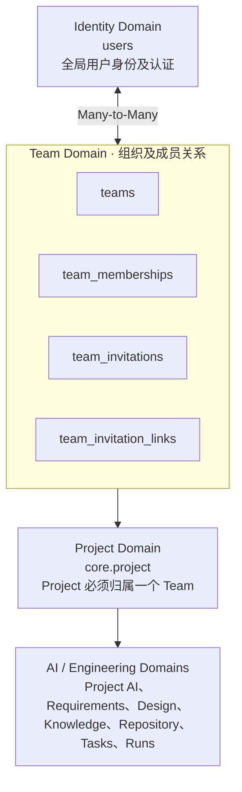
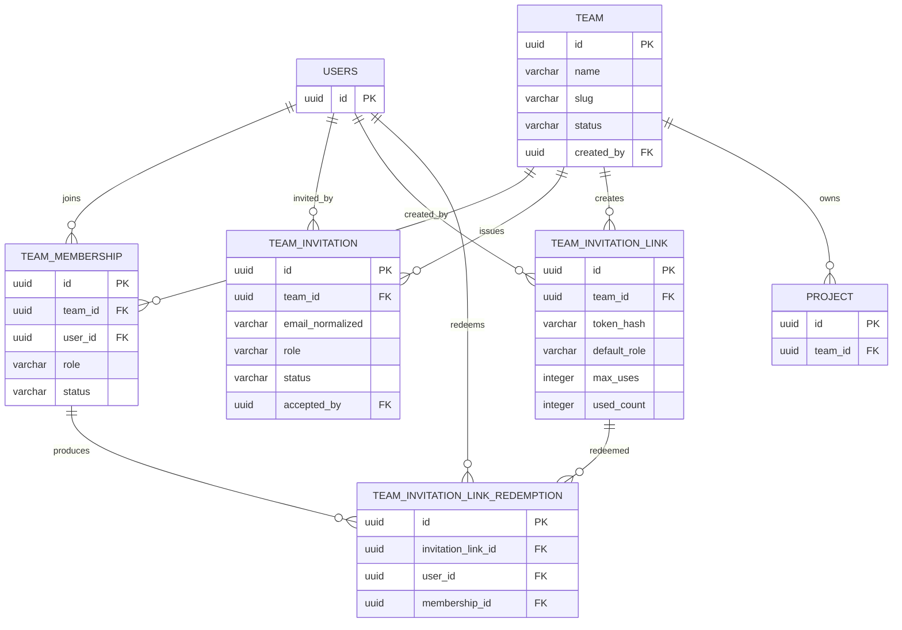
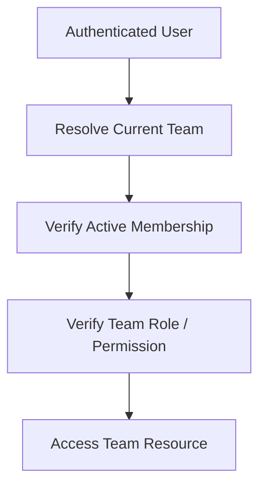
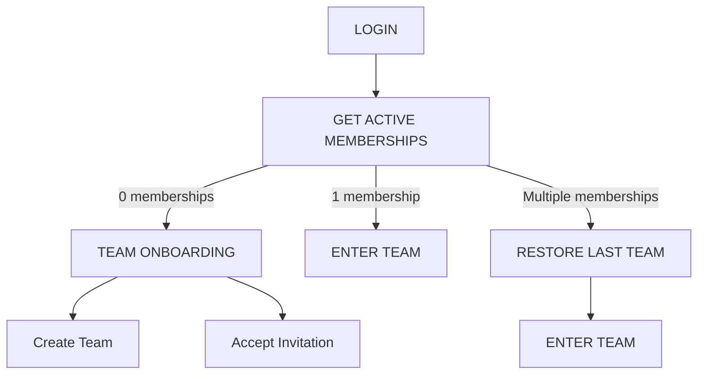

# Team Domain Model & Database Design V1.0

| 属性 | 值 |
| --- | --- |
| 设计基线 | 正式交付 · PostgreSQL |
| 项目 | PM-AI Platform |
| 模块 | Team Onboarding & Team Management |
| 设计版本 | V1.0 |
| 关联产品裁决 | 2026-11-06 |
| 设计状态 | Proposed Technical Baseline，待代码现实扫描及技术实施确认 |

本次设计的目标不是简单增加一张 team 表，而是建立 PM-AI 的组织与多租户基础。

先明确三个架构原则：

1. User 是全局身份，Team 是组织边界。 一个 User 可以加入多个 Team。
2. Membership 是独立领域实体。 用户在不同 Team 中的角色、状态和权限相互独立。
3. Team 是 Project 的直接归属边界。 Project、Team LLM 配置及相关资源必须遵守 Team 隔离规则。

另外，必须与已有架构保持一致：不能因为增加 Team 而重新设计一遍已有的 Project、Authentication、ai.project_ai_config 或 Team LLM Provider 模块。

---

## 1. 领域模型总览

### 1.1 Domain Architecture

> 由架构图截图转写为 mermaid。



关系语义：

- Identity ↔ Team：Many-to-Many，经由 `team_memberships` 表达。
- Team → Project：一对多归属，`core.project` 必须归属一个 Team。
- Project → AI / Engineering Domains：依赖传递，Project AI、Requirements、Design、Knowledge、Repository、Tasks、Runs 平行依赖 Project。

### 1.2 领域边界

| Domain | 负责内容 |
| --- | --- |
| Identity | User 身份、认证 |
| Team | Team 生命周期、团队资料 |
| Membership | 用户与团队的成员关系 |
| Invitation | 邮箱邀请、邀请链接 |
| Authorization | Team 和 Project 访问授权 |
| Project | 项目及其所属团队 |
| Team AI Configuration | Team LLM Provider 授权和配置 |

注意：Authorization 是横跨多个业务领域的访问控制能力，不应将所有权限逻辑堆进 Team 表。

---

## 2. 核心实体定义

建议 V1.0 包含以下六个核心实体。

| 实体 | 数据表 | 必须 |
| --- | --- | --- |
| Team | core.team | 是 |
| Team Membership | core.team_membership | 是 |
| Team Invitation | core.team_invitation | 是 |
| Invitation Link | core.team_invitation_link | 是 |
| Invitation Acceptance | 通过邀请状态及 Membership 关联记录 | 否，V1 不单独建表 |
| Team Audit Event | 复用平台审计基础设施 | 是，复用优先 |

这里采用 core 作为逻辑命名空间示例。实施前需要扫描现有数据库，确认实际 schema 和表命名约定。

---

## 3. Database Schema 详细设计

### 3.1 core.team

团队主表。

| 字段 | 类型 | 约束 | 说明 |
| --- | --- | --- | --- |
| id | UUID | PK | Team ID |
| name | VARCHAR(120) | NOT NULL | 团队名称 |
| slug | VARCHAR(100) | NOT NULL | 团队标识 |
| description | TEXT | NULL | 团队描述 |
| status | VARCHAR(20) | NOT NULL | 团队状态 |
| created_by | UUID | FK User | 创建者 |
| created_at | TIMESTAMPTZ | NOT NULL | 创建时间 |
| updated_at | TIMESTAMPTZ | NOT NULL | 更新时间 |
| deleted_at | TIMESTAMPTZ | NULL | 软删除时间 |

建议状态：

- ACTIVE
- SUSPENDED
- DELETED

关键约束：

- id 全局唯一。
- slug 全局唯一（如果采用全局 URL 命名）。
- 创建 Team 和创建者 Membership 必须在同一个数据库事务中完成。
- Team 创建者自动获得 OWNER。

created_by 是创建历史，不是当前 Owner 的唯一判断依据。当前 Owner 应通过 Membership 查询。

### 3.2 core.team_membership

这是整个设计最重要的一张表。

它负责维护 User 与 Team 的多对多关系。

| 字段 | 类型 | 约束 | 说明 |
| --- | --- | --- | --- |
| id | UUID | PK | Membership ID |
| team_id | UUID | FK Team | 所属 Team |
| user_id | UUID | FK User | 所属 User |
| role | VARCHAR(20) | NOT NULL | 团队角色 |
| status | VARCHAR(20) | NOT NULL | 成员状态 |
| joined_at | TIMESTAMPTZ | NOT NULL | 加入时间 |
| created_at | TIMESTAMPTZ | NOT NULL | 创建时间 |
| updated_at | TIMESTAMPTZ | NOT NULL | 更新时间 |
| deleted_at | TIMESTAMPTZ | NULL | 关系终止时间 |

角色：

- OWNER
- ADMIN
- MEMBER

成员状态：

- ACTIVE
- SUSPENDED
- REMOVED

约束：

```sql
UNIQUE (team_id, user_id)
```

建议增加索引：

```sql
CREATE INDEX idx_team_membership_user
ON core.team_membership(user_id);

CREATE INDEX idx_team_membership_team_status
ON core.team_membership(team_id, status);

CREATE INDEX idx_team_membership_user_status
ON core.team_membership(user_id, status);
```

关键设计裁决：

- 一个 User 可以有多个 Membership。
- 一个 Team 可以有多个 Membership。
- 每个 Membership 只有一个当前角色。
- Membership 状态不能代表 User 账号状态。
- 用户离开 Team 不等于删除 User。
- 删除 Membership 不影响其他 Team 的成员关系。

对于历史成员关系，建议保留原记录，通过 status 和 deleted_at 管理，而不是物理删除。

#### Owner 约束

一个 Team 必须至少有一名有效 Owner。

但不能只依赖普通 CHECK Constraint 实现，因为 Owner 数量属于跨行约束。

建议通过数据库事务、服务层并发控制以及必要的数据库约束共同保证：

1. 创建 Team 时必须同时创建 Owner Membership。
2. Owner 转移时，先确保新 Owner 已经成为 ACTIVE 成员。
3. 转移后原 Owner 可以降为 ADMIN。
4. 不允许删除或停用最后一名 Owner。
5. 并发 Owner 转移必须串行化处理。

可采用以 Team 行为锁定对象的事务方案（SELECT ... FOR UPDATE）。

### 3.3 core.team_invitation

邮箱邀请记录。

| 字段 | 类型 | 约束 | 说明 |
| --- | --- | --- | --- |
| id | UUID | PK | Invitation ID |
| team_id | UUID | FK Team | 被邀请的 Team |
| email | VARCHAR(320) | NOT NULL | 被邀请邮箱 |
| email_normalized | VARCHAR(320) | NOT NULL | 规范化邮箱 |
| role | VARCHAR(20) | NOT NULL | 预设角色 |
| token_hash | VARCHAR(255) | NOT NULL | 邀请 Token 哈希 |
| status | VARCHAR(20) | NOT NULL | 邀请状态 |
| invited_by | UUID | FK User | 邀请人 |
| expires_at | TIMESTAMPTZ | NOT NULL | 到期时间 |
| accepted_by | UUID | FK User | 接受邀请的用户 |
| accepted_at | TIMESTAMPTZ | NULL | 接受时间 |
| revoked_at | TIMESTAMPTZ | NULL | 撤销时间 |
| created_at | TIMESTAMPTZ | NOT NULL | 创建时间 |

状态：

- PENDING
- ACCEPTED
- EXPIRED
- REVOKED

设计规则：

1. 邀请记录属于 Team。
2. 邀请邮箱必须经过规范化处理。
3. 不能仅根据邮箱字符串自动赋予 Membership。
4. 接受邀请时必须验证当前登录用户的已验证邮箱。
5. 接受邀请与创建 Membership 必须在同一个事务中完成。
6. 邀请不能重复接受。
7. 同一个邮箱可以在不同 Team 中分别接受邀请。

建议约束：

```sql
UNIQUE (team_id, id)
```

以及针对待处理邀请的部分唯一索引：

```sql
CREATE UNIQUE INDEX uq_team_invitation_pending_email
ON core.team_invitation(team_id, email_normalized)
WHERE status = 'PENDING';
```

这样可以避免同一个团队对同一邮箱产生多个有效待处理邀请。

建议使用 7 天作为初始默认有效期，具体值由产品配置控制，而不是写死在数据库约束中。

### 3.4 core.team_invitation_link

团队邀请链接。

| 字段 | 类型 | 约束 | 说明 |
| --- | --- | --- | --- |
| id | UUID | PK | Link ID |
| team_id | UUID | FK Team | 所属 Team |
| token_hash | VARCHAR(255) | NOT NULL | Token 哈希 |
| default_role | VARCHAR(20) | NOT NULL | 默认加入角色 |
| status | VARCHAR(20) | NOT NULL | 链接状态 |
| max_uses | INTEGER | NULL | 最大使用次数 |
| used_count | INTEGER | NOT NULL | 已使用次数 |
| expires_at | TIMESTAMPTZ | NOT NULL | 到期时间 |
| created_by | UUID | FK User | 创建人 |
| created_at | TIMESTAMPTZ | NOT NULL | 创建时间 |
| revoked_at | TIMESTAMPTZ | NULL | 撤销时间 |

状态：

- ACTIVE
- EXHAUSTED
- EXPIRED
- REVOKED

关键规则：

- max_uses = NULL 表示不限制使用次数。
- used_count 不能超过 max_uses。
- 链接 Token 只能以哈希形式保存。
- 不能通过 UUID 猜测或枚举邀请链接。
- 创建链接的人必须具有对应 Team 的邀请权限。
- 创建链接时固定默认角色，不能允许访问者自行选择 OWNER 或 ADMIN。
- 默认角色建议为 MEMBER。

邀请链接本身不是成员关系。

打开链接只代表进入邀请流程，真正加入 Team 必须在用户登录并确认后完成。

### 3.5 core.team_invitation_link_redemption

建议增加一张关联记录表，用于解决邀请链接的并发使用、重复提交和审计问题。

| 字段 | 类型 | 说明 |
| --- | --- | --- |
| id | UUID PK | Redemption ID |
| invitation_link_id | UUID FK | 邀请链接 |
| user_id | UUID FK | 接受邀请的用户 |
| membership_id | UUID FK | 最终创建或激活的 Membership |
| redeemed_at | TIMESTAMPTZ | 接受时间 |

约束：

```sql
UNIQUE (invitation_link_id, user_id)
```

这样可以确保同一用户不能重复使用同一个邀请链接。

使用次数应在同一个事务内通过锁定邀请链接记录进行更新，避免两个并发请求同时消耗最后一个名额。

### 3.6 Team Audit

Team 相关操作必须进入现有审计系统。

优先复用 PM-AI 已有的 Audit/Event 基础设施，不建议再创建一个孤立的审计子系统。

至少需要记录：

| Event | 说明 |
| --- | --- |
| TEAM_CREATED | 创建团队 |
| TEAM_UPDATED | 修改团队 |
| MEMBER_INVITED | 邀请成员 |
| MEMBER_JOINED | 成员加入 |
| MEMBER_ROLE_CHANGED | 修改成员角色 |
| MEMBER_SUSPENDED | 暂停成员 |
| MEMBER_REMOVED | 移除成员 |
| OWNER_TRANSFERRED | 转移所有权 |
| INVITATION_REVOKED | 撤销邀请 |
| INVITATION_LINK_CREATED | 创建邀请链接 |
| INVITATION_LINK_REVOKED | 撤销邀请链接 |

审计事件至少需要：

- actor
- team_id
- event_type
- target_type
- target_id
- occurred_at
- request_id
- metadata

不能将 Token、密码、Provider Secret 等敏感信息写入审计 metadata。

---

## 4. ER Diagram

以下是建议的完整关系模型。



这里有一个值得强调的设计：

**Invitation 和 Membership 不应该合并。**

Invitation 代表加入团队的授权过程；Membership 代表已经成立的团队成员关系。

两者的生命周期不同。

---

## 5. Project Domain 的数据库调整

Team 设计必须与现有 Project 表连接。

假设当前项目表是：`core.project`

需要增加：

```sql
ALTER TABLE core.project
ADD COLUMN team_id UUID;
```

然后建立外键：

```sql
ALTER TABLE core.project
ADD CONSTRAINT fk_project_team
FOREIGN KEY (team_id)
REFERENCES core.team(id);
```

增加索引：

```sql
CREATE INDEX idx_project_team
ON core.project(team_id);
```

正式实施时应当：

1. 先创建 Team 表及其基础数据。
2. 确定现有 Project 的 Team 归属策略。
3. 对历史 Project 完成归属迁移。
4. 验证所有 Project 都有合法 Team。
5. 最后将 team_id 设为 NOT NULL。

不能直接给现有 Project 加 NOT NULL，否则可能破坏现有数据。

### Project 归属约束

一个 Project 只能属于一个 Team。

```text
Team A
 ├── Project 1
 ├── Project 2
 └── Project 3

Team B
 ├── Project 4
 └── Project 5
```

用户加入多个 Team 后，仍然需要通过 Team Membership 和 Project 权限检查才能访问 Project。

不能因为用户知道 Project ID 就允许访问。

另外，现有 ai.project_ai_config 应保留 Project 级配置，不应在 Team 设计中重复建立 AI 配置表。Team 的 LLM Provider 授权仍然遵循已裁决的 Team 独立持有凭证、Project 只能选择团队授权模型、按 AI Role 分配模型的架构。

---

## 6. 权限模型与数据库隔离

### 6.1 Team Role 权限矩阵

建议 V1.0：

| 操作 | OWNER | ADMIN | MEMBER |
| --- | --- | --- | --- |
| 查看团队 | ✓ | ✓ | ✓ |
| 修改团队资料 | ✓ | ✓ | — |
| 邀请成员 | ✓ | ✓ | — |
| 撤销邀请 | ✓ | ✓ | — |
| 修改 MEMBER 角色 | ✓ | ✓ | — |
| 修改 ADMIN 角色 | ✓ | — | — |
| 转移 OWNER | ✓ | — | — |
| 移除成员 | ✓ | ✓* | — |
| 删除团队 | ✓ | — | — |
| 管理 Team LLM Provider | ✓ | ✓* | — |

\* 表示还需要遵守目标成员角色及具体配置权限约束。

特别是 ADMIN 不得：

- 修改 OWNER 角色。
- 移除最后一个 OWNER。
- 转移 OWNER 所有权。
- 通过邀请链接创建 ADMIN 或 OWNER。

### 6.2 Project 权限与 Team 权限分离

不能把 Team Role 当作所有 Project 操作的唯一授权依据。

建议采用两层授权：

- Team-level Authorization：能否进入团队、管理成员和配置。
- Project-level Authorization：能否查看、编辑、管理具体项目。

例如：

Alice 是 Team A 的 MEMBER，但可以是 Project 1 的 Project Admin。

这与现有 PM-AI 的 Project 级权限设计兼容。

### 6.3 数据隔离

后端每个 Team-scoped API 必须执行：

> 由文本流程图转写为 mermaid。



建议关键查询都包含 Team 条件：

```sql
SELECT *
FROM core.project
WHERE id = :project_id
  AND team_id = :current_team_id;
```

不能先按 ID 查询资源，再仅在前端检查所属 Team。

对于高敏感数据，可以进一步采用 PostgreSQL Row Level Security，但 RLS 应作为纵深防御，而不是替代应用层授权。实施前需要确认现有连接池、事务和数据库角色模型是否支持安全的会话上下文。

---

## 7. 核心业务事务设计

这一部分决定数据库模型能否真正支撑业务，而不仅仅是保存数据。

### 7.1 创建 Team

创建 Team 和创建 Owner Membership 必须是一个原子事务。

```sql
BEGIN;

INSERT INTO core.team (
    id,
    name,
    slug,
    status,
    created_by,
    created_at,
    updated_at
)
VALUES (
    :team_id,
    :name,
    :slug,
    'ACTIVE',
    :user_id,
    NOW(),
    NOW()
);

INSERT INTO core.team_membership (
    id,
    team_id,
    user_id,
    role,
    status,
    joined_at,
    created_at,
    updated_at
)
VALUES (
    :membership_id,
    :team_id,
    :user_id,
    'OWNER',
    'ACTIVE',
    NOW(),
    NOW(),
    NOW()
);

COMMIT;
```

如果 Membership 创建失败，Team 创建也必须回滚。

不能出现没有 Owner 的 Team。

### 7.2 接受邮箱邀请

```text
BEGIN
  1. Lock Invitation FOR UPDATE
  2. Verify Invitation Status = PENDING
  3. Verify Expiration
  4. Verify Logged-in User Email
  5. Verify Team Status = ACTIVE
  6. Check Existing Membership
  7. Create / Reactivate Membership
  8. Update Invitation = ACCEPTED
  9. Write Audit Event
COMMIT
```

邮箱邀请必须与用户已验证邮箱匹配。

如果用户已经是该 Team 的 ACTIVE Member：

- 不重复创建 Membership。
- 返回已经加入的结果。
- 对原邀请采取明确的终结处理，不允许重复执行接受流程。

如果 Membership 历史状态为 REMOVED，可以在通过有效新邀请后重新激活原记录，并更新加入时间。

### 7.3 接受邀请链接

```text
BEGIN
  1. Find Invitation Link by Token Hash
  2. Lock Invitation Link FOR UPDATE
  3. Verify ACTIVE Status
  4. Verify Expiration
  5. Verify Remaining Uses
  6. Verify Team Status
  7. Check Existing Membership
  8. Create / Reactivate Membership
  9. Insert Redemption
 10. Increment Used Count
 11. Update Link Status if Exhausted
 12. Write Audit Event
COMMIT
```

注意：同一个用户重复提交请求必须具有幂等性。

并发使用最后一个名额时，只有一个请求能够成功。

### 7.4 Owner 转移

Owner 转移是一个独立的领域操作，不能简单地修改一个 role 字段就结束。

```text
BEGIN
  1. Lock Team FOR UPDATE
  2. Verify Current User is ACTIVE OWNER
  3. Verify Target User is ACTIVE Team Member
  4. Update Target Membership to OWNER
  5. Update Previous Owner to ADMIN (or selected role)
  6. Write OWNER_TRANSFERRED Audit Event
COMMIT
```

必须保证整个过程原子化，不能出现两个并发请求互相覆盖，导致团队没有有效 Owner。

### 7.5 移除成员

```text
BEGIN
  1. Lock Team FOR UPDATE
  2. Verify Actor Permission
  3. Verify Target Membership
  4. Prevent Removal of Last OWNER
  5. Set Membership Status = REMOVED
  6. Revoke / terminate relevant team-scoped access
  7. Write Audit Event
COMMIT
```

被移除用户的其他 Team Membership 不受影响。

---

## 8. 数据库完整性约束

建议建立以下数据库约束。

| 规则 | 实现方式 |
| --- | --- |
| User 与 Team 不重复关联 | UNIQUE(team_id,user_id) |
| Team slug 唯一 | UNIQUE |
| 角色只能是三种有效角色 | CHECK |
| Membership 状态合法 | CHECK |
| Invitation 状态合法 | CHECK |
| Invitation Link 状态合法 | CHECK |
| max_uses 必须大于 0 或 NULL | CHECK |
| used_count 不得小于 0 | CHECK |
| used_count 不得超过 max_uses | CHECK |
| 过期时间晚于创建时间 | CHECK |
| Redemption 不重复 | UNIQUE(link_id,user_id) |
| Team 至少一名 Owner | 事务锁定 + 数据库辅助约束 |
| Project 必须归属 Team | FK + NOT NULL |

另外，建议对 Team 内部外键关系采用复合约束。

例如：

```sql
UNIQUE (team_id, id)
```

对于 team_membership，使其他 Team-scoped 表能够使用 (team_id, membership_id) 作为复合外键，避免关联到其他 Team 的成员记录。

这对于后续审计、邀请和 Project 级成员授权都很有价值。

---

## 9. 数据库 Migration 实施计划

不建议将所有改动放进一个巨大的 Migration。

建议拆成六个阶段。

| Migration | 内容 | 风险 |
| --- | --- | --- |
| TDM-001 | 创建 Team 表 | 低 |
| TDM-002 | 创建 Membership 表及约束 | 中 |
| TDM-003 | 创建 Invitation 和 Link 表 | 中 |
| TDM-004 | 创建 Redemption 及审计集成 | 中 |
| TDM-005 | Project 增加 team_id、历史数据迁移 | 高 |
| TDM-006 | 完成 Team 数据隔离约束及索引 | 高 |

### Migration 重要原则

TDM-001 至 TDM-004：

新增领域模型，不破坏已有 Project 业务。

TDM-005：

这是最需要谨慎处理的阶段。

必须先对现有 Project 进行归属盘点，不能把所有旧 Project 无条件归入一个新 Team。

需要明确历史项目的实际所有者或组织归属，并保留原有 Project ID、关联数据和审计历史。

TDM-006：

在数据迁移验证通过后，再收紧约束。

迁移应支持重复执行检查、失败恢复和明确的回滚策略。对于已经写入新业务数据的 Migration，不能简单删除新表作为回滚方案。

---

## 10. 数据库索引规划

V1.0 建议至少包含以下索引：

| Table | Index | 用途 |
| --- | --- | --- |
| team | slug | Team 查找 |
| team | status | 团队状态筛选 |
| team_membership | user_id | 查询用户所属团队 |
| team_membership | team_id,status | 查询团队成员 |
| team_invitation | team_id,status | 查询待处理邀请 |
| team_invitation | email_normalized | 邮箱邀请查找 |
| team_invitation_link | token_hash | 邀请链接验证 |
| team_invitation_link | team_id,status | 团队邀请链接管理 |
| redemption | invitation_link_id,user_id | 防止重复使用 |
| project | team_id | 团队项目查询 |

建议对所有涉及 Team 的常用查询做 EXPLAIN ANALYZE，避免过早引入不必要的索引。

---

## 11. 安全设计

这是 Team 作为多租户隔离边界必须满足的要求。

| 安全项目 | 设计要求 |
| --- | --- |
| Team ID | 使用 UUID |
| Invitation Token | 高熵随机 Token |
| Token 保存 | 仅保存安全哈希 |
| 邮箱 | 必须验证归属 |
| 邀请链接 | 支持撤销、过期 |
| 角色提升 | 需要权限校验 |
| Owner 转移 | 必须有审计 |
| 数据访问 | 服务端强制检查 Team |
| 并发修改 | 事务锁及幂等处理 |
| 审计日志 | 不得包含秘密凭证 |

邀请链接建议使用至少 256 bit 的密码学安全随机 Token，数据库保存 SHA-256 哈希即可；如果采用专门的 Token 验证设计，也可以使用 HMAC。

此外：

- 不允许在日志中记录完整邀请 Token。
- 不允许在 URL 查询参数中长期暴露 Token。
- 邀请页面应考虑 Referrer 泄漏及浏览器缓存。
- 邀请接受后应清理或失效化邀请凭证。
- 重要管理操作需要记录操作者和请求追踪 ID。

---

## 12. Onboarding 状态与 Team 上下文

这里还需要解决一个容易遗漏的问题：用户登录后，系统如何知道应该进入哪个 Team？

建议将以下概念分开：

- Membership：用户实际属于哪些 Team。
- Current Team：用户当前正在使用哪个 Team。
- Default Team：用户默认进入哪个 Team。

Current Team 不应该直接成为 User 的唯一 team_id。

建议新增一个用户团队偏好表，或者扩展现有 User Preference：

### core.user_team_preference

| 字段 | 类型 | 说明 |
| --- | --- | --- |
| user_id | UUID PK | 用户 |
| last_team_id | UUID FK | 上次使用的 Team |
| updated_at | TIMESTAMPTZ | 更新时间 |

约束：

- last_team_id 必须属于该 User 的 ACTIVE Membership。
- 用户被移出 Team 后，不能继续使用该 Team 作为当前上下文。
- 登录时优先恢复上次使用的有效 Team。
- 如果只有一个 Team，自动进入。
- 如果有多个 Team，默认进入上次使用的 Team；没有有效历史记录时，显示 Team Switcher。

这张表只保存用户体验偏好，不作为权限依据。

### 12.1 登录决策

> 由文本流程图转写为 mermaid。



这里不需要额外创建 team_onboarding_status 表。

Onboarding 是否完成，应该从真实 Membership 数据推导，而不是再维护一份容易与实际状态不一致的数据。

---

## 13. 建议 API 与 Domain Service 边界

虽然本次主要是数据库设计，但建议同步固定领域服务边界，避免后续 API 直接操作数据库而绕过业务规则。

| Domain Service | 职责 |
| --- | --- |
| TeamService | 创建、修改、停用 Team |
| TeamMembershipService | 成员加入、移除、角色管理 |
| TeamInvitationService | 邮箱邀请及接受 |
| TeamInvitationLinkService | 创建、撤销、使用邀请链接 |
| TeamAuthorizationService | Team 级权限检查 |
| TeamContextService | 当前 Team 解析和切换 |

建议 API：

| Method | Endpoint | 功能 |
| --- | --- | --- |
| POST | /api/teams | 创建 Team |
| GET | /api/teams | 获取用户所属 Team |
| GET | /api/teams/{id} | 获取 Team 详情 |
| PATCH | /api/teams/{id} | 修改 Team |
| GET | /api/teams/{id}/members | 获取成员 |
| PATCH | /api/teams/{id}/members/{memberId} | 修改成员角色 |
| DELETE | /api/teams/{id}/members/{memberId} | 移除成员 |
| POST | /api/teams/{id}/invitations | 邮箱邀请 |
| POST | /api/invitations/{token}/accept | 接受邮箱邀请 |
| POST | /api/teams/{id}/invitation-links | 创建邀请链接 |
| POST | /api/invitation-links/{token}/accept | 接受链接邀请 |
| DELETE | /api/teams/{id}/invitation-links/{id} | 撤销链接 |
| POST | /api/teams/{id}/transfer-ownership | 转移 Owner |
| PUT | /api/user/team-preference | 切换当前 Team |

其中，接受邀请的 API 必须从认证上下文获取 User ID，不能信任客户端提交的 user_id。

---

## 14. 代码实施前的现实扫描要求

### 必须执行

结合 PM-AI 已有架构，我不建议现在直接生成并执行 Migration。

必须先进行 Code Reality Scan。

重点检查：

| 检查对象 | 检查内容 |
| --- | --- |
| User | 真实用户表、认证系统、邮箱验证机制 |
| Project | 当前 core.project 结构及历史数据 |
| Database | Schema、Migration 编号、命名规范 |
| Authorization | 现有 RBAC、Permission、审计实现 |
| LLM Provider | 现有 Team Provider 设计及实际代码 |
| Project AI | ai.project_ai_config 现有结构 |
| API | 现有 API 路由和服务层规范 |
| Tenant Isolation | 是否已经存在 Team 或其他租户隔离机制 |

需要特别核实：

1. 是否已有 Team 或 Organization 实体。
2. 是否已经存在 team_id 或类似租户字段。
3. 是否已有用户与团队关联表。
4. 是否有现成的 Invitation 实现。
5. 是否有现成的 Audit/Event 表。
6. 当前数据库 Migration 的最后编号。
7. 历史 Project 应如何归属 Team。

不允许为了满足本设计而重复创建已有实体。

对于已有实现，应采用 Extend / Migrate，而不是 Drop & Rebuild。

---

## 15. V1.0 数据库验收标准

开发完成后，测试组应执行以下测试。

| ID | 测试场景 | 预期结果 |
| --- | --- | --- |
| TDM-001 | 创建 Team | 成功 |
| TDM-002 | 创建者自动成为 Owner | 成功 |
| TDM-003 | 一个 User 加入多个 Team | 成功 |
| TDM-004 | 不同 Team 使用不同角色 | 成功 |
| TDM-005 | 相同 User 重复加入同一 Team | 不产生重复 Membership |
| TDM-006 | 邮箱邀请接受 | 创建 Membership |
| TDM-007 | 邮箱不匹配 | 拒绝 |
| TDM-008 | 邀请过期 | 拒绝 |
| TDM-009 | 邀请撤销 | 拒绝 |
| TDM-010 | 邀请链接重复使用 | 幂等处理 |
| TDM-011 | 邀请链接并发使用 | 不超过使用次数 |
| TDM-012 | Owner 转移 | 原子完成 |
| TDM-013 | 删除最后一名 Owner | 拒绝 |
| TDM-014 | 移除 Team A 成员 | 不影响 Team B |
| TDM-015 | 跨 Team 查询 Project | 拒绝 |
| TDM-016 | Team 创建事务失败 | 不留下孤立 Team |
| TDM-017 | 历史 Project 迁移 | 不丢失项目数据 |
| TDM-018 | Team 切换 | 权限和上下文正确更新 |

另外需要加入并发测试、数据库约束测试和 Migration 回滚测试。

---

## 16. 最终技术裁决建议

我建议将以下内容作为 Team Domain Model V1.0 的正式技术基线：

```text
Team Domain Model V1.0
核心架构已明确

领域模型
- User ↔ Team：Many-to-Many
- Team Membership：独立实体
- Invitation：独立实体
- Invitation Link：独立实体
- Redemption：独立实体
- Team Audit：复用统一审计系统

组织关系
- Team 是 Project 的归属边界。
- 一个 Project 只能属于一个 Team。
- 一个 User 可以属于多个 Team。
- 不同 Team 的权限和 LLM 配置相互隔离。

权限
- OWNER / ADMIN / MEMBER
- Team 权限和 Project 权限分离。
- Owner 转移必须原子化。
- 后端强制执行 Team 数据隔离。

数据库
- PostgreSQL。
- UUID 主键。
- 外键、唯一约束、CHECK 约束。
- 事务、并发控制、审计。
- 采用渐进式 Migration。
```