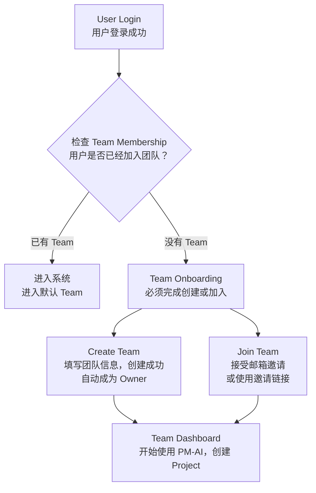
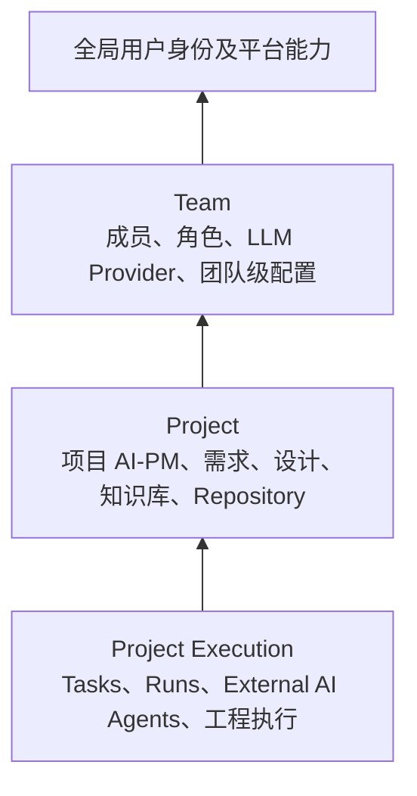

# Team Onboarding & Team Management V1.0

| 属性 | 值 |
| --- | --- |
| 项目 | PM-AI Platform |
| 模块 | Team Onboarding & Team Management |
| 版本 | V1.0 |
| 状态 | Approved / 已裁决 |
| 裁决日期 | 2026-11-06 |

本设计基线确定 PM-AI 用户首次登录、团队创建、成员邀请和多团队成员关系的核心业务规则，作为后续数据库设计、后端 API、权限模型及 UI/UX 实施的统一依据。

---

## 1. 正式产品裁决

| 决策项 | 用户选择 | 正式规则 |
| --- | --- | --- |
| Q1 首次登录 | A | 必须创建或加入 Team |
| Q2 创建者角色 | A | 自动成为 Team Owner |
| Q3 邀请方式 | B | 邮箱邀请 + 邀请链接 |

### Q1：首次登录必须创建或加入 Team

用户首次登录后：

- 如果尚未加入任何 Team，必须进入 Team Onboarding。
- 用户可以创建新的 Team。
- 用户可以通过邀请加入已有 Team。
- 未创建或加入 Team 前，不允许进入正常项目管理界面。
- 不提供 Skip / Later。

这是一个系统级入口约束，而不是普通的新手引导。

### Q2：创建者自动成为 Team Owner

A · 已确认

创建 Team 的用户自动获得 OWNER 角色。

Owner 是团队最高管理角色，负责团队生命周期、成员管理和团队级配置。

### Q3：支持邮箱邀请和邀请链接

B · 已确认

支持两种邀请方式：

1. Email Invitation：输入邮箱，发送邀请。
2. Invitation Link：生成团队邀请链接，由其他用户打开并接受邀请。

两种方式最终都必须经过统一的邀请验证和成员加入流程。

---

## 2. 核心领域模型

这里有一个重要的架构要求：

**User 与 Team 必须采用多对多关系，不允许在 User 实体中直接使用单一 team_id 表达归属。**

建议核心实体：

| 实体 | 职责 |
| --- | --- |
| User | 全局用户账号 |
| Team | 团队基本信息 |
| Team Membership | 用户与团队关系 |
| Team Invitation | 邮箱邀请记录 |
| Team Invitation Link | 邀请链接及其生命周期 |

其中，Membership 至少需要：

- user_id
- team_id
- role
- status
- joined_at
- created_at

并对 (user_id, team_id) 建立唯一约束，避免重复成员关系。

---

## 3. 首次登录完整业务流程

> 由流程图截图（First-time Onboarding Flow）转写为 mermaid。

注意：已有 Team 的用户不应该每次登录都重新进入 Onboarding。

---

## 4. Team 成员管理规则

### 4.1 成员角色

建议 V1.0 采用三个基础角色：

| Role | 权限定位 |
| --- | --- |
| OWNER | 团队所有者，最高管理权限 |
| ADMIN | 团队管理、成员管理及配置管理 |
| MEMBER | 普通团队成员 |

核心原则：

- 每个 Team 至少有一名 Owner。
- 同一个 User 在不同 Team 中可以拥有不同角色。
- 角色属于 Membership，而不是 User。
- Owner 转移必须有明确的授权和审计记录。
- 删除或停用成员关系不能删除全局 User 账号。

### 4.2 成员关系示例

| User | Team A | Team B | Team C |
| --- | --- | --- | --- |
| Alice | OWNER | MEMBER | — |
| Bob | ADMIN | — | MEMBER |
| Carol | MEMBER | OWNER | MEMBER |

这意味着用户的身份是全局的，但权限是团队上下文相关的。

### 4.3 团队切换

用户加入多个 Team 后，系统需要提供全局 Team Switcher。

切换 Team 后：

- 切换当前团队上下文。
- 重新加载对应团队的 Project。
- 使用该 Team 的成员权限。
- 使用该 Team 的 LLM Provider 授权配置。
- 不得访问其他 Team 未授权的数据。

---

## 5. Invitation 邀请机制

### 5.1 Email Invitation

建议流程：

1. Team Owner / Admin 输入邮箱。
2. 选择被邀请者的团队角色。
3. 系统创建 Pending Invitation。
4. 发送邀请邮件。
5. 用户登录或注册。
6. 用户接受邀请。
7. 创建 Team Membership。
8. Invitation 更新为 Accepted。

邀请不能因为邮箱已经注册就自动加入团队，必须经过接受操作。

### 5.2 Invitation Link

邀请链接流程：

1. Owner / Admin 创建邀请链接。
2. 系统生成不可预测的安全 Token。
3. 用户通过链接访问邀请页面。
4. 系统检查链接是否有效。
5. 用户登录或注册。
6. 用户确认加入。
7. 创建 Membership。

建议链接具备以下安全机制：

- 可设置过期时间。
- 可以主动撤销。
- 支持限制使用次数。
- Token 不以明文存储。
- 接受邀请时必须验证目标 Team。
- 已加入该 Team 的用户不能重复加入。

特别注意：邀请链接不能绕过团队权限控制。

### 5.3 Invitation 状态

建议统一邀请状态：

| 状态 | 说明 |
| --- | --- |
| PENDING | 等待接受 |
| ACCEPTED | 已接受 |
| EXPIRED | 已过期 |
| REVOKED | 已撤销 |

邀请记录与 Membership 是两个不同的领域对象，不应该混为一谈。

---

## 6. 与 PM-AI 现有架构的关系

这部分非常重要，因为 Team 不只是一个用户分组，而是 PM-AI 的核心资源隔离边界。

建议明确以下层级：

与现有架构的约束：

1. Project 必须属于一个 Team。
2. Team 的 LLM Provider 配置不能跨 Team 共享。
3. Project AI 配置遵循所属 Team 的模型授权范围。
4. Project 数据访问必须检查用户的 Team Membership 及项目权限。
5. MCP、Codex、Claude Code 等外部工具执行时，必须保持 Team / Project 的授权边界。
6. 用户加入多个 Team，不意味着不同 Team 的项目数据自动互通。

---

## 7. 核心业务约束与异常处理

| 场景 | 系统行为 |
| --- | --- |
| 用户重复接受邀请 | 不重复创建 Membership |
| 邀请已过期 | 拒绝加入，提示重新邀请 |
| 邀请已撤销 | 拒绝加入 |
| 用户已经属于 Team | 提示已加入 |
| 用户加入多个 Team | 正常支持 |
| 用户离开 Team | 只删除对应 Membership |
| Team Owner 离开 | 必须先转移 Owner |
| 邀请链接被撤销 | 后续访问不能加入 |
| 用户被移出 Team | 立即失去该 Team 的访问权限 |

还需要特别规定：

- Team 删除不能直接删除 User。
- Team Membership 删除不能影响用户其他团队。
- 所有团队管理操作都应记录审计事件。
- 后端必须实施 Team 级数据隔离，不能只依赖前端隐藏菜单。

---

## 8. V1.0 页面范围

建议本模块包含以下页面：

| 页面 | 用途 | 优先级 |
| --- | --- | --- |
| First Login Onboarding | 首次登录入口 | P0 |
| Create Team | 创建团队 | P0 |
| Join Team | 接受邀请 | P0 |
| Invite Members | 邀请成员 | P0 |
| Team Dashboard | 团队工作入口 | P0 |
| Team Members | 成员管理 | P0 |
| Team Settings | 团队基本配置 | P1 |
| Team Switcher | 多团队切换 | P0 |
| Invitation Management | 邀请记录管理 | P1 |

---

## 9. 实施验收标准

开发和测试必须至少覆盖以下场景：

- [ ] 新用户首次登录，必须进入 Team Onboarding。
- [ ] 用户成功创建 Team，自动成为 Owner。
- [ ] 用户可以通过邮箱邀请成员。
- [ ] 用户可以通过邀请链接邀请成员。
- [ ] 未登录用户可以先注册，再接受邀请。
- [ ] 同一个 User 可以加入多个 Team。
- [ ] 同一个 User 在不同 Team 可以有不同角色。
- [ ] 用户切换 Team 后，数据和权限正确切换。
- [ ] 用户离开一个 Team，不影响其他 Team。
- [ ] 邀请过期、撤销、重复接受均正确处理。
- [ ] Team Owner 不允许在没有转移所有权的情况下退出。
- [ ] 跨 Team 数据访问必须被后端拒绝。

---

## 10. 本次裁决与后续设计边界

### 已冻结的产品规则

本次正式确定：

1. 用户必须先加入至少一个 Team 才能进入正常业务系统。
2. Team 创建者自动成为 Owner。
3. 支持邮箱邀请与邀请链接。
4. User 与 Team 是多对多关系。
5. Membership 独立管理角色与成员关系。
6. Team 是 Project 的归属及数据隔离边界。

### 未裁决事项（属后续技术设计）

以下属于后续技术设计需要进一步明确的细节，不视为本次已经裁决：

- Invitation Link 默认有效期及使用次数。
- 是否允许一个邀请链接邀请无限成员。
- Owner 转移的具体确认机制。
- 团队删除、冻结及恢复策略。
- 团队角色的完整权限矩阵。

---

## 11. 后续交付建议

建议按照这个顺序推进：

| 阶段 | 交付物 |
| --- | --- |
| 01 | Team Domain Model & Database Design |
| 02 | Team API & Permission Design |
| 03 | Team Onboarding UI/UX Figma Prompt |
| 04 | Team Management UI/UX Figma Prompt |
| 05 | Backend & Frontend Implementation |
| 06 | Team Onboarding Test Specification |