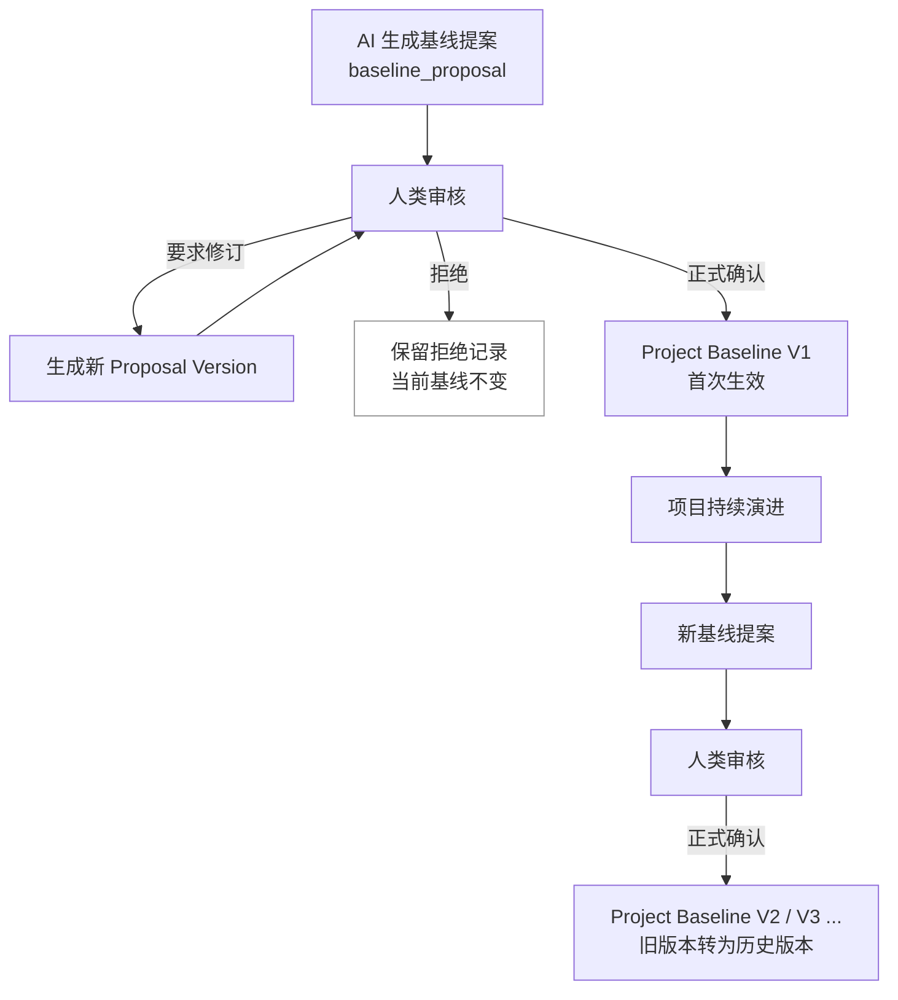
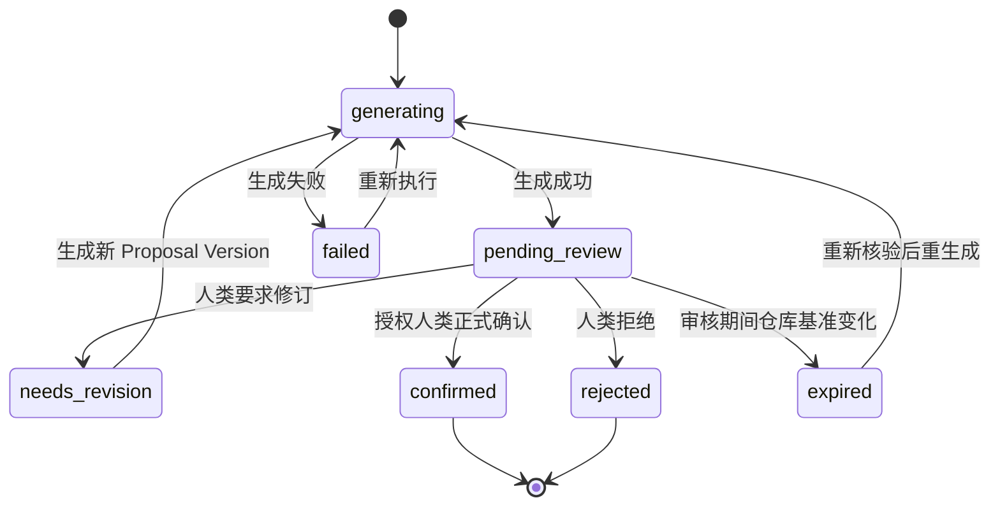

# S01-01 · 项目基线确认 UX 规范 V1.0

> **文档性质**：前端交互与状态规范
> **所属场景**：S01 项目初始化与接入
> **版本**：V1.0
> **日期**：2026-11-04
> **状态**：待评审
> **适用范围**：项目首次建立正式基线时的确认流程；长期基线演进的管理体验见 S01-05

---

## 1. 背景与边界

### 1.1 为什么需要这份规范

项目初始化过程中，Project AI-PM 会基于项目资料、仓库代码和 Commit 事实生成一份「项目理解」。

这份理解不能直接成为正式项目知识。原因有三点：

1. AI 生成的是分析结论，不是人类授权过的项目事实。
2. 同一项目会持续演进，基线不可能只建立一次。
3. 一旦基线被下游需求、任务和执行计划引用，就必须可追溯、可审计、不可静默覆盖。

因此需要把「AI 提案」与「正式基线」拆开，并规定两者的生命周期、确认动作和异常处理。

### 1.2 生命周期模型



核心要求：

| 规则 | UX 与业务约束 |
| --- | --- |
| 首次确认 | 建立 V1 正式基线 |
| 后续确认 | 允许建立 V2、V3 等新版本 |
| 历史版本 | 不允许覆盖或删除历史确认记录 |
| 当前版本 | 始终明确标识当前生效基线，且全项目唯一 |
| 修订提案 | 不自动改变当前正式基线 |
| 拒绝提案 | 不影响当前正式基线 |
| 确认权限 | 必须由具备项目授权的人类用户执行 |
| 审核期间 | 新基线审核不通过或尚未生效时，旧基线持续有效 |

### 1.3 与 S01-05 的边界

| 范围 | S01-01 基线确认 | S01-05 项目基线管理 |
| --- | --- | --- |
| 解决的问题 | 项目首次建立正式基线 | 项目长期演进中的基线变更 |
| 主要用户任务 | 理解提案、审查变化、处理风险、正式确认 | 基线浏览、变更发起、影响分析、版本治理 |
| 版本范围 | 建立 V1，并定义 V2+ 的版本语义 | 持续产生 V2、V3 及其治理闭环 |
| 交互能力 | 本规范定义的确认流程与状态模型 | 在本规范基础上扩展长期管理视图 |

S01-01 不承担「长期基线管理控制台」的职责，但其版本模型必须能承载后续演进，避免 S01-05 重建第二套基线体系。

---

## 2. 核心对象与术语

| 对象 | 建议标识 | 含义 |
| --- | --- | --- |
| 基线提案 | `project_baseline_proposal` | AI 生成的、尚未获得人类正式确认的项目基线建议 |
| 提案版本 | `proposal_version` | 同一提案每次修订产生的新版本，历史版本保留 |
| 正式基线 | `project_baseline` | 经授权人类确认后生效的不可覆盖版本 |
| 当前基线指针 | `project.current_baseline_id` | 指向项目当前唯一生效基线，首次确认前为空 |
| 确认记录 | `baseline_confirmation` | 记录确认人、时间、提案版本、仓库 Commit、意见和生效版本 |
| 版本差异 | `baseline_diff` | 新旧正式基线之间的新增、修改、删除和未变化内容 |
| 风险项 | `baseline_risk` | 提案中需要人类关注的 P0/P1/P2 问题 |

关键语义：

- `project_baseline_proposal` 是待审核对象，不是正式基线。
- `project_baseline` 一经确认即不可覆盖，只能新建版本。
- `project.current_baseline_id` 全项目最多指向一个版本。
- AI 的分析结论、修订建议和风险标记，都不能替代 `baseline_confirmation`。

---

## 3. 状态模型

### 3.1 提案状态机



| 状态 | 含义 | 允许的人类动作 |
| --- | --- | --- |
| `generating` | AI 正在生成提案 | 无，展示生成中状态 |
| `pending_review` | 提案可供审核 | 确认、要求修订、拒绝 |
| `needs_revision` | 已提出修订要求 | 等待 AI 生成新版本 |
| `rejected` | 提案被拒绝 | 查看拒绝记录 |
| `confirmed` | 提案已确认并生成正式基线 | 查看确认记录 |
| `expired` | 提案基准已过期 | 重新核验、重新生成 |
| `failed` | 提案生成失败 | 查看失败原因、重新执行 |

状态约束：

- `confirmed` 只能由正式确认动作触发，AI 不得自动置位。
- `expired` 不改变当前正式基线。
- `rejected` 记录保留，不删除提案及其证据。

### 3.2 正式基线版本

正式基线不设置「可编辑状态」。一个基线版本被确认后即冻结，其生命周期由项目指针和确认时间表达：

| 状态 | 判定方式 | 含义 |
| --- | --- | --- |
| 当前生效 | `project.current_baseline_id == baseline.id` | 下游正式引用依据 |
| 历史版本 | 已被新版本取代，`superseded_at IS NOT NULL` | 只读、可追溯、不可覆盖 |

约束：

- 同一项目在任意时刻最多一个当前生效基线。
- 新版本确认与旧版本转历史必须在同一事务中完成。
- 确认失败时，旧版本继续为当前生效基线。

---

## 4. 核心用户流程（四个任务）

基线确认页面拆分为四个连续但可回看的用户任务，避免一次性大审批。

### 4.1 任务一：理解提案

**目标**：让用户在做出任何决定前，理解这份基线从哪里来、依据是什么、哪些是事实、哪些是推断。

必须展示的信息：

| 信息 | 呈现要求 |
| --- | --- |
| AI 为什么生成这份基线 | 说明触发原因、分析范围和生成目标 |
| 使用了哪些项目资料 | 列出需求文档、知识文档、项目设置等来源，可展开查看证据 |
| 使用了哪个仓库及 Commit | 每个仓库分别展示 `repository_name`、`repository_url`、`branch_name`、`commit_sha` |
| 哪些内容来自代码事实 | 标注 `source_type = code_fact` 或 `git_commit`，并附可定位证据 |
| 哪些内容来自 AI 推断 | 标注 `source_type = ai_inference`，并展示推断依据和置信度 |
| 是否存在未解决问题 | 展示未解决事项数量、P0/P1/P2 分布，并提供跳转 |

交互要求：

- 提案内容必须可查看全文，支持按章节浏览。
- 每条关键结论都应能追溯来源；不能只给一个总体「AI 分析」标签。
- 代码事实与 AI 推断必须在视觉层级和文案上可区分，不能混排成同一可信度。
- 提案处于 `generating`、`failed`、`expired` 时，不展示可用的「正式确认」按钮。

### 4.2 任务二：审查变化

**目标**：让用户清楚地看到「这一版和上一版到底差在哪里」，而不是自己在新版全文里找差异。

| 场景 | 展示内容 |
| --- | --- |
| 首次确认 | 展示完整基线内容；同时说明这是首次建立，不存在可比较的旧正式版本 |
| 后续确认 | 在完整内容之外，必须提供版本差异视图 |

差异视图必须包含：

| 差异类型 | 要求 |
| --- | --- |
| 新增内容 | 明确列出新增的模块、约束、仓库职责、目标等 |
| 修改内容 | 展示修改前后的值，并标注修改原因 |
| 删除内容 | 明确列出被移除的内容及原因，不得静默消失 |
| 未变化内容 | 与变化内容分开呈现，可折叠或按需展开 |
| 影响范围 | 展示对现有 `task`、`requirement` 和 `execution_plan` 的影响 |

交互要求：

- 默认进入差异视图时，优先呈现变化内容；提供「查看完整基线」入口。
- 支持按差异类型筛选，支持逐条查看证据。
- 差异项必须可定位到基线中的具体章节或字段。
- 若提案是基于过期基准生成的，差异视图需明确提示并阻止确认。

### 4.3 任务三：处理风险

**目标**：让用户识别并裁决阻塞项，防止 AI 的单方面判断被误认为已获人类认可。

| 风险等级 | 处理要求 |
| --- | --- |
| P0 | 必须解决，或由授权人类完成明确裁决；未处理时阻止普通确认 |
| P1 | 必须展示，并要求用户给出确认的处理意见 |
| P2 | 允许记录并纳入后续处理 |

必须区分的语义：

- `AI 标记已解决`：AI 的分析状态，不等于人类确认。
- `人类已裁决`：授权人类对风险作出的治理结论，具有审计效力。

交互要求：

- 风险列表展示 `risk_level`、`risk_title`、`risk_description`、`ai_status`、`human_decision`、`evidence_ref`。
- 对人类未裁决的 P0 项，确认入口必须禁用并说明原因。
- 每条风险的处理必须保留操作人、时间和意见。
- 不允许用「全部标记已解决」一键跳过人类裁决。

### 4.4 任务四：正式确认

**目标**：将审核通过的提案转化为独立、不可覆盖的正式基线版本。

确认记录必须包含：

| 字段 | 说明 |
| --- | --- |
| `confirmed_by` | 确认人 |
| `confirmed_at` | 确认时间 |
| `proposal_id` + `proposal_version` | 提案及其版本 |
| `repository_baselines` | 来源仓库及 `commit_sha` |
| `confirmation_note` | 确认意见 |
| `resulting_baseline_version` | 生效的 Baseline Version |

确认交互要求：

- 使用明确的二次确认弹窗，而不是单击即生效。
- 弹窗必须复述关键事实：提案版本、来源 Commit、差异统计、未解决风险、将生成的基线版本。
- 用户必须主动确认后才能提交；提交过程中展示处理中状态，防止重复提交。
- 确认成功后，新版本成为 `current_baseline_id`，并给出「已生效」的明确反馈。
- 确认失败、冲突、过期、权限不足时，不得出现「已生效」的误导性提示。

---

## 5. 页面信息架构

基线确认区建议采用单页多视图结构，而不是并列菜单。

```text
项目工作空间
└── 项目基线
    ├── 提案审核
    │   ├── 提案摘要与生成原因
    │   ├── 来源与证据
    │   ├── 完整基线内容
    │   ├── 版本差异
    │   └── 风险与裁决
    ├── 当前生效基线
    └── 历史版本与确认记录
```

建议路由：

| 路由 | 用途 |
| --- | --- |
| `/projects/:project_id/baseline` | 当前基线总览 |
| `/projects/:project_id/baseline/proposals/:proposal_id` | 提案审核 |
| `/projects/:project_id/baseline/history` | 版本历史与确认记录 |

页面必须始终展示「当前生效版本」标识；即使正在审核新提案，也不能隐藏或弱化当前版本。

---

## 6. 异常与边界行为

| 场景 | 系统行为 |
| --- | --- |
| 提案生成失败 | 保留失败记录，展示失败原因，允许重新执行 |
| 审核期间仓库发生变化 | 提示基准过期，禁止确认，要求重新核验或重新生成 |
| 两个人同时确认 | 采用乐观并发控制，仅一个请求成功，另一个收到明确的版本冲突提示 |
| 确认过程中网络中断 | 支持按请求标识查询确认结果，避免重复提交；重试需可识别幂等结果 |
| 用户失去项目权限 | 禁止继续确认，刷新授权状态并提示权限不足 |
| 存在未解决 P0 | 阻止普通确认，必须先解决或完成明确的人类裁决 |
| 新版本确认失败 | 旧版本继续生效，不得回滚或清空当前基线指针 |
| AI 后续修改提案 | 只能生成新 Proposal Version，不得修改已确认的历史版本 |

---

## 7. 权限与并发约束

### 7.1 权限

| 能力 | 判定 |
| --- | --- |
| 查看提案与基线 | 具备项目读取权限的成员 |
| 要求修订 / 拒绝提案 | 具备项目治理权限的成员 |
| 正式确认 | 必须具备独立的 Approver 授权，不能由普通项目成员身份自动获得 |
| MCP Key 调用确认接口 | 必须拒绝 |

前端需按能力返回值控制动作可见性，但服务端必须再次校验；不能仅依赖按钮隐藏。

### 7.2 并发

正式确认必须携带并发令牌，至少包括：

- `expected_current_baseline_id`：防止基于已过期的正式基线提交。
- `expected_proposal_version` 或 `expected_row_revision`：防止提案在审核期间被并发修订。

`content_hash` 只能用于完整性与证据校验，不能代替并发令牌。发生冲突时返回明确的 `409 BASELINE_CONFLICT`，前端提示用户刷新并重新审核，不允许静默覆盖。

---

## 8. 状态与反馈清单

1. AI 提案与正式基线必须清晰区分。
2. 当前生效版本必须始终可见、唯一。
3. 必须提供提案版本历史入口。
4. 必须支持版本差异审查。
5. 必须区分 AI 分析结果与人类裁决。
6. 必须展示阻塞项和待处理风险。
7. 正式确认必须具备二次确认语义。
8. 成功、失败、过期、权限不足、并发冲突均需明确反馈。
9. 必须能够追溯历史确认记录。

---

## 9. 验收标准

- [ ] 用户能够区分 Proposal 和正式 Baseline。
- [ ] 用户能够查看完整基线内容。
- [ ] 用户能够查看版本差异。
- [ ] 用户能够要求 AI 修订。
- [ ] 用户能够拒绝提案。
- [ ] 只有授权人类能够正式确认。
- [ ] 确认后产生独立的正式基线版本。
- [ ] 历史版本及其确认记录不可被覆盖。
- [ ] 新基线未生效时，旧基线仍然有效。
- [ ] 异常状态不会造成错误的确认结果。