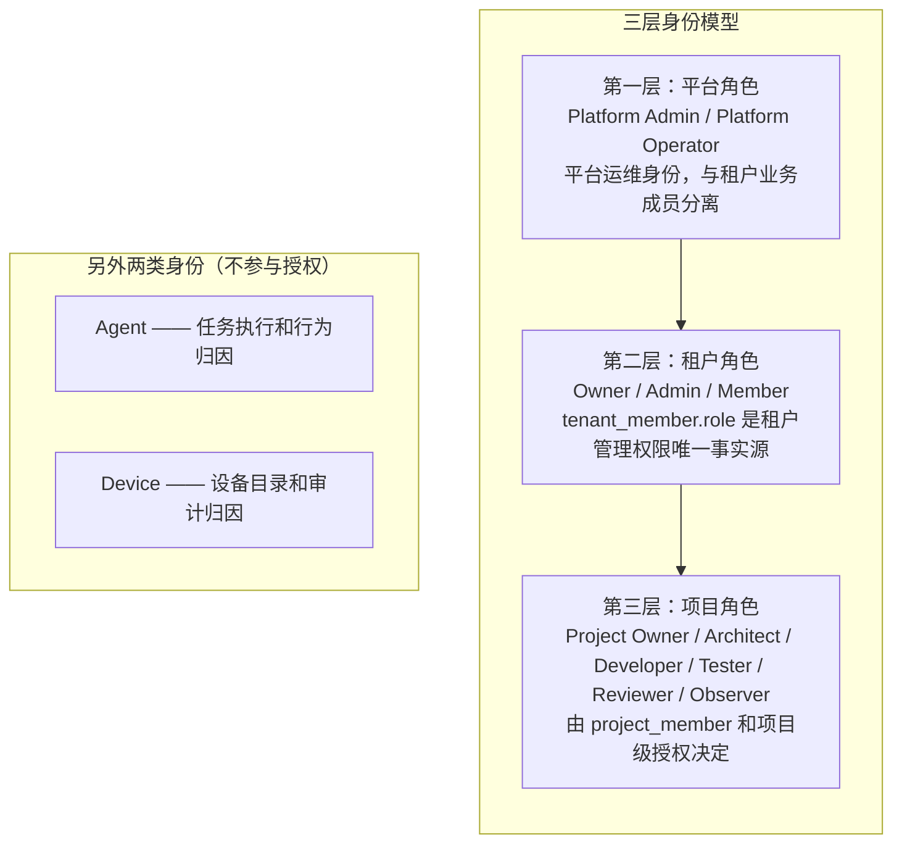
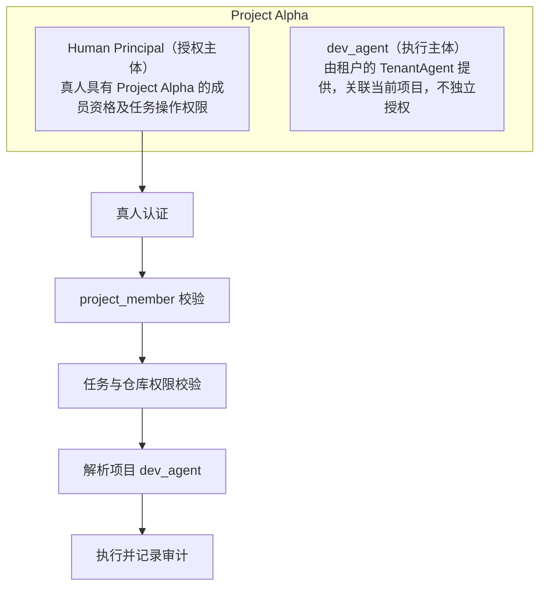
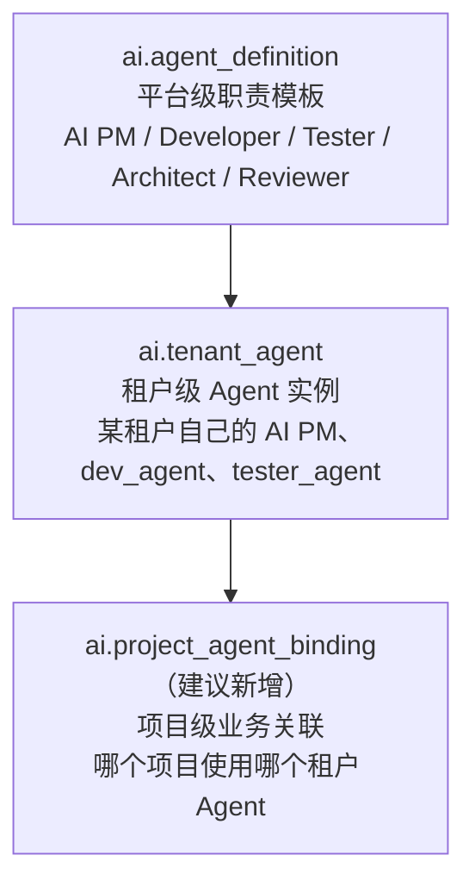
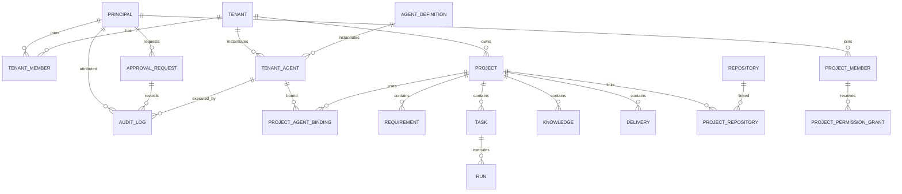
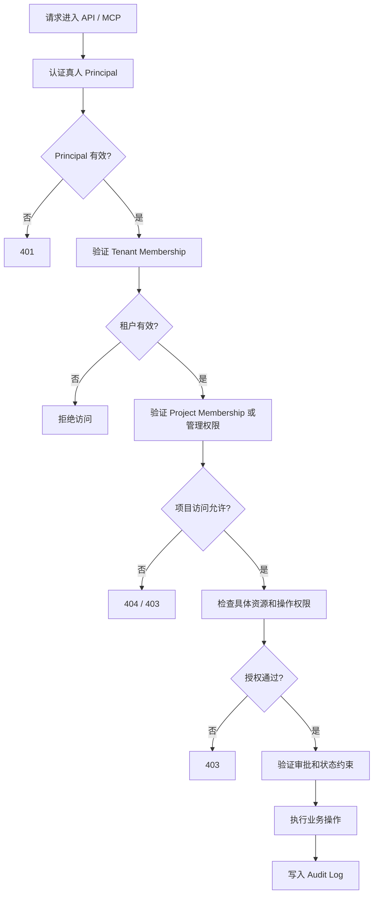

# smark-pm：菜单体系、角色权限与数据库权限模型 V1

> 录入日期：2026-11-03
> 状态：**待评审**（用户宣布「启动评审分析」之前不进入评审）
> **菜单结构已被取代（2026-11-04 用户裁决「以 S01-00 为主」）**：本文「二、菜单体系 V1」的 7 全局一级菜单结构由
> [`docs/ui/s01/s01-00-global-navigation-information-architecture-v1.md`](s01/s01-00-global-navigation-information-architecture-v1.md)（V1.0 冻结基线）取代——
> 6 个全局一级入口，移除全局 AI 协作中心（S01-00 裁决 Q1=A）；本文角色/权限矩阵/数据库权限模型内容不受影响，仍待评审。
> 项目管理模式已确认：**A —— 人类负责，AI 协助执行**
> 说明：本文为上位设计稿，**不直接作为数据库迁移脚本**；原稿图 1–图 5（截图）已转写为 Mermaid。

本次设计以已确认的 smark-pm 架构决策为基础，不重新发明一套权限体系。

先明确核心定位：

**smark-pm 是人类负责项目治理、AI Agent 负责研发协作与执行的多租户 AI 研发管理平台。**

这意味着：

- 人类是项目的责任人、决策者和授权主体。
- Agent 是被分配工作的执行主体，不是项目所有者。
- 项目成员决定谁可以参与项目。
- 租户成员决定谁有权管理租户。
- 项目、仓库、任务、Run、交付和知识库分别有自己的资源边界。
- 所有 Agent 操作都必须能够追溯到发起操作的真人。

这也意味着需要纠正一个容易出现的设计偏差：

> 不能把传统软件公司的组织架构（产品经理、架构师、开发、测试）直接变成系统的全局权限角色。这些更多是**项目职责**，而不是**安全身份**。

---

## 一、先冻结权限模型的基本原则

结合此前 T-087、T-088、D3 等设计，以下原则作为本设计的上位约束。

| 编号 | 原则 | 说明 |
|---|---|---|
| P1 | Tenant 隔离 | 租户之间的数据完全隔离 |
| P2 | Tenant Role | `tenant_member.role` 是租户管理权限的唯一事实源 |
| P3 | Project Membership | `project_member` 是项目访问资格的核心依据 |
| P4 | Human Principal | 真人 Principal 是唯一授权主体 |
| P5 | Agent Attribution | Agent 表示执行主体和行为归因，不独立获得授权 |
| P6 | Repository Boundary | 仓库访问需要独立验证，项目关联不等于代码访问授权 |
| P7 | Device Boundary | Device ID 只用于设备目录和审计归因，不授予任何权限 |
| P8 | MCP Consistency | API、MCP、后台任务必须执行一致的授权规则 |
| P9 | Human Approval | 重要需求、架构决策和交付验收由人类负责 |
| P10 | Auditability | 重要操作必须记录真人、Agent、资源和操作结果 |

特别是 P4、P5，T-088 已经明确：

```text
Human Principal
      |
      | 身份认证
      v
项目成员权限校验
      |
      | 授权成功
      v
解析当前 Project 的 dev_agent
      |
      v
构造 AuditActor
      |
      v
执行业务操作
```

不能反过来让 dev_agent 自己获得一个独立的租户管理员身份。

---

## 二、菜单体系 V1：最终建议

采用 **7 个一级菜单 + 项目工作区**。

项目工作区是特别重要的概念：用户进入项目后，导航自动切换为项目上下文，不必让全局菜单承载所有项目功能。

### 2.1 全局菜单

#### 01 工作台（全体成员）

跨项目的个人工作入口。

- 我的待办
- 我的决策
- 待我审批
- 待我验收
- 我参与的项目
- 最近活动

#### 02 项目（授权成员）

- 项目列表
- 创建项目
- 项目归档

#### 03 AI 协作中心（授权成员）

- Agent 执行概览
- Run 执行记录
- 任务执行监控
- Agent 交接记录
- MCP 调用记录

#### 04 开发环境（受限授权）

- 我的设备
- Codex 接入
- 项目环境
- Runner / Worker 状态
- MCP 配置

#### 05 组织管理（Owner / Admin）

- 组织概览
- 成员管理
- 项目授权
- Agent 实例
- 组织配置

#### 06 审计与安全（受限授权）

- 操作审计
- 权限变更
- 身份与设备记录
- 安全事件

#### 07 系统设置（按范围授权）

- 个人设置
- 通知设置
- API 凭据
- 租户设置
- 平台设置（平台管理员）

这里有两个调整：

1. **知识库不再作为全局一级菜单。** 它属于项目资产，应当从项目工作区进入。
2. **交付验收不放在 AI 协作中心。** 它属于项目治理，由人类负责验收。

这样更符合 A 模式。

### 2.2 项目工作区菜单

用户进入某个 Project 后，导航切换为项目上下文菜单：

- 项目概览
- 需求管理
- 任务管理
- 仓库管理
- Agent 团队
- 执行与协作
- 交付验收
- 项目知识库
- 项目成员
- 项目设置

各菜单职责：

| 菜单 | 核心对象 | 主要操作 |
|---|---|---|
| 项目概览 | Project | 项目状态、风险、进度 |
| 需求管理 | Requirement | 创建、修订、确认 |
| 任务管理 | Task | 拆解、分派、依赖、状态 |
| 仓库管理 | Repository | 多仓库关联、默认分支、授权状态 |
| Agent 团队 | TenantAgent | 项目 Agent 配置、职责绑定 |
| 执行与协作 | Run | 执行、日志、重试、交接 |
| 交付验收 | Delivery | 交付清单、验证、验收 |
| 项目知识库 | Knowledge | 文档、ADR、审核、版本 |
| 项目成员 | ProjectMember | 项目人员及角色 |
| 项目设置 | Project | 项目配置和生命周期 |

继续沿用已确定的模型：

```text
Tenant
  └── Project
        ├── Repository  (多对多)
        ├── Requirement
        ├── Task
        ├── Run
        ├── Delivery
        ├── Knowledge
        └── Project Members
```

**Project 是业务边界，不是 Repository 的别名。**

---

## 三、角色体系：不要把角色混成一张表

建议使用三层身份模型（图 1）。这五类概念不能混用。

**图 1：三层身份模型（另加两类非授权身份）**



### 3.1 平台角色

| 角色 | 职责 |
|---|---|
| Platform Admin | 平台配置、租户生命周期、全局运维 |
| Platform Operator | 服务监控、Worker、Runner、故障处理 |

平台角色不应自动成为租户的 Owner 或项目成员。

### 3.2 租户角色

保留现有三个角色，不增加 Developer、Tester 等角色。

| 权限 | Owner | Admin | Member |
|---|---|---|---|
| 查看组织信息 | ✓ | ✓ | ✓ |
| 查看成员 | ✓ | ✓ | 按需 |
| 邀请成员 | ✓ | ✓ | — |
| 修改普通成员角色 | ✓ | ✓ | — |
| 修改 Owner | ✓ | 受限 | — |
| 删除普通成员 | ✓ | ✓ | — |
| 创建项目 | ✓ | ✓ | 按授权 |
| 管理全部项目 | ✓ | ✓ | — |
| 创建租户 Agent | ✓ | ✓ | — |
| 修改租户 Agent 配置 | ✓ | ✓ | — |
| 查看全租户审计 | ✓ | ✓ | — |
| 修改租户设置 | ✓ | ✓ | — |
| 删除租户 | ✓ | — | — |

必须保证：

- 至少一个 Owner。
- Admin 不能提升自己为 Owner。
- Admin 不能修改或移除 Owner。
- Owner 转移需要专门的受控操作。
- 撤销成员权限即时生效。

### 3.3 项目角色

保留以下六种项目职责角色：

| 角色 | 定位 |
|---|---|
| Project Owner | 人类项目负责人 |
| Architect | 架构职责 |
| Developer | 开发职责 |
| Tester | 测试职责 |
| Reviewer | 独立评审职责 |
| Observer | 只读观察 |

其中：

- **Project Owner 必须是人类 Principal，不能是 Agent。**
- 项目 Owner 负责：项目范围和目标；重要需求确认；关键架构决策；项目成员授权；交付验收；项目归档。
- Architect、Developer、Tester、Reviewer 是职责，不是必须互斥的安全身份。一个人可以同时担任多个职责。

---

## 四、角色权限矩阵

采用：**角色默认权限 + 资源范围授权 + 关键操作审批**。不为每一个操作都创建一个新角色。

### 4.1 项目功能权限矩阵

| 功能 | Owner | Architect | Developer | Tester | Reviewer | Observer |
|---|---|---|---|---|---|---|
| 查看项目 | ✓ | ✓ | ✓ | ✓ | ✓ | ✓ |
| 修改项目基本信息 | ✓ | — | — | — | — | — |
| 管理项目成员 | ✓ | — | — | — | — | — |
| 绑定仓库 | ✓ | 按授权 | — | — | — | — |
| 创建需求 | ✓ | ✓ | ✓ | — | — | — |
| 修改需求草稿 | ✓ | ✓ | ✓ | — | — | — |
| 确认正式需求 | ✓ | 按审批授权 | — | — | — | — |
| 创建任务 | ✓ | ✓ | ✓ | 按授权 | — | — |
| 修改任务 | ✓ | ✓ | 按分配 | 按分配 | — | — |
| 分配 Agent | ✓ | 按授权 | — | — | — | — |
| 执行开发任务 | ✓ | 按授权 | ✓ | — | — | — |
| 查看 Run | ✓ | ✓ | ✓ | ✓ | ✓ | ✓ |
| 重新执行 Run | ✓ | 按授权 | 按分配 | — | — | — |
| 提交测试结果 | ✓ | — | 按授权 | ✓ | — | — |
| 提交评审意见 | ✓ | ✓ | — | 按授权 | ✓ | — |
| 批准架构决策 | ✓ | 按审批授权 | — | — | — | — |
| 提交知识修改 | ✓ | ✓ | ✓ | ✓ | ✓ | — |
| 发布正式知识 | ✓ | 按审批授权 | — | — | — | — |
| 验收交付 | ✓ | — | — | 按授权 | 按授权 | — |
| 归档项目 | ✓ | — | — | — | — | — |

这里的「按授权」需要由明确的权限授予或审批流程控制，**不能简单理解成所有对应职责角色默认拥有**。

### 4.2 权限要区分四种动作

以需求管理为例：

| 动作 | 含义 | 人类负责 |
|---|---|---|
| Create | 创建需求草稿 | 是 |
| Update | 修改需求草稿 | 是 |
| Submit | 提交需求确认 | 是 |
| Approve | 确认成为正式需求 | 是 |

Agent 可以：

- 分析需求。
- 提出修改。
- 拆解任务。
- 提交分析结果。
- 提出变更建议。

Agent 不可以：

- 自己批准自己提交的需求。
- 自己批准正式架构决策。
- 自己验收自己的交付。
- 自己提升自己的权限。

这正好可以延续此前确定的 Command → Validate → Authorize → Revision → Audit 流程。

### 4.3 Agent 的权限模型

Agent 不建立传统意义上的角色权限账户。

**图 2：一次 MCP 操作（授权主体 vs 执行主体）**



这里有一个历史设计需要明确修正：

早期方案曾考虑在 Project 创建时，把租户 Agent 加入 `project_member`。在 T-088 确立真人 Principal 唯一授权主体之后，**不再把 Agent 当作真正的项目成员参与权限判断**。应该分开：

- `project_member`：真人项目成员。
- `tenant_agent`：租户级 Agent 实例。
- `project_agent_binding`：Agent 与项目的业务关联（如果当前实现还没有对应关系表，可以新增）。

这样可以避免未来出现 Agent 被误认为拥有项目成员权限的问题。

---

## 五、数据库权限模型

先说一个设计取舍：**不建议现在就引入一个非常复杂的通用 RBAC 引擎，也不建议所有权限都通过 JSON 存储。**

V1 采用：

- 固定的租户角色。
- 固定的项目职责角色。
- 明确的资源关系表。
- 必要时使用细粒度授权表。
- 业务服务统一进行权限判断。

这样更容易维护、测试和审计。

### 5.1 核心身份与组织表

沿用现有 core Schema：

| 表 | 说明 |
|---|---|
| `core.tenant` | 租户 |
| `core.principal` | 真人及其他系统身份 |
| `core.principal_identity` | 外部身份映射，例如 MCP API Key |
| `core.tenant_member` | 真人与租户关系、租户角色 |
| `core.project` | 项目基本信息 |
| `core.project_member` | 真人与项目关系、项目职责 |

`core.tenant_member` 字段建议：

| 字段 | 类型 | 说明 |
|---|---|---|
| id | UUID | 主键 |
| tenant_id | UUID | 租户 |
| principal_id | UUID | 真人 Principal |
| role | ENUM/TEXT | owner/admin/member |
| status | ENUM/TEXT | active/invited/suspended |
| created_at | TIMESTAMPTZ | 创建时间 |

约束：

```sql
UNIQUE (tenant_id, principal_id)
```

**只有这张表中的 role 是租户管理权限的事实源。**

`core.project_member` 字段建议：

| 字段 | 类型 | 说明 |
|---|---|---|
| id | UUID | 主键 |
| tenant_id | UUID | 租户 |
| project_id | UUID | 项目 |
| principal_id | UUID | 真人 Principal |
| role | TEXT | 项目主职责 |
| status | TEXT | active/removed |
| created_at | TIMESTAMPTZ | 创建时间 |

约束：

```sql
UNIQUE (project_id, principal_id)
```

`project_member.role` 保存**主职责**，不把所有业务能力硬塞进一个角色字段。如果以后需要一个人同时担任多个职责，可以新增：

`core.project_member_role`：

| 字段 | 说明 |
|---|---|
| project_member_id | 对应成员 |
| role_code | architect/developer/tester/reviewer |
| granted_by | 授权人 |
| created_at | 授权时间 |

这样项目 Owner 本身就是一项主职责，不需要再给每个项目成员建立重复账户。

另外，租户 Owner/Admin 对项目的管理权限可以通过租户管理策略实现，**不必自动给他们插入每个项目的 project_member 记录**。但要区分：**租户管理权限 ≠ 项目业务参与资格**。Admin 可以管理项目配置，不代表他自动成为项目需求决策者或交付验收人。

### 5.2 Agent 相关表

沿用此前确定的 `ai.agent_definition`、`ai.tenant_agent`。

**图 3：Agent 三级模型**



建议 `project_agent_binding` 字段：

| 字段 | 说明 |
|---|---|
| id | 主键 |
| tenant_id | 租户 |
| project_id | 项目 |
| tenant_agent_id | 租户 Agent |
| purpose | project_manager/developer/tester 等 |
| status | active/disabled |
| created_at | 创建时间 |

唯一约束建议：

```sql
UNIQUE (project_id, purpose)
```

表示一个项目同一种职责默认绑定一个 Agent 实例。

**注意，这里是业务绑定，不是授权绑定。**

尤其是 dev_agent：

- 它属于 Tenant。
- 它不是 per-project 新建的独立账户。
- 项目可以关联租户已有的 dev_agent。
- MCP 操作仍然以真人 Principal 的权限为准。

### 5.3 项目资源与仓库权限

继续沿用多仓库模型：

```text
core.project
    |
    | 多对多
    |
integration.project_repository
    |
    v
Repository
```

`integration.project_repository` 是项目和仓库的业务关联。

但是：**项目关联仓库不等于真人已经获得仓库代码访问权限。**

建议把授权判断拆成：

1. 真人是否属于租户？
2. 真人是否属于项目？
3. 项目是否关联目标仓库？
4. 真人是否具有该仓库的操作权限？
5. 当前任务是否允许该操作？

Repository 的实际访问凭据、Git 权限和代码平台授权，应由 Integration / Repository Access 层管理，不能用 project_member 直接代替。

已有的 `devenv.device`、`devenv.device_project_binding` 继续保留。其中 Device 与 Project 的绑定只记录设备声明及已验证仓库事实，**不产生项目权限**。

### 5.4 细粒度授权表（可选扩展，建议预留）

如果以后需要：

- 允许某个 Developer 额外管理仓库。
- 允许某个 Reviewer 审批特定类型的文档。
- 允许某个 Tester 执行某些特殊操作。

可以增加 `governance.project_permission_grant`：

| 字段 | 说明 |
|---|---|
| id | 主键 |
| tenant_id | 租户 |
| project_id | 项目 |
| principal_id | 被授权真人 |
| permission_code | 权限代码 |
| resource_type | 资源类型 |
| resource_id | 资源 ID，可为空 |
| granted_by | 授权人 |
| expires_at | 过期时间 |
| revoked_at | 撤销时间 |
| created_at | 创建时间 |

权限代码示例：

```text
project.read
project.update
project.member.manage

repository.read
repository.write
repository.manage

requirement.create
requirement.update
requirement.submit
requirement.approve

task.create
task.update
task.assign
task.execute

run.read
run.execute
run.retry

delivery.read
delivery.submit
delivery.accept

knowledge.read
knowledge.propose
knowledge.approve
knowledge.publish
```

这里需要强调：**project_permission_grant 是例外授权，不是另一套独立的角色系统。**

权限计算建议：

```text
effective_permissions =
    tenant_role_permissions
    + project_role_permissions
    + explicit_project_grants
    - revoked_or_expired_permissions
```

其中所有权限还要受到资源范围和审批策略约束。例如，Developer 被授予 repository.write，也不能因此访问不属于当前项目的其他仓库。

### 5.5 审批与审计表

继续沿用已有的 `governance.approval_request`、`governance.audit_log`。

建议审批记录至少能够表达：

| 字段 | 说明 |
|---|---|
| tenant_id | 租户 |
| project_id | 项目 |
| requester_principal_id | 发起人 |
| approval_type | 审批类型 |
| resource_type | 资源类型 |
| resource_id | 对应资源 |
| status | pending/approved/rejected/cancelled |
| approver_principal_id | 审批人 |
| decided_at | 决策时间 |

典型审批类型：

```text
REQUIREMENT_APPROVAL
ARCHITECTURE_DECISION
KNOWLEDGE_PUBLICATION
DELIVERY_ACCEPTANCE
PROJECT_ARCHIVE
```

审计表建议至少能够区分：

| 字段 | 说明 |
|---|---|
| principal_id | 真人授权主体 |
| actor_type | HUMAN / AGENT / SYSTEM |
| agent_id | Agent 执行主体，可空 |
| device_id | 设备归因，可空 |
| tenant_id | 租户 |
| project_id | 项目 |
| action | 操作代码 |
| resource_type | 资源类型 |
| resource_id | 资源 ID |
| result | 成功或失败 |
| metadata | 操作上下文 |
| created_at | 时间 |

特别注意：**principal_id 和 agent_id 不能混成一个字段。** 否则未来无法回答：

- 谁授权执行？
- 哪个 Agent 执行？
- 哪台设备发起？
- 执行了什么？
- 是否经过审批？

---

## 六、数据库完整关系图

**图 4：核心实体关系**（原稿中虚线关联表示业务关联或授权校验，不代表 Agent 自动获得权限；Mermaid erDiagram 不区分线型，虚线语义以第五章文字为准）



补充说明：

- PROJECT_PERMISSION_GRANT 可以通过 principal_id 直接关联真人，不一定必须引用 PROJECT_MEMBER；实际建表时建议增加复合外键，保证成员归属一致。
- REQUIREMENT、TASK、RUN、KNOWLEDGE、DELIVERY 都应保留明确的 `tenant_id` 和 `project_id`，避免只依赖间接关联实现租户隔离。

### 6.1 数据库约束特别重要

所有租户业务表尽可能采用复合约束，例如：

```sql
UNIQUE (tenant_id, id)
```

子表通过：

```sql
FOREIGN KEY (tenant_id, project_id)
REFERENCES core.project (tenant_id, id)
```

保证项目不能跨租户关联。

成员关系同理：

```sql
FOREIGN KEY (tenant_id, project_id)
REFERENCES core.project (tenant_id, id)
```

并通过相应的成员复合外键保证成员与项目的租户归属一致。

另外还需要：

1. tenant_member 同一租户同一真人只能有一条有效成员关系。
2. project_member 同一项目同一真人只能有一条成员关系。
3. Project Owner 必须是有效真人项目成员。
4. Agent 绑定必须满足 Agent 与 Project 属于同一租户。
5. Agent 绑定不能被当作 project_member。
6. 被撤销的成员不能继续通过历史 MCP 会话执行操作。
7. 关键权限变更需要审计。

---

## 七、统一权限判断服务

这是数据库模型和实际业务之间最重要的一层。

建议在后端建立统一的授权服务：

```rust
trait AuthorizationService {
    async fn authorize(
        &self,
        actor: &HumanActor,
        action: Permission,
        resource: &ResourceRef,
    ) -> Result<AuthorizationDecision>;
}
```

不要让每个 Handler 自己写一套 `if user.is_admin() { ... }`，否则 API、MCP、后台任务很容易出现权限不一致。

**图 5：统一授权流程**



这里要区分认证、授权和业务审批，**四个概念不能合并**：

- Authentication：你是谁？
- Authorization：你有没有权限？
- Approval：这件事是否已经得到必要批准？
- Validation：当前资源状态是否允许操作？

### 7.1 API 与 MCP 共用授权

| 入口 | 真人身份来源 | 授权方式 |
|---|---|---|
| Web API | 登录 Principal | AuthorizationService |
| MCP | API Key → Principal | AuthorizationService |
| 后台任务 | 显式业务上下文 | 对应系统操作策略 |
| Agent 执行 | 发起操作的真人上下文 | 真人权限 + 任务授权 |

对于 MCP：

- 17 个工具全部执行成员校验。
- 非项目成员访问项目资源返回 404。
- Device ID 不参与授权。
- 设备绑定不产生权限。
- dev_agent 不作为真人授权替代品。
- 权限撤销需要即时生效。

这部分沿用 T-088 V1.1 的冻结结论。

### 7.2 PostgreSQL RLS

建议增加数据库层面的 Row Level Security 作为纵深防御。但**不建议只依赖 RLS**：业务服务仍然需要明确授权，RLS 用来防止漏写租户过滤条件造成跨租户数据泄漏。

```text
业务层：
  AuthorizationService
      ↓
  校验真人、租户、项目、资源

数据库层：
  tenant_id
      ↓
  RLS 租户隔离
      ↓
  SQL 查询
```

特别注意数据库连接池的上下文设置：

- 每次事务必须显式设置当前租户上下文。
- 使用事务级上下文，避免连接复用造成租户串号。
- 应用数据库角色不能拥有绕过 RLS 的权限。
- 不允许通过客户端提交的 tenant_id 直接建立可信身份。

---

## 八、菜单与权限如何落到后端 API

建议不要按页面设计 API，而是按业务资源和操作设计 API。

| 业务域 | API 资源 | 权限前缀 |
|---|---|---|
| Tenant | 租户 | tenant.* |
| Member | 租户成员 | tenant.member.* |
| Project | 项目 | project.* |
| ProjectMember | 项目成员 | project.member.* |
| Repository | 仓库 | repository.* |
| Requirement | 需求 | requirement.* |
| Task | 任务 | task.* |
| Run | 执行记录 | run.* |
| Delivery | 交付 | delivery.* |
| Knowledge | 知识 | knowledge.* |
| Agent | Agent | agent.* |
| Device | 设备 | device.* |
| Approval | 审批 | approval.* |

接口命名建议示例：

```text
GET    /api/projects
POST   /api/projects
GET    /api/projects/{id}

GET    /api/projects/{id}/members
POST   /api/projects/{id}/members
DELETE /api/projects/{id}/members/{member_id}

GET    /api/projects/{id}/tasks
POST   /api/projects/{id}/tasks
POST   /api/tasks/{id}/assign
POST   /api/tasks/{id}/execute

GET    /api/projects/{id}/deliveries
POST   /api/deliveries/{id}/accept

GET    /api/projects/{id}/knowledge
POST   /api/knowledge/proposals
POST   /api/knowledge/{id}/publish
```

这里的接口仅是建议命名，不代表现有端点需要全部重建。

权限代码应集中定义，API 和 MCP 共用，不要各自维护一套。

---

## 九、实施顺序：不要一次性重构

结合现有 smark-pm 的实施进度，建议按下面顺序推进：

| 阶段 | 工作内容 | 目的 |
|---|---|---|
| M1 | 菜单信息架构 | 确定全局与项目工作区 |
| M2 | 租户角色核对 | 固化 Owner/Admin/Member |
| M3 | 项目成员角色核对 | 固化真人项目职责 |
| M4 | 统一权限服务 | API/MCP 共用 |
| M5 | Agent 关联模型 | 区分执行主体和授权主体 |
| M6 | 审批与审计 | 人类治理闭环 |
| M7 | RLS 与隔离测试 | 多租户安全 |
| M8 | 前端菜单权限 | 根据授权动态显示 |

建议不要一开始就做通用权限管理后台，也不要一开始就支持用户自定义角色。先把固定角色和授权边界做正确。

### 九.1 特别需要检查的现有实现

在开始新增迁移之前，先检查：

- `core.tenant_member` 是否已经完整实现租户角色。
- `core.project_member` 是否已经具备成员和职责信息。
- `ai.agent_definition`、`ai.tenant_agent` 是否符合租户级实例模型。
- `integration.project_repository` 是否具备多仓库关联约束。
- `devenv.device_project_binding` 是否始终不参与授权。
- `governance.approval_request` 是否能表达需求、架构和交付审批。
- `governance.audit_log` 是否能记录真人与 Agent 双重归因。

尤其不能因为新增菜单设计，就重复创建已有的数据表。

---

## 十、最终需要冻结的六项架构决策

建议将这份方案整理为一个正式设计任务，例如 **T-096：菜单体系与统一权限模型**。

在进入实施之前，建议冻结下面六项：

| 编号 | 决策 | 建议 |
|---|---|---|
| D1 | 全局菜单与项目菜单 | 七个全局菜单 + 项目工作区 |
| D2 | 租户角色 | Owner/Admin/Member，保持不变 |
| D3 | 项目角色 | Project Owner/Architect/Developer/Tester/Reviewer/Observer |
| D4 | Agent 身份 | TenantAgent，项目关联不授予权限 |
| D5 | 权限机制 | 固定角色 + 细粒度授权 + 统一授权服务 |
| D6 | 关键业务审批 | 真人负责，Agent 不得自我审批 |

三个容易被忽略的边界：

1. 租户 Admin 管理项目，不等于自动拥有项目业务决策权。
2. Project Owner 是人类项目责任人，不是 Agent。
3. Agent 可以承担架构分析、代码开发、测试和评审职责，但不能因此获得真人的授权身份。

---

## 最终产品定位

**Human-led, AI-assisted Development**

人类负责目标、决策、授权和验收；AI 负责分析、拆解、协作、执行和知识整理。

| 主体 | 关键词 | 职责 |
|---|---|---|
| 人类 | Accountability | 项目责任、权限治理、重要决策、交付验收 |
| AI Agent | Execution | 任务分析、研发执行、测试、评审、知识提案 |

建议：先把这份设计定为权限和导航的上位设计，再拆成**数据库、后端授权、前端菜单**三个实施任务。**不要直接把这份逻辑设计当成数据库迁移脚本。**
