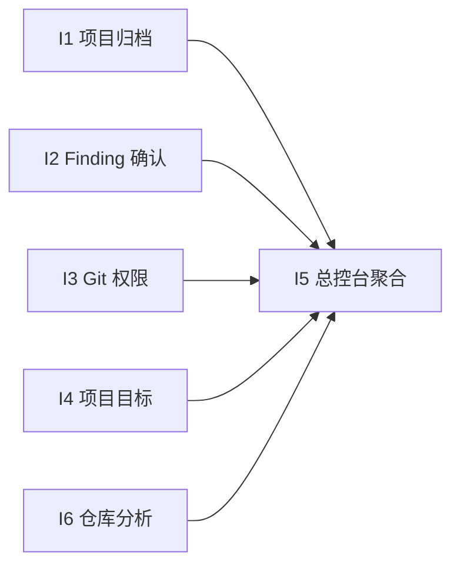

# S01 最终设计基线 V1.3

| 项目 | 内容 |
|---|---|
| 文档性质 | S01 最终设计基线 |
| 版本 | V1.3 |
| 日期 | 2026-11-03 |
| 状态 | 待确认冻结 |
| 上位依据 | S01 原始设计、此前已确认的领域裁决、实施影响核对结果 |
| 本轮范围 | I1～I6 |
| 实施原则 | 先完成设计核对与任务定稿，再进入代码实施 |

> **编者按**：本稿为 S01 基线 V1.3，取代同目录 `smark-pm-s01-final-baseline-v1-2.md`（V1.2）中与之冲突的部分——V1.2 的 Q1～Q6 六项裁决、四项独立成果、领域模型关系与页面菜单落点继续有效；V1.3 在此之上把「实施影响核对」拆成 I1～I6 六个工作包，并冻结归档生命周期、Finding 人工确认权限边界、Git 四层授权模型三条核心安全与生命周期原则。事实依据见 `smark-pm-s01-evidence-v1-1.md`。文末「附录 A」为本轮落盘时对本稿引用事实的代码级复核结果。

---

## 0. 版本说明与设计原则

### 0.1 V1.3 修订目的

V1.3 将此前 S01 设计与本轮实施影响核对结果合并，形成统一实施基线。

本次不是重新设计整个项目管理平台，而是针对实施过程中发现的领域边界、权限边界、生命周期和数据契约问题进行最终收敛。

本版本重点冻结三个问题：

1. 项目归档不能简单等同于删除项目或强制终止进程。
2. Finding 的人工确认必须是平台控制的领域操作，不能由 Agent 直接修改业务事实。
3. Git 操作权限必须由调用人授权、平台策略、任务仓库约束和 Run 执行快照共同决定。

### 0.2 事实可信度标记

全文使用以下分类：

| 标记 | 含义 | 使用规则 |
|---|---|---|
| EXISTING | 已由现有资料证实 | 可以作为既有能力复用 |
| VERIFY | 需要代码核验 | 不得在实施任务中假定已经存在 |
| NEW | 需要新增实现 | 必须定义接口、状态、权限和测试 |
| DECIDED | 已确认的设计裁决 | 后续实现不得自行改变 |

迁移文件、设计稿中的描述与实际运行代码可能存在差异。

因此，EXISTING 代表已有资料证据，不代表本轮已经完成当前分支的代码审计。

### 0.3 总体架构原则

继续坚持：

- 平台负责权限、状态、审计和业务裁决。
- Agent 负责分析、提出建议和执行获准的工作。
- MCP 是 Agent 与平台交互的受控通道。
- Git 是代码及知识文档的权威事实来源。
- 数据库负责领域状态、关系、索引和可审计的操作记录。
- 前端负责呈现状态和发起用户操作，不承担业务授权裁决。

任何 Agent 都不得绕过平台直接修改受保护的领域状态。

---

## 1. I1：项目归档生命周期

### 1.1 设计目标

项目归档是项目生命周期的受控关闭操作。

归档后，项目不再接受新的业务活动，但必须保证已经开始的工作能够按既有生命周期正确收尾。

归档不是：

- 删除项目。
- 删除项目知识库。
- 强制杀死 Codex 进程。
- 将所有 Run 直接改成 cancelled。
- 将未完成任务伪装成成功或失败。
- 绕过现有状态机批量修改业务状态。

### 1.2 核心裁决

**DECIDED：归档禁止新活动，已有 Run 按生命周期受控收尾，不伪造进程终止。**

归档后必须禁止：

1. 创建新的执行 Run。
2. 新的任务领取。
3. 创建新的 Agent 执行实例。
4. 发起新的项目级业务操作。
5. 新增项目知识写入和其他受保护的变更操作。
6. 通过重试、Outbox 重放等间接路径重新启动新的项目活动。

只读查询、历史记录查看和审计访问应继续保留。

具体哪些只读或管理操作允许执行，需要按操作分类定义，而不是简单地把所有 API 一律关闭。

### 1.3 已有 Run 的处理原则

必须先区分 Run 的生命周期状态：

| Run 状态 | 归档后的处理原则 |
|---|---|
| queued | 不得继续领取；按正式取消协议收尾 |
| claimed | 不得启动新的执行实例；按领取与租约协议收尾 |
| running | 不得伪造进程终止；进入受控收尾 |
| succeeded | 保留历史结果 |
| failed | 保留失败记录 |
| timed_out | 保留超时记录 |
| cancelled | 保留取消记录 |

注意：

上述为归档处理原则，不是对现有状态机的直接扩展。

尤其是 running（**沿用 T-032 D3 终裁，已由代码核验**）：

- 先撤销凭据并落终态：`record_termination` 在同一事务内以条件 UPDATE（`status IN ('claimed','running')` 先到先得）写终态并清空 `lease_token_hash`，随后才发起进程终止。
- 进程终止是后续资源清理：terminate 失败不回滚终态，只告警并留待 `cleanup_finished_processes` 兜底重试。
- 数据库终态表达「该 Run 的执行授权已撤销」，不表达「操作系统进程已退出」；两者不得混谈。
- 取消后的 Run 经 MCP 的后续请求立即被拒：每次调用校验 token hash、generation、Run 状态、租约有效期与 deadline，任一不符即 Forbidden。
- 如果执行器失联，按既有超时、租约和恢复协议处理（B3-1/B3-2、`reconcile_orphans`）。
- 历史 Commit、日志、执行证据不得删除。

### 1.4 必须核对的现有能力

| 核对项 | 现有资料 | 状态 |
|---|---|---|
| Run 状态集合 | migration 0010、0011 相关设计 | EXISTING |
| Run 领取及租约 | D1 设计、claim/lease/reclaim | EXISTING |
| queued/claimed 的回收 | D1 生命周期设计 | EXISTING |
| Run 取消协议（先撤凭据后清进程） | T-032 D3 终裁：`run_executor.rs::cancel_run` / `record_termination` | EXISTING（已代码核验） |
| 终态残留进程兜底清理 | `cleanup_finished_processes`（1 小时窗口内轮询重试） | EXISTING（已代码核验；超窗缺口见附录 A.5） |
| queued Run 的取消路径 | `cancel_run` 只处理 claimed/running；queued 无现成取消协议 | NEW（归档需补） |
| 项目归档状态与新活动门禁 | Run 创建/claim/outbox 三个入口现状均不检查项目状态 | NEW |
| Outbox 在归档后禁止重新启动项目活动 | TaskReadyHandler 不查项目状态，已入队事件归档后仍会建 Run | NEW（门禁须覆盖） |

### 1.5 设计要求

项目归档必须作为服务端领域命令执行。

建议定义：

`archive_project(project_id, actor, reason)`

具体应用层接口名称待代码核验后确定。

业务处理必须保证：

1. 调用人具有项目管理权限。
2. 项目当前状态允许归档。
3. 归档操作具备幂等性。
4. 归档状态和审计记录原子提交。
5. 所有新活动入口执行归档门禁。
6. 已有 Run 不因归档而丢失生命周期管理能力。
7. Worker、Outbox Handler、MCP 和 API 不得绕过归档门禁。

归档时发现活跃 Run，不应简单拒绝归档，也不应强行结束 Run。

应允许归档进入受控收尾状态，直到满足最终归档条件。

具体是否采用 `archiving` 中间状态，须由现有 Project 状态机核验后确定，不在 V1.3 中凭空声明为既有状态。

### 1.6 I1 验收标准

- [ ] 归档项目不能创建新的 Run。
- [ ] 归档项目不能领取 queued Run。
- [ ] Outbox 重放不能绕过归档门禁。
- [ ] 已有 running Run 按 T-032 D3 顺序处理：先撤凭据、先落终态，不等待进程终止确认。
- [ ] 进程终止失败不回滚 Run 终态，残留进程由兜底清理处理。
- [ ] 执行器失联时仍走原有超时和恢复协议。
- [ ] 历史 Run、Commit、审计和知识资料保留。
- [ ] 归档与并发创建 Run 不产生竞态窗口。
- [ ] 归档操作可以重复请求，不产生重复副作用。
- [ ] 所有归档动作具有完整审计记录。

---

## 2. I2：F3 Finding 人工确认

### 2.1 设计目标

Finding 是 Discovery 分析产生的问题或发现。

Agent 可以创建 Finding、更新分析内容、补充证据和提出确认建议。

但 Finding 的业务确认属于人类授权的领域决策。

**DECIDED：Agent 不拥有 Finding 的人工确认权限。**

### 2.2 核心裁决

人类确认必须经过：

1. 身份认证。
2. 项目及租户范围校验。
3. 操作权限校验。
4. Finding 当前状态校验。
5. 合法状态转换。
6. 事务提交。
7. 审计记录。

Agent 不得通过以下方式绕过上述流程：

- 直接 UPDATE Finding 状态。
- 通过 MCP 直接写数据库。
- 修改 Discovery Proposal 伪装成人工确认。
- 将 Agent 自己的分析结论写成 human-confirmed。
- 使用调用人的普通读取权限冒充确认权限。

### 2.3 责任划分

| 参与者 | 可以做什么 | 不可以做什么 |
|---|---|---|
| Agent | 创建、分析、补充证据、提出确认建议 | 代替人类确认 |
| 人类项目成员 | 查看、确认、拒绝、要求补充 | 绕过服务端状态机 |
| 平台服务端 | 授权、校验、转换状态、审计 | 无授权自动确认 |
| 前端 | 展示 Finding、提交确认命令 | 直接修改数据库状态 |

### 2.4 必须核对的既有能力

| 核对项 | 资料线索 | 状态 |
|---|---|---|
| Discovery 数据模型 | migration 0025 | VERIFY |
| Discovery Proposal 状态 | pending / approved / rejected / conflict | EXISTING（已有资料记载，仍需核对代码） |
| Proposal 审核服务 | Discovery 相关应用服务 | VERIFY |
| Finding 的独立状态机 | 需要检查现有实现 | VERIFY |
| Finding 确认专用 API | 需要检查现有路由 | VERIFY |
| 人类确认权限 | 需要检查授权实现 | VERIFY |
| Finding 确认审计 | 需要检查审计落点 | VERIFY |
| Finding 并发控制列 | 现表无 version/revision 列 | NEW（expected_revision 需新增列或等效机制） |
| Finding 确认人/确认时间落点 | 现表无 decided_by / decided_at / updated_at | NEW（权威落点为 governance.audit_log，不在 Finding 表加列） |
| Agent 禁止直接确认 | 本轮裁决 | DECIDED |

注意：

`discovery.discovery_proposal` 的 `pending/approved/rejected/conflict` 是 Proposal 的状态，不能直接当作 Finding 的状态枚举。

同样，已有 Proposal 审核 API 也不能自动证明 Finding 已具备独立的人工确认闭环。

补充事实（已代码核验）：`discovery_finding` 现有列为 id / tenant_id / session_id / kind / content / confidence / verification_status / evidence / actor_role / created_at。F3 确认是 **kind（speculation→user_confirmed）与 verification_status（PENDING→CONFIRMED）两列的一次原子更新**；确认人与确认时间的权威落点是 `governance.audit_log`（已有 actor_id / action / target_type / target_id / before_data / after_data / created_at），不在 Finding 表上新增确认人列。

### 2.5 目标接口契约

建议定义独立领域命令：

`confirm_finding`

其逻辑输入至少包括：

- finding_id
- decision
- comment
- expected_revision

其中：

- finding_id：目标 Finding。
- decision：人类确认或拒绝等明确决策。
- comment：决策说明。
- expected_revision：防止并发覆盖的版本条件。

调用人身份必须由服务端认证上下文获得，不能由 Agent 提供一个 actor_id 就视为真实人类身份。

服务端执行顺序：

1. 解析真实调用人身份。
2. 校验租户和项目归属。
3. 校验人类操作权限。
4. 锁定 Finding 或使用等效并发控制。
5. 检查当前状态及 revision。
6. 调用领域状态转换守卫。
7. 更新 Finding。
8. 写入审计。
9. 返回最新状态及 revision。

状态枚举和迁移关系必须以代码核验为前提，本基线不预设未证实的状态名称。

### 2.6 审计要求

至少记录：

- Finding ID。
- Project ID。
- 操作人。
- 操作前状态。
- 操作后状态。
- 决策内容。
- 决策说明。
- revision。
- 操作时间。
- 调用来源。

必须能够区分：

- Agent 创建 Finding。
- Agent 更新分析证据。
- 人类确认 Finding。
- 人类拒绝 Finding。
- 平台自动处理。

不能只通过一个通用 `updated_by` 字段判断是谁做出了业务确认。

### 2.7 I2 验收标准

- [ ] Agent 不能直接确认 Finding。
- [ ] Agent 不能通过 MCP 绕过服务端授权。
- [ ] 普通项目成员不能在没有授权的情况下确认。
- [ ] 授权的人类操作可以完成合法状态转换。
- [ ] 非法状态转换被拒绝。
- [ ] 旧 revision 提交产生并发冲突，而不是覆盖。
- [ ] 状态修改和审计原子提交。
- [ ] 审计能明确识别真实人类调用人。
- [ ] Proposal 审核和 Finding 确认不混为同一状态机。
- [ ] 所有拒绝、冲突和失败场景都有测试。

---

## 3. I3：Git 权限与执行授权

### 3.1 设计目标

Git 权限必须由平台统一计算，不能由 Agent 自己决定。

本项目允许一个 Project 关联多个 Repository。

每个 Task 可以选择其中一个或多个 Repository，并且不同仓库可以具有不同写入权限和路径范围。

因此权限不能只在 Project 层面判断。

### 3.2 核心裁决

**DECIDED：四层同时约束。**

四层分别是：

1. 调用人授权。
2. 策略合成。
3. 任务仓库约束。
4. Run 执行快照。

任何一层不允许，最终结果都不能获得对应权限。

### 3.3 四层权限模型

#### 第一层：调用人授权

判断真实调用人是否有权要求执行相应 Git 操作。

例如：

- 读取仓库。
- 修改仓库。
- 提交 Commit。
- 执行其他受控 Git 操作。

调用人授权来自平台身份及授权关系。

Agent 自身的能力声明不能替代调用人授权。

#### 第二层：策略合成

使用既有策略合成体系计算允许能力及限制。

已有资料确认：

- migration 0013 引入 `delivery.policy_scope`。
- 作用域包括 organization / project / task_type。
- Task 级存在 `delivery.task_policy_override`。
- migration 0016 对应 D2.1 完整策略合成。
- 能力类采用 AND 合成。
- 约束类采用累加或更严格者胜。
- `policy_version` 使用有效策略 canonical 内容的 SHA-256 前缀。
- `policy_hash` 保留完整内容哈希。
- **已知类型缺口**：`delivery.task_run.policy_version` 当前列类型为 `INT`（migration 0010），与上述 SHA-256 前缀口径不一致；兼容方案在 I3 单独设计，不得假定已落地。

需要以 D2.1 设计稿和实际代码复核字段映射。

#### 第三层：任务仓库约束

Task 与 Repository 的关联决定本任务可以操作哪些仓库。

既有 D1 资料确认：

- `delivery.task_repository` 表达任务与仓库关系。
- `delivery.task_run_repository` 保存本次 Run 的仓库契约事实。
- `write_access` 是仓库写入权限的重要字段。
- `path_scope` 是路径范围约束。
- `base_ref` 和 `base_commit` 用于锁定执行基线。

必须保证：

- 未被 Task 关联的仓库不能被本次 Run 操作。
- 只读仓库不得出现 Commit。
- 不同仓库可以有不同权限。
- Agent 不能自行扩大 path_scope。
- 仓库改名不能导致执行工作区映射发生不可控变化。

#### 第四层：Run 执行快照

Run 创建或领取时必须形成不可随意修改的执行授权快照。

至少包含：

- 调用人授权结果及其来源。
- 有效策略版本。
- 有效策略哈希。
- Repository ID。
- base_ref。
- base_commit。
- write_access。
- path_scope。
- 其他影响本次执行授权的有效限制。
- 快照生成时间。

Run 启动后不能因为 Project 策略变化而静默改变当前执行授权。

但如果发现调用人授权被撤销、项目归档、仓库被移除等强制安全条件，应执行对应的撤权和停止协议。

快照是本次执行的授权依据，不是不可撤销的永久授权。

### 3.4 权限合成公式

对具体仓库及操作：

`effective_permission = caller_grant AND policy_permission AND task_repository_permission AND run_snapshot_permission`

其中：

- 调用人授权决定是否有资格提出操作。
- 策略决定平台允许什么能力。
- Task 仓库约束决定当前任务的操作范围。
- Run 快照决定本次执行实际持有的权限上限。

所有层级必须同时通过。

### 3.5 auto_* 裁决

**DECIDED：`auto_*` 不产生授权。**

实际存在的自动化策略字段为 `auto_accept`、`auto_merge`、`auto_publish_knowledge`（另有约束类字段 `require_human_approval`、`additional_checks`）。它们只表示平台在已有授权范围内是否允许自动执行。

它们不是授权来源，也不是 Git 权限的表达。

例如：

- `auto_merge=true` 不代表调用人获得合并或仓库写入权限。
- `auto_publish_knowledge=true` 不代表调用人获得知识发布授权。
- `auto_accept=true` 不代表只读仓库的交付可被自动验收。
- 任一 `auto_*` 为 true 都不代表 Agent 可以操作任务未关联的仓库。
- 任务策略不能覆盖调用人的权限不足。
- 自动化开关不能放宽 Run 已冻结的执行约束。

### 3.6 必须核对的既有实现

| 核对项 | 资料 | 状态 |
|---|---|---|
| D2.1 四层策略合成 | `docs/ai-pm-d2-1-policy-composition-v1.md` | EXISTING |
| 策略作用域 | migration 0013 | EXISTING |
| 策略合成相关实现 | migration 0016 | EXISTING |
| Task 仓库关系 | D1 / migration 0011 相关设计 | EXISTING |
| Run 仓库快照 | `task_run_repository` | EXISTING |
| `write_access` 读取链路 | 已定位：`run_executor.rs`（组装执行基线）、`run_context.rs` / `run_dispatch/lease.rs`（随契约下发） | EXISTING（读取已证实） |
| `write_access`/`path_scope` 执行期强校验 | 执行器真实文件操作阶段是否强制拒绝越权 | VERIFY（仍未证实） |
| `auto_*` 是否错误地产生授权 | 全链路代码搜索 | VERIFY |
| 授权撤销对运行中 Run 的即时影响 | 执行器及策略刷新协议 | VERIFY |

### 3.7 I3 验收标准

- [ ] 调用人没有写权限时，自动写入不能生效。
- [ ] `auto_write=true` 不能突破调用人授权。
- [ ] Project 策略不能突破调用人授权。
- [ ] Task 不能操作未关联仓库。
- [ ] 只读仓库不能产生 Commit。
- [ ] `path_scope` 在真实文件操作阶段得到约束。
- [ ] Run 快照完整记录实际有效授权。
- [ ] 策略变更不会静默篡改已经运行的 Run 快照。
- [ ] 授权撤销能够触发明确的停止或限制处理。
- [ ] 多仓权限彼此独立。
- [ ] API、MCP、执行器采用同一权限语义。
- [ ] 拒绝操作具有可追溯的审计原因。

---

## 4. I4：项目目标 Project Goal

### 4.1 设计目标

项目目标是 Project 级知识内容。

它与 Task 不同：

- Task 表示具体工作。
- Project Goal 表示项目希望达到的长期目标。
- Knowledge 表示项目相关的结构化及文档化知识。
- Agent 可以读取目标并据此分析、拆分任务和提出修改建议。

项目目标不应成为一套独立于知识系统的重复文档系统。

### 4.2 核心裁决

目标采用：

`knowledge + project-goal`

即：

- `knowledge` 继续承担知识存储和文档管理职责。
- `project-goal` 是项目目标的明确语义类型或逻辑分类。
- 不单独建设第二套项目目标文档存储。
- 不让 Agent 直接绕过知识写入流程修改正式目标。

具体采用 document type、metadata 还是既有知识分类字段，需要先核对知识模块现状。

### 4.3 读写契约

必须提供稳定、可重复调用的目标读取与写入契约。

读取：

`get_project_goal(project_id)`

写入：

`upsert_project_goal(project_id, content, expected_revision, idempotency_key)`

以上为目标语义接口，实际端点和方法名称待核验。

读取要求：

1. 项目范围隔离。
2. 返回当前生效版本。
3. 返回 revision。
4. 没有目标时明确返回空结果。
5. 不得将历史草稿误认为当前正式目标。

写入要求：

1. 验证调用人权限。
2. 校验项目归属。
3. 校验 revision。
4. 支持幂等请求。
5. 保留修改历史。
6. 产生审计记录。
7. 遵守既有知识发布规则。

### 4.4 Agent 使用原则

Agent 可以：

- 读取正式目标。
- 分析目标是否过时。
- 提出目标修改建议。
- 基于目标生成 Task。
- 指出 Task 与目标之间的偏差。

Agent 不可以：

- 未经授权直接覆盖正式目标。
- 把建议内容当成已确认目标。
- 绕过知识提案和发布规则。
- 删除目标历史版本。

### 4.5 I4 验收标准

- [ ] 一个 Project 有明确的当前生效目标读取结果。
- [ ] 没有目标时能够明确返回未设置。
- [ ] 目标写入具有幂等性。
- [ ] 并发修改能够检测 revision 冲突。
- [ ] 正式目标保留版本历史。
- [ ] Agent 只能按授权流程修改目标。
- [ ] 目标内容能够被项目 Agent 稳定读取。
- [ ] 不重复建设独立于 Knowledge 的文档存储。
- [ ] 项目间目标数据严格隔离。

---

## 5. I6：仓库分析

### 5.1 设计目标

仓库分析用于展示 Project 所关联 Repository 的分析情况。

必须区分：

- 当前分析作业。
- 最近一次成功分析。
- 最近一次失败分析。
- 当前仓库基础信息。
- 分析结果的版本与时间。

不能简单地用一个 `status` 字段覆盖所有历史结果。

### 5.2 核心裁决

仓库分析至少需要两个独立查询语义，**均以 project_id 为主口径**：

**当前作业（项目级）：**

`get_current_repository_analysis_job(project_id)`

依据事实：`integration.repo_import` 是**项目级**作业表（无 repository_id 列），与具体仓库的关联经 `integration.repo_import_source(import_id, repository_id)` 建立，分析所用 Commit SHA 记录于 `repo_import_source.head_commit_sha`。同一项目同时至多一个在飞作业——`repo_import_one_in_progress` 唯一索引作用于 project_id（WHERE status IN queued/cloning/reading/analyzing）。

用于回答：

- 当前是否正在分析？
- 当前作业是否排队？
- 是否正在执行？
- 是否失败？
- 作业何时启动？
- 是否存在可恢复或超时状态？

**最近成功结果（项目级，仓库维度经 repo_import_source 展开）：**

`get_latest_successful_repository_analysis(project_id)`

用于回答：

- 最近一次成功分析是什么时候？
- 使用哪个仓库 Commit（`repo_import_source.head_commit_sha`）？
- 使用哪个分析版本？
- 分析结果是否仍对应当前仓库基线（对照 `project_repository.head_commit_sha`）？
- 是否存在比它更新的失败作业？

这两个查询必须分离。

另须区分两个数据模型：**仓库连接事实**（`project_repository.status/head_commit_sha/last_verified_at/last_error_code`，migration 0009）与**分析作业结果**（`repo_import` / `repo_import_source`）分属不同表，必须分别表达，不得互相覆盖或合并展示为单一「仓库状态」。

### 5.3 结果有效性

最近成功结果不代表当前分析一定最新。

例如：

1. 上次成功分析 Commit A。
2. 仓库更新到 Commit B。
3. 新分析作业正在执行。
4. 新分析失败。

此时应当：

- 保留 Commit A 对应的成功分析结果。
- 显示当前分析失败。
- 明确指出成功结果落后于当前仓库基线。
- 不把失败结果覆盖成成功结果。
- 不将旧成功结果伪装成当前最新分析。

### 5.4 必须核对的现有能力

重点核对：

- Repository 模型。
- Discovery Session。
- Repo Import。
- 分析作业持久化。
- 最近成功分析结果的存储位置。
- Commit SHA 与分析结果的关联。
- 分析状态及失败原因。
- 是否存在可以直接复用的作业查询接口。

现阶段不能直接假定已经存在统一的 Repository Analysis Job API。

### 5.5 I6 验收标准

- [ ] 能独立查询当前分析作业。
- [ ] 能独立查询最近成功结果。
- [ ] 成功结果与失败作业互不覆盖。
- [ ] 能识别分析结果对应的 Commit SHA。
- [ ] 能识别成功结果是否落后于当前仓库基线。
- [ ] 不存在历史成功结果时返回明确空状态。
- [ ] 同一项目的并发分析由 `repo_import_one_in_progress` 唯一索引在数据库层拒绝（不以「应用层识别当前作业」作为验收口径）。
- [ ] 仓库连接事实（project_repository）与分析作业结果（repo_import）分别表达，互不覆盖。
- [ ] 历史分析结果可追溯。
- [ ] 项目及仓库范围隔离。

---

## 6. I5：总控台聚合

### 6.1 设计目标

总控台用于展示 Project 初始化与运行准备情况。

它不是另一个业务状态机，也不是各个子系统状态的重复存储。

总控台负责聚合 I1～I4、I6 所涉及的必要信息，为人类提供项目整体视图。

### 6.2 核心裁决

**I5 最后实施。**

原因：

1. I1 决定项目是否可以继续活动。
2. I2 决定 Finding 是否经过人工确认。
3. I3 决定仓库和执行权限是否满足要求。
4. I4 决定项目目标是否存在且有效。
5. I6 决定仓库分析是否完成以及结果是否有效。

这些事实明确后，才能定义准确的聚合读模型。

不能提前为总控台建立一个包含大量推测性字段的 API。

### 6.3 总控台聚合内容

建议至少包含：

| 区域 | 聚合内容 | 数据来源 |
|---|---|---|
| 项目状态 | 项目生命周期、归档状态 | Project |
| 项目目标 | 是否设置、当前版本 | I4 |
| Discovery | 当前分析进度、待确认 Finding | I2 |
| 仓库 | 仓库数量、关联情况、分析情况 | I6 |
| Git 权限 | 授权是否完整、是否存在阻塞 | I3 |
| 执行状态 | 活跃 Run、异常 Run | 既有 Run 查询 |
| 初始化进度 | 各阶段完成情况 | 上述各域聚合 |

### 6.4 聚合原则

- 以现有领域服务为事实来源。
- 不在总控台复制业务状态机。
- 不因为 UI 需要而引入第二套状态存储。
- 能使用既有读模型时优先复用。
- 只有存在明确性能或一致性需求时才新增聚合读模型。
- 必须区分未设置、处理中、成功、失败、阻塞和不适用。
- 不得把未知状态显示为成功。

### 6.5 I5 验收标准

- [ ] 总控台不重复实现子领域状态机。
- [ ] 每个展示状态都能追溯到权威数据来源。
- [ ] 初始化进度能够反映真实业务状态。
- [ ] I1～I4、I6 的数据口径一致。
- [ ] 空数据和未知状态有明确表现。
- [ ] 不会因单个子系统暂时不可用而伪造整个项目成功。
- [ ] 聚合接口有项目级权限校验。
- [ ] 只有确有必要时才新增聚合读模型。

---

## 7. I1～I6 工作包关系与实施顺序

### 7.1 固定顺序

本轮采用以下顺序：

| 顺序 | 工作包 | 核心工作 | 性质 |
|---|---|---|---|
| 1 | I1 项目归档 | Run 取消协议核对、归档门禁 | 生命周期 |
| 2 | I2 Finding 确认 | Discovery API、Proposal、审计核对 | 安全与领域 |
| 3 | I3 Git 权限 | D2.1、0013、0016、执行器消费核对 | 安全与授权 |
| 4 | I4 项目目标 | knowledge + project-goal 读写契约 | 数据契约 |
| 5 | I6 仓库分析 | 当前作业与最近成功结果契约 | 查询契约 |
| 6 | I5 总控台 | 初始化进度聚合读模型 | UI 与聚合 |

### 7.2 依赖关系

I1、I2、I3 属于领域正确性和安全边界，必须先完成设计核对。

I4、I6 需要分别定义清晰的数据契约。

I5 依赖前五项的权威数据口径。

依赖图：

说明：I4 和 I6 可以在 I1～I3 设计定稿后分别推进，但 I5 必须等待其余工作包的数据契约明确。

### 7.3 实施阶段划分

每个工作包分为三个阶段：

**阶段 A：现状核对**

- 查迁移。
- 查领域模型。
- 查应用服务。
- 查 API / MCP。
- 查调用链。
- 查测试。
- 查实际字段消费位置。

**阶段 B：设计定稿**

- 明确既有能力。
- 明确需要修改的能力。
- 明确新增能力。
- 明确接口契约。
- 明确权限及审计。
- 明确并发和幂等。
- 明确验收标准。

**阶段 C：代码实施**

必须经过独立确认后才能进入。

V1.3 阶段不直接执行 C。

---

## 8. 实施影响核对清单

### 8.1 I1 核对范围

- `delivery.task_run` 状态机。
- Run 取消协议。
- `RunExecutor`。
- Codex 进程管理。
- 租约及心跳。
- Outbox Handler。
- TaskReady。
- 项目归档命令。
- 项目级新活动入口。

交付物：I1 现状与归档生命周期设计稿。

### 8.2 I2 核对范围

- `discovery.discovery_proposal`。
- Finding 数据模型。
- Discovery API。
- Proposal 审核服务。
- Finding 状态转换。
- 真实人类调用人身份。
- 审计写入路径。
- MCP 工具权限。

交付物：I2 Finding 人工确认设计稿。

### 8.3 I3 核对范围

- D2.1 策略合成设计。
- migration 0013。
- migration 0016。
- `delivery.policy_scope`。
- `delivery.task_policy_override`。
- `delivery.task_repository`。
- `delivery.task_run_repository`。
- `policy_snapshot`。
- `write_access`。
- `path_scope`。
- `auto_*`。
- Codex Executor 实际消费字段。

交付物：I3 Git 授权与执行快照设计稿。

### 8.4 I4 核对范围

- Knowledge 文档模型。
- Project 与 Knowledge 的关联。
- 现有文档类型。
- 文档发布状态机。
- Proposal 审核。
- revision。
- 幂等写入。
- Agent 读取入口。

交付物：I4 项目目标读写契约。

### 8.5 I6 核对范围

- Repository。
- Repo Import。
- Discovery Session。
- 分析任务。
- 作业状态。
- 成功结果持久化。
- Commit SHA。
- 失败记录。
- 查询 API。

交付物：I6 仓库分析查询契约。

### 8.6 I5 核对范围

- Project 聚合查询。
- 项目目标读取。
- Finding 确认情况。
- Repository 分析状态。
- Git 权限状态。
- Run 状态。
- 初始化进度计算。

交付物：I5 总控台读模型设计稿。

---

## 9. 跨领域强制不变量

以下规则对所有 I1～I6 生效。

### 9.1 身份与授权

- 所有业务命令必须经过服务端身份认证。
- Agent 身份不能代替人类授权。
- `actor_id` 不能由客户端任意指定。
- 权限检查必须发生在服务端。
- 跨租户数据不能通过聚合查询泄漏。

### 9.2 状态与审计

- 业务状态只能经领域状态机或正式领域命令变更。
- 不能由 UI 直接修改业务状态。
- 不能由 Agent 直接修改受保护状态。
- 重要业务操作必须有审计记录。
- 状态更新与审计应保持事务一致性。

### 9.3 幂等与并发

- 创建类操作必须具备幂等保护。
- 修改类操作必须有 revision 或等价并发控制。
- 不能用重复请求产生重复 Run。
- 不能用重复确认产生重复业务效果。
- 历史结果不能被新失败覆盖。

### 9.4 权限快照

- 执行授权必须可以还原。
- Run 必须具有明确的执行范围。
- 不能在执行时由 Agent 临时扩大授权。
- 自动化策略不能创造用户授权。
- 撤权必须有明确的生效语义。

### 9.5 历史与事实

- 历史 Run 不删除。
- 历史 Finding 决策可追溯。
- 历史 Git Commit 不因项目归档丢失。
- 历史知识修订保留。
- 仓库分析失败不覆盖最近成功结果。

---

## 10. 设计冻结与变更管理

### 10.1 冻结内容

V1.3 冻结：

1. I1 项目归档的生命周期原则。
2. I2 Finding 人工确认的权限边界。
3. I3 Git 四层授权模型。
4. I4 项目目标采用 knowledge + project-goal。
5. I6 当前作业与最近成功结果分离。
6. I5 最后定义聚合读模型。
7. 六个工作包的依赖关系与实施边界。

### 10.2 尚未冻结的实现细节

以下内容必须通过现状核验后才能定稿：

- 项目归档的具体中间状态。
- running Run 取消请求与执行器终止的 API 契约。
- Finding 的实际状态枚举及合法迁移。
- Finding 确认接口和权限代码。
- `write_access`、`path_scope` 在执行器真实文件操作阶段的强制校验（读取链路已定位，强校验未证实）。
- `task_run.policy_version`（INT）与 D2.1 内容寻址（SHA-256 前缀）的兼容方案。
- `auto_*` 字段的最终映射关系（实际字段：auto_accept / auto_merge / auto_publish_knowledge / require_human_approval / additional_checks）。
- Project Goal 的实际存储字段。
- Repository Analysis Job 的真实数据来源。
- I5 聚合读模型是否需要新增数据库结构。

不能为了让文档看起来完整而把上述内容写成既有事实。

### 10.3 后续实施门禁

每个工作包必须依次提交：

1. 现状核对报告。
2. 最终设计稿。
3. 用户确认记录。
4. 独立实施任务。
5. 实施结果。
6. 测试证据。
7. 代码事实回填。

不得把六个工作包一次性交给 Codex 实施。

不得在设计核对阶段顺手修改代码。

---

## 11. 最终交付物

| 编号 | 交付物 | 验收结果 |
|---|---|---|
| S01-V1.3 | 最终设计基线 | 六个工作包边界明确 |
| I1 | 项目归档生命周期设计 | Run 受控收尾，不伪造终止 |
| I2 | Finding 确认设计 | 人类授权、状态转换、审计闭环 |
| I3 | Git 权限设计 | 四层授权一致且可还原 |
| I4 | Project Goal 契约 | 读写幂等、版本可追溯 |
| I6 | Repository Analysis 契约 | 当前作业与最近成功结果分离 |
| I5 | 总控台聚合设计 | 数据来源明确、无重复状态机 |

**最终完成标准：**

S01 V1.3 不只是六个功能的描述，而是后续所有实施任务的共同约束。

任何实现如果违反本基线的身份、授权、生命周期、状态转换和审计要求，即使 UI 功能正常，也不能判定为通过。

---

## 12. 版本变更记录

| 版本 | 日期 | 变更 |
|---|---|---|
| V1.0～V1.2 | 历史版本 | 沿用此前已确认的 S01 设计与裁决 |
| V1.3 | 2026-11-03 | 合并本轮实施影响核对；冻结 I1～I3 核心安全与生命周期原则；明确 I4～I6 契约、顺序及验收标准 |
| V1.3（同日修订） | 2026-11-03 | 附录 A 复核事实同步修订入正文：I1 取消协议对齐 T-032 D3；I3 字段名更正 + policy_version 缺口 + write_access 定位；I6 项目级查询口径 + 唯一索引验收；I2 Finding 列事实；A.4 补 initializing 写入事实（修正 V1.2 Q4「只写 planning」）；A.5 增 I1 并发核验新事实 |

**当前状态：待用户确认冻结。**

---

## 附录 A：落盘时的事实复核结果

> 本附录为落盘时对本稿引用事实的代码级复核（阅读 migrations 与 Rust 源码），用于核对本稿 EXISTING / VERIFY 标记的准确性。**不含设计裁决**，仅报告「引用事实与代码是否一致」。
>
> **修订记录（同日）**：A.2 三项与 A.3 两项已同步修订入正文（§1.3/§1.4/§1.6 对齐 T-032 D3；§3.5 字段名更正；§3.3 补 policy_version 缺口；§5.2/§5.5 项目级口径；§2.4 补 Finding 列事实）。A.4 的 initializing 发现与 A.5 的 I1 并发核验新事实见下。

### A.1 复核通过

| 本稿引用 | 复核结果 |
|---|---|
| Run 状态集合含 `claimed` | 一致。`delivery.task_run` 初始 CHECK 为 6 态（queued/running/succeeded/failed/timed_out/cancelled），migration 0011 追加 `claimed` 并扩展为 7 态 |
| `delivery.policy_scope` 作用域 organization / project / task_type | 一致（migration 0013） |
| `delivery.task_policy_override` 存在 | 一致，含 auto_accept / auto_merge / auto_publish_knowledge / require_human_approval / additional_checks |
| `delivery.task_repository` 表达任务与仓库关系 | 一致，含 write_access / path_scope / base_ref / base_commit / role |
| `delivery.task_run_repository` 保存 Run 仓库契约 | 一致，含 repository_id / base_ref / base_commit / write_access / workspace_path / path_scope，复合外键防跨项目串仓 |
| 能力类 AND 合成、约束类累加或更严格者胜 | 一致（D2.1 设计稿 §合成规则） |
| D2.1 设计稿存在 | 一致（`docs/ai-pm-d2-1-policy-composition-v1.md`） |

### A.2 需要修订或补充的事实（3 项）

**A.2.1 §1.3 与 §1.6 关于 running Run 的要求与既有终裁方向相反（最高优先级）**

本稿 §1.3 要求「平台必须区分取消请求、执行器确认终止和平台记录终态」「不能把数据库状态当作进程已经停止的证据」，§1.6 验收项要求「执行器确认终止后，平台才能按正式协议记录终止结果」。

既有实现的顺序恰好相反。`crates/pm-application/src/run_executor.rs` 的 `cancel_run` 注释明确写着：

> T-032 D3 终裁：**先撤销凭据（落终态），进程终止作为后续资源清理**——凭据撤销是 DB 事务（原子且即时），进程终止存在竞态。即使 terminate 失败，Run 已终态 + token 已撤销；残留进程由 `cleanup_finished_processes` 兜底。

`record_termination` 亦为条件 UPDATE（`status IN ('claimed','running')`）先到先得，先落终态再 terminate 进程。

因此 I1 的实现要求不能写成「等执行器确认后才记录终态」，否则会与 T-032 D3 终裁冲突。V1.3 已把该项标为 VERIFY，但正文措辞已预设了相反方向，需在 I1 现状核对稿中先行对齐：是沿用 T-032 终裁（先落终态、进程清理兜底），还是提出新的撤销优先协议。

**A.2.2 §3.5 引用的 `auto_read` / `auto_write` / `auto_commit` 三个字段名在库内不存在**

全仓检索（SQL 与 Rust）无这三个字段。现存自动化策略字段为 `auto_accept` / `auto_merge` / `auto_publish_knowledge` / `require_human_approval` / `additional_checks`。

V1.2 §Q6 已用正确字段名，本稿此处为新引入的不准确命名。建议改为实际字段名，或改为「自动化策略字段（如 auto_merge、auto_publish_knowledge）」的表述。裁决本身（auto_* 不产生授权）不受影响。

**A.2.3 §5.2 两个查询语义的主键口径应为 project_id，而非 repository_id**

`integration.repo_import` 是**项目级**作业表（只有 project_id），与具体仓库的关联通过 `integration.repo_import_source(import_id, repository_id)` 建立；分析所用 Commit SHA 记录在 `repo_import_source.head_commit_sha`。

因此「当前分析作业」在库内天然是项目级唯一：`repo_import_one_in_progress` 唯一索引建立在 `project_id` 上（WHERE status IN queued/cloning/reading/analyzing），即同一项目同时只允许一个在飞分析作业。

影响两处：

- §5.2 的 `get_current_repository_analysis_job(repository_id)` 与 `get_latest_successful_repository_analysis(repository_id)` 需说明是以 project_id 为主、repository_id 为筛选维度，或明确改为项目级语义。
- §5.5 验收项「并发分析时能够正确识别当前作业」需调整为：同一项目内并发分析当前被唯一索引禁止；跨项目并发不受限。

补充：仓库自身的连接状态与基准已另有承载——`integration.project_repository` 具备 status（pending/verified/unreachable/archived）、head_commit_sha、last_verified_at、last_error_code（migration 0009），因此「当前仓库基础信息」与「分析结果」分属两张表，I6 的两类查询契约应显式区分这两个来源。

### A.3 建议补入 I2 核对范围的两项

本稿 §2.5 要求 `expected_revision` 并发控制，§2.6 要求记录确认人与确认时间。但 `discovery.discovery_finding` 现有列为：id / tenant_id / session_id / kind / content / confidence / verification_status / evidence / actor_role / created_at。

- **无 version / revision 列**：并发控制需要新增列或改用其他等价机制（如以 evidence 内容哈希替代），否则 `expected_revision` 无处落地。
- **无 decided_by / decided_at / updated_at 列**：「确认人 + 确认时间」无法就地记录，需依赖 `governance.audit_log`（已具备 actor_id / action / target_type / target_id / before_data / after_data / created_at），或新增列。建议在 §2.6 明确审计落点为 audit_log 而非 Finding 表自身，避免实施时误加列。

另注：F3 确认需要同时改变 `kind`（speculation → user_confirmed）与 `verification_status`（PENDING → CONFIRMED）两列，属一次逻辑操作的双列原子更新，§2.5 的状态转换守卫应覆盖这一点。

### A.4 其他观察（不影响本稿结论）

- §1.5 提到的 `archiving` 中间状态：`core.project.status` 目前**无 CHECK 约束**，若要引入中间状态需新增约束与迁移。
- **重要事实修正（推翻 V1.2 Q4「代码只写入 planning」）**：project_import 流程实际写入 `planning → initializing`（`project_import/lifecycle.rs:127`，导入启动）并在 applied 时回 `planning`（`advance.rs:73`）；且 **`cancel_import` 不回滚 initializing**（取消路径无恢复语句，lifecycle.rs:226-257）——取消导入后项目停留在 initializing。这是现有唯一的项目中间态先例，且已带「卡死」缺陷，为 I1「不引入 archiving 中间态」提供了反面佐证。
- §3.6 的 `write_access` / `path_scope` 消费位置已可初步定位：`run_executor.rs` 读取 `task_run_repository` 的 write_access / workspace_path 并组装执行基线；`run_context.rs` 与 `run_dispatch/lease.rs` 读取 path_scope。是否为**执行期强校验**（而非仅读取）仍需专门核对，本稿标 VERIFY 恰当。
- §3.3 第二层提到的 `policy_version` 为 SHA-256 前缀，而 `delivery.task_run.policy_version` 当前类型为 `INT`（migration 0010）。INT 与哈希前缀不兼容，D2.1 的内容寻址方案在该列上尚未落地，属 I3 需处理的具体缺口。

### A.5 I1 并发边界核验新事实（归档门禁设计输入）

以实际代码为准（详见反馈稿 `smark-pm-s01-v1-3-revision-and-i1-verification.md`）：

1. **Run 创建三入口均不检查项目状态、与归档无共同锁**：TaskReadyHandler（outbox_handlers.rs:41）事务内仅锁 `delivery.task` 行；`enqueue_review`（review/queue.rs:294）同；`insert_task_run`（run_dispatch/port.rs:30）前置仅要求 task 行锁（B2），INSERT 的 core.project 子查询只取 tenant_id。
2. **claim 两条模式（Worker / MCP Model A）的候选 SQL 均不联结项目状态**（claim.rs:271-300；Model A 前置 authorize 是真人成员门，非项目状态门）。
3. **Outbox 已入队执行消息归档后仍会建 Run**：outbox at-least-once + 重试死信，TaskReady → delivery run、DeliverySubmitted → review run，均无项目状态谓词。
4. `cancel_run` 只处理 claimed/running（run_executor.rs:347），**queued Run 无现成取消路径**；`run_dispatch/lease.rs:171` 的内部 cancel_run 为无条件 UPDATE，仅用于 task_missing/task_terminal。
5. `cancel_run` 目前**无外部入口**（仅测试与 claim 内部调用），`record_termination` 的 reason_code 硬编码四值（user_cancel/timeout/agent_heartbeat_lost/progress_stalled）——归档将成为其第一个正式业务调用方，需扩展归档原因。
6. `cleanup_finished_processes` 仅清理 `finished_at > now()-1h` 且 LIMIT 64（run_executor.rs:455-464）：超窗终态残留进程无后续清理路径（`reconcile_orphans` 只扫 claimed/running）。
7. **撤权即时性已证实**：`run_context.rs::verify_row`（121-153）每次 MCP 调用校验 token hash + generation + status + 租约 + deadline；cancel 落库后后续请求立即 Forbidden。
