# S02-04 · Requirement 需求领域总体设计与最终裁决 V1.2

> **文档编号**：S02-04
> **所属阶段**：S02 — Requirement 需求提出与管理
> **文档性质**：领域总体设计 + 最终裁决基线
> **版本**：V1.2（取代 V1.1）
> **状态**：总体设计与裁决完成——S02-05 详细设计与实施的输入基线；**不代表相关代码已实施，不代表 DEF-01~04 已关闭**
> **修订日期**：2026-11-05
> **上一版本**：V1.1（2026-11-04，六项用户裁决收编版）
> **修订依据**：本稿按《S02-04-REV-01 V1.2 修订任务书》操作化收编全文评审 R-7～R-19（`smark-pm-s02-04-full-review-v1.md`），并落实三项核验意见（AI 写入分层调和 / 0006+0014 生命周期链引用 / 人类起草路径）。所有裁决重新对照 **2026-11-05 代码事实复核**（本仓 master 工作区，迁移 0001–0035）逐条标注证据；对 V1.1 中已被新事实推翻的表述在 §15.4 集中更正。

---

## §0. 结论摘要

### 0.1 本稿定位与边界

1. 本稿是 **S02 需求领域的总体设计与最终裁决基线**：定义领域模型、生命周期、权威协议、权限边界与实施切片。
2. 本稿 **不代替 S02-05 详细设计**（I 切片的字段级/接口级设计），也 **不构成任何代码实施的授权**——一切落库以 S02-05 切片设计与迁移登记为准。
3. 本稿 **不关闭任何运行时缺陷**：DEF-01/DEF-02 的"约束性修复裁决"是设计层裁决；**关闭 = 后续修复提交 + 针对性回归证据**（§14.3）。任何将本稿发布解读为"P0 已解决"的表述均无效。

### 0.2 结论摘要

| # | 结论 |
|---|---|
| 1 | 六项用户裁决（R1~R6）全部收编，并与裁决台账 Q-1~Q-21 建立唯一映射（§2.1），R-10 编号撞号问题以"台账编号为准"方式终局解决 |
| 2 | 裁决台账 **Q-1~Q-21 + 3 项登记 + Q-I7-11 + I1-D01~D12 全部裁决完毕或显式移交**（编号+归属切片），无悬空项（§16.3、§17.4）——R-9 关闭 |
| 3 | 全文接上 S02-02 运行时核验：V-01~V-06、V-12 状态修正完毕（§16.1）；DEF-01~04 逐项绑定修复归属与通过条件（§14）——R-7/R-8 关闭 |
| 4 | 领域模型定案：Requirement（复用 `delivery.requirement`）+ Requirement Revision（复用，状态机扩值）+ **Requirement Confirmation（新表，DEF-02 修复载体）** 三实体；Raw Requirement 不独立成需求域实体，定为 `source.source_input`（Q-18 裁决选项 A）；第一 Wave 仅新增 4 张表 + 1 个候选，其余显式延后（§4.2、§15.5） |
| 5 | 三套生命周期分离定案：Requirement（active/withdrawn/archived）∥ Revision（draft/pending_confirmation/approved/rejected/superseded）∥ 知识文档发布（0006/0014 既有八态），同名 rejected 不同义、禁止互串（§5） |
| 6 | Markdown 权威协议落地：写入职责三层分工（人类/AI-PM 起草 → AI-Agent 唯一文件写入执行 → System 校验投影），DB `content` 降级为可重建投影；四消费方迁移清单 + 反向投影工具（现状不存在，I2 新建）+ 冷启动导入双写（§6） |
| 7 | DEF-02 修复裁决：**独立人类确认约束**（Confirmation 表 + Approver 显式授权 + 可信交互上下文 + MCP 零确认工具），策略红线名单补录仅为纵深防御、不是安全边界（§7.3） |
| 8 | DEF-01 修复裁决：项目成员授权在统一 Application Service 单点校验，覆盖六点处理面（§12.1） |
| 9 | 统一 Application Service 定案（DEF-04/S02D-01）：九个领域命令单点实现，REST/MCP/Executor 降级为适配器；`content_hash` 收敛单点 helper（§13） |
| 10 | I7 前置裁决（Q-I7-11）交付完毕：Q-18/20/21 + 来源继承语义全部裁决，I7/I3 可冻结来源实体命名与外键（§16.3） |
| 11 | 迁移号段**再更正：S02 自 0036 起**（0034/0035 已被 S01 收尾批 `0034_s01_command_center_indexes` / `0035_s01_run_cleanup` 占用；0029 永久空号）（§17.2）——I1 §11.5 的"0034 起"已过期 |

### 0.3 证据与状态标记约定（R-11 落实）

本稿沿用四档事实标记 + 两档证据强度：

| 标记 | 含义 |
|---|---|
| **Existing** | 现有代码/迁移已实现（附路径:行号） |
| **Partial** | 结构或链路部分存在 |
| **Missing** | 扫描范围内未发现实现 |
| **Conflict** | 现有实现与目标模型冲突，须按本稿裁决改造 |
| **Unverified** | 证据不足，不下结论 |

证据强度：**[运行时已证]**（S02-02 实测，证据目录 `.s02v-evidence/`）＞ **[静态]**（源码/迁移阅读）＞ **[设计约束]**（目标规则，待实施）。禁止把 [设计约束] 写成 Existing。

---

## §1. 输入基线与前置文档

| 文档 | 版本 | 用途 |
|---|---|---|
| S02-01 需求领域资产盘点 | V1.1（`smark-pm-s02-01-requirement-domain-asset-inventory-v1-1.md`） | 事实权威稿：S02-01-001~040、A/B/C/D 资产分类、Q-1~Q-17 台账 |
| S02-02 需求领域运行时核验报告 | V1.0（`docs/s02-02-requirement-runtime-verification-v1.md`） | DEF-01~04 运行时实证、V-1~V-6 判定、关闭语义、统一服务架构约束 |
| S02-03 需求管理业务场景稿评审 | V1.0（C-1~C-8） | 场景承接项（来源第五类、验收双链、三步影响、术语三分） |
| S02-04 全文评审 | V1.0（R-7~R-19，K-1~K-10） | 本稿修订任务清单 |
| 外部供稿《原始来源与需求治理模型》 | V1.0（13 点 + E-1~E-4、Q-18~Q-21） | 来源模型输入（方案 B 降级为候选——I7 V1.1 R-I7-1 裁决延续） |
| S02-I1 Requirement Core 详细设计 | V1.0 | 生命周期/确认/并发/正文边界的切片设计底稿，本稿逐项裁决其 I1-D01~D12 |
| S02-I6-A 权限基座设计 | V1.2 + 代码核验 | Approver 显式授权、A\* 确认入口边界（MCP 无确认工具）、step-up |
| S02-I7 外部代码变更接管 | V1.1 修订定稿 | 前置裁决依赖（Q-I7-11）、第七切片、evidence/intake 事实 |
| 用户裁决 | 2026-11-03/04 | 六项 R1~R6（§2）+ 非功能需求五约束（S02-01 §14.1） |
| 本轮代码事实复核 | 2026-11-05 | §15 全部路径证据；迁移清单 0034/0035 占用复核；前端占位态复核 |

---

## §2. 六项用户裁决收编（台账编号对齐）

### 2.1 编号映射表（R-10 第一撞号的终局解决）

V1.1 的 Q1~Q6 独立编号与台账 Q-1~Q-21 撞号且错位。**本稿起，六项裁决一律以台账编号引用**；"R1~R6"仅作为任务书输入的行标签保留。跨文档引用规则：裁决引 `Q-x`，设计裁定引 `S02D-xx`，运行时缺陷引 `DEF-xx`，核验引 `V-x`（S02-02）。

| 任务书标签 | 台账编号 | 裁决内容（用户职权，不可推翻） | 本稿落地章节 |
|---|---|---|---|
| R1 | **Q-3** | Knowledge Markdown 是唯一正文权威；DB 结构化数据/索引/摘要/读模型不得形成第二份竞争权威 | §6（S02D-03） |
| R2 | **Q-2** | AI 不得自动确认正式需求；正式确认必须由具权人类完成 | §7（S02D-02/S02D-21） |
| R3 | **Q-10** | 第一阶段不建 Project Baseline 实体；基线=各正式 Requirement Revision 的集合表达 | §8.5（集合视图） |
| R4 | **Q-17** | 同一 Task 对同一 Requirement 默认只允许一个执行依据；不得随最新版本静默替换 | §8（S02D-14） |
| R5 | **Q-4** | Finding 纳入 S02 需求治理体系 | §9（requirement_finding） |
| R6 | **Q-5** | Decision 语义由 S02 定义，实现与 S03 协同 | §10（S02D-08） |

### 2.2 影响注记（承 V1.1 全文评审 §1，全部维持）

- **Q-3（R1）迁移面大于稿面**：`requirement_revision.content` 有四个权威消费方（REST `pm_write`、前端 `createRevision`、任务上下文 `read.rs:40-56`、执行器 `create_requirements`），全部须改造；冷启动导入是现系统唯一创建入口，新模型下必须同时产 Markdown；**从 Markdown 重建需求投影的工具不存在**（`knowledge_migrate` 是 DB→Markdown 反向，`knowledge_indexer` 是检索索引）→ §6.5/§6.6 显性化。
- **Q-2（R2）= DEF-02 的约束性修复裁决**：细则绑定见 §7.3。
- **Q-10（R3）**：S02 核心结果「需求基线」口径=每需求 `current_revision_id` 的集合视图；S01-I5 总控台需求统计按此口径。
- **Q-17（R4）**：现主键 `(task_id, revision_id)` 须改唯一 `(task_id, requirement_id)`；`read.rs:47-53` 的 LATERAL 最新版兜底随语义收紧删除。
- **Q-4（R5）**：前提依赖 finding 补 `project_id`——**已完成**（0031:112-125），前提满足。
- **Q-5（R6）**：形态细节由 Q-15 裁决（S02D-08）。

---

## §3. 领域上下文与十问逐答

### 3.1 领域上下文图（图 1）

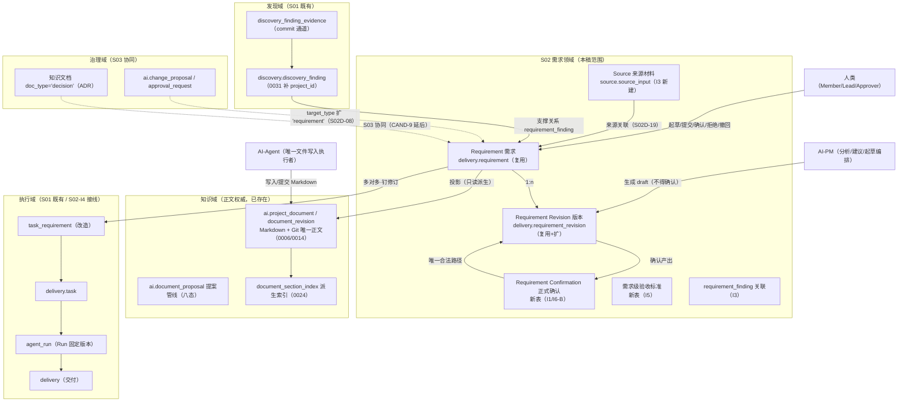

### 3.2 十问逐答（任务目标第一节的十个问题）

| # | 问题 | 裁决（详见对应章节） |
|---|---|---|
| 1 | 什么是 Requirement | 项目内具有稳定 UUID、项目内唯一 code、正式版本指针与类型的需求实体；复用 `delivery.requirement`，不新建主表（§4.3） |
| 2 | 原始需求与正式需求的关系 | 原始需求=**来源材料**（`source.source_input`，独立于需求域的输入侧实体，I3），经提案/起草进入需求域；正式需求=经人类确认的需求实体。原始材料**不是** Requirement 的前身实体，二者是关联关系（Q-18/S02D-15、S02D-19） |
| 3 | 生命周期如何管理 | 三套生命周期分离：Requirement（active/withdrawn/archived）/ Revision（五态）/ 知识文档发布（八态）；见 §5 |
| 4 | Revision 如何表达版本 | `version` 需求内单调递增 + `UNIQUE(requirement_id,version)`；正文权威在 Markdown，Revision 绑定 `markdown_version_ref` + 纯正文 `content_hash`（§5.3、§6.4） |
| 5 | AI 如何参与 | AI-PM 分析/建议/起草 draft/识别冲突缺失（经统一服务）；AI-Agent 唯一执行 Markdown 文件写入；**AI 不得确认**（§7） |
| 6 | 人类如何确认 | 正式确认=独立领域行为：Confirmation 记录（新表）+ Approver 显式授权 + 可信交互上下文（REST/UI），MCP 零确认工具（§7.1~7.2） |
| 7 | 如何与 Task/Finding/Decision/Knowledge 关联 | Task：task_requirement 钉修订（§8）；Finding：requirement_finding 多对多（§9）；Decision：治理侧 target_type 扩值 + S03 协同（§10）；Knowledge：投影关系（§6） |
| 8 | 如何成为执行依据 | Task 关联行显式携带 revision_id；创建关联要求需求已有正式版本；Run/Delivery 各自固定实际依据（§8） |
| 9 | 变更如何追踪 | 修订链（superseded 永不删除）+ Confirmation/审计记录 + 变更三步（识别/提示/人裁决）+ 改绑审计（§5.5、§8.3） |
| 10 | 事实/版本/执行依据一致性 | 唯一权威正文（Markdown）+ 唯一写路径（Application Service）+ CAS 并发控制 + 集合视图基线 + 过期显式判定（§6、§13、§8.5） |

---

## §4. 核心领域模型

### 4.1 实体关系图（图 2，ER）

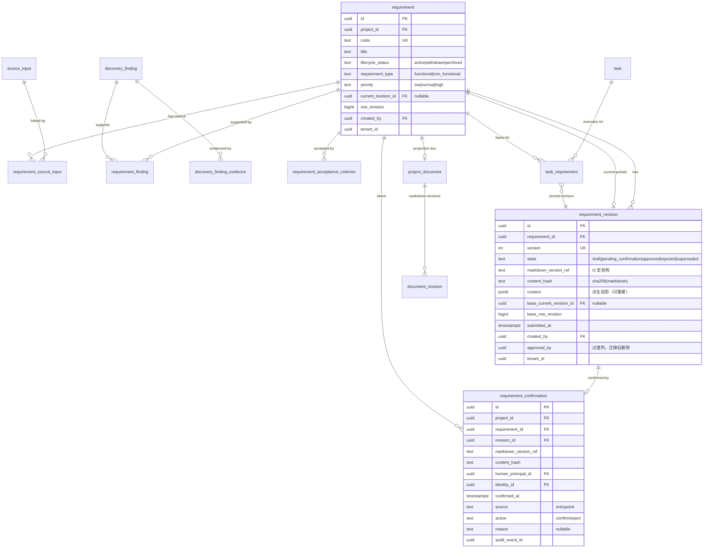

### 4.2 概念判定总表（十概念逐项裁决）

> 原则：**不因概念名称不同而机械新增表**。每行给判定 + 现状 + 去向。

| 概念 | 判定 | 现状（证据） | 去向 |
|---|---|---|---|
| **Raw Requirement（原始需求）** | 领域实体，但**属于来源侧（I3），不是需求域实体** | Missing——全仓无来源材料表；`source_artifact_id` 为指向相反语义的空裸列（0002:22，零读写） | 新建 `source.source_input`（Q-18 选项 A）+ `requirement_source_input` 关联；旧列废弃（Q-20/S02D-17） |
| **Requirement** | 领域实体（复用） | Existing——`delivery.requirement`（0002:3-14；0019 租户化） | 复用；补列改造（§15.5）；不新建主表【已裁定，S02-01 §10.1.1】 |
| **Requirement Revision** | 领域实体（复用） | Existing——`delivery.requirement_revision`（0002:16-34，三态 CHECK） | 复用；state CHECK 扩值 + 基版本列 + Markdown 绑定列（§5.3、§15.5） |
| **Requirement Proposal（需求提案）** | **不是独立需求域实体**——提案形态 = `draft`/`pending_confirmation` Revision + 来源标记；知识域 `ai.document_proposal` 是**文档发布候选**（doc_type='requirement' 指文档类型，非需求领域对象） | Partial——修订实体已支持 draft；`ai.document_proposal` 八态已存在（0014:38-41） | 不新建提案表；AI 提案=经统一服务创建 draft（来源标记 AI+reason）；知识域提案管线保持独立（S02-01 §8.2 判定维持） |
| **Knowledge Document** | 知识域实体（复用）——**正文唯一权威** | Existing——`ai.project_document`/`ai.document_revision`（0006，无正文列）+ Git 存储（knowledge.rs:1-3） | 复用；需求投影文档的 doc_key/doc_path 规范由 I2 定义（§6.4） |
| **Finding** | 发现域实体（复用，不升格为需求） | Existing——`discovery.discovery_finding`（0025:48-62；0031:112-125 补 project_id） | 复用；治理关联经 `requirement_finding`（§9）；S01-I2 的 Finding 确认与本域确认相互独立 |
| **Decision** | **不是新实体**——需求治理 Decision = 治理域读模型（`governance.approval_request` + `ai.change_proposal`）+ 关联扩值；技术 ADR = 知识文档（S03 域） | Existing（读模型）——`/v1/pm/decisions` 为拼装读模型（pm_lists.rs:414-437）；无独立表 | 不新建 decisions 表；`change_proposal.target_type` 扩 `'requirement'`（0003:133 无 CHECK，零迁移成本）（§10、S02D-08） |
| **Task** | 执行域实体（复用） | Existing——`delivery.task`（0001/0010） | 不动本体；关联表改造（§8、S02D-14） |
| **Evidence** | 值对象/证据记录（发现域），**非需求域新实体** | Existing——`discovery_finding_evidence`（0031:128-169，evidence_type 五值 + commit_sha）；治理登记实体 Missing | 复用；外部变更治理登记 `repository_change_intake` 由 I3 统一裁决（I7 Q-I7-01 倾向新增） |
| **Confirmation** | **领域行为记录实体（新表）** | Missing——无任何确认记录表；现仅修订表 `approved_by` 单列（0002:28） | 新建 `requirement_confirmation`（S02D-21/DEF-02 修复载体；I1 §11.3；命名 I6-B 终定） |

### 4.3 核心实体及关系定义（交付物 3）

**Requirement（需求）**：项目内稳定身份。不变量——`UNIQUE (project_id, code)`；`current_revision_id` 为空表示尚无正式版本，非空则必须指向本需求 `state='approved'` 的 Revision；任意时刻最多一个当前正式版本；类型创建后 V1 不可普通变更（I1-D01，治理提案除外）；code 创建后不可普通修改（I1-D02）。

**Requirement Revision（需求版本）**：版本的唯一载体。不变量——`UNIQUE (requirement_id, version)` 且 version 需求内单调递增、永不复用（I1-D06/D11）；正文权威在 Markdown，Revision 携带 `markdown_version_ref` + `content_hash=sha256(markdown)`；`pending_confirmation` 冻结（正文与 Markdown 版本均不可变，I1 §5.4）；`rejected`/`superseded` 均为终态、不可复活，重开须新建 Revision（I1-D03）。

**Requirement Confirmation（正式确认记录，新表）**：一次确认/拒绝行为的不可变事实。六要素：`requirement_id + revision_id + markdown_version_ref + content_hash + human_principal_id(+identity_id) + confirmed_at`，另带入口 `source` 与审计引用 `audit_event_id`。**一条 Revision 最多一条有效 confirm 记录**；拒绝以同表 `action='reject'` + reason 记录（I1-D12 的重放语义由 I6-B 幂等键实现）。`claimed_device_id` 属归因信息，不进确认表（I1 §11.3）。

**关系**：Requirement 1:n Revision；Revision 0..1 Confirmation（confirm）；Requirement 1:n Confirmation（含 reject）；Requirement n:m Finding（经 requirement_finding，relation=supports）；Requirement n:m source_input（经 requirement_source_input，来源属需求级、修订继承——S02D-19）；Task n:m Requirement（经 task_requirement，行内钉 revision_id）；Requirement ↔ 知识投影文档 1:1（投影，非权威）。

### 4.4 明确不建立的对象（克制清单）

| 对象 | 裁决 | 理由 |
|---|---|---|
| Project Baseline 实体 | **不建**（Q-10/R3） | 基线=集合视图（§8.5）；需求级快照先例为零（E-4 §7 检索：全库 snapshot 均为配置快照） |
| 独立 Requirement Proposal 表 | 不建 | 提案=draft/pending_revision（§4.2）；塞入 `ai.document_proposal` 会绑架生命周期且拿不到领域 ID（S02-01 §8.2） |
| 独立 decisions 表 | 不建 | 治理读模型已拼装（A6）；ADR 归 S03 |
| requirement_relation（需求间依赖/冲突/派生） | **V1 延后**（显式登记） | 无现实场景输入；形态可参考 `delivery.task_dependency`（0021）；登记为 S02-05 可选项 |
| 需求塞入 `ai.document_proposal` | 禁止 | 同上 |
| 按 requirement_type 分表 / NFR 第二套生命周期 | 禁止 | 用户五约束（S02-01 §14.1） |

---

## §5. 生命周期设计（交付物 4）

### 5.1 三套生命周期分离原则（REV-01「三套生命周期」收编）

| 生命周期 | 载体 | 状态集 | 权威 |
|---|---|---|---|
| ① Requirement 领域生命周期 | `delivery.requirement.lifecycle_status` | active / withdrawn / archived | PG（本域） |
| ② Revision 版本生命周期 | `delivery.requirement_revision.state` | draft / pending_confirmation / approved / rejected / superseded | PG（本域） |
| ③ 知识文档发布生命周期 | `ai.document_revision.status` + `ai.document_proposal.status` | 0006:29-31 `draft/published/rejected/rolled_back`；0014:38-41 八态 | 知识域（既有，**不动**） |

三套**不共用一个状态字段**、转换互不驱动（投影/发布由 I2 协议衔接）。**同名不同义警示**：①②的 rejected（本域，S02D-04 新增）与③的 rejected/rolled_back（文档发布域，**0006 与 0014 两处既有**）互不引用；需求域确认链引用知识文档生命周期时必须同时引 0006（document_revision）与 0014（document_proposal），不得只引其一（REV-01 意见②落实）。

### 5.2 Requirement 生命周期（采纳 I1 V1.0 §4，裁决确认）

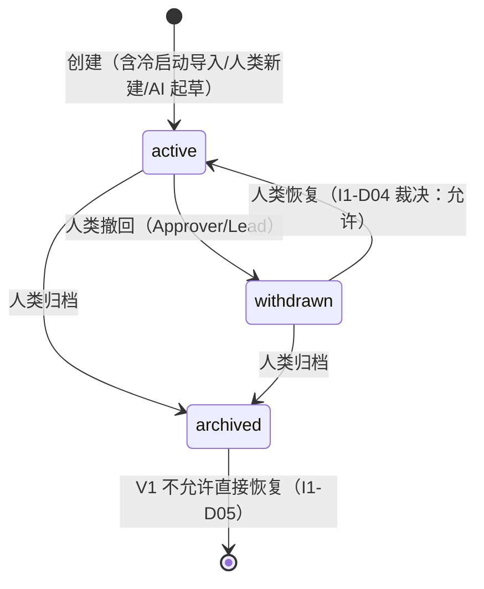

裁决（S02D-04 前半）：
1. `lifecycle_status ∈ ('active','withdrawn','archived')`，`CHECK` 约束落库；现 `status` 列（**无 CHECK**，0002:8 仅 default 'draft'——本轮复核确认）RENAME 为 `lifecycle_status` 并替换值域。旧值 `'draft'/'approved'` 废弃：「是否有正式版本」由 `current_revision_id IS NOT NULL` 表达；无存量数据（AGENTS 规则 1）→ 兼容迁移简化为直改。
2. 两套定稿路径对 `status` 的分叉写入（REST 置 'approved'（revision.rs:114）vs 执行器不写（本轮复核 B2））随本裁决一并消除：**任何路径不得再把"批准"写入需求级状态**。
3. 撤回/恢复/归档 = 人类治理命令（Withdraw/Restore/ArchiveRequirement，I1 §17.5），Approver/Lead 权限，审计必录；withdrawn/archived 不使其历史 Revision 失效，已建立的执行依据继续可追溯。

### 5.3 Revision 生命周期（采纳 I1 V1.0 §5，裁决确认）——版本演进图（图 4）

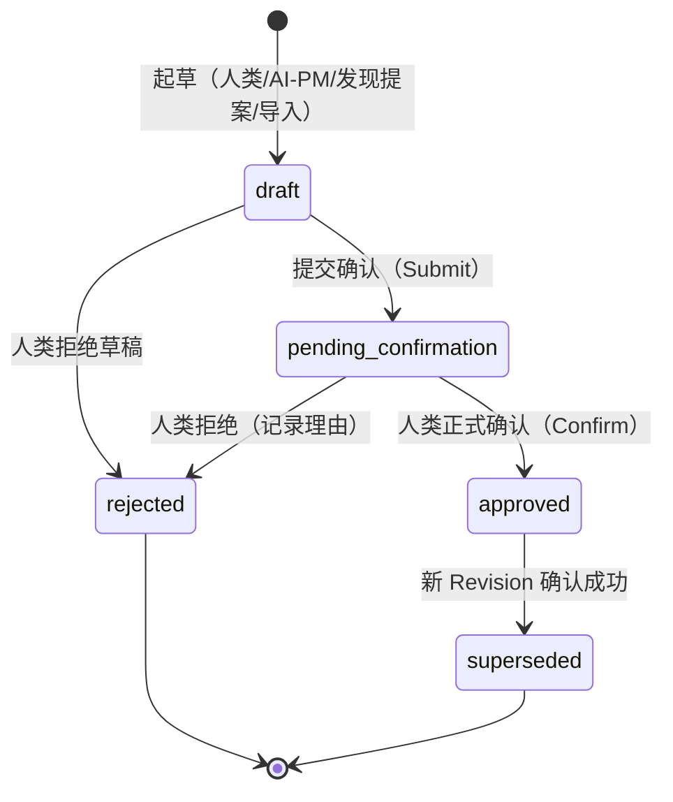

裁决（S02D-04 后半）：`state` CHECK 由三值扩为五值（现 CHECK 0002:23-25 重写）；`superseded` 只能由新正式确认产生；`draft→approved` 直跳路径**废除**（现两入口均直跳——改造点），必须经 `pending_confirmation`；拒绝记录保留拒绝人/时间/理由（Confirmation 表 `action='reject'`）；被拒绝的 Revision 不复用（I1-D03）。

### 5.4 Raw → Proposal → Human Confirmation → Formal 主流程图（图 3）

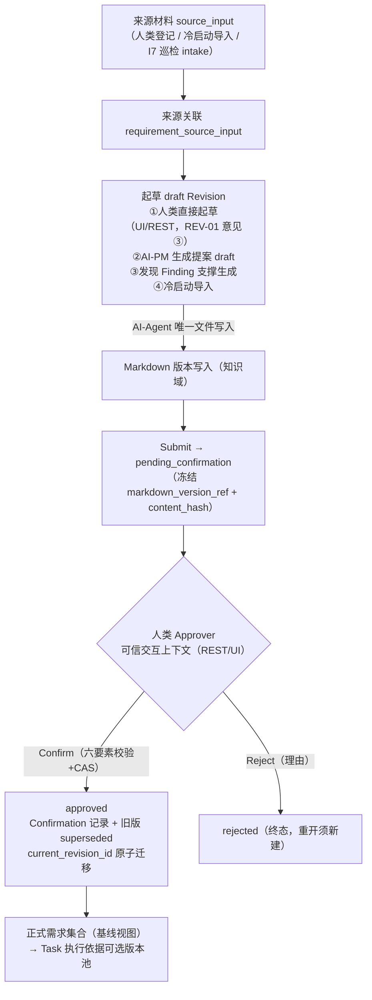

来源枚举五类（R-13/C-1 承接）：人类直接输入 / 会话澄清（Discovery）/ 外部反馈（邮件/工单）/ 外部代码变更接管（I7）/ **存量与冷启动导入**（现系统唯一创建路径，与运行时新建共用同一身份/类型/生命周期语义）。

### 5.5 拒绝、废弃、替换的历史保留规则

| 场景 | 规则 |
|---|---|
| Revision 被拒绝 | 终态保留；拒绝人/时间/理由入 Confirmation+审计；同需求已 approved 的版本不受影响、`current_revision_id` 不变（I1 §5.6） |
| Requirement 被撤回（withdrawn） | 生命周期态变更，修订链与历史依据全部保留；恢复允许（I1-D04） |
| Requirement 归档 | 同上；V1 无直接恢复（I1-D05） |
| Revision 被替换 | 旧 approved → superseded（终态保留）；版本号永不复用 |
| 禁止无痕删除 | 修订链不可跳脱（S02-03 C-7/BR-08）；DB 级无 DELETE 授权路径，审计完备 |

---

## §6. Knowledge Markdown 权威正文协议（Q-3/R1 落地，S02D-03）

### 6.1 权威与投影关系（图 8）

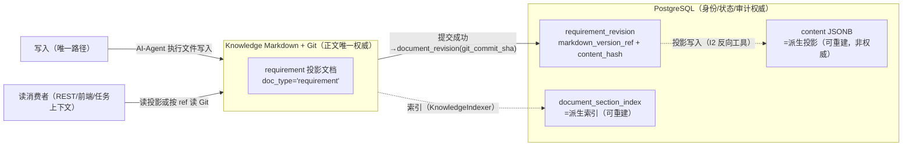

不变量（I1 §8.2 采纳）：`Markdown 正文 = A` 且 `requirement_revision.content = B` 时**禁止 A≠B 的双权威消费**；`content` 若保留必须标记为投影、记录对应 Markdown 版本与 hash、可从 Markdown 重建、禁止反向修改 Markdown。

### 6.2 写入职责分层（REV-01 意见①：与知识空间稿的调和裁决）

知识空间稿「AI-PM 是主要写入者」与 I1/REV-01「AI-Agent 唯一写入」存在字面冲突。**裁决：按职责分层调和，两者在不同层各自成立**（I2 落文本对齐）：

| 层 | 主体 | 职责 | 边界 |
|---|---|---|---|
| 内容层（写什么） | 人类 / AI-PM | 起草与修改**内容**；AI-PM 是主要的**内容起草与编排者**（分析、建议、生成 draft 内容） | 不得决定确认；不得直接触达文件系统 |
| 执行层（怎么写） | **AI-Agent（唯一）** | 唯一的 Markdown **文件写入执行者**（含人类起草内容的落盘） | 禁止决定内容语义；写入须携带 content_hash 与 operation_id 幂等 |
| 治理层（何时生效） | 人类 Approver | 确认/拒绝/撤回/归档 | 仅可信交互上下文 |
| 校验层 | System | hash 校验、投影一致性、审计 | 无业务决定权 |

### 6.3 人类起草路径（REV-01 意见③落实）

人类直接起草为一等路径，不是 AI 提案的附属：UI/REST 提交内容 → 统一服务创建 draft（来源标记=human principal）→ AI-Agent 执行文件写入 → 流程同图 3。**禁止**因"AI-Agent 唯一写入"而要求人类先经 AI 中转。

### 6.4 Revision ↔ Markdown 版本映射规则

1. 每个 Revision 在 `pending_confirmation` 起绑定精确 `markdown_version_ref`（对应 `ai.document_revision(git_commit_sha, revision_no)`，结构由 I2 定义）与 `content_hash=sha256(markdown)`。
2. 确认校验必须六要素全匹配（I1 §5.4），任何一项不符即拒绝——阻止跨版本重放。
3. 需求投影文档 `doc_key` 规范、目录结构与 front-matter（沿用 `knowledge_migrate` 的 id/type/source_events 形态扩展）由 I2 定义；一个 Requirement 对应一份投影文档（1:1），修订历史由 Git 版本链承载。

### 6.5 四消费方迁移清单（R-12 落实）

| 现有消费方 | 现状（本轮复核证据） | 目标 | 归属 |
|---|---|---|---|
| REST `pm_write` 直写 `content` | Conflict——`revision.rs:44-47` 写 `{"markdown"}`；`approve` 无锁直改 | 经统一服务提交；`content` 只写投影 | S02-I1/I6-B |
| 前端 `createRevision` | Existing——`api/pm.ts:92-98`（页面现为占位，§15.4） | 切换统一写入协议 | S02-I1 |
| 任务上下文 `read.rs:40-56` | Conflict——LATERAL 取最新修订 `content` 当正文 | 按钉定 revision 的 `markdown_version_ref` 读取；LATERAL 最新版兜底删除 | S02-I2/I4 |
| 执行器 `create_requirements` | Conflict——`executor.rs:398-489` 写 DB 正文 | 经 AI-Agent 文件写入 + 统一服务建行 | S02-I1/I2 |
| **反向投影工具（Markdown→DB 投影）** | **Missing**（`knowledge_migrate`=DB→MD，`knowledge_indexer`=检索索引，均非此用） | I2 新建重建机制（投影损坏可恢复） | S02-I2 |

### 6.6 冷启动导入改造

`CreateRequirements`（executor.rs:398-489；现系统唯一创建入口，`RequirementDraft` 无类型字段 import.rs:83-95）改造为：补类型字段（默认 functional，S02D-13）→ 经统一服务建 Requirement（lifecycle_status='active'）→ 首版 draft 经 AI-Agent 写 Markdown → **不自动定稿**（现注释已声明，command.rs:57）。导入与运行时新建共用同一身份/类型/生命周期语义（C-1）。

### 6.7 跨存储一致性

Git commit 与 PG 事务**不原子**（I1 §6.3）：确认事务内校验 `markdown_version_ref`+hash 后提交 PG；写入失败的恢复（孤儿 commit/投影漂移）协议由 I2 定义；`ai.knowledge_write_operation`（0024:43-56，`UNIQUE(project_id, operation_id)`）为写入幂等账本，需求域写入复用该机制。

---

## §7. 权限与人类正式确认协议（交付物 5；Q-2/R2 落地）

### 7.1 Confirmation 协议（S02D-21）

**正式确认是独立领域操作**，不是审计事件的副产物、不是 approval_request 的复用、不是文档红线确认：

| 概念 | 载体 | 判定 |
|---|---|---|
| 需求正式确认 | `requirement_confirmation`（新表） | 本域唯一确认权威 |
| 治理通用审批 | `governance.approval_request`（0003:157-168，与 change_proposal 1:1） | **不得复用**为需求确认（S03 已有同型裁决：1:1 不得复用为通用设计审批） |
| 文档红线确认 | `ai.document_proposal.redline_confirmed_by/at` + `knowledge_write_operation('confirm_redline')` | 知识域自有，不混用 |
| 审计事件 | `governance.audit_log` | 记录事实，不承载确认语义 |

协议六要素（缺一拒绝）：`requirement_id`、`revision_id`、`markdown_version_ref`、`content_hash`、`human_principal_id`（真人主体，`principal.kind=human` 且 identity 可信）、`project_id`。附加校验：Approver 显式授权有效（H-19/H-21/H-22 测试继承 I6-A）、可信 Human Interactive Context（H-17：Agent 持人类 Key 直呼 REST 确认接口必须拒绝）、CAS 并发校验（I1 §7.4：`expected_current_revision_id`+`expected_row_revision`）。

### 7.2 确认权限与入口

- **Approver 是独立授权**，不随 Project Member 自动获得（I6-A V1.2；`project_member.role='owner'`→Lead，不新增枚举）。
- **确认入口仅 REST/UI 可信交互上下文**（A\* 裁决继承）；MCP 不提供任何需求确认工具（现 19 工具无一定稿工具——保持，H-15）。
- 入口形态总裁决（Q-8/S02D-06）：创建/起草/提交 = REST + MCP 双入口（I2-D 铁律，权限码机制沿用 `auth.rs:572,616` 的 `PM_MCP_*` 模式）；**确认/拒绝/撤回/归档 = 仅 REST/UI**。

### 7.3 DEF-02 修复细则（S02D-02，强制修复裁决）

| # | 裁决 | 关闭证据要求 |
|---|---|---|
| 1 | `ConfirmRequirementRevision`（及 reject/withdraw/archive）具备**独立人类确认约束**：Confirmation 表 + Approver 授权 + 可信交互上下文三重校验，在统一服务内实现；**不得依赖策略黑名单**（红线策略与需求审批不是同一概念） | V-2 场景重放：策略断言不再出现 `ApproveRequirementRevision→AutoApply` 放行至定稿 |
| 2 | `approved_by`/Confirmation 写入主体必须为真人；AI 主体（AiPm/Agent）提交确认类命令 → 生成 `pending_confirmation` 待确认项 + 通知，**不得执行** | 执行器重放 `ActorKind::AiPm` 定稿用例（command_executor.rs:681/756/975/1020 改造后）必须失败 |
| 3 | 纵深防御：策略 YAML `red_lines` **补录** approve 类命令（`required_role` 按 I6-A 角色）；明确名单仅为第二道防线 | 名单 diff + 测试 |
| 4 | MCP 零确认工具维持；新增 AI 起草类工具须挂权限码 | 工具清单 diff |
| 5 | `openai_adapter.rs:31` 的合法命令清单移除确认类命令 | prompt diff |

### 7.4 AI 与 Human 职责边界（图 9 + 四类主体职责表）

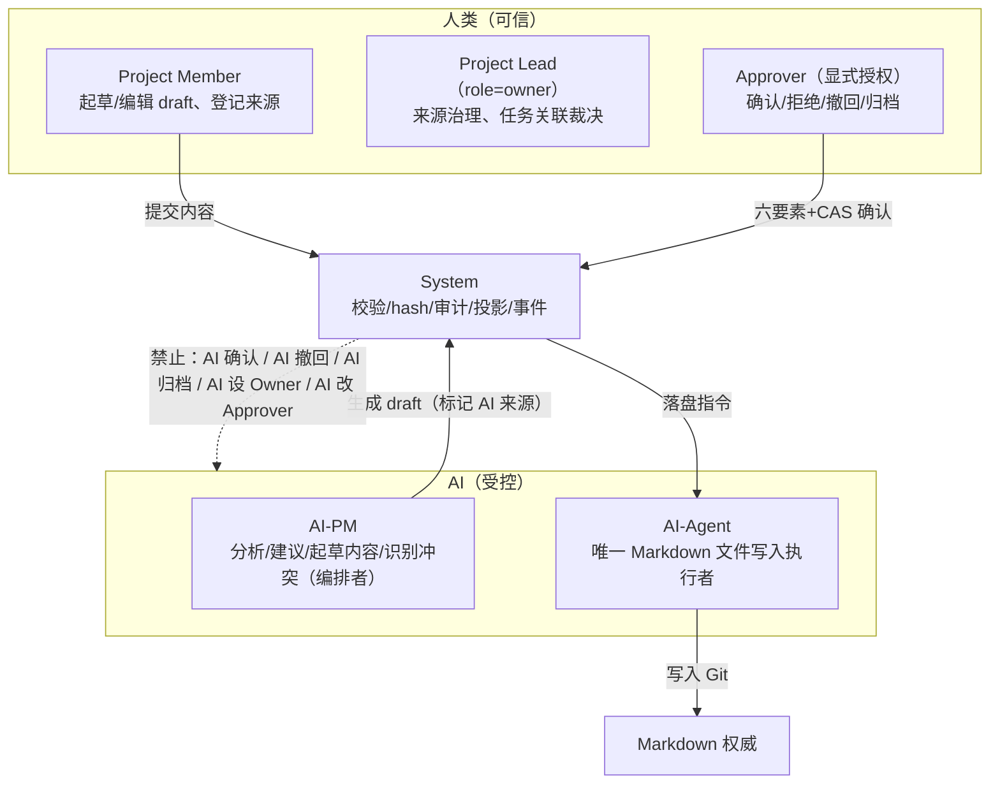

| 职责 | Human Member | Human Lead | Approver | AI-PM | AI-Agent | System |
|---|---|---|---|---|---|---|
| 起草/编辑 draft | ✅ | ✅ | ✅ | ✅（标记 AI 来源） | ❌（仅执行写入） | — |
| 提交确认（submit） | ✅ | ✅ | ✅ | ✅（发起） | ❌ | — |
| **正式确认/拒绝** | ❌ | ❌（非 Approver 时） | ✅ 唯一 | ❌ | ❌ | ❌ |
| 撤回/恢复/归档 | ❌ | ✅ | ✅ | 建议 | ❌ | ❌ |
| Markdown 文件写入 | ❌（经受控流程） | ❌ | ❌ | ❌（内容编排） | ✅ 唯一执行者 | 校验 |
| 登记来源（source_input） | ✅ | ✅ | ✅ | 建议 | ❌ | 校验 |
| 指定 Approver | ❌ | ✅（Lead） | ❌ | ❌ | ❌ | 校验 |

---

## §8. Task 执行依据规则（交付物 7；Q-17/R4 落地，S02D-14）

### 8.1 执行依据关系图（图 5）

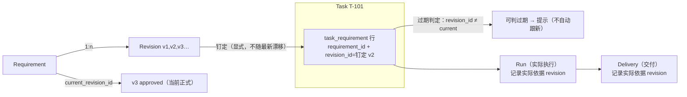

### 8.2 task_requirement 改造（Conflict → 目标）

| 项 | 现状 | 裁决 |
|---|---|---|
| 主键 | `(task_id, revision_id)`（0002:73）——同需求多修订可重复挂载（S02-01-021） | 改 `PRIMARY KEY (task_id, requirement_id)`：**同一 Task 对同一 Requirement 默认仅一个执行依据**（R4） |
| 执行依据列 | `revision_id NOT NULL` | 保留：显式钉定，**不得只引 requirement_id 动态读最新** |
| 改绑 | 无端点、无历史 | 允许改绑（受控命令）+ 旧值留审计（before/after + 理由）；**改绑不得静默** |
| 审计 | 无（随 create_tasks 一笔带过，executor.rs:605-616） | 关联/改绑/解除均有独立审计动作 |
| 写入口 | 仅执行器（ON CONFLICT DO NOTHING） | 收敛统一服务；REST/MCP 同批（I2-D 铁律） |
| created_at | Missing | 补列 |
| 前提 | — | 关联写入要求目标需求 `current_revision_id IS NOT NULL`（I1-D07：无正式版本不得作为正式执行依据；参考性关联 V1 不做，I4 细化） |

### 8.3 版本变化三步与反向读模型（C-3 落实）

需求正式版本变化对已关联 Task 的影响 = **识别**（哪些 Task 钉了旧 revision——需"需求→任务列表"反向读模型，现状 Missing，S02-01 §5.1）→ **提示**（向 Task 责任人/Agent 发变更信号）→ **裁决**（人决定：跟新 / 维持快照 / 解除关联）。系统只识别与提示，**不自动改绑**。

### 8.4 Run/Delivery 追溯（R-16/K-3 新增面标注）

现状态：全库引用需求的实体仅 `task_requirement` 一处（S02-01-022）；**Run/Delivery 级需求版本关联实体不存在**——Run 携带需求正文是运行时拼装（read.rs）。裁决：Run 实际依据、Delivery 实际依据的记录结构由 **S02-I4** 设计（Task 计划依据 / Run 实际依据 / Delivery 实际依据三者不混用，I1 §10.4/10.5）；本稿仅锁定语义：**Project 当前版本变化不得改变已有 Run 的执行版本**。

### 8.5 执行依据与基线视图（Q-10/R3 落地）

- **项目需求基线 = 集合视图**：`{ r | r.project_id=P ∧ r.lifecycle_status='active' ∧ r.current_revision_id IS NOT NULL }`，元素=（requirement_id, code, current_revision_id, version, content_hash）。不落表、不编号、不冻结快照。
- **执行依据过期判定**（显式、可计算）：`task_requirement.revision_id ≠ requirement.current_revision_id` → 该依据"过期"。过期**只触发提示**，历史 Run/Delivery 引用的 revision 永不因此失效。
- **禁止**引入任何承载该集合的 Baseline 实体/表/编号（含间接形态，如"基线版本号列"）。

---

## §9. Finding 治理关联（交付物 8 前半；Q-4/R5 落地）

### 9.1 治理关联图（图 6）

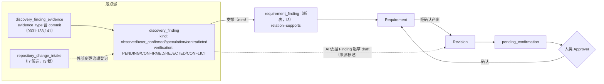

### 9.2 裁决要点

1. **Finding ≠ Requirement、CONFIRMED ≠ approved**：两轴独立（S02-01 §8.1 维持）；S01-I2 的 Finding 确认与本域确认是两个动作。
2. **关联表**：`requirement_finding(requirement_id, finding_id, relation, created_by, created_at)` 多对多——一条 Finding 支撑多条 Requirement、一条 Requirement 由多条 Finding 支撑（I1 §10.1）；不复制 Finding 内容进正文。
3. **Finding → Requirement 提案路径**：AI-PM 依据已确认 Finding 生成 draft Revision（来源标记 finding_ids）→ 人类确认；Finding 亦可由人类直接引用起草。AI 不得跳过确认。
4. **Evidence 通道**：Commit 级证据已存在（0031:128-169）；I7 的外部变更治理登记（`repository_change_intake`，Q-I7-01 倾向新增）由 I3 统一裁决；evidence FK 前向收口按 I7 V1.1 §7.3 执行。

---

## §10. Decision 领域语义（交付物 8 后半；Q-5/Q-15/R6 落地，S02D-08）

### 10.1 四概念分离表（不得混同）

| 概念 | 语义 | 载体 | 与 Requirement 的关系 |
|---|---|---|---|
| 需求治理 Decision | 对需求提案/变更/废弃的项目级治理决定 | 读模型 = `governance.approval_request` ⋈ `ai.change_proposal`（pm_lists.rs:414-437；AI 决策事实落 `ai.analysis_run`+`change_proposal`，0003:107-154） | `change_proposal.target_type` 扩 `'requirement'`（S02D-08；列无 CHECK，零迁移成本，0003:133） |
| 技术架构决策 ADR | 技术方案决策记录（S03 领域） | `ai.project_document(doc_type='decision')`（0006:12）——S03 协同 | S02 只声明语义接口（需求可引用 Decision 为来源/依据/约束，不得复制文本）；CAND-9 关联表延后 S03 |
| 人类确认行为（Confirmation） | 对 Revision 的一次性正式确认事实 | `requirement_confirmation` 新表（§7.1） | 确认 ≠ Decision：确认是**批准动作**，Decision 是**治理结论** |
| 普通操作审计 | 系统事实流水 | `governance.audit_log`（0003:188-202 + 0004/0018/0027 扩列） | 只记录，不承载语义 |

### 10.2 语义关系图（图 7）

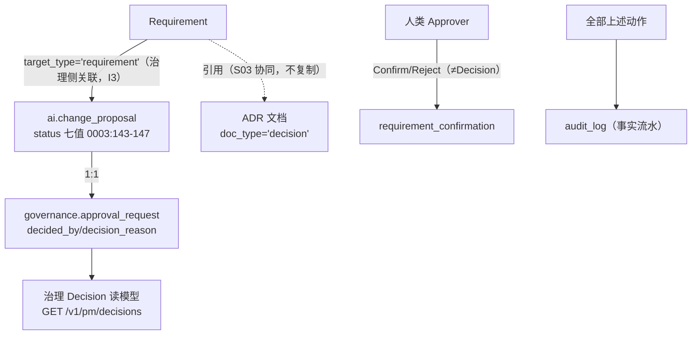

### 10.3 裁决

1. 需求治理 Decision 的**业务语义由本稿定义**：针对需求的治理决定（立项提案、变更提案、废弃提案）以 `change_proposal(target_type='requirement')` + `approval_request` 承载；AI 可提出，人类裁决。
2. **实现与 S03 协同**：ADR/技术决策关联（CAND-9）、approval_request 与 S03 五类决策（Requirement Approval / Design Approval / ADR Acceptance / Design Review Decision / Baseline Freeze）的边界，按 S03 V1.1 既有裁决——`approval_request` 1:1 特性不得复用为通用设计审批；需求域确认不走 approval_request。
3. 现状标注：`target_type` 实际取值仅 `'task'/'task_run'/'project_repository'`（S02-01-029），扩值属 **Missing→新增面**（I3）。

---

## §11. 非功能需求统一治理（用户五约束收编）

1. **统一模型**：NFR 与 FR 共用 Requirement 身份/版本/生命周期/审计（`requirement_type='non_functional'` 承载；S02D-13）。
2. **验收载体方向裁定**（Q-11/S02D-09）：新表 `requirement_acceptance_criterion`，**锚 requirement_id**（不绑修订——验收语义属需求级治理内容），记录 `established_in_revision_id` 留痕；**不可改造 `delivery.task_acceptance_criterion`**（0015:25-40，硬锚 task + 7 处读写点，S02-01 §11.4 冲击 A）。
3. **版本化口径**（Q-12/S02D-10）：验收项不随 Revision 版本机重版本；修改验收项=独立受控命令（Approver 权限+审计）；`pending_confirmation` 期间允许修改但确认时输出一致性提示（漂移风险登记 §18）。
4. **承载层**（Q-13/S02D-11）：`verification_kind` 扩枚举（容纳性能/安全/审查等验证族）+ `params JSONB` 承载指标/阈值/测量方法/审查准则/通过规则；**禁止按类型分表**；形状由应用层按 requirement_type 校验。细化归 S02-I5。
5. **零 Task NFR**（Q-14/S02D-12）：验收触发与裁决不得只挂 Task 链（否则零 Task NFR 永久 awaiting）；需求级验收裁决入口由 I5 交付；S02 向 S04/S05 声明该接口。
6. **验收双链汇合**（C-2）：任务级验收链（既有）与需求级验收链（新建）在**交付确认（Delivery acceptance）**处汇合，由交付确认同时背书两链结论。

---

## §12. 权限与授权（Q-9/DEF-01 落地，S02D-07）

### 12.1 DEF-01 修复裁决（强制修复裁决）

**原问题**（[运行时已证]，S02-02 V-4）：租户内非项目成员可创建（201）并定稿（200）任意项目需求；读侧有成员校验、写侧仅校验租户（`requirement_in_tenant`，pm_writes.rs:54-65）；执行器夹具无成员行仍成功。

**设计冲突**：目标模型（需求=项目域治理对象，须成员+角色授权）vs 现实现（tenant 级放行 + 黑名单策略缺项）。

**最终裁决**：项目成员授权**在统一 Application Service 单点校验**（不是各入口零散补查），覆盖六点处理面：
1. 项目成员角色校验（读可见性沿用 `require_project_visible` 形态；写须成员）；
2. Requirement 创建权限；
3. Revision 起草/修改权限；
4. Revision 提交/确认权限（叠加 §7 Approver 协议）；
5. AI-Agent/AI-PM 作为执行主体时的项目授权（复用 `resolve_project_executor`，authz.rs:81-98）；
6. REST/MCP/Executor 三入口授权一致性（I2-D 铁律）。

**修订内容**：§7 协议 + §13 统一服务共同承载；**后续实施影响**：I6-A/I6-B 与 I1 同批交付授权层；回归证据=V-4 场景重放（非成员写 403）。

### 12.2 权限模型与角色

- 继承 I6-A：Project Member / Lead（role='owner'）/ **Approver（显式授权）**；`git_capability_grant 0032 建→0033 撤` 先例提示：显式授权表进迁移前须 I6-A 终稿确认。
- MCP 工具权限码：沿用 `PM_MCP_*` 映射（auth.rs:559-570 现有；本轮复核 572/616）；新增需求类工具逐个挂码。
- 策略层：红线名单补录 approve 类（纵深防御，§7.3-3）；`automation_mode`（ai_lead/controlled，0003:62-66）不影响确认约束——controlled 模式下 AI 同样不得确认。

---

## §13. 统一 Application Service、审计与事件（Q-1/DEF-04 落地，S02D-01）

### 13.1 统一写入（架构约束上升为裁决）

S02-02 V-6 已证：REST 与 Executor 对同一"定稿"语义存在**业务级分叉**（无锁 vs FOR UPDATE；不可回滚 vs CompensationSpec::Restore；审计两套词表）。裁决：

1. **九个领域命令单点实现**（I1 §17.5）：CreateRequirement / CreateRequirementRevision / UpdateRequirementDraft / SubmitRequirementRevision / ConfirmRequirementRevision / RejectRequirementRevision / WithdrawRequirement / RestoreRequirement / ArchiveRequirement。现 `ApproveRequirementRevision` 命令映射退役（适配层兼容期后移除）。
2. REST、MCP、Executor **只作适配器**，不得独立实现生命周期/并发/授权/审计规则；执行器现有 `FOR UPDATE`+`CompensationSpec`（executor.rs:823-849、918-940）与 `CompensableTable` 映射（executor/mod.rs:126-128）收编为服务内部实现。
3. 并发控制（DEF-03 修复方向）：CAS 双令牌 `expected_current_revision_id` + `expected_row_revision`（I1 §7.2-7.6）；两 Draft 并发确认=后至者显式 409；同一 Revision 重放按幂等键判定（I1-D12：同一幂等请求幂等成功，不同请求 409）。

### 13.2 审计词表统一（S02D-23）

现三套词表并存（`requirement.*` 点号式 / `approve_requirement_revision` 下划线式 / 关联无动作，S02-01-034）。裁决：**点号式**为唯一词表（`requirement.created / requirement.revision_drafted / requirement.revision_submitted / requirement.confirmed / requirement.revision_rejected / requirement.revision_superseded / requirement.withdrawn / requirement.restored / requirement.archived / requirement.basis_linked / requirement.basis_rebound / requirement.basis_removed`）；审计负载带 before/after + `markdown_version_ref` + `content_hash`；身份五列（actor_id / actor_identity_id / actor_client / actor_auth_mode / claimed_device_id）沿用 0018+0027 既有结构。**注意**：`pm_write/audit.rs:31-36` 的"无认证上下文兜底取第一个 active human principal"行为与审计可信性冲突，统一服务中**废除**（无身份→拒绝写，不兜底）。

### 13.3 outbox 事件族注册（S02D-22，新增面）

现状：`integration.outbox_event` 事件目录（outbox.rs:100-131）仅 5 类，**零 requirement 事件**；未登记事件禁止生产（outbox.rs:87-92）。裁决：需求域事件族入目录注册（与 §13.2 词表对齐：`RequirementCreated / RequirementRevisionSubmitted / RequirementConfirmed / RequirementRevisionRejected / RequirementSuperseded / RequirementWithdrawn / RequirementArchived / RequirementBasisChanged`），供下游（总控台、通知、I7 巡检差分）消费；入站 `requirement_submitted → [requirement_analysis, risk_detection]` 路由（skill_router.rs:11）维持。

---

## §14. 运行时缺陷处置与基线通过条件（交付物 11 的 DEF 部分；R-8 落实）

### 14.1 逐项绑定

| 缺陷 | 级别 | 原问题（证据） | 设计冲突 | **最终裁决** | 修订内容 | 后续实施影响 |
|---|---|---|---|---|---|---|
| **DEF-01** | P0 | 非成员读保护写全开（V-4 [运行时已证]；`requirement_in_tenant` 仅查 tenant，pm_writes.rs:54-65；执行器夹具无成员行仍成功） | 需求=项目域治理对象 vs tenant 级放行 | **S02D-07**：统一服务单点项目授权（§12.1 六点） | §12 新增；Q-9 关闭 | I6-A/I6-B + I1 同批；回归=V-4 重放 403 |
| **DEF-02** | P0 FAIL | AI 可无人类确认定稿（V-2 [运行时已证]：`test_8` 断言 AutoApply；`ActorKind::AiPm` 实跑 444s 成功；红线名单缺项 policy_engine.rs:41-64） | 「人类确认的需求基线」核心结果 vs AutoApply 放行 | **Q-2 + S02D-02 + S02D-21**：独立人类确认约束（Confirmation 表+Approver+可信上下文+MCP 零确认工具）；红线补录仅纵深防御 | §7 重写 | I1/I6-A/I6-B；回归=V-2 重放断言翻转 + AiPm 拒绝 + 真人 REST 确认成功 |
| **DEF-03** | P1 | 不同修订并发定稿双 200 静默丢失更新（V-3 [运行时已证]；`row_revision` 只写不校、无 FOR UPDATE） | 目标"冲突显式可识别" vs 无护栏 | **S02D-01 + I1 §7**：CAS 双令牌 + 统一服务单点 | §13.1 | S02-05/06 必办；回归=V-3 重放后至者 409 |
| **DEF-04** | P1 | 双入口业务语义分叉（V-6 对照表 [运行时已证]；REST 会写 status='approved' 而执行器不写——本轮复核新增分叉点） | 单一语义 vs 两套实现 | **S02D-01**：统一 Application Service；status 分叉随 S02D-04 消除；content_hash 收敛单点 helper（S02D-16） | §13 + §6 | I6-B；回归=V-6 重放双入口审计/锁/补偿一致 |

### 14.2 基线通过条件（增补条款）

> **本基线通过条件 = DEF-01/DEF-02 具备约束性修复裁决（即 §12.1 + §7.3，本稿已给出）；DEF-03/DEF-04 进入 S02-05/06 必办；四项缺陷相互独立关闭；任何一项的关闭 = 修复提交 + 针对性回归证据。本稿的发布不构成任何一项的关闭或降级。**

### 14.3 关闭语义

四项独立关闭（专家 2026-11-04 口径维持）：P0 修复不使 P1 自动解决；统一入口裁决不自动解决并发缺陷；关闭状态由回归证据确认。S02-02 的"零代码修改"约束不构成任何关闭依据。

---

## §15. 现有数据库映射与代码差异报告（交付物 10）

### 15.1 表级映射总表

| 表 | 判定 | 关键证据与字段 | 本稿处置 |
|---|---|---|---|
| `delivery.requirement` | **Existing + Conflict** | 0002:3-14（id/project_id/code/title/status 无 CHECK/current_revision_id 复合 FK 0002:36-39/row_revision/created_at）；0019:103-157,185,241 租户化；索引 0003:220-221 | 复用+改造（type/priority/created_by/lifecycle_status/updated_*，§15.5） |
| `delivery.requirement_revision` | **Existing + Conflict** | 0002:16-34（version UNIQUE、content JSONB 双形态 0002 既有+revision.rs:47 vs executor.rs:427-431、source_artifact_id 裸列 0002:22、state 三态 CHECK、content_hash 三语义——revision.rs:34-35 / executor.rs:432-433 / knowledge.rs:646-653、created_by、approved_by；**approved_at Missing**） | 复用+扩值+补列；content 降级投影；hash 语义统一（S02D-16） |
| `delivery.task_requirement` | **Conflict** | 0002:68-80（PK `(task_id,revision_id)`、revision_id NOT NULL、无 created_at）；写入 executor.rs:604-616；读取 read.rs:46-51 | S02D-14 改造（§8.2） |
| `discovery.discovery_finding` | **Existing** | 0025:48-62 + 0031:112-125（project_id 补列+UNIQUE+复合 FK；evidence 列迁出） | 复用；关联新表（§9） |
| `discovery.discovery_finding_evidence` | **Existing** | 0031:128-169（evidence_type 五值 CHECK 0031:133、commit_sha 0031:141、组合 FK 0031:154-159、条件 CHECK 0031:160-168） | 复用；intake 由 I3 裁 |
| `delivery.review_finding` | **Existing（异域同名警示）** | 0026:165-183（评审发现，severity info/warning/blocker） | 与 discovery_finding 严格区分，不入需求治理关联 |
| `ai.project_document` / `ai.document_revision` | **Existing** | 0006:7-20 / 22-39（doc_type 四值 0006:11-13、无正文列 0006:1-5、**rejected/rolled_back 0006:29-31**、git_commit_sha NOT NULL）；0014:10-14 加 4 列 | 复用；需求投影协议 I2 定义 |
| `ai.document_proposal` | **Existing** | 0014:21-51（八态 0014:38-41、proposed_markdown、redline_confirmed_by/at、resulting_revision_id） | 保持知识域专用；禁止承载需求领域对象 |
| `ai.document_section_index` / `ai.document_index_state` / `ai.knowledge_write_operation` | **Existing** | 0024:11-26 / 0014:60-76 / 0024:43-56（写入幂等账本） | 复用；PageIndex 仅注释（0024:9）——Missing |
| `governance.approval_request` | **Existing** | 0003:157-168（proposal_id UNIQUE 1:1） | 不复用为需求确认（§7.1） |
| `governance.audit_log` | **Existing** | 0003:188-202 + 0004:7-9（source_kind/source_ref）+ 0018:25-28（actor_identity_id/actor_client/actor_auth_mode）+ 0027:88（claimed_device_id）；通知触发 0005:9-33 | 复用；词表统一（S02D-23） |
| `integration.outbox_event` / `inbound_event` | **Existing** | 0010:123-142；事件目录 outbox.rs:100-131（5 类，无 requirement） | S02D-22 注册需求事件族 |
| **requirement_confirmation** | **Missing → 新建** | — | S02D-21（I1 §11.3） |
| **requirement_finding** | **Missing → 新建** | — | §9（I3） |
| **source.source_input / requirement_source_input** | **Missing → 新建** | — | S02D-15/17/19（I3） |
| **requirement_acceptance_criterion** | **Missing → 新建** | 现唯一验收表 `delivery.task_acceptance_criterion` 硬锚 task（0015:25-40；verdict 0026:210-211） | S02D-09（I5） |
| requirement_relation | Missing → **延后** | 形态参考 task_dependency（0021） | 登记（§4.4） |
| repository_change_intake | Missing → **I3 裁**（倾向新增） | I7 Q-I7-01 | I3 |

### 15.2 命令 / 服务 / 端点映射

| 项 | 判定 | 证据 | 处置 |
|---|---|---|---|
| `ApproveRequirementRevision` 命令（执行器版） | Existing + Conflict | command.rs:26-30；executor.rs:809-969（FOR UPDATE 823-849 / superseded 892-896 / approved_by 900-907 / 指针迁移 908-915 / 审计 950-961）；测试 command_executor.rs:681,756,975,1020 | 收编入统一服务→退役（§13.1） |
| REST 起草/定稿 | Existing + Conflict | pm_lists.rs:39-46 → pm_writes.rs:223-245 → pm_write/revision.rs:4-141（无锁 83-95；**直写 status='approved' 112-120**） | 改造为 submit/confirm 协议（§5.3/§13.1） |
| `POST /v1/pm/requirements`（创建） | **Missing** | 路由零命中（S02-01-027 维持） | 新增（Q-8/S02D-06；I6-A 基座先行） |
| MCP 需求定稿工具 | **Missing（保持）** | 19 工具全集（server.rs 73-449）无定稿工具 | 维持零确认工具（H-15）；新增起草/关联工具挂权限码 |
| 冷启动 `CreateRequirements` | Existing + Conflict | executor.rs:398-489；command.rs:57"不自动定稿"；import.rs:83-95 无类型 | §6.6 改造 |
| 迁移端点 `POST .../revisions/{rev}/migrate` | Existing | routes.rs:255-257 → documents.rs:495-517 → knowledge_migrate.rs:16-62 | I2 重定义为投影协议的一部分 |
| AI 提案执行链 | Existing（=DEF-02 机制面） | orchestrator.rs:229-297（AutoApply 直接 execute）；policy_engine.rs:31-32/41-64/312；self_review.rs:3-17 | S02D-02 改造 |
| AI 模型接入 | Partial | worker 用 FakeModel（ai-pm-worker/main.rs:59-61，TODO Task 17）；OpenAI adapter 已备（openai_adapter.rs:31,34） | 确认类命令出 prompt 合法清单（§7.3-5） |
| actor 解析 | Existing | caller.rs:1-43（授权主体永远是真人 24-26）；auth.rs:225-264/361+；authz.rs:81-98；**兜底回退 pm_write/audit.rs:31-36（Conflict——审计可信性）** | 兜底废除（§13.2） |
| 前端 | Partial | api/pm.ts:32-103 四方法 Existing；**页面=PlaceholderView（router/index.ts:33,57-63）**；mock fixtures 有 Requirement | S02-05 前端切片接真实页 |

### 15.3 事件与审计映射

见 §13.2/§13.3（词表统一 + 事件族注册；现状三套词表 + 零 requirement 事件均为 Missing/Conflict→新增面）。

### 15.4 本轮新鲜度更正（对 V1.1 及部分输入稿）

| # | 更正 | 依据 |
|---|---|---|
| F-1 | **迁移号段：S02 自 0036 起**（0034_s01_command_center_indexes / 0035_s01_run_cleanup 已被 S01 收尾批占用）；I1 §11.5 的"0034 起"、R-17 的"0032 起"均过期 | 本轮 `migrations/` 清单复核 |
| F-2 | `rejected/rolled_back` 状态**在 0006:29-31（document_revision）与 0014:38-41（document_proposal）两处**既有——REV-01 意见②的引用修正以两处为准 | A7 复核 |
| F-3 | 前端需求页现为**占位视图**（S02-01 §4.3 描述的 RequirementsPage 属迁移前旧前端）；现行 ai-frontend 仅 API client 存在 | router/index.ts:33,57-63 |
| F-4 | MCP 工具数=19（非 18/20）；权限码示例 `PM_MCP_DOCUMENT_WRITE`；知识域另有三类红线（external_commitment/delete_history/rewrite_delivered，knowledge_quality.rs:14）——与命令级红线是**两套机制** | server.rs/tools.rs 复核 |
| F-5 | REST/执行器对 `requirement.status` 的写入分叉（REST 写 'approved'、执行器不写）为新增 Conflict 点 | revision.rs:112-120 vs executor.rs:892-915 |
| F-6 | `governance.approval_request` 已存在且 1:1（0003:157-168）——S03"不得复用"裁决的前置事实在库 | A11 |
| F-7 | `requirement.status` 无 CHECK 约束（仅 default）——值域改造无约束阻力 | 0002:8 |

### 15.5 差异汇总：新增结构与改造清单（克制原则执行记录）

**新增（4 表 + 1 候选，全部有裁决理由）**：`requirement_confirmation`（DEF-02 载体）、`requirement_finding`（R5）、`source.source_input`+`requirement_source_input`（Q-18/来源模型）、`requirement_acceptance_criterion`（用户五约束-3）；候选 `repository_change_intake`（I3 裁）。**延后**：requirement_relation、CAND-9。**禁止**：Baseline 实体、独立 Proposal 表、decisions 表、按类型分表。

**改造（迁移 0036+，按切片拆分）**：requirement（+requirement_type/+priority/+created_by/+updated_at/+updated_by；status→lifecycle_status RENAME+值域+CHECK）；requirement_revision（state CHECK 五值、+base_current_revision_id/+base_row_revision/+markdown_version_ref/+submitted_at、content 投影化、content_hash 语义切换 legacy 声明、approved_by 过渡保留→迁移后删、source_artifact_id DROP——S02D-17）；task_requirement（主键/唯一改造+created_at）；outbox 目录+策略 YAML+prompt 合法清单（代码层）。

---

## §16. P0 问题逐项处理结果（交付物 11；R-7~R-10 终局闭合记录）

### 16.1 R-7 · 全文接上 S02-02 核验报告（状态修正表）

| V1.1 稿编号 | 修正后状态 | S02-02 对应 |
|---|---|---|
| V-01 REST 生命周期 | **已完成 · PASS**（范围限定：不覆盖拒绝/撤回/归档） | V-1 |
| V-02 AI AutoApply | **已完成 · 策略/执行器 FAIL + 真模型 BLOCKED；DEF-02 整体 P0 FAIL，不降级** | V-2 |
| V-03 并发审批 | **已完成 · FAIL（DEF-03）** | V-3 |
| V-04 跨 Project 授权 | **已完成 · FAIL（DEF-01，读保护/写全开，双入口一致缺失）** | V-4 |
| V-05 前端 | **已完成 · BLOCKED（环境缺失，非产品缺陷）；另见 F-3 页面占位现状** | V-5 |
| V-06 双入口一致性 | **已完成 · FAIL（DEF-04）** | V-6 |
| V-12 row_revision | **已答：只写不校**（V-3 实证） | V-3 |
| V-07 创建入口 | 静态预答已定：零存在（S02-01-027/F 现复核维持） | — |
| V-08 主键隐患 | 静态预答已定：S02-01-021（本轮 A3 复核维持） | — |
| V-09/V-10 零关联 | 静态预答已定：D-8/D-12（§10/§11 承接） | — |
| V-13 row_revision 参与 | 已答：不参与写入条件检查 | V-3 |

§11.3 类"待核验"问句全部换为 [运行时已证] 结论（R-11 同步落实：本稿 §0.3 已设运行时档）。

### 16.2 R-8 · DEF 绑定与通过条件

已完成——见 §14（逐项绑定 + 通过条件条款 + 关闭语义）。**无任何 P0 被标记为已解决。**

### 16.3 R-9 · 裁决表（Q-1~Q-21 全台账 + 3 登记 + Q-I7-11）

> 每行：**裁决**（含结论）+ 依据 + 落地编号/归属。`〔已裁〕`=本稿终局；`〔移交〕`=显式移交并给编号归属。

| 台账 | 问题 | 裁决 | 归属 |
|---|---|---|---|
| Q-1 | 定稿唯一权威路径 | 〔已裁〕S02D-01 统一 Application Service；REST/MCP/Executor 适配器；执行器锁+补偿收编 | I6-B/I1（§13.1） |
| Q-2 | 人类确认强制 | 〔已裁〕R2；S02D-02+S02D-21 细则 | I1/I6-A/I6-B（§7） |
| Q-3 | 正文权威 | 〔已裁〕R1；S02D-03 协议（投影/映射/迁移/导入） | I2（§6） |
| Q-4 | Finding 通道 | 〔已裁〕R5；requirement_finding 多对多 | I3（§9） |
| Q-5 | Decision 边界 | 〔已裁〕R6；语义本稿定义、实现 S03 协同 | §10 |
| Q-6 | 状态机扩展 | 〔已裁〕S02D-04：Requirement 三态 + Revision 五态；知识域八态不动；rejected 同名不同义警示 | I1（§5） |
| Q-7 | priority 表达 | 〔已裁〕S02D-05：行级列 `low/normal/high`（对齐种子 `normal`），默认 normal | I1 迁移 |
| Q-8 | 创建入口形态 | 〔已裁〕S02D-06：REST+MCP 双入口；**确认类仅 REST/UI**；I6-A 基座先行/同批 | I1/I6（§7.2） |
| Q-9 | 跨项目越权修复 | 〔已裁〕S02D-07（DEF-01 强制修复裁决，六点） | I6/I1（§12.1） |
| Q-10 | 项目级基线实体 | 〔已裁〕R3：不建；集合视图+过期判定 | §8.5 |
| Q-11 | 验收载体形态 | 〔已裁·方向〕S02D-09：新表锚 requirement_id + established_in_revision_id 留痕 | I5（列级细化） |
| Q-12 | 验收项版本化 | 〔已裁〕S02D-10：不随修订版本化；独立受控修改+审计；确认时一致性提示 | I5 |
| Q-13 | 类型适配承载层 | 〔已裁·方向〕S02D-11：verification_kind 扩枚举 + params JSONB；禁分表 | I5（枚举值细化） |
| Q-14 | 零 Task NFR | 〔已裁〕S02D-12：需求级验收裁决入口；接口声明 S04/S05 | I5（§11.5） |
| Q-15 | Decision 关联形态 | 〔已裁〕S02D-08：治理侧 target_type 扩值；知识侧 CAND-9 移交 S03 | I3/S03（§10） |
| Q-16 | 类型取值域与导入默认 | 〔已裁〕S02D-13：`functional/non_functional` NOT NULL DEFAULT 'functional'；constraint 不引入；RequirementDraft 补字段 | I1（§15.5） |
| Q-17 | Task 关联语义 | 〔已裁〕R4+S02D-14：唯一 (task_id,requirement_id)、钉修订、改绑留痕、三步影响 | I4（§8） |
| Q-18 | 来源实体命名 | 〔已裁〕S02D-15：**选项 A**——`source.source_input`；避开三套 artifact 既有义（E-1） | I3（§4.2） |
| Q-19 | content_hash 语义 | 〔已裁〕S02D-16：纯正文 `sha256(markdown)`；单点 helper 收敛（DEF-04 子项）；无存量不回填+legacy 声明 | I1/I6-B（§15.5） |
| Q-20 | source_artifact_id 处置 | 〔已裁〕S02D-17：**废弃 DROP**+留档注释（原为架构稿 V2 artifact 交付物预留指针，从未实现，与 S02 来源模型无继承关系，E-3） | I3 |
| Q-21 | 附件存储边界 | 〔已裁〕S02D-18：V1 只落文本来源（original_content ≤256KB）+ storage_ref 预留不接存储；object-storage 不进 S02 | I3（§15.5） |
| 登记① | 来源继承语义 | 〔已裁〕S02D-19：来源关联属 Requirement 级，修订继承；I7 commit 来源经 I3 intake 关联 | I3 |
| 登记② | 来源捕获权限与红线（A-3） | 〔已裁〕S02D-20：来源登记=成员人类写操作（授权+审计，非红线）；AI 不得擅自登记；I7 巡检为系统行为落 intake 待人确认 | I3/I6 |
| 登记③ | 拒绝语义（A-2 CHECK 冲突） | 〔已裁〕并入 Q-6/S02D-04（Revision 五态含 rejected；CHECK 重写消除冲突） | I1 |
| Q-I7-11 | I7 前置裁决包 | 〔已裁〕Q-18/20/21+登记① 全部交付 → I7/I3 可冻结来源实体命名、存储引用语义与关联外键 | I7/I3 |
| I7 Q-I7-01 | repository_change_intake | 〔移交〕I3 统一裁决（倾向新增维持） | I3 |
| I7 Q-I7-02~10 | 接管细节 | 〔移交〕I3/I7 实施设计（编号保留，不悬空） | I3/I7 |

### 16.4 R-10 · 编号规范执行记录

三重撞号全部消除：①六项裁决改用台账编号（§2.1 映射表）；②设计裁定启用 **S02D-01~S02D-23**（与 S01-0 缺陷台账 D-1~D-13 区隔）；③核验编号直接引 S02-02 V-x，本稿无新增核验项（复核事实以 F-1~F-7 登记）。本稿自身修订记录见 §20。

### 16.5 P1 收编记录（R-11~R-19 落点）

R-11→§0.3；R-12→§6.5/§6.6；R-13→§5.4（来源五类）+§11.6（双链汇合）+§8.3（三步）；R-14→§4.2/S02D-09（CAND-8 落点）+§17.1（I5 前置）；R-15→S02D-19/20/S02D-04；R-16→§8.4（新增面标注）；R-17→§17.2（并 F-1 更正）；R-18→§17.1（S02-I 前缀、I6-A 先行、I2×S01-I4 交叉引用）；R-19→S02D-05（normal 对齐）+S02D-23（点号式确认采纳）。

### 16.6 REV-01 三项核验意见处理记录

1. **AI 写入分层调和**：§6.2 四层职责表——"AI-PM 主要写入者"限定为内容层、"AI-Agent 唯一写入"限定为执行层，冲突消除，I2 落文本对齐。
2. **生命周期链引用修正**：§5.1 明确 rejected/rolled_back 在 0006（document_revision）与 0014（document_proposal）**两处**既有；需求域确认链引用时必须双引；同名不同义警示成文（F-2）。
3. **人类起草路径**：§5.4 主流程① + §6.3 成为一等路径；起草主体表含人类直接起草。

---

## §17. S02-05 详细设计输入基线（交付物 12）

### 17.1 切片表与依赖图（收编 I7 R-I7-5；S02-I 前缀）

| 切片 | 名称 | 优先级 | 依赖 | 本稿输入 |
|---|---|---|---|---|
| S02-I1 | Requirement Lifecycle（核心身份/类型/生命周期/确认语义） | P0 | S02-I6-A（先行/同批——R-18②） | §4/§5/§7/§15.5；I1 V1.0 + I1-D 裁决（§17.4） |
| S02-I2 | Markdown & Revision Governance（正文权威协议） | P0 | I1 | §6 全节；四消费方迁移；反向投影工具；×S01-I4 共用协议（R-18③） |
| S02-I3 | Source & Traceability（来源/发现/决策关联/intake） | P0 | I1、I6-A | §9/§10/§4.2；Q-18/20/21+登记①②已裁（可冻结） |
| S02-I4 | Task 执行依据与追溯 | P1 | I1/I2 | §8 全节；Run/Delivery 依据结构 |
| S02-I5 | Acceptance（需求级验收） | P1 | I1 | §11；Q-11~14 方向已裁 |
| S02-I6-A/B | 权限基座与统一应用服务 | P0 | — | §7/§12/§13；I6-A V1.2 既有 |
| S02-I7 | 外部代码变更接管 | P1 | I3、I6-A、I1/I2 治理链路 | I7 V1.1 全文；Q-I7-11 已解冻 |

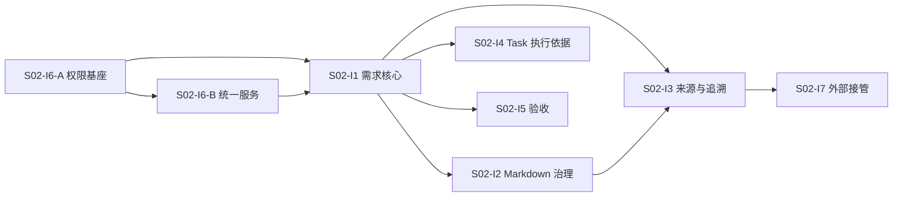

### 17.2 迁移号段

**S02 迁移自 0036 起**（F-1）；0029 永久空号；每迁移一个主责 TASK、并入迁移登记表；实施前复核目标分支清单（I1 §11.5 既有告诫，本次即为复核案例）。

> **2026-11-06 实施前复核更正（RSK-4）**：0036/0037 已被 S01-04/05（cognition/baseline）占用、0038 被 S01 仓库基线确认占用——**S02 实际自 0039 起**。首个迁移 = `0039_s02_requirement_core.sql`（S02-I1）。

### 17.3 每切片完成标准（对齐 I1 §19 精神）

各切片完成标准 = 本稿对应章节裁决全部落库/落码 + 依赖切片接口兑现 + 涉及 DEF 项的回归证据（§14.3）。**任何切片完成都不等于 DEF 关闭。**

### 17.4 I1-D01~D12 逐项裁决（S02-05 直接输入）

| 编号 | 问题 | 裁决 |
|---|---|---|
| I1-D01 | 类型创建后变更 | V1 禁止普通变更；确需变更走治理提案（target_type='requirement'）+Approver 裁决 |
| I1-D02 | code 修改 | 创建后不可普通修改（受控变更须治理路径+审计；与 Project Key 同原则） |
| I1-D03 | rejected Revision 重提交 | 不复用；新建 Revision |
| I1-D04 | withdrawn 恢复 | 允许（人类） |
| I1-D05 | archived 恢复 | V1 不允许直接恢复 |
| I1-D06 | 草稿删除与 version 复用 | V1 不提供草稿物理删除（生命周期无 deleted 态；废弃走 rejected 或弃置）；version 永不复用 |
| I1-D07 | 无正式版本可否关联 Task | 不得作为正式执行依据；参考性关联 V1 不做（I4 细化） |
| I1-D08 | Confirmation 独立建表 | **是**（S02D-21）；命名 I6-B 终定 |
| I1-D09 | approved_by 迁移 | 先迁读取消费者至 Confirmation 读模型→后删列；禁止双权威并存 |
| I1-D10 | content 保留为投影 | 是（有条件：标记投影+绑版本+hash+可重建，§6.1） |
| I1-D11 | version 编号策略 | Requirement 内单调递增（UNIQUE 既有，0002:21） |
| I1-D12 | 重放确认语义 | 同一幂等请求幂等成功；不同请求 409；幂等键 I6-B 落 |

### 17.5 S02-05 必办清单

① DEF-03/04 修复方案细化（CAS+统一服务接口）；② 四消费方迁移设计 + 反向投影工具设计（§6.5）；③ 冷启动导入双写改造；④ 验收载体列级设计（Q-11/13 细化）；⑤ MCP 需求类工具集与权限码设计（确认类除外）；⑥ `ai.project_document` 需求投影 doc_key/目录规范；⑦ 切片排期与迁移拆分（0036+）。

---

## §18. 未决问题与风险清单（交付物 13）

### 18.1 未决（全部有编号与归属，无悬空）

| # | 事项 | 归属 | 说明 |
|---|---|---|---|
| O-1 | `repository_change_intake` 是否新增 | I3（Q-I7-01） | 倾向新增；与 evidence 前向收口同批 |
| O-2 | 验收 verification_kind 枚举值集与 params 形状 | I5（Q-13 细化） | 方向已裁（§11.4） |
| O-3 | 需求投影文档 doc_key/目录/front-matter 规范 | I2 | §6.4 |
| O-4 | Markdown 版本引用结构（markdown_version_ref 具体形态） | I2 | §6.4 |
| O-5 | 幂等键机制细节（确认重放） | I6-B（I1-D12） | §7.1 |
| O-6 | Approver 授权载体（表形态） | I6-A/B 终稿 | 0032/0033 先例警示：进库前须终稿 |
| O-7 | I7 Q-I7-02~10 | I3/I7 | 编号保留 |
| O-8 | requirement_relation（需求间关系） | 未来批次 | §4.4 延后登记 |
| O-9 | 跨租户/平台级需求视图 | 不在本期 | 现状均为租户内模型 |

### 18.2 风险

| # | 风险 | 等级 | 缓解 |
|---|---|---|---|
| RSK-1 | **Q-3 迁移面**：四消费方 + 冷启动双写 + 反向投影工具全部不存在，I2 是最大实施风险 | 高 | 切片排期前置；投影双读过渡期（投影缺失→回退 Git 读取）在 I2 定义 |
| RSK-2 | 跨存储一致性（Git/PG 非原子）确认窗口漂移 | 高 | I2 恢复协议 + knowledge_write_operation 幂等账本复用 |
| RSK-3 | DEF 回归依赖测试环境（登录链/prue 缺失 → V-5 型 BLOCKED 复现） | 中 | 回归证据以 API/DB 层重放为准（V-1~V-4/V-6 形态），UI 层另补 |
| RSK-4 | 并行会话再占迁移号（0034/0035 先例） | 中 | 实施前强制复核（§17.2） |
| RSK-5 | 验收项与正文漂移（Q-10 口径下不版本化） | 中 | 确认时一致性提示（I5）；漂移事件可审计 |
| RSK-6 | 知识域三类红线与命令级红线的双机制认知混乱 | 低 | §15.4-F-4 已辨析；I2 文档对齐 |
| RSK-7 | AI-PM 提案质量依赖真模型接入（现 FakeModel，TODO Task 17） | 中 | 提案质量不阻塞治理链路（人类起草一等路径兜底） |

---

## §19. Acceptance Criteria（交付物 14）

> 本基线自身的验收（对本文档，非对代码）。

- **A 裁决完备性**：Q-1~Q-21 + 3 登记 + Q-I7-11 + I1-D01~D12 全部有终局裁决或显式移交（编号+归属切片）；DEF-01~04 绑定修复归属与通过条件；无悬空待裁项。
- **B 领域模型一致性**：十概念判定逐项完成（实体/VO/关联/事件/读模型/已有表/新增结构）；三套生命周期分离且同名不同义有警示；新增表 ≤4+1 候选且逐表有裁决理由；禁止清单（Baseline/Proposal 表/decisions 表/分表）成文。
- **C Markdown 权威协议可执行**：写入职责分层（含人类起草一等路径）、Revision↔Markdown 映射、四消费方迁移清单、反向投影工具归属、冷启动双写、跨存储恢复协议归属全部落到切片。
- **D 权限与确认协议可测试**：Confirmation 六要素、Approver 显式授权、MCP 零确认工具、AI 禁确认三重校验、CAS 双令牌均有归属与回归证据形态（V-2/V-4/V-3/V-6 重放）。
- **E 事实映射真实性**：§15 每条判定带路径:行号；五档标记 + 运行时/静态强度全程分离；F-1~F-7 新鲜度更正入档；**无凭空表/字段/API**。
- **F 实施就绪**：切片表含依赖与优先级；迁移号段（0036+）与复核规则成文；S02-05 必办清单七项；未决项全部有编号归属；本文档不与 S01/S03 边界冲突（K-10 维持通过）。

**基线通过即时生效**：本稿满足 A~F 即为 S02-04 最终基线；后续修订须走 revision-log（§20）。

---

## §20. 修订记录

| 版本 | 日期 | 修订 |
|---|---|---|
| V1.0 | 2026-11-04 | 专家初稿（截断于 §3.2，初评 R-1~R-6） |
| V1.1 | 2026-11-04 | 六项用户裁决收编重发；全文评审 R-7~R-19 交付（K-1/2/4 败） |
| **V1.2** | 2026-11-05 | **本稿**：R-7~R-19 全部闭合（P0×4 终局处理）；REV-01 任务书操作化收编；三项核验意见落实；Q-18~21+登记项+Q-I7-11+I1-D 全裁决；S02-I3/I7 入切片表；DEF 绑定与通过条件成文；迁移号段更正 0036 起；代码事实全面复核更新（F-1~F-7） |

---

*参见：`smark-pm-s02-01-requirement-domain-asset-inventory-v1-1.md`（事实权威稿）· `docs/s02-02-requirement-runtime-verification-v1.md`（运行时核验）· `smark-pm-s02-04-full-review-v1.md`（R-7~R-19）· `smark-pm-s02-04-source-artifact-model-verification-v1.md`（E-1~E-4/Q-18~21）· `smark-pm-s02-i1-requirement-core-v1.md`（I1 V1.0）· `smark-pm-s02-i7-external-commit-adoption-v1-1.md`（I7 V1.1）· I6-A V1.2（权限基座）· 知识空间设计稿（Markdown+Git 权威）。*
