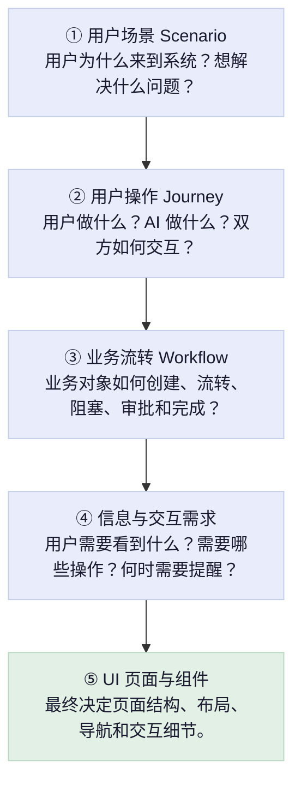
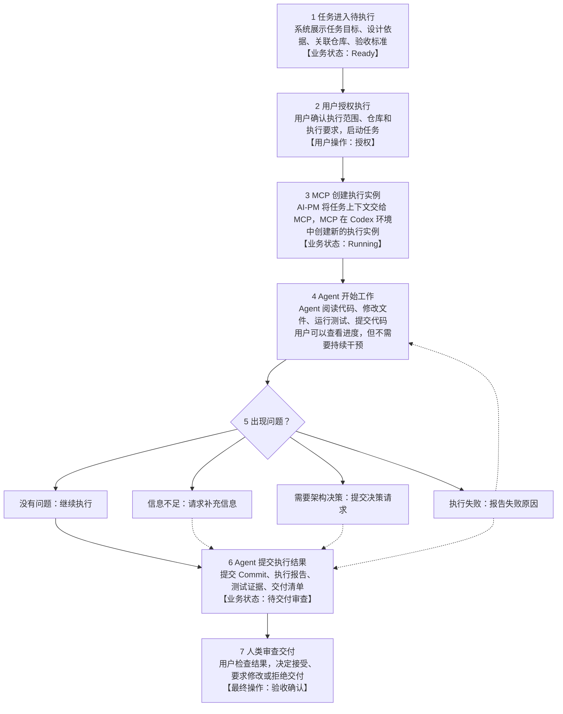

# smark-pm 用户场景与业务交互模型 V1.0

> 它是 UI 设计的上位依据。

## 一、先确定系统的核心使用原则

我们已经确定了一个重要前提：

**A 模式：人类负责项目，AI Agent 协助执行。**

因此，smark-pm 不是一个传统的项目管理系统，也不是一个 Agent 调度控制台。

它应该是一个**人类管理项目、AI 协助研发、双方围绕业务对象协作的工作空间**。

这意味着用户的核心工作不是操作 CRUD，而是：

1. 明确项目目标。
2. 提出需求和变更。
3. 组织 AI 分析和拆解。
4. 确认任务及执行授权。
5. 监督 Agent 执行。
6. 处理执行过程中出现的问题。
7. 审查决策、知识和交付成果。
8. 确认最终交付。

AI 可以主动分析、提出建议、发现风险、生成任务、执行代码工作，但不能代替人类完成需要人类授权的治理和验收行为。

这里还有一个非常重要的原则：

> 用户不应该为了管理 Agent 而管理 Agent，而应该为了完成项目目标而使用 Agent。
>
> Agent 是执行能力，不应该成为用户工作的中心。

## 二、我们应该从五个层次设计用户操作

我建议所有 UI 设计都遵循下面这条链路：

### 页面存在的判据

每个页面都应该能够回答以下问题：

- 用户为什么需要这个页面？
- 用户进入页面时处于什么业务状态？
- 页面要帮助用户做出什么判断？
- 用户可以采取什么行动？
- 操作之后，业务状态会发生什么变化？

如果一个页面无法回答这些问题，就要考虑它是否真的需要独立存在。

## 三、先建立用户的核心业务场景

我初步建议把 smark-pm 的用户工作划分为八大场景。

### 场景 S01：项目初始化与接入

用户创建项目，接入一个或多个 Git 仓库，配置项目 AI-PM，建立项目基础认知。
核心结果：项目具备开始研发工作的条件。

### 场景 S02：需求提出与需求管理

用户提出新需求、补充需求、修改已有需求，AI 协助分析影响、澄清问题和整理需求文档。
核心结果：形成经过人类确认的需求基线。

### 场景 S03：分析、设计与技术决策

AI 分析需求，检查现有架构和知识库，提出设计方案。人类与 AI 讨论并作出关键技术裁决。
核心结果：形成正式设计、决策和实施依据。

### 场景 S04：任务拆解与研发组织

AI 将设计转化为任务，确定任务依赖、关联仓库、验收标准和执行要求。人类审核并授权。
核心结果：形成可执行的研发任务。

### 场景 S05：AI Agent 执行与协作

Agent 通过 MCP 获取任务，在 Codex 环境中执行，提交代码和结果。多个 Agent 可以并行工作。
核心结果：任务产生可追踪的执行记录和交付成果。

### 场景 S06：异常、阻塞与人工介入

Agent 遇到信息不足、需要决策、权限不足、外部依赖或执行失败时，系统将问题交给合适的人处理。
核心结果：问题得到处理，工作能够恢复流转。

### 场景 S07：交付审查与验收

用户查看任务交付、代码提交、测试结果、仓库交付清单，AI 辅助检查验收标准。
核心结果：人类确认交付是否符合要求。

### 场景 S08：项目知识沉淀与持续学习

AI 从需求、执行、决策和交付过程中提取知识，生成提案。人类审核后进入正式知识库。
核心结果：项目认知持续积累，后续 Agent 可以复用。

这八个场景覆盖项目从建立到持续研发的主要生命周期。

需要注意：**它们不是严格的顺序流程**。例如，需求变更可能重新触发技术设计、任务拆解和交付审查；知识沉淀也贯穿整个过程。

## 四、真正需要设计的是场景内部的操作流程

我们不能停留在上面的八个分类。每个场景都要继续拆成用户旅程。

举一个例子。

### S05：AI Agent 执行与协作

假设用户已经批准了一个任务，现在希望 Codex Agent 开始执行。

（图1：用户与 AI 的协作过程）

这里会产生很多 UI 设计结论：

- Ready 的任务应该提供启动操作。
- Running 的任务应该突出执行进度和当前 Agent。
- Waiting 的任务应该突出等待原因，以及需要谁处理。
- Failed 的任务应该提供失败分析和重新执行入口。
- 待验收的任务应该突出交付证据，而不是 Agent 的运行日志。
- 已验收的任务应该保留完整执行历史。

这比先设计一个包含十几个按钮的任务详情页合理得多。

## 五、每个场景都要有统一的业务描述模板

我建议后续所有场景都使用同一个模板，避免讨论着讨论着变成单纯讨论页面。

| 项目 | 要回答的问题 |
| --- | --- |
| 场景目标 | 用户想完成什么？ |
| 触发条件 | 什么情况下进入这个场景？ |
| 参与者 | 哪些真人、AI-PM、Agent 参与？ |
| 前置条件 | 开始之前必须具备什么？ |
| 用户操作 | 用户需要做什么？ |
| AI 操作 | AI 自动做什么？ |
| 交互节点 | 哪些地方必须等待用户确认？ |
| 业务状态 | 对象有哪些状态？ |
| 异常分支 | 失败、阻塞、撤销如何处理？ |
| 完成条件 | 什么情况下算完成？ |
| UI 需求 | 需要什么信息、页面和操作？ |

特别强调三个事情：

**1. 区分用户操作与 AI 自动行为。**

不要让用户为了让系统运转而进行不必要的点击。

**2. 区分业务状态与执行状态。**

例如 Task 是一个业务任务，Run 是一次执行。Task 可以有多次 Run，某次 Run 失败不意味着 Task 永久失败。

**3. 所有需要人类介入的事情，都要有明确的处理入口。**

例如待决策、待补充信息、待审批、待验收，不能只出现在日志里面。

## 六、从业务流程反推 UI，而不是让菜单决定 UI

我希望最后形成这样的对应关系：

| 用户工作 | 主要 UI 形态 |
| --- | --- |
| 了解项目整体情况 | 项目总控台 |
| 确定项目目标和计划 | 目标与计划工作区 |
| 讨论需求和设计 | AI 协作工作区 |
| 处理待决策事项 | 决策中心 |
| 监督 Agent 工作 | AI 执行工作区 |
| 处理阻塞和异常 | 待处理工作区 |
| 检查交付 | 产物验收工作区 |
| 查看和维护项目认知 | 项目认知工作区 |

这里有一个设计上的重要区别：

> **导航菜单是系统功能的组织方式，工作空间是用户业务的组织方式。两者不应该混为一谈。**

我们之前讨论的《AI R&D Workspace — 高保真设计系统 V1.0》仍然是 UI 的视觉和布局基准，包括桌面三栏、顶部导航、右侧上下文面板、底部 AI 指令栏等。

但现在我们先不急着把这些区域填满，而是先搞清楚每个区域在用户工作中承担什么责任。

## 七、我建议接下来这样推进

不要一次性设计八个场景。我们逐个场景讨论，每个场景确定后再进入下一个。

推荐顺序：

| 序 | 场景设计路线 |
| --- | --- |
| 1 | S01 项目初始化与接入 — 决定用户如何创建项目、接入仓库、初始化 AI-PM |
| 2 | S02 需求管理 — 决定用户如何提出需求、讨论需求、确认需求 |
| 3 | S03 分析与技术决策 — 决定 AI 如何参与分析，人类如何裁决 |
| 4 | S04 任务拆解与组织 — 决定需求如何变成可以执行的任务 |
| 5 | S05 Agent 执行与协作 — 决定 MCP、Codex、多 Agent 如何融入用户工作 |
| 6 | S06 异常与阻塞处理 — 决定系统如何让人类及时介入 |
| 7 | S07 交付与验收 — 决定成果如何审查和正式验收 |
| 8 | S08 知识沉淀 — 决定 AI 如何学习、提案、审核和更新项目知识 |

每个场景完成后，产出三份东西：

1. 用户操作流程图（User Journey）。
2. 业务状态流转图（State Machine）。
3. UI 页面及交互需求清单（UI Specification）。

最后再统一汇总为菜单、页面层级、页面原型和组件规范。
