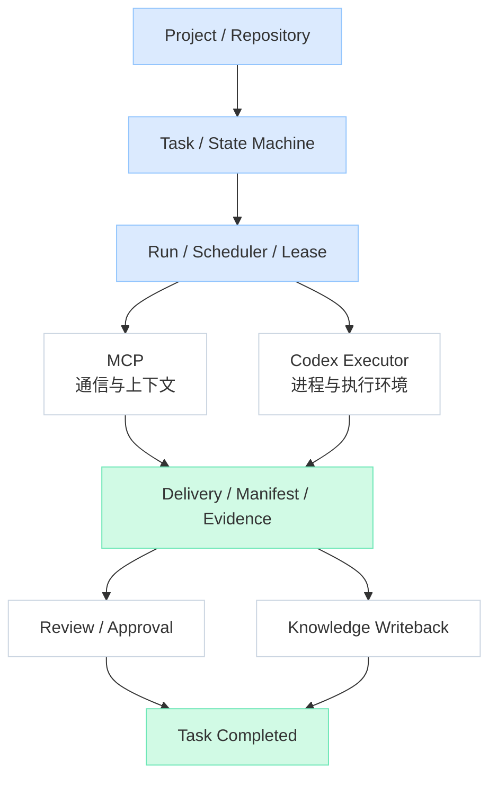

# AI 研发管理平台开发路线

先建立可靠的任务管理底座，再打通 Codex 执行闭环，然后完善知识管理、审批、Review 和协作能力，最后扩展多仓库、多 Agent 和自动化。

不要先把所有页面做出来，也不要先做一个功能很全的 Agent 管理系统。这个产品真正的核心是：平台能够可靠地创建任务、派发任务、管理执行、接收交付、验证结果，并把结果沉淀为项目知识。

---

## 一、总体开发路线

### AI 研发管理平台开发路线

1. **P0：项目与仓库基础** — 项目、仓库、成员、权限、配置
2. **P1：Task 任务管理核心** — Task 模型、状态机、依赖、任务类型、事件
3. **P2：Run 执行管理核心** — Run 生命周期、调度、领取、租约、恢复
4. **P3：MCP 接入层** — MCP 身份、领取任务、上下文、心跳、提交结果
5. **P4：Codex 执行引擎** — Git Worktree、执行器、日志、取消、超时
6. **P5：交付与验收** — Delivery Manifest、Commit、变更文件、交付记录
7. **P6：知识库与 PageIndex** — Markdown 事实源、知识写入、索引、检索
8. **P7：Review 与审批** — 独立 Reviewer、审批策略、人工决策
9. **P8：Outbox 与可靠异步处理** — 事件分发、重试、死信、幂等、监控
10. **P9：AI 协作与多 Agent** — Agent 角色、任务分解、协作、上下文传递
11. **P10：研发管理工作台** — 六大工作区、执行中心、知识和决策视图
12. **P11：规模化与自动化** — 多仓库并发、资源隔离、自动调度、治理

> **特别说明：** Outbox 的基础能力不是 P8 才做。可靠的 Outbox 数据模型、同事务写入、Worker、重试和幂等属于第一版基础设施；P8 是进一步完善事件体系和业务事件覆盖。

---

## 二、逐阶段模块设计

### P0：项目与仓库基础

**第一阶段基础**

**目标：** 建立研发管理平台的基本组织结构。

| 模块 | 具体职责 |
| --- | --- |
| Project 项目管理 | 创建项目、项目描述、项目状态、项目配置 |
| Repository 仓库管理 | Git 仓库地址、默认分支、认证配置 |
| ProjectRepository 关联 | 一个项目关联多个仓库 |
| 成员管理 | 项目成员、角色、权限 |
| 环境配置 | 开发环境、运行环境、工具配置 |
| 系统配置 | 模型配置、MCP 配置、Codex 配置 |

> **设计约束：** 这里要从一开始就保留 Project 与 Repository 多对多关系。不要把仓库直接设计成项目的一个字段。一个项目可能涉及多个代码仓库，同一个仓库也可能被多个项目引用。

**交付标准：**

- 能创建项目。
- 能关联一个或多个 Git 仓库。
- 能配置每个仓库的分支和访问方式。
- 能查询项目对应的仓库基准版本。

---

### P1：Task 任务管理核心

**目标：** 平台能够独立管理研发任务，而不依赖 Codex。

| 模块 | 具体职责 |
| --- | --- |
| Task 数据模型 | 任务 ID、标题、描述、目标、类型、优先级 |
| Task 状态机 | Draft、Ready、Claimed、Running、Blocked 等状态 |
| 状态转换服务 | 统一状态写入、合法转换校验 |
| Task 依赖 | 前置任务、后置任务、依赖关系 |
| Task 类型 | 架构设计、需求分析、编码、测试、Review |
| Task 输入 | 需求、附件、参考文档、约束 |
| Task 变更记录 | 修改历史、状态历史、操作人 |
| Task 事件 | 状态变化产生领域事件 |

> **需要特别明确：**
> - Task 是业务任务。
> - Run 是任务的一次执行。
> - Task 可以有多个 Run。
> - 重执行不能覆盖旧 Run。
> - Task 的生命周期与 Run 的生命周期不能混为一谈。

**交付标准：**

可以创建任务、修改任务、安排任务、改变任务状态，并完整记录历史。即使还没有 Codex，也能管理整个任务生命周期。

---

### P2：Run 执行管理核心

**当前重点：D1**

这是整个平台最关键的底层模块之一。

| 模块 | 具体职责 |
| --- | --- |
| Run 数据模型 | Run ID、Task ID、执行次数、执行状态 |
| Run 创建服务 | 根据任务创建新的执行实例 |
| Run 状态机 | queued、claimed、running、terminal |
| Run 调度器 | 查找可执行任务、领取 Run |
| Claim 服务 | 原子领取，防止重复执行 |
| Lease 服务 | 租约、心跳、过期检测 |
| Recovery 服务 | 过期恢复、执行器丢失恢复 |
| Retry 服务 | 失败重试、创建新 Run |
| Attempt 计数 | 执行次数、连续失败次数 |
| Policy Snapshot | 保存本次执行时的有效策略快照 |

**建议拆分为三个独立子模块：**

1. **Run Scheduler**：决定哪个 Run 可以被领取。
2. **Run Lifecycle**：负责 Run 的状态变化和生命周期。
3. **Run Recovery**：负责租约过期、异常终止和恢复。

> 不要让 Scheduler 同时承担所有恢复职责。

当前 D1 应该先完成这一阶段，尤其是已经讨论过的 B1–B3、R1–R7、S1–S6 和 Q1–Q10。

**交付标准：**

- TaskReady 可以可靠地产生 queued Run。
- 同一个 Task 不会因为重复事件产生多个活跃 Run。
- 多个 Worker 并发时不会重复领取。
- Worker 崩溃后可以恢复。
- 旧 Run 的历史不会丢失。
- 任务重执行会产生新的 Run。

---

### P3：MCP 接入层

**目标：** 让 Codex 环境能够通过 MCP 与平台通信。

| 模块 | MCP 工具 |
| --- | --- |
| 任务领取 | claim_task |
| 任务详情 | get_task |
| 执行上下文 | get_task_context |
| 执行状态 | start_run |
| 心跳 | heartbeat |
| 进度更新 | update_run_progress |
| 交付提交 | submit_delivery |
| 执行结束 | complete_run |

**具体职责：**

- MCP Client 身份认证。
- 项目和仓库权限验证。
- Run 与 MCP Session 绑定。
- 获取任务要求和知识上下文。
- 上报执行进度。
- 上报执行结果。
- 防止重复提交。
- 会话中断后的恢复。

> **注意：** MCP 不是执行器本身。MCP 是 Codex 与平台之间的通信协议和接入层。

**交付标准：**

在 Codex 环境里，可以通过 MCP 领取任务、获取完整任务上下文、更新执行状态、提交执行结果。

---

### P4：Codex 执行引擎

**目标：** 让平台真正具备执行研发工作的能力。

| 模块 | 具体职责 |
| --- | --- |
| RunExecutor 接口 | 定义执行器统一接口 |
| Codex CLI Adapter | 调用 Codex CLI |
| Workspace Manager | 管理执行工作目录 |
| Git Worktree Manager | 创建、清理独立 Worktree |
| Repository Checkout | 拉取指定仓库和基准版本 |
| Process Manager | 启动、监控、终止 Codex 进程 |
| Log Collector | 收集标准输出、错误和执行日志 |
| Timeout Manager | 执行超时控制 |
| Cancellation Manager | 用户取消执行 |
| Executor Recovery | 进程异常退出、执行器失联处理 |

**建议执行过程：**

1. Run Scheduler 领取 Run
2. Workspace Manager 创建工作区
3. Git Worktree 准备代码
4. Codex CLI 执行任务
5. MCP 回写执行状态和结果
6. 生成 Delivery Manifest

**交付标准：**

给一个简单的编码任务，平台能够启动 Codex，Codex 能够修改代码、执行测试、提交 Git Commit，最后平台能收到执行结果。

> 第一版不要急着支持多个 Codex 同时执行同一个 Task。

---

### P5：交付与验收

**目标：** 解决 AI 完成任务后，平台如何判断它到底交付了什么。

| 模块 | 具体职责 |
| --- | --- |
| Delivery Manifest | 描述本次 Run 的完整交付 |
| Commit Tracking | 记录 Git Commit |
| File Changes | 记录修改、新增、删除文件 |
| Test Evidence | 保存测试命令和测试结果 |
| Artifact Storage | 保存日志、报告、附件 |
| Delivery Validation | 校验交付内容是否完整 |
| Baseline Validation | 检查仓库基准版本是否发生变化 |
| Delivery History | 保留所有 Run 的交付记录 |

**建议 Delivery Manifest 至少包含：**

- Task ID、Run ID。
- Repository ID。
- 执行前基准 Commit。
- 执行后 Commit。
- 变更文件清单。
- 测试结果。
- 执行摘要。
- 交付时间。

> **注意：** 一个 Task 可以涉及多个仓库。交付记录不能只存一个 Commit，而应该支持多个 Repository 的 Commit 集合。

**交付标准：**

平台能够明确知道某次 Run 修改了哪个仓库、基于哪个版本、产生了什么提交、测试结果是什么。

---

### P6：知识库与 PageIndex

**目标：** 让平台不只是管理代码，还能管理研发过程中产生的知识。

> 你之前确定的原则是：Markdown/Git 是事实源，PageIndex 是索引和检索层。

**建议模块如下：**

| 模块 | 具体职责 |
| --- | --- |
| Knowledge Repository | 知识库仓库管理 |
| Markdown Manager | Markdown 文件读取、写入、版本管理 |
| Knowledge Schema | 需求、决策、架构、规范等文档类型 |
| Knowledge Extraction | 从任务、Run、Review 提取知识 |
| PageIndex Builder | 构建文档索引 |
| Knowledge Search | 按问题检索知识 |
| Context Assembler | 为 Task 组装相关知识上下文 |
| Knowledge Writeback | 执行完成后的知识回写 |
| Knowledge Versioning | 追踪知识变化 |

**知识类型建议先分为：**

- 需求文档。
- 需求变更。
- 架构决策。
- 技术方案。
- 研发规范。
- 项目状态。
- 任务执行记录。
- Review 结论。

> 这里不要让 AI 每次执行完任务就随意修改知识库。应该有明确的知识提取、校验、写入和版本记录流程。

**交付标准：**

创建一个任务时，可以自动检索项目已有的需求、架构决策和技术规范，生成任务上下文；任务完成后，可以将重要结论写回 Markdown。

---

### P7：Review 与审批

**目标：** 让 AI 的执行结果可以被独立验证和控制。

| 模块 | 具体职责 |
| --- | --- |
| Reviewer Agent | 独立 Review Agent |
| Review Run | 独立的审查执行实例 |
| Review Context | 独立审查上下文 |
| Review Findings | 问题、严重程度、证据 |
| Review Decision | Approved / ChangesRequested / Inconclusive / Failed |
| Approval Engine | 审批规则 |
| Approval Workflow | 人工审批流程 |
| Decision Center | 等待用户决策的事项 |
| Policy Engine | 组织、项目、任务类型和任务级策略 |

**有几个重要边界：**

1. Reviewer 应当是独立的 Reviewer Run，而不是原 Codex 执行过程中的一个附属步骤。
2. Reviewer 默认只读，不能擅自修改执行结果。
3. Review 发现问题，不等于原 Run 执行失败。
4. 必须区分"需要审批"和"已经审批"。
5. 高层策略的强制审批要求不能被 Task 级设置放宽。

**交付标准：**

Codex 提交结果后，平台可以启动独立 Reviewer，Reviewer 给出审查结论；需要人工决策的任务进入 Awaiting Decision。

---

### P8：Outbox 与可靠异步处理

**目标：** 确保平台的业务状态变化和后续异步动作不会脱节。

> 虽然基础 Outbox 已经提前建设，但完整事件处理应该在业务流程稳定后逐步补齐。

| 模块 | 具体职责 |
| --- | --- |
| Outbox Producer | 业务事务内写入事件 |
| Outbox Worker | 拉取和分发事件 |
| Event Handler Registry | 事件处理器注册 |
| Idempotency | 事件幂等 |
| Retry Scheduler | 失败重试 |
| Dead Letter | 死信处理 |
| Manual Replay | 人工重新投递 |
| Event Monitoring | 事件处理监控 |

**首批重点事件：**

- TaskReady
- RunRequested
- RunCompleted
- DeliverySubmitted
- ReviewCompleted
- KnowledgeBaseWriteRequested

> 不要为了凑齐六种事件而提前创建没有真实业务语义的 Handler。每个事件都应该对应一个明确的生产者、消费者和幂等边界。

**交付标准：**

业务事务提交后，即使 Worker 崩溃、重复消费或临时失败，也不会丢失任务调度、交付和知识回写动作。

---

### P9：AI 多 Agent 协作

**目标：** 从一个 Codex 执行任务，扩展到多个不同角色的 Agent 协同完成研发工作。

**建议角色：**

| Agent 角色 | 职责 |
| --- | --- |
| AI 负责人 | 负责任务整体协调和状态跟踪 |
| 需求分析 Agent | 分析需求、识别歧义、整理验收条件 |
| 架构 Agent | 架构定性、技术方案和边界 |
| 研发 Agent | 实际代码实现 |
| 测试 Agent | 测试设计和执行 |
| Review Agent | 独立检查代码和交付 |
| 知识管理 Agent | 提取和维护项目知识 |

**需要开发的模块：**

- Agent Role Registry
- Agent Capability
- Agent Session
- Agent Assignment
- Task Decomposition
- Subtask Management
- Agent Handoff
- Shared Context
- Agent Collaboration History
- Conflict Resolution

> 我建议不要把所有角色做成永久运行的独立 Agent。角色首先是一套职责、权限、上下文和执行策略。需要执行时再创建相应 Run。

**交付标准：**

一个复杂需求可以先由需求分析 Agent 分析，再由架构 Agent 给出方案，随后拆分任务交给研发 Agent，最后由独立 Reviewer 审查。

---

### P10：研发管理工作台

**目标：** 把后端能力组织成真正好用的研发管理界面。

你之前接受的工作区结构是六个主要区域：

**六大工作区：**

| 工作区 | 内容 |
| --- | --- |
| 目标与计划 | 项目目标、路线图、任务规划 |
| AI 执行 | Agent、Run、Codex、执行日志 |
| 决策管理 | 架构决策、审批、待处理事项 |
| 项目知识 | Markdown、PageIndex、知识检索 |
| 交付验收 | Commit、测试、Review、交付记录 |
| 项目设置 | 仓库、策略、Agent、环境配置 |

**具体页面模块：**

| 页面 | 主要功能 |
| --- | --- |
| 项目总览 | 目标、进度、任务、风险 |
| 任务列表 | Task 创建、筛选、状态管理 |
| 任务详情 | 需求、上下文、执行历史、交付 |
| AI 执行中心 | Run 列表、执行状态、日志 |
| Agent 管理 | Agent 角色、能力、实例 |
| 决策中心 | 审批、待决事项、架构决策 |
| 知识库 | 文档浏览、搜索、版本历史 |
| 交付验收 | Commit、测试报告、Review |
| 仓库管理 | 多仓库、分支、基准版本 |
| 策略配置 | 执行权限、审批、风险规则 |
| 审计中心 | 操作历史、事件历史 |

> 建议页面开发与后端能力同步进行，不要等所有后端模块完成才开始做 UI。但页面必须依赖真实的业务模型，不要先做一套与实际状态机脱节的假数据页面。

---

### P11：规模化与自动化

**最后再建设规模化能力：**

| 模块 | 具体职责 |
| --- | --- |
| 多项目调度 | 多项目任务调度 |
| 多仓库执行 | 一个 Run 管理多个仓库 |
| 并发控制 | 项目、仓库、Agent 并发限制 |
| 资源管理 | CPU、内存、执行时间和配额 |
| Workspace 隔离 | 执行环境安全隔离 |
| 任务自动规划 | 根据目标自动生成任务 |
| 任务自动分解 | 复杂任务自动拆分 |
| 自动重试策略 | 根据故障类型决定重试 |
| 自动 Review | 自动触发审查 |
| 自动知识维护 | 自动提取并提交知识变更 |
| 运行监控 | 调度、执行器、MCP 健康状况 |

> 这一阶段再考虑更复杂的 Agent 协作和自动化闭环。

---

### 三、真正的开发依赖关系

上面的阶段不是完全线性的。有些模块可以并行，但关键链路必须遵守依赖关系。

#### 核心技术依赖图

> **关于 Outbox 的定位：** Outbox 横向贯穿 Task、Run、Delivery、Review、Knowledge 等模块，不能把它理解成单纯的消息队列页面。它在核心技术依赖图中不是纵向链路上的一个独立节点，而是附着在各业务模块之上的横切能力——业务事务内同事务写入事件，再由 Worker 统一分发、重试与保证幂等。因此上图未将 Outbox 单独列为一个竖向环节，而是应当理解为覆盖 Task→Run→Delivery→Review→Knowledge 整条链路的一致性与异步动作保障层。

---

### 四、第一版应该做哪些模块？

我不建议按照上面 12 个阶段全部完成后才发布。应该把第一版定义为一个完整的、真实可运行的研发闭环。

**MVP 第一版范围：**

| 优先级 | 模块 | 第一版要求 |
| --- | --- | --- |
| P0 | Project | 必须 |
| P0 | Repository | 必须 |
| P0 | Task | 必须 |
| P0 | Task State Machine | 必须 |
| P0 | Run | 必须 |
| P0 | Run Scheduler | 必须 |
| P0 | Lease / Recovery | 必须 |
| P0 | Outbox | 必须 |
| P0 | MCP | 必须 |
| P0 | Codex Executor | 必须 |
| P0 | Git Worktree | 必须 |
| P0 | Delivery Manifest | 必须 |
| P0 | 基础审计 | 必须 |
| P1 | Markdown Knowledge | 基础读写和上下文检索 |
| P1 | PageIndex | 基础索引 |
| P1 | Review | 可以先人工验收 |
| P1 | Approval | 基础人工审批 |
| P2 | 多 Agent 协作 | 暂缓 |
| P2 | 自动任务拆分 | 暂缓 |
| P2 | 多仓库并发执行 | 暂缓 |
| P2 | 高级自动化 | 暂缓 |

**第一版的实际运行场景：**

1. 用户创建项目并绑定一个 Git 仓库。
2. 用户创建一个研发任务。
3. 平台检查任务是否满足执行条件。
4. TaskReady 产生一个 queued Run。
5. Codex 环境通过 MCP 领取 Run。
6. 平台准备 Git Worktree。
7. Codex 获取需求和项目知识，开始工作。
8. Codex 修改代码、测试、Commit。
9. MCP 提交执行结果。
10. 平台生成 Delivery Manifest。
11. 用户检查交付并验收。
12. 平台将有价值的结论写回 Markdown 知识库。

> 这条链路跑通，比先实现十几个 Agent 角色更有价值。

---

### 五、结合当前进度，接下来怎么安排？

根据之前已经讨论和确认的工作，我建议当前开发计划这样排：

| 顺序 | 开发任务 | 当前安排 |
| --- | --- | --- |
| 1 | D1：Run 调度、领取、租约、恢复 | 当前进行中，先完成 |
| 2 | D2：MCP 任务上下文与通信 | D1 验收后 |
| 3 | D3：Codex Executor 与 Worktree | D2 后 |
| 4 | D4：Delivery Manifest 与 Git 交付 | D3 后 |
| 5 | D5：Review、失败恢复、知识回写 | D4 后 |
| 6 | 多仓库基础支持 | 在单仓库闭环稳定后扩展 |
| 7 | PageIndex 完整索引与知识治理 | 随知识回写完善 |
| 8 | 审批策略和独立 Reviewer 完善 | 核心执行闭环稳定后 |
| 9 | 多 Agent 任务分解和协作 | 最后 |

> **重要调整：** 多仓库的数据模型和仓库基准版本机制应该在 P0/P2 就预留，但第一版实际执行先限定单仓库。这样不需要将来推翻 Task、Run 和 Delivery 的模型。
