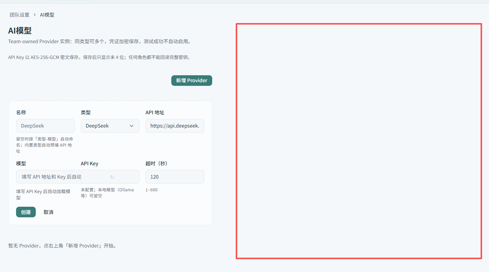

1. 改进 http://localhost:8848/settings/team/ai-providers 设置页面，如下图。他应该适当宽度，并且居中。这个按照你的审美设置就可以。

管理下的页面都有同样的问题。

点击topbar的【专注】按钮，会适当地加大了宽度，但是管理下这些页面不应该受【专注】影响。

这些是共性问题。看看不能抽出这类不应该有Ai助手和上下文的页面

2. http://localhost:8848/admin/settings 系统设置。现状这里只设置 Embedding 供给
我已经是管理员（admin），但是一直说 【加载失败（需要系统管理员）】。请问确认一件事。这个
ollama设置属于 团队的。不同团队有不同的设置 

3. [alt text](f269e4b6-a9a3-4d19-9331-01c5636c538e.png) 图片，所有的search-from都有布局问题，他们应该是横着排列，现状变为竖着排列。最好变为一套 search-from的组件

